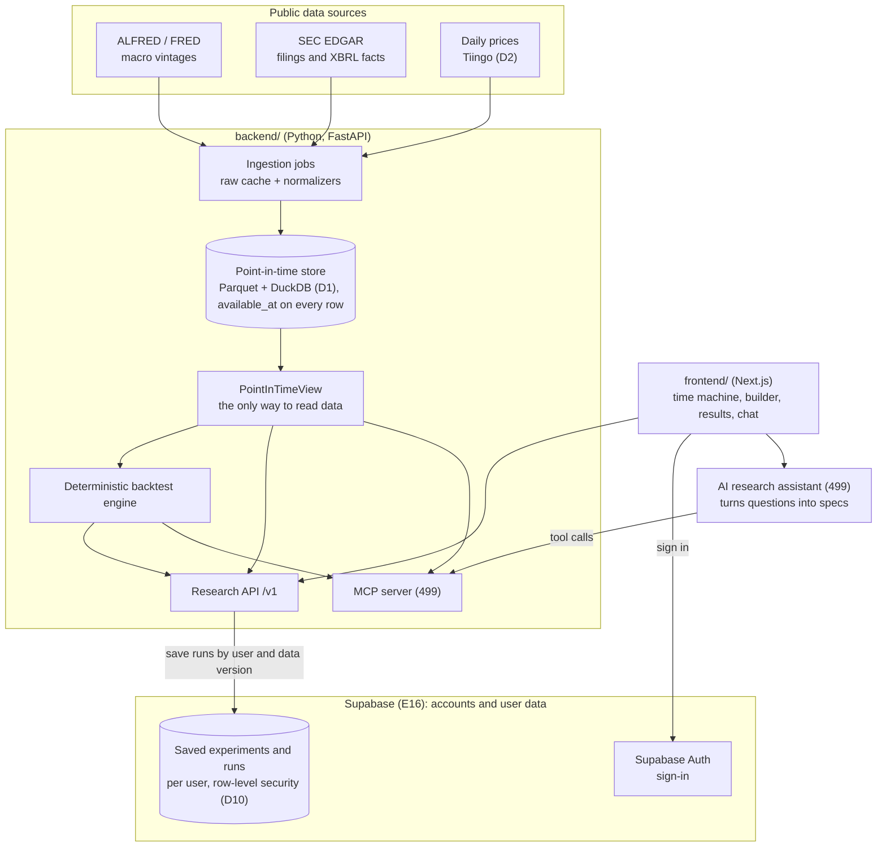
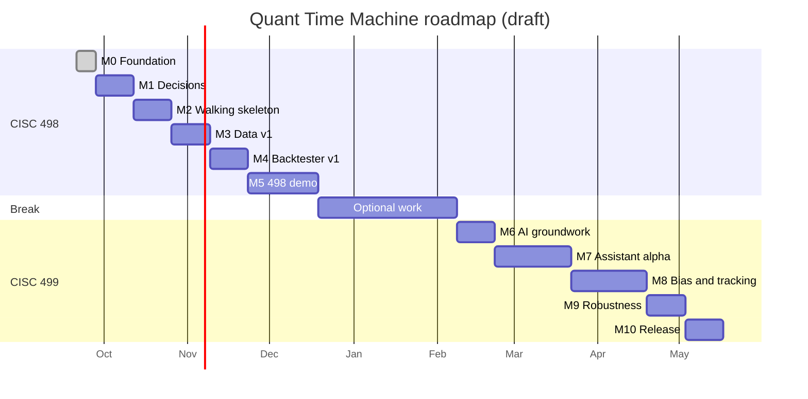
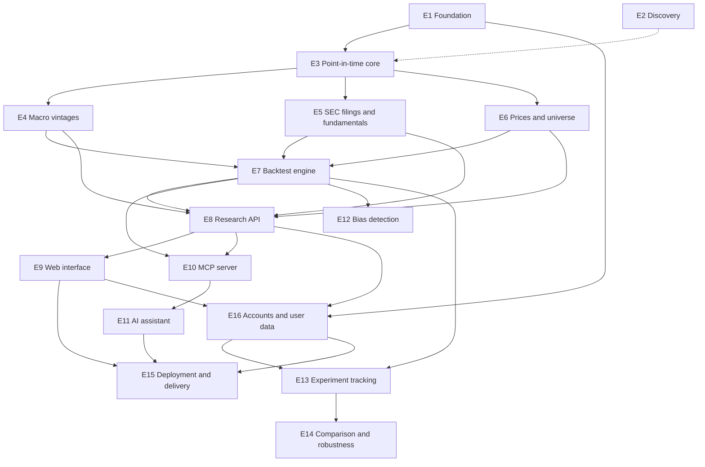

# Quant Time Machine: Roadmap and Product Backlog

> **Draft v0.2, last updated 2026-10-11 (end of Sprint 1, milestone M1).** This is a living plan for CISC 498 (Fall 2026) and CISC 499 (Spring 2027), not a commitment. Scope will change as interviews and data exploration teach us more.
>
> **How to use it:** every epic, story, and task below is written to become a GitHub Project item (see [§6](#6-running-the-project-board)). Once the issues exist, the board is the source of truth. Update this file at each milestone so it stays a readable summary, and if you change a story's metadata here, update its row in the [backlog overview](#7-backlog-overview) too.

## At a glance

- **What we're building:** a research environment that reconstructs what was knowable at any past moment (prices, SEC filings, fundamentals from those filings, and economic data as first published) and runs deterministic, reproducible backtests using only that information.
- **CISC 498 (Fall 2026):** point-in-time data layer, deterministic backtester, research API, and web interface. The demo opens the time machine at June 5, 2020, 9:30 AM ET and runs the revenue-growth-plus-momentum backtest from the browser.
- **CISC 499 (Spring 2027):** MCP tools and an AI research assistant that turns questions into structured experiments, plus look-ahead-bias detection, experiment tracking, strategy comparison, and robustness testing.
- **Ground rule:** the AI translates; deterministic code calculates. Every number comes from tested code, and every input carries the time it became public.
- **Size:** 16 epics and 104 stories, 70 of them P0 (needed for a semester demo). Sprints are two weeks long; Sprint 1 starts Monday, September 28, 2026.

## Contents

1. [Product overview](#1-product-overview)
2. [How point-in-time works](#2-how-point-in-time-works)
3. [Proposed architecture](#3-proposed-architecture)
4. [Requirements](#4-requirements)
5. [Roadmap](#5-roadmap)
6. [Running the project board](#6-running-the-project-board)
7. [Backlog overview](#7-backlog-overview)
8. [Epics, stories, and tasks](#8-epics-stories-and-tasks)
9. [Risks](#9-risks)
10. [Decision log](#10-decision-log)
11. [Glossary](#11-glossary)
12. [References](#12-references)

## 1. Product overview

### 1.1 Problem and vision

Backtests often "see the future" by accident. They use a quarter's revenue before the 10-Q was filed, economic data that was revised months later, or today's index membership for past years. This **look-ahead bias** makes strategies look better than they really were.

Quant Time Machine answers one question for any past moment: *what could a trader actually have known at that time?* It then lets a researcher test ideas using only that information, for example:

> "Using only information available at the beginning of each month, test whether companies with improving revenue growth and positive momentum outperformed the market from 2010 to 2025."

The goal is not an AI that predicts stocks. It is a research environment where results are honest, auditable, and reproducible.

### 1.2 Goals

| Semester | Goal | Demo that proves it |
| --- | --- | --- |
| CISC 498, Fall 2026 | Point-in-time data layer, deterministic backtester, research API, web interface | Open the time machine at June 5, 2020, 9:30 AM ET and see what was and wasn't known. Run the revenue-growth-plus-momentum backtest from the browser and drill into the exact inputs behind any rebalance. |
| CISC 499, Spring 2027 | AI research assistant over MCP tools, look-ahead-bias detection, experiment tracking, strategy comparison, robustness testing | Type a hypothesis in plain English, approve the generated experiment, run it, and read a bias report and a robustness report built from the engine's numbers. |

### 1.3 Non-goals

- Predicting prices, recommending trades, or giving investment advice.
- Live or paper trading, brokerage connections, or order execution.
- Intraday data (daily bars only), options, futures, crypto, FX, or non-US markets.
- Letting the AI, or users, run arbitrary code inside the engine.
- A mobile app. A desktop app is a "maybe later."

### 1.4 Users

From the team's Problem Exploration:

| Persona | Who | What they need |
| --- | --- | --- |
| Student researcher (primary) | University students learning quantitative research | Test an idea honestly without building a data pipeline, and understand why the test is valid |
| Independent researcher or small team (primary) | People combining datasets without data-engineering support | Point-in-time data in one place, reproducible runs, and evidence they can show others |
| Reviewer | Instructors, collaborators, and decision-makers who rely on findings | Confirm that a result used only information available at the time, and re-run it |
| Developer | Our team | Clear contracts, fast tests, and guardrails that make look-ahead impossible by construction |

### 1.5 Success measures

| Measure | Target | How we check |
| --- | --- | --- |
| Point-in-time correctness | All golden cases pass; zero audit violations across runs | Golden tests in CI (S3.6), audit check on every run (S12.1) |
| Deliberate look-ahead is caught | Every case in the biased-strategy suite is flagged | Suite in CI (S12.5) |
| Reproducibility | Re-running any saved run gives identical results | Determinism test (S7.7), re-run and verify (S13.2) |
| Less research effort | Users finish a point-in-time-correct experiment faster than with their current approach | Usability sessions (S15.3, S15.8) compared with interview baselines (S2.1) |
| AI translation quality | Set after a baseline, for example at least 85% of eval questions produce the correct spec | Eval suite (S11.7) |

### 1.6 Where we are today (October 11, 2026)

| Area | State |
| --- | --- |
| Repository | Monorepo with `frontend/` (Next.js 16, React 19, TypeScript, Tailwind CSS 4) and `backend/` (Python 3.14, FastAPI, uv, pytest, Ruff). MIT license, pull request and issue templates, and a data policy in the README. |
| Backend | `GET /health`; typed settings in `app/config.py` with `.env.example`; `app/data/` and `app/backtest/` are still placeholders. Sprint 1 spikes live in `backend/spikes/`. |
| Frontend | Starter homepage, set up for Vercel; `lib/api.ts` reads `NEXT_PUBLIC_API_URL` |
| CI | GitHub Actions lints, builds, and tests both apps on every pull request |
| Decisions | Time model written ([`doc/time-model.md`](time-model.md)). Storage: Parquet files queried with DuckDB (D1, [`doc/storage.md`](storage.md)). Prices: Tiingo (D2), confirmed by a test pull. Timing: 09:30 ET decision with a same-day close fill (D5). License: MIT (D11). Sources and terms are in [`doc/data-sources.md`](data-sources.md). All pending team review. |
| Accounts | Planned: Supabase sign-in, with each user's saved experiments and runs kept in Supabase (E16, owned by the database lead). Market data stays in Parquet + DuckDB (D1). |
| Open from M1 | The board (S1.2); going public with Vercel previews and branch protection (S1.3, S1.4); the WRDS question (S2.3); team review of the docs; interviews (S2.1) |
| Security | A FRED API key was committed in `doc/apiDoc.ipynb` on October 9. It's removed from the working tree but still in git history, so it must be revoked before the repo goes public (R14). |
| Hosting | Vercel's free plan won't deploy teammates' commits from a private repo, so the repo needs to go public (S1.3). Backend hosting is undecided (S1.6). |

## 2. How point-in-time works

Everything in this plan depends on one idea, so it is worth agreeing on early (S3.1 ratifies it).

### 2.1 Two clocks on every record

Every stored fact has:

- **What it describes:** a date or period, such as the June 4 close, Apple's fiscal Q2 2020 revenue, or the May 2020 unemployment rate.
- **`available_at`:** when the world could first know it, such as 4:00 PM ET for a close, the EDGAR acceptance time for a 10-Q, or 8:30 AM ET for the jobs report.
- **`ingested_at`:** when *our* database stored it.

A decision at time *T* may use only rows with `available_at ≤ T`. A saved run also pins a data version (rows with `ingested_at` up to a snapshot), so adding data later never changes an old result. The store is **append-only**: a revision or restatement is a new row, never an overwrite.

```text
    period end                   available_at                 decision time T
    Mar 28, 2020                 around May 1, 2020           Jun 5, 2020, 09:30 ET
    (Apple's fiscal Q2 ends)     (10-Q accepted by EDGAR)
────┼────────────────────────────┼────────────────────────────┼─────▶ time
    │  not public yet: unusable  │    public: usable (≤ T)    │
```

### 2.2 Conventions

| Topic | Rule |
| --- | --- |
| Storage | Timestamps are timezone-aware and stored in UTC |
| Market clock | `America/New_York` and the NYSE calendar, including holidays, early closes, and unscheduled closures |
| Knowledge-time input | A bare date means 09:30 ET on that date, and a time without an offset is New York time (D12); every response echoes the exact timestamp it used |
| Daily price bar | Known at that session's close (16:00 ET, or 13:00 ET on early-close days) |
| SEC filing | Known at its EDGAR acceptance time, not the period end and not the filing date |
| XBRL fact | Known at the acceptance time of the filing that reported it; a value re-reported or restated later is a new version from that later filing's time |
| Macro observation | Known at its ALFRED vintage date plus the release's scheduled time (for example, the Employment Situation at 08:30 ET). If the time is unknown, assume end of day, so it's first usable the next trading day. |
| Universe membership | A change applies from its effective date, never earlier |
| Decisions | Default: first trading day of each month at 09:30 ET |
| Fills | Always strictly after the decision. Default: the decision day's close. |
| Missing or unclear timestamps | Use the later plausible time (conservative) and flag it |

### 2.3 Example: June 5, 2020, at 9:30 AM ET

This table is the acceptance test for the snapshot endpoint (S8.3) and the Time Machine explorer (S9.2).

| Item | Known? | Why |
| --- | --- | --- |
| AAPL daily prices through the June 4 close | ✓ | Each bar is known at 4:00 PM on its own day |
| The June 5 closing price | ✗ | Not known until 4:00 PM on June 5 |
| May 2020 unemployment rate, first print 13.3% | ✓ | The Employment Situation came out at 8:30 AM on June 5 |
| Later revisions to May 2020 labor data | ✗ | Published in later releases and annual revisions |
| Apple's 10-Q for the quarter ended March 28, 2020 | ✓ | Accepted by EDGAR around May 1, 2020 |
| Apple's 10-Q for the quarter ended June 27, 2020 | ✗ | Not filed until late July 2020 |
| Any 10-Q/A or 10-K/A filed after June 5 | ✗ | An amendment counts only from its own acceptance time |
| Fed and other economic data as published by that morning | ✓ | The latest ALFRED vintage on or before that time |
| Universe changes after June 5 | ✗ | Membership applies from its effective date |

### 2.4 Where look-ahead bias creeps in

| Pitfall | Example | Our rule |
| --- | --- | --- |
| Period date used as publication date | Q1 revenue used in April, although the 10-Q came out in May | Fundamentals become usable at the filing's acceptance time |
| Revised data | January 1990 unemployment was first reported as 5.3%, later revised to 5.4% | Use the ALFRED vintage that existed at decision time |
| Restatements and amendments | A 10-K/A changes last year's revenue | A restated value applies only from the amendment's acceptance time |
| Same-day prices | A 9:30 AM decision that uses that day's close | A bar is known only after its session closes |
| Back-adjusted prices | A split-adjusted 2012 AAPL price already reflects the 2014 (7-for-1) and 2020 (4-for-1) splits | Store raw prices plus splits and dividends, compute returns from them, and never use adjusted price levels in signals |
| Survivorship and today's constituents | Testing 2010 with today's S&P 500 list | Point-in-time universe membership; keep delisted companies when data exists; report coverage gaps |
| "Latest value" APIs | SEC's XBRL frames API returns the most recently filed value for each period | Never use latest-value endpoints in backtests |
| AI hindsight | A language model "knows" which companies did well after 2010 | The AI translates the user's hypothesis instead of picking stocks, tools are time-locked, and every variant is logged |
| Data snooping | Trying 50 variants and reporting the best one | Experiment tracking counts variants; robustness tests; multiple-testing-adjusted metrics as a stretch goal |

## 3. Proposed architecture

### 3.1 Overview



### 3.2 Components

Folder names are suggestions. Keep the existing rule that API handlers stay thin and call into `app.data` and `app.backtest`.

| Component | Where | Semester | Epics |
| --- | --- | --- | --- |
| Ingestion and raw cache | `backend/app/data/sources/` | 498 | E3–E6 |
| Point-in-time store and `PointInTimeView` | `backend/app/data/` | 498 | E3 |
| Trading calendar | `backend/app/data/calendar.py` | 498 | E3 |
| Backtest engine: spec, schedule, signals, portfolio, metrics, audit | `backend/app/backtest/` | 498 | E7 |
| Research API | `backend/app/api/` | 498 | E8 |
| Web app | `frontend/app/` | 498–499 | E9, E11–E14 |
| MCP server | `backend/app/mcp/` | 499 | E10 |
| AI assistant: agent loop, prompts, evals | `backend/app/assistant/` | 499 | E11 |
| Bias checks | `backend/app/backtest/checks/` | 499 | E12 |
| Run registry | `backend/app/runs/`, with per-user records in Supabase (D10) | Files at first; Supabase once accounts exist (E16) | E7, E13, E16 |
| Accounts and user data | Supabase (migrations in `supabase/`), sign-in pages in `frontend/app/`, token check in `backend/app/api/` | 498 | E16 |

### 3.3 Data sources

| Data | Source | Point-in-time field | Access | Watch out for |
| --- | --- | --- | --- | --- |
| Economic series and their revisions | ALFRED / FRED API | `realtime_start` and `realtime_end` of each vintage (dates only) | Free API key | Real-time parameters default to *today*, which returns revised data; release time of day isn't in the API; vintage history for some series starts later than the data; some series carry third-party copyright |
| Filing history | SEC EDGAR submissions API (`data.sec.gov/submissions/`) | `acceptanceDateTime` of each filing, corrected: the JSON runs ahead of the true time by the Eastern UTC offset (S5.1) | Free, no key; send a User-Agent with contact details and stay under 10 requests per second | Older filings are paginated; never use `filingDate` or `reportDate` as the availability time |
| Reported financials | SEC XBRL company facts API (`data.sec.gov/api/xbrl/companyfacts/`) | `filed` date and accession number, joined to the filing's acceptance time | Same as above | XBRL starts in 2009–2011 depending on filer size; tags vary by company and year; the frames API returns last-filed values, so it isn't point-in-time |
| Bulk backfill (optional) | SEC nightly bulk archives or Financial Statement Data Sets | Acceptance time of each submission | Free downloads | Large files; only needed beyond the starter universe |
| Daily prices, splits, dividends | Tiingo end-of-day API (D2; see [`doc/data-sources.md`](data-sources.md#daily-prices-decision-d2)). WRDS (CRSP) through UD's Lerner College, for internal validation only | Bar date and session close | Free key: 50 requests per hour, 1,000 per day, 500 symbols per month | Free and Power plans are internal use only, so displaying prices needs permission or a license; delisted coverage is partial (recent delistings yes, few before 2010) |
| Universe membership | A curated list, `starter_large_caps` (D3; see [`doc/data-sources.md`](data-sources.md#universe-v1-starter_large_caps-decision-d3)), dated by S&P's public announcements | Effective date of each change | Free | Official index membership is proprietary, so we cite announcements for our members only; choosing the members still uses hindsight |
| Trading calendar | `exchange_calendars` (or `pandas_market_calendars`) | Not applicable | Open-source library | Early closes and unscheduled closures |

### 3.4 The experiment spec: where the AI stops and code starts

Every backtest, whether built in the web form (498) or by the AI assistant (499), is a validated JSON document. The assistant's only job is to write and explain this document. The engine validates it, runs it, and produces every number. Here is the canonical question as a spec:

```json
{
  "spec_version": 1,
  "name": "Improving revenue growth + positive momentum",
  "universe": { "type": "point_in_time_list", "id": "starter_large_caps" },
  "period": { "start": "2010-01-01", "end": "2025-12-31" },
  "schedule": {
    "rebalance": "monthly",
    "decision": "first_trading_day 09:30 America/New_York",
    "fill": "same_day_close"
  },
  "signals": {
    "rev_accel": { "type": "revenue_growth_acceleration", "basis": "yoy_quarterly" },
    "mom_12_1": { "type": "momentum", "lookback_months": 12, "skip_months": 1 }
  },
  "filters": [
    { "signal": "rev_accel", "op": ">", "value": 0 },
    { "signal": "mom_12_1", "op": ">", "value": 0 }
  ],
  "portfolio": { "weighting": "equal", "long_only": true },
  "benchmark": "SPY",
  "costs": { "bps_per_trade": 10 }
}
```

Signals come from a fixed, documented library, not free-form code. When a spec asks for data outside our coverage, for example fundamentals before XBRL existed, the engine rejects it or warns, and says why.

## 4. Requirements

**Priority:** *Must* is needed for that semester's demo, *Should* is planned but can slip, and *Could* is a stretch goal. The Stories column lists the stories that deliver each requirement.

### 4.1 Functional requirements

#### Point-in-time data (FR-D)

| ID | Requirement | Priority | Stories |
| --- | --- | --- | --- |
| FR-D1 | Every stored record carries the date or period it describes, when it became public (`available_at`), when we ingested it, and its source reference (URL, accession number, or vintage) | Must | S3.4, S4.2, S5.3, S5.5, S6.2 |
| FR-D2 | All reads go through as-of queries bound to a knowledge time; no code path can return a record with `available_at` later than that time | Must | S3.3 |
| FR-D3 | Macro series return values as published at the knowledge time (ALFRED vintages), including past periods that were later revised | Must | S4.1, S4.2, S4.3, S4.4, S4.6 |
| FR-D4 | For a company and knowledge time, list the filings accepted by then and return the latest filing of a given form (10-K, 10-Q, 8-K) with its acceptance time and link | Must | S5.1, S5.3, S5.4 |
| FR-D5 | For a company, metric, and knowledge time, return fundamentals as known then (original, or restated by filings accepted before then), deriving quarterly values where needed (Q4 = full year − first nine months) | Must | S5.1, S5.5, S5.6, S5.7 |
| FR-D6 | Daily raw prices, where an as-of query returns the latest bar whose close was already known | Must | S6.1, S6.2, S6.3 |
| FR-D7 | Splits and dividends stored with ex-dates, and total returns computed without back-adjusted price levels | Must | S6.2, S6.4 |
| FR-D8 | Point-in-time universe membership that keeps companies that later left or were delisted, when data allows | Must | S6.5, S6.6 |
| FR-D9 | A knowledge snapshot for a moment: what was known and what wasn't yet known, for chosen companies and series | Must | S8.3, S9.2 |
| FR-D10 | Repeatable ingestion that caches raw responses, records provenance, and respects each source's rate limits | Must | S3.4, S3.7, S5.8, S15.5 |
| FR-D11 | Coverage reports showing which companies, periods, and series have data, and where the gaps are | Should | S5.6, S6.7 |
| FR-D12 | Resolve a ticker to a company as of a date, using a permanent internal ID (CIK plus security ID) | Must | S5.2 |
| FR-D13 | Revision history for any macro observation: every published value and when it was published | Should | S4.5 |

#### Backtesting (FR-B)

| ID | Requirement | Priority | Stories |
| --- | --- | --- | --- |
| FR-B1 | Accept a structured, versioned experiment spec (universe, period, schedule, signals, filters, weighting, benchmark, costs) and return clear validation errors | Must | S7.1, S7.8 |
| FR-B2 | At each decision time, the engine reads data only through a point-in-time view bound to that time | Must | S7.3 |
| FR-B3 | Deterministic results: the same spec, data version, and engine version always produce identical output | Must | S7.7 |
| FR-B4 | A documented signal library: price momentum, revenue growth and its acceleration, and macro conditions | Must | S7.4 |
| FR-B5 | Portfolio construction: filters, quantile ranking, equal weights, and transaction costs in basis points (value weights and long-short are optional) | Must | S7.5 |
| FR-B6 | Outputs: returns, equity curve against the benchmark, holdings, trades, and standard metrics (CAGR, volatility, Sharpe, max drawdown, turnover, excess return, t-statistic) | Must | S7.6, S7.8 |
| FR-B7 | A data-access audit listing every input used at every decision, with its `available_at` | Must | S3.3, S7.7 |
| FR-B8 | Coverage warnings when companies or periods drop out because of missing data | Should | S6.7, S7.3 |
| FR-B9 | Configurable decision and fill timing, with fills always strictly after decisions | Must | S3.1, S3.5, S7.2 |

#### Research API (FR-A)

| ID | Requirement | Priority | Stories |
| --- | --- | --- | --- |
| FR-A1 | JSON endpoints for as-of prices, macro values, filings, and fundamentals | Must | S8.2 |
| FR-A2 | A knowledge-snapshot endpoint | Must | S8.3 |
| FR-A3 | Endpoints to submit a backtest, check its status, and fetch its results and audit | Must | S8.4 |
| FR-A4 | Catalog endpoints listing available series, companies, and signals with their parameters | Must | S8.5 |
| FR-A5 | OpenAPI docs, versioned routes, consistent errors, and every response echoing the knowledge time and data version it used | Must | S8.1 |

#### Web interface (FR-W)

| ID | Requirement | Priority | Stories |
| --- | --- | --- | --- |
| FR-W1 | Time Machine explorer: pick a moment plus companies and series, and see what was known and what wasn't yet known | Must | S9.1, S9.2 |
| FR-W2 | Macro revision viewer | Should | S9.3 |
| FR-W3 | Company filing timeline showing period ends, acceptance times, and amendments | Could | S9.4 |
| FR-W4 | Backtest builder form with presets, usable without the AI | Must | S9.5 |
| FR-W5 | Results page with charts, metrics, holdings, assumptions, warnings, and an audit drill-down | Must | S9.6 |
| FR-W6 | Methodology page explaining timing rules and known limitations | Should | S9.7 |

#### AI assistant and MCP (FR-AI), CISC 499

| ID | Requirement | Priority | Stories |
| --- | --- | --- | --- |
| FR-AI1 | An MCP server exposing point-in-time data tools, where every call is bound to a knowledge time and can't return later data | Must | S10.1, S10.2 |
| FR-AI2 | MCP tools to validate and run experiments and fetch their results | Must | S10.4 |
| FR-AI3 | Translate a plain-English hypothesis into a schema-valid spec, asking clarifying questions when terms are ambiguous or the period exceeds data coverage | Must | S11.1, S11.2 |
| FR-AI4 | The user reviews, edits, and confirms the spec before anything runs | Must | S11.3 |
| FR-AI5 | Every number shown comes from the engine; the assistant cites run IDs and never computes returns itself | Must | S11.4 |
| FR-AI6 | Guardrails: no arbitrary code or web access, library signals only, no investment advice, and spend limits | Must | S11.6 |
| FR-AI7 | A chat interface with the spec card, run status, and results together | Must | S11.5 |
| FR-AI8 | An evaluation suite that measures translation accuracy | Must | S11.7 |
| FR-AI9 | Every tool call logged with its inputs, knowledge time, and outcome | Must | S10.5 |
| FR-AI10 | Time-locked sessions that cap the knowledge time a conversation's tools can use | Should | S10.3 |
| FR-AI11 | Mitigations for AI hindsight, such as flagging tickers or dates the assistant introduced and optionally anonymizing companies | Should | S2.5, S11.8 |

#### Look-ahead-bias detection (FR-L), CISC 499

| ID | Requirement | Priority | Stories |
| --- | --- | --- | --- |
| FR-L1 | Check every run's audit: all inputs have `available_at` ≤ decision time, and fills come after decisions | Must | S12.1 |
| FR-L2 | Future-perturbation test: changing data after time *T* must not change any decision before *T* | Should | S12.2 |
| FR-L3 | "Bias delta" report: rerun in a clearly labeled naive mode (revised data, period-end dating, today's universe, adjusted prices) and show how much the results change | Must | S12.3 |
| FR-L4 | Spec lint rules that flag risky constructs and suggest fixes | Should | S12.4 |
| FR-L5 | A suite of deliberately biased experiments that the detectors must flag | Must | S12.5 |
| FR-L6 | A bias report in the results UI | Should | S12.6 |

#### Experiment tracking (FR-X), CISC 499

| ID | Requirement | Priority | Stories |
| --- | --- | --- | --- |
| FR-X1 | Persist every run: spec, spec hash, data version, code version, results, metrics, and warnings | Must | S13.1 |
| FR-X2 | Re-run any saved run and confirm identical results, or show what differs | Must | S13.2 |
| FR-X3 | Browse, search, tag, and annotate runs, and count the variants tried for each research question | Must | S13.3 |
| FR-X4 | Export a run (JSON and CSV) and share a read-only link | Should | S13.4 |

#### Comparison and robustness (FR-R), CISC 499

| ID | Requirement | Priority | Stories |
| --- | --- | --- | --- |
| FR-R1 | Compare two to four runs side by side: metrics, curves, and spec differences | Must | S14.1 |
| FR-R2 | Parameter sensitivity sweeps shown as a heatmap | Must | S14.2 |
| FR-R3 | Sensitivity to subperiod, rebalance timing, and transaction costs | Should | S14.3 |
| FR-R4 | Statistical robustness: bootstrap confidence intervals, placebo tests, and a deflated Sharpe ratio | Could | S14.4 |
| FR-R5 | A one-click robustness report, also available through the assistant | Should | S14.5 |

#### Accounts and user data (FR-U)

| ID | Requirement | Priority | Stories |
| --- | --- | --- | --- |
| FR-U1 | Users can sign up, sign in, and sign out, and the backend verifies who is calling | Should | S16.1, S16.3, S16.4 |
| FR-U2 | Saved experiments and runs belong to one user and are private by default (row-level security). They point to market data by data version instead of copying it. | Should | S16.2, S16.5, S13.1 |
| FR-U3 | A privacy page explains what is stored, and users can delete their account and data | Should | S16.6 |

### 4.2 Non-functional requirements

| ID | Quality | Requirement | Priority | Stories |
| --- | --- | --- | --- | --- |
| NFR-1 | No look-ahead by construction | Enforced in the data-access layer, not by convention, and covered by invariant, canary, and golden tests | Must | S3.3, S3.6, S12.1 |
| NFR-2 | Reproducibility | Deterministic engine, pinned dependencies (`uv.lock`, `package-lock.json`), and a pinned data version per run | Must | S1.1, S3.7, S7.7, S13.2 |
| NFR-3 | Transparency | Every result shows its sources, timing assumptions, coverage gaps, and known limitations | Must | S9.6, S9.7 |
| NFR-4 | Time correctness | Timezone-aware UTC storage, the NYSE calendar, and the bare-date rule applied everywhere | Must | S3.1, S3.5, S4.3, S8.1 |
| NFR-5 | Performance | Targets to validate: a single as-of API lookup under 300 ms, and the canonical 2010–2025 monthly backtest on the starter universe under 60 s | Should | S3.2, S8.6, S15.2 |
| NFR-6 | Cost | Runs on free tiers or the course budget; AI spend is capped per session and per day | Must | S1.6, S2.3, S11.1, S11.6, S15.1, S15.6 |
| NFR-7 | Data terms | Follow SEC fair-access rules, FRED terms, and the price source's terms; never commit raw datasets; don't redistribute restricted data | Must | S1.3, S2.3, S3.4, S6.1 |
| NFR-8 | Security | Secrets live only in environment variables, never in the repo or the browser bundle; AI endpoints are protected before public launch | Must | S1.3, S1.5, S11.6, S15.1, S15.6, S15.7 |
| NFR-9 | Maintainability | CI lint, format, test, and build on every PR; review before merge; docs for each module | Must | S1.1, S1.2, S1.4, S15.5, S15.9 |
| NFR-10 | Usability | A first-time user runs the canonical example from the UI within 5 minutes, without reading code | Should | S2.1, S2.4, S15.3, S15.8 |
| NFR-11 | Onboarding | A new teammate can set up and run the tests in under 30 minutes, using the READMEs and fixture data (no API keys needed) | Should | S1.5, S3.6, S15.9 |
| NFR-12 | Accessibility | Keyboard-usable forms, sufficient contrast, and a layout that works at tablet width | Could | S15.3 |

## 5. Roadmap

### 5.1 Timeline



Spring dates are placeholders until the Spring 2027 calendar is confirmed. Move course deadlines (presentations, reports) onto the milestones as soon as they're announced.

### 5.2 Milestones

| ID | Milestone | Target | Exit criteria |
| --- | --- | --- | --- |
| M0 | Foundation | ✅ Sep 27, 2026 | Monorepo, CI, and starter apps in place |
| M1 | Decisions and discovery | Oct 11, 2026 | Board live; repo public with a LICENSE; time model ratified; storage and price source chosen; data-sources memo written; interviews underway |
| M2 | Walking skeleton | Oct 25, 2026 | UNRATE vintages, Apple's filings, and a few tickers' prices ingested; as-of functions and `/v1` endpoints return the right answers for June 5, 2020; a bare web page shows them; backend hosting decided |
| M3 | Point-in-time data v1 | Nov 8, 2026 | Revenue as known at any time for the starter universe (restatements, Q4); total returns; universe v1; snapshot endpoint and Time Machine explorer; experiment spec v1; interviews synthesized |
| M4 | Backtester v1 | Nov 22, 2026 | The canonical example runs end to end and deterministically, with an audit and with metrics checked against a hand-computed case; backtest API works |
| M5 | Web UI and CISC 498 demo | Dec 2026, per the course calendar | Builder and results pages work against the deployed backend; methodology page; first usability test; demo rehearsed; final report delivered |
| M6 | Hardening and AI groundwork | Feb 21, 2027 | 498 feedback addressed; MCP and model spikes decided; hindsight memo written; optional data expansion done |
| M7 | AI research assistant alpha | Mar 21, 2027 | In chat, ask the canonical question, confirm the generated spec, run it, and get a grounded explanation; MCP tools work from an MCP client; runs are saved; AI endpoints are protected |
| M8 | Bias detection and experiment tracking | Apr 18, 2027 | Every run has an audit check and a bias report; the biased-strategy suite passes; saved runs are searchable and re-runnable; the eval suite has a baseline and a target |
| M9 | Comparison and robustness | May 2, 2027 | Comparison, parameter sweeps, and stress tests work from the UI and the assistant; security review and second usability test done |
| M10 | Final release and CISC 499 showcase | May 16, 2027, per the course calendar | `v1.0` tagged; docs complete; showcase and final report delivered |

**M1 status (October 11, 2026).** The repository work is in review:

- the LICENSE, templates, configuration, and data policy;
- the time model, D1, D2, and D5;
- the data-sources memo;
- all four spikes (ALFRED, EDGAR, prices, storage).

Still open:

- the board, going public, and branch protection;
- the WRDS question;
- revoking the leaked FRED key;
- team review of the new docs;
- interviews.

See §7 for each story.

### 5.3 Sprint plan

Stories that span several sprints appear in each one. **Load** is the sum of size midpoints (S ≈ 3 h, M ≈ 6 h, L ≈ 12 h), split evenly across a story's sprints. Five people at 8–10 hours a week give roughly 80–100 hours per sprint, so Sprints 2 and 3 are full: protect them from new work. Accounts (E16) have a dedicated owner, the database lead, so their hours come from that person, not from the other workstreams. Spring sprints are deliberately lighter, because carry-over, bug fixes, and learning the AI stack will take real time.

| Sprint | Dates | Milestone | Focus | Stories | Load |
| --- | --- | --- | --- | --- | --- |
| 0 | Sep 21–27, 2026 | M0 | Repository and CI setup (done) | S1.1 | ~6 h |
| 1 | Sep 28 – Oct 11 | M1 | Board, public repo, configuration, data spikes, time model, storage decision; interviews start | S1.2, S1.3, S1.4, S1.5, S2.1, S2.2, S2.3, S3.1, S3.2, S4.1, S5.1, S6.1 | ~40 h |
| 2 | Oct 12 – Oct 25 | M2 | Walking skeleton: point-in-time core, calendar, first ingestion of macro, filings, and prices; as-of functions; API conventions; app shell | S1.6, S2.1, S2.2, S2.4, S3.3, S3.4, S3.5, S3.6, S4.2, S4.3, S4.4, S5.2, S5.3, S5.4, S6.2, S6.3, S6.5, S8.1, S8.2, S9.1, S16.1 | ~85 h |
| 3 | Oct 26 – Nov 8 | M3 | Fundamentals (XBRL, tags, Q4, restatements), total returns, universe v1, spec v1, snapshot and explorer | S2.1, S3.6, S3.7, S4.5, S5.5, S5.6, S5.7, S6.4, S6.5, S7.1, S7.2, S8.2, S8.3, S8.5, S9.2, S16.2 | ~85 h |
| 4 | Nov 9 – Nov 22 | M4 | Engine loop, signals, portfolio, metrics, audit, canonical run, backtest API | S6.7, S7.3, S7.4, S7.5, S7.6, S7.7, S7.8, S8.4, S9.3, S16.3, S16.4 | ~66 h |
| 5 | Nov 23 – Dec 6 | M5 | Builder, results, methodology, backend deploy. Thanksgiving is Nov 26, so plan for about 60% capacity. | S8.6, S9.4, S9.5, S9.6, S9.7, S15.1, S15.2, S16.5, S16.6 | ~54 h |
| 6 | Dec 7 – end of term | M5 | First usability test, demo, report, retro, winter plan | S15.3, S15.4 | ~12 h |
| Winter | Dec 19 – Feb 7 | — | Optional: bug fixes, data expansion, universe v2 | Volunteer basis | — |
| 7 | Feb 8 – Feb 21, 2027 | M6 | 498 feedback, data expansion, MCP and model spikes, hindsight research | S2.5, S4.6, S5.8, S6.6, S10.1, S10.2, S11.1, S15.5 | ~45 h |
| 8 | Feb 22 – Mar 7 | M7 | MCP tools, question → spec, chat UI, access control | S10.2, S10.3, S10.4, S10.5, S11.2, S11.5, S15.6 | ~42 h |
| 9 | Mar 8 – Mar 21 | M7 | Spec confirmation, grounded answers, guardrails, run registry | S11.3, S11.4, S11.5, S11.6, S11.7, S13.1 | ~33 h |
| 10 | Mar 22 – Apr 4 | M8 | Audit check, perturbation test, biased-strategy suite, re-run, history, evals | S11.7, S11.8, S12.1, S12.2, S12.5, S13.2, S13.3 | ~30 h |
| 11 | Apr 5 – Apr 18 | M8 | Bias delta, lint rules, bias UI, export, sweeps | S12.3, S12.4, S12.5, S12.6, S13.4, S14.2 | ~24 h |
| 12 | Apr 19 – May 2 | M9 | Comparison, sweeps, stress tests, robustness report, security review, second usability test | S14.1, S14.2, S14.3, S14.4, S14.5, S15.7, S15.8 | ~42 h |
| 13 | May 3 – May 16 | M10 | Docs, release, showcase | S15.9, S15.10 | ~12 h |

Spring break will fall somewhere in Sprints 9–11; shift the dates once the calendar is out.

**Suggested workstreams.** One lead per workstream, pairing on L-sized stories. Assign people at Sprint 1 planning, and rotate reviewers so nobody is the only person who understands a module.

| Semester | Workstream | Epics |
| --- | --- | --- |
| Fall | Point-in-time core and macro data | E3, E4 |
| Fall | SEC filings and fundamentals (largest data epic; pair up in Sprint 3) | E5 |
| Fall | Prices, returns, and universe | E6 |
| Fall | Backtest engine | E7 |
| Fall | API and web | E8, E9 |
| Fall | Accounts and user data: the database lead, working on it exclusively | E16 |
| Spring | MCP and assistant (two people) | E10, E11 |
| Spring | Bias detection | E12 |
| Spring | Experiment tracking and robustness | E13, E14 |
| Spring | Web follow-ups and delivery | E9, E15 |

Foundation (E1) and discovery (E2) are shared; take turns running interviews.

### 5.4 Epic dependencies



### 5.5 If we fall behind

Cut scope in this order:

1. P2 stories.
2. P1 stories that aren't on the demo path, such as the filing timeline, revision viewer, or typed client.
3. Scope inside P0 stories: fewer companies, fewer series, or shorter periods, before dropping a P0 story entirely.

Never cut point-in-time enforcement (S3.3), the golden tests (S3.6), or determinism and the audit (S7.7). They are the product.

## 6. Running the project board

### 6.1 Structure

- **Epic:** an issue labeled `epic`. Its body holds the goal and "done when."
- **Story:** an issue labeled `story` (or `spike` for time-boxed investigations), added as a **sub-issue** of its epic. Its body holds the user story, acceptance criteria, and tasks.
- **Task:** a checklist item inside the story. Promote a task to its own sub-issue only when it needs a separate owner or pull request.
- **Bug:** an issue with GitHub's default `bug` label, linked to the story it affects.

### 6.2 Fields

GitHub's built-in project templates (for example, Team planning or Kanban) include most of these; add whatever is missing.

| Field | Values |
| --- | --- |
| Status | Backlog → Ready → In progress → In review → Done |
| Priority | P0 (needed for the semester demo), P1 (planned, can slip), P2 (stretch) |
| Size | XS under 2 h, S 2–4 h, M 4–8 h, L 8–16 h, XL over 16 h (split before starting) |
| Iteration | Two weeks; the first iteration starts Monday, September 28, 2026 |
| Milestone | Repository milestones M0–M10, with the target dates in [§5.2](#52-milestones) |

### 6.3 Labels

| Label | Use |
| --- | --- |
| `epic`, `story`, `spike` | Item type (`bug` and `documentation` are GitHub defaults) |
| `area: data`, `area: engine`, `area: api`, `area: web`, `area: ai`, `area: infra`, `area: research` | Part of the system; matches each story's Area |
| `good first issue` | Small, well-defined starter work (GitHub default) |
| `blocked` | Waiting on a decision or another story |

### 6.4 Views

| View | Layout | Setup |
| --- | --- | --- |
| Current sprint | Board | Filter `iteration:@current`; columns by Status |
| Backlog | Table | Group by parent issue (epic); sort by Priority |
| Roadmap | Roadmap | Dates from Iteration; group by Milestone |
| My work | Table | Filter `assignee:@me` |

### 6.5 Working agreement

- One story per branch, for example `feature/s4-4-macro-as-of`. The pull request says `Closes #<issue>`.
- Keep pull requests small (aim for under 400 changed lines). A teammate reviews within 48 hours.
- At most two items In progress per person.
- Turn on the project's built-in workflows: add new issues automatically, and move items to Done when an issue closes or a pull request merges.

### 6.6 Definition of Ready and Done

**Ready** (can enter a sprint):

- Acceptance criteria are written and understood.
- Size and priority are set, and anything larger than L is split.
- Dependencies are done or scheduled earlier in the same sprint.
- It has an owner.

**Done:**

- Acceptance criteria are demonstrated in the pull request, with a screenshot, or at sprint review.
- Merged through a reviewed pull request with CI green (lint, format, tests, build).
- Tests added. Anything that reads data includes at least one test proving a future-dated record can't leak in.
- Docs updated where behavior changed (README, docstrings, `doc/`).
- No secrets and no raw data files committed.

### 6.7 Team rhythm

| When | What | Length |
| --- | --- | --- |
| Sprint start (Monday) | Planning: pull Ready stories, pick owners, confirm sizes | 45 min |
| Monday, Wednesday, Friday | Async standup in the team chat: done, next, blocked | 5 min each |
| Mid-sprint | Quick sync on blockers and demo readiness | 15 min |
| Sprint end | Review and demo, then a short retro (keep, change, try) | 45 min |
| Each milestone | Update this document, re-prioritize, and review the risks | 30 min |

### 6.8 Creating the board from this document

1. Create the labels and milestones (commands below).
2. Create a Project from a built-in template and add the fields in [§6.2](#62-fields).
3. Create one issue per epic ([§8](#8-epics-stories-and-tasks)), then one issue per story, added as a sub-issue of its epic. Paste the story block into the issue body.
4. Set Priority, Size, Iteration, and Milestone from each story's metadata line.
5. Create the views in [§6.4](#64-views). Stories for M4 and later can be created once M3 is done, so the board stays readable.

```bash
# Labels (colors are optional; gh picks one if omitted)
for label in epic story spike blocked "area: data" "area: engine" "area: api" \
             "area: web" "area: ai" "area: infra" "area: research"; do
  gh label create "$label"
done

# Milestones (repeat for M0–M10 with the dates in §5.2)
gh api "repos/{owner}/{repo}/milestones" -f title="M1 Decisions and discovery" -f due_on="2026-10-11T23:59:59Z"
```

## 7. Backlog overview

Every story in one table, like the Project's table view. Select an ID to jump to its details. Status is ✅ Done (merged), In review (work finished, awaiting team review and merge), In progress, Ready (scheduled for the current sprint), or Backlog.

| ID | Story | Epic | Priority | Size | Sprint | Milestone | Status |
| --- | --- | --- | --- | --- | --- | --- | --- |
| [S1.1](#s11-monorepo-scaffold-with-ci) | Monorepo scaffold with CI | E1 | P0 | M | 0 | M0 | ✅ Done |
| [S1.2](#s12-set-up-the-github-project-board) | Set up the GitHub Project board | E1 | P0 | S | 1 | M1 | Ready |
| [S1.3](#s13-make-the-repository-public-safely) | Make the repository public safely | E1 | P0 | S | 1 | M1 | In progress |
| [S1.4](#s14-contribution-templates-and-branch-protection) | Contribution templates and branch protection | E1 | P1 | S | 1 | M1 | In progress |
| [S1.5](#s15-configuration-and-secrets) | Configuration and secrets | E1 | P0 | S | 1 | M1 | ✅ Done |
| [S1.6](#s16-spike-choose-backend-and-data-hosting) | Spike: choose backend and data hosting | E1 | P0 | S | 2 | M2 | ✅ Done |
| [S2.1](#s21-interview-target-users) | Interview target users | E2 | P0 | L | 1–3 | M3 | Ready |
| [S2.2](#s22-compare-existing-tools) | Compare existing tools | E2 | P1 | M | 1–2 | M2 | Ready |
| [S2.3](#s23-data-sources-and-terms-memo) | Data sources and terms memo | E2 | P0 | M | 1 | M1 | ✅ Done |
| [S2.4](#s24-success-measures-and-evaluation-plan) | Success measures and evaluation plan | E2 | P1 | S | 2 | M2 | Backlog |
| [S2.5](#s25-research-how-an-ai-assistant-could-introduce-hindsight) | Research: how an AI assistant could introduce hindsight | E2 | P1 | M | 7 | M6 | Backlog |
| [S3.1](#s31-ratify-the-time-model) | Ratify the time model | E3 | P0 | S | 1 | M1 | ✅ Done |
| [S3.2](#s32-spike-choose-the-storage-engine) | Spike: choose the storage engine | E3 | P0 | S | 1 | M1 | ✅ Done |
| [S3.3](#s33-pointintimeview-the-only-way-to-read-data) | `PointInTimeView`: the only way to read data | E3 | P0 | M | 2 | M2 | ✅ Done |
| [S3.4](#s34-raw-cache-provenance-and-ingestion-cli) | Raw cache, provenance, and ingestion CLI | E3 | P0 | M | 2 | M2 | ✅ Done |
| [S3.5](#s35-trading-calendar) | Trading calendar | E3 | P0 | S | 2 | M2 | ✅ Done |
| [S3.6](#s36-fixtures-and-golden-test-cases) | Fixtures and golden test cases | E3 | P0 | M | 2–3 | M3 | In progress |
| [S3.7](#s37-data-versions-for-reproducible-runs) | Data versions for reproducible runs | E3 | P0 | S | 3 | M3 | Backlog |
| [S4.1](#s41-spike-explore-the-alfred-api) | Spike: explore the ALFRED API | E4 | P0 | S | 1 | M1 | ✅ Done |
| [S4.2](#s42-ingest-vintage-history-for-the-starter-series) | Ingest vintage history for the starter series | E4 | P0 | M | 2 | M2 | ✅ Done |
| [S4.3](#s43-model-release-times) | Model release times | E4 | P0 | S | 2 | M2 | ✅ Done |
| [S4.4](#s44-get_macro_as_of) | `get_macro_as_of` | E4 | P0 | M | 2 | M2 | ✅ Done |
| [S4.5](#s45-revision-history) | Revision history | E4 | P1 | S | 3 | M3 | Backlog |
| [S4.6](#s46-expand-the-series-catalog) | Expand the series catalog | E4 | P2 | M | 7 | M6 | Backlog |
| [S5.1](#s51-spike-explore-the-edgar-apis) | Spike: explore the EDGAR APIs | E5 | P0 | S | 1 | M1 | ✅ Done |
| [S5.2](#s52-company-identity-cik-tickers-share-classes) | Company identity: CIK, tickers, share classes | E5 | P0 | M | 2 | M2 | ✅ Done |
| [S5.3](#s53-ingest-filing-histories) | Ingest filing histories | E5 | P0 | M | 2 | M2 | ✅ Done |
| [S5.4](#s54-get_latest_filing_as_of) | `get_latest_filing_as_of` | E5 | P0 | S | 2 | M2 | ✅ Done |
| [S5.5](#s55-ingest-xbrl-company-facts) | Ingest XBRL company facts | E5 | P0 | M | 3 | M3 | Backlog |
| [S5.6](#s56-map-xbrl-tags-to-standard-metrics) | Map XBRL tags to standard metrics | E5 | P0 | M | 3 | M3 | Backlog |
| [S5.7](#s57-quarterly-fundamentals-as-known-at-a-time) | Quarterly fundamentals as known at a time | E5 | P0 | L | 3 | M3 | Backlog |
| [S5.8](#s58-bulk-backfill-from-sec-bulk-files) | Bulk backfill from SEC bulk files | E5 | P2 | M | 7 | M6 | Backlog |
| [S6.1](#s61-spike-choose-a-daily-price-source) | Spike: choose a daily price source | E6 | P0 | S | 1 | M1 | ✅ Done |
| [S6.2](#s62-ingest-raw-prices-and-corporate-actions) | Ingest raw prices and corporate actions | E6 | P0 | M | 2 | M2 | ✅ Done |
| [S6.3](#s63-get_price_as_of) | `get_price_as_of` | E6 | P0 | S | 2 | M2 | ✅ Done |
| [S6.4](#s64-total-returns-without-look-ahead) | Total returns without look-ahead | E6 | P0 | M | 3 | M3 | Backlog |
| [S6.5](#s65-point-in-time-universe-v1) | Point-in-time universe v1 | E6 | P0 | M | 2–3 | M3 | In progress |
| [S6.6](#s66-universe-v2-top-n-by-market-cap-as-of-each-date) | Universe v2: top N by market cap as of each date | E6 | P1 | L | 7 | M6 | Backlog |
| [S6.7](#s67-delistings-and-coverage-report) | Delistings and coverage report | E6 | P1 | M | 4 | M4 | Backlog |
| [S7.1](#s71-experiment-spec-v1) | Experiment spec v1 | E7 | P0 | M | 3 | M3 | Backlog |
| [S7.2](#s72-rebalance-schedule-and-decision-and-fill-timing) | Rebalance schedule and decision and fill timing | E7 | P0 | S | 3 | M3 | Backlog |
| [S7.3](#s73-simulation-loop) | Simulation loop | E7 | P0 | L | 4 | M4 | Backlog |
| [S7.4](#s74-signal-library-v1) | Signal library v1 | E7 | P0 | M | 4 | M4 | Backlog |
| [S7.5](#s75-portfolio-construction-and-costs) | Portfolio construction and costs | E7 | P0 | M | 4 | M4 | Backlog |
| [S7.6](#s76-metrics-and-benchmark-comparison) | Metrics and benchmark comparison | E7 | P0 | M | 4 | M4 | Backlog |
| [S7.7](#s77-run-records-determinism-and-audit-log) | Run records, determinism, and audit log | E7 | P0 | M | 4 | M4 | Backlog |
| [S7.8](#s78-run-the-canonical-example-end-to-end) | Run the canonical example end to end | E7 | P0 | S | 4 | M4 | Backlog |
| [S8.1](#s81-api-conventions) | API conventions | E8 | P0 | S | 2 | M2 | ✅ Done |
| [S8.2](#s82-as-of-data-endpoints) | As-of data endpoints | E8 | P0 | M | 2–3 | M3 | In progress |
| [S8.3](#s83-knowledge-snapshot-endpoint) | Knowledge snapshot endpoint | E8 | P0 | M | 3 | M3 | Backlog |
| [S8.4](#s84-backtest-endpoints) | Backtest endpoints | E8 | P0 | M | 4 | M4 | Backlog |
| [S8.5](#s85-catalog-endpoints) | Catalog endpoints | E8 | P0 | S | 3 | M3 | Backlog |
| [S8.6](#s86-typed-client-and-response-caching) | Typed client and response caching | E8 | P2 | S | 5 | M5 | Backlog |
| [S9.1](#s91-app-shell-and-api-client) | App shell and API client | E9 | P0 | S | 2 | M2 | In progress |
| [S9.2](#s92-time-machine-explorer) | Time Machine explorer | E9 | P0 | L | 3 | M3 | Backlog |
| [S9.3](#s93-macro-revision-viewer) | Macro revision viewer | E9 | P1 | M | 4 | M4 | Backlog |
| [S9.4](#s94-company-filing-timeline) | Company filing timeline | E9 | P2 | M | 5 | M5 | Backlog |
| [S9.5](#s95-backtest-builder) | Backtest builder | E9 | P0 | L | 5 | M5 | Backlog |
| [S9.6](#s96-backtest-results-page) | Backtest results page | E9 | P0 | L | 5 | M5 | Backlog |
| [S9.7](#s97-methodology-page) | Methodology page | E9 | P1 | S | 5 | M5 | Backlog |
| [S10.1](#s101-spike-mcp-server-setup) | Spike: MCP server setup | E10 | P0 | S | 7 | M6 | Backlog |
| [S10.2](#s102-data-tools) | Data tools | E10 | P0 | M | 7–8 | M7 | Backlog |
| [S10.3](#s103-time-locked-sessions) | Time-locked sessions | E10 | P1 | M | 8 | M7 | Backlog |
| [S10.4](#s104-experiment-tools) | Experiment tools | E10 | P0 | M | 8 | M7 | Backlog |
| [S10.5](#s105-tool-call-logging) | Tool-call logging | E10 | P0 | S | 8 | M7 | Backlog |
| [S11.1](#s111-spike-model-api-and-agent-loop) | Spike: model, API, and agent loop | E11 | P0 | S | 7 | M6 | Backlog |
| [S11.2](#s112-question-to-experiment-spec) | Question to experiment spec | E11 | P0 | L | 8 | M7 | Backlog |
| [S11.3](#s113-review-and-confirm-the-spec) | Review and confirm the spec | E11 | P0 | M | 9 | M7 | Backlog |
| [S11.4](#s114-grounded-results-explanation) | Grounded results explanation | E11 | P0 | M | 9 | M7 | Backlog |
| [S11.5](#s115-chat-interface) | Chat interface | E11 | P0 | L | 8–9 | M7 | Backlog |
| [S11.6](#s116-guardrails-and-cost-limits) | Guardrails and cost limits | E11 | P0 | M | 9 | M7 | Backlog |
| [S11.7](#s117-translation-eval-suite) | Translation eval suite | E11 | P0 | M | 9–10 | M8 | Backlog |
| [S11.8](#s118-hindsight-mitigations) | Hindsight mitigations | E11 | P1 | M | 10 | M8 | Backlog |
| [S12.1](#s121-audit-invariant-check) | Audit invariant check | E12 | P0 | S | 10 | M8 | Backlog |
| [S12.2](#s122-future-perturbation-test) | Future-perturbation test | E12 | P1 | M | 10 | M8 | Backlog |
| [S12.3](#s123-naive-vs-point-in-time-bias-delta-report) | Naive vs. point-in-time "bias delta" report | E12 | P0 | M | 11 | M8 | Backlog |
| [S12.4](#s124-spec-lint-rules) | Spec lint rules | E12 | P1 | S | 11 | M8 | Backlog |
| [S12.5](#s125-deliberately-biased-test-suite) | Deliberately biased test suite | E12 | P0 | M | 10–11 | M8 | Backlog |
| [S12.6](#s126-bias-report-in-the-ui) | Bias report in the UI | E12 | P1 | M | 11 | M8 | Backlog |
| [S13.1](#s131-persistent-run-registry) | Persistent run registry | E13 | P0 | M | 9 | M7 | Backlog |
| [S13.2](#s132-re-run-and-verify) | Re-run and verify | E13 | P0 | S | 10 | M8 | Backlog |
| [S13.3](#s133-experiment-history) | Experiment history | E13 | P0 | M | 10 | M8 | Backlog |
| [S13.4](#s134-export-and-share) | Export and share | E13 | P1 | S | 11 | M8 | Backlog |
| [S14.1](#s141-compare-strategies-side-by-side) | Compare strategies side by side | E14 | P0 | M | 12 | M9 | Backlog |
| [S14.2](#s142-parameter-sensitivity-sweeps) | Parameter sensitivity sweeps | E14 | P0 | M | 11–12 | M9 | Backlog |
| [S14.3](#s143-stress-tests-subperiods-timing-and-costs) | Stress tests: subperiods, timing, and costs | E14 | P1 | M | 12 | M9 | Backlog |
| [S14.4](#s144-statistical-robustness) | Statistical robustness | E14 | P2 | L | 12 | M9 | Backlog |
| [S14.5](#s145-robustness-report-and-assistant-support) | Robustness report and assistant support | E14 | P1 | M | 12 | M9 | Backlog |
| [S15.1](#s151-deploy-the-backend-with-data) | Deploy the backend with data | E15 | P0 | M | 5 | M5 | Backlog |
| [S15.2](#s152-performance-baseline) | Performance baseline | E15 | P1 | S | 5 | M5 | Backlog |
| [S15.3](#s153-usability-test-round-1) | Usability test, round 1 | E15 | P1 | M | 6 | M5 | Backlog |
| [S15.4](#s154-cisc-498-demo-and-final-report) | CISC 498 demo and final report | E15 | P0 | M | 6 | M5 | Backlog |
| [S15.5](#s155-logging-monitoring-and-scheduled-data-refresh) | Logging, monitoring, and scheduled data refresh | E15 | P2 | M | 7 | M6 | Backlog |
| [S15.6](#s156-protect-the-public-deployment) | Protect the public deployment | E15 | P0 | M | 8 | M7 | Backlog |
| [S15.7](#s157-security-review) | Security review | E15 | P1 | S | 12 | M9 | Backlog |
| [S15.8](#s158-usability-test-round-2) | Usability test, round 2 | E15 | P1 | M | 12 | M9 | Backlog |
| [S15.9](#s159-final-documentation) | Final documentation | E15 | P1 | M | 13 | M10 | Backlog |
| [S15.10](#s1510-cisc-499-final-release-and-showcase) | CISC 499 final release and showcase | E15 | P0 | M | 13 | M10 | Backlog |
| [S16.1](#s161-spike-set-up-supabase-migrations-and-sign-in) | Spike: set up Supabase, migrations, and sign-in | E16 | P1 | S | 2 | M2 | Ready |
| [S16.2](#s162-user-data-schema-with-row-level-security) | User-data schema with row-level security | E16 | P1 | M | 3 | M3 | Backlog |
| [S16.3](#s163-sign-up-sign-in-and-sign-out) | Sign-up, sign-in, and sign-out | E16 | P1 | M | 4 | M4 | Backlog |
| [S16.4](#s164-the-backend-knows-who-is-calling) | The backend knows who is calling | E16 | P1 | S | 4 | M4 | Backlog |
| [S16.5](#s165-save-and-reopen-experiments) | Save and reopen experiments | E16 | P1 | M | 5 | M5 | Backlog |
| [S16.6](#s166-privacy-page-and-account-deletion) | Privacy page and account deletion | E16 | P1 | S | 5 | M5 | Backlog |

## 8. Epics, stories, and tasks

Each story starts with a metadata line: priority, size, sprint, milestone, area, dependencies, and the requirements it covers. Then come the user story, acceptance criteria, and tasks. Paste a story block into a GitHub issue as is; the checkboxes become a task list.

| Epic | Goal | Semester | Milestones | Stories | P0 |
| --- | --- | --- | --- | --- | --- |
| [E1. Project foundation and team workflow](#e1-project-foundation-and-team-workflow) | Everyone can build, test, review, and ship changes safely, and the board runs the project | 498 | M0–M2 | 6 | 5 |
| [E2. Discovery and validation](#e2-discovery-and-validation) | Test our assumptions about users, existing tools, and data before building too much, and turn what we learn into scope decisions | 498 + 499 | M1–M3, M6 | 5 | 2 |
| [E3. Point-in-time core and time model](#e3-point-in-time-core-and-time-model) | A single, tested way to ask "what was known at time *T*?" that every other part of the system uses | 498 | M1–M3 | 7 | 7 |
| [E4. Vintage macroeconomic data (ALFRED/FRED)](#e4-vintage-macroeconomic-data-alfredfred) | Economic series exactly as they were published at any past moment | 498 + 499 | M1–M3, M6 | 6 | 4 |
| [E5. SEC filings and point-in-time fundamentals (EDGAR/XBRL)](#e5-sec-filings-and-point-in-time-fundamentals-edgarxbrl) | Know which filings and reported numbers existed at any moment | 498 + 499 | M1–M3, M6 | 8 | 7 |
| [E6. Market prices, corporate actions, and universe](#e6-market-prices-corporate-actions-and-universe) | Honest daily prices and returns for a universe that reflects what existed at the time | 498 + 499 | M1–M4, M6 | 7 | 5 |
| [E7. Deterministic backtesting engine v1](#e7-deterministic-backtesting-engine-v1) | Turn a structured experiment into reproducible results using only point-in-time data | 498 | M3–M4 | 8 | 8 |
| [E8. Research API](#e8-research-api) | Expose point-in-time data and backtests over HTTP for the web app, and later for the MCP server | 498 | M2–M5 | 6 | 5 |
| [E9. Web interface v1](#e9-web-interface-v1) | Make point-in-time research visible and usable without writing code | 498 | M2–M5 | 7 | 4 |
| [E10. MCP server: point-in-time tools](#e10-mcp-server-point-in-time-tools) | Let AI clients use the data and engine only through safe, time-bounded tools | 499 | M6–M7 | 5 | 4 |
| [E11. AI research assistant](#e11-ai-research-assistant) | Turn research questions into structured, confirmed experiments, while the engine does the math | 499 | M6–M8 | 8 | 7 |
| [E12. Look-ahead-bias detection](#e12-look-ahead-bias-detection) | Prove, rather than promise, that a result didn't see the future, and show how much look-ahead would have changed it | 499 | M8 | 6 | 3 |
| [E13. Experiment tracking and reproducibility](#e13-experiment-tracking-and-reproducibility) | Every experiment is saved, findable, and re-runnable with identical results | 499 | M7–M8 | 4 | 3 |
| [E14. Strategy comparison and robustness testing](#e14-strategy-comparison-and-robustness-testing) | Help users tell a robust effect from a lucky backtest | 499 | M9 | 5 | 2 |
| [E15. Deployment, quality, and delivery](#e15-deployment-quality-and-delivery) | A dependable, documented system and strong semester deliverables | 498 + 499 | M5–M10 | 10 | 4 |
| [E16. Accounts and user data](#e16-accounts-and-user-data) | People sign in, and what they save stays with their account, private by default | 498 (499 builds on it) | M2–M5 | 6 | 0 |

### E1. Project foundation and team workflow

- **Goal:** everyone can build, test, review, and ship changes safely, and the board runs the project.
- **Done when:** the repo is public with a LICENSE, the board is populated, every teammate gets CI results and preview deploys, and backend hosting is decided.
- **Semester:** CISC 498 · **Milestones:** M0–M2

#### S1.1 Monorepo scaffold with CI

**Priority:** P0 · **Size:** M · **Sprint:** 0 · **Milestone:** M0 · **Area:** infra · **Depends on:** — · **Reqs:** NFR-2, NFR-9 · **Status:** Done

**Story:** As a developer, I want a working frontend, backend, and CI from day one, so that every change is linted, built, and tested automatically.

**Acceptance criteria**

- `npm run dev` and `uv run fastapi dev` start both apps locally.
- CI runs lint, format check, tests, and build for both apps on every pull request.

**Tasks**

- [x] Scaffold the Next.js app with `create-next-app`
- [x] Scaffold the FastAPI app with uv, pytest, and Ruff, and add `GET /health`
- [x] Add the GitHub Actions workflow
- [x] Write the root and per-app READMEs

#### S1.2 Set up the GitHub Project board

**Priority:** P0 · **Size:** S · **Sprint:** 1 · **Milestone:** M1 · **Area:** infra · **Depends on:** — · **Reqs:** NFR-9

**Story:** As a team member, I want all our work on one board, so that everyone knows what to do next and what's blocked.

**Acceptance criteria**

- The Project has the fields, labels, milestones, and views in [§6](#6-running-the-project-board).
- Every epic is an issue, and every story in M1–M3 is an issue attached to its epic as a sub-issue.
- Sprint 1 stories are in the current iteration with owners.

**Tasks**

- [ ] Create the labels and milestones M0–M10
- [ ] Create the Project, its fields, and its views
- [ ] Create epic issues, then story issues for M1–M3
- [ ] Turn on the built-in workflows (auto-add, closed → Done, merged → Done)
- [ ] Hold Sprint 1 planning

#### S1.3 Make the repository public safely

**Priority:** P0 · **Size:** S · **Sprint:** 1 · **Milestone:** M1 · **Area:** infra · **Depends on:** — · **Reqs:** NFR-7, NFR-8 · **Status:** In progress

**Story:** As a team, we want the repository public, so that Vercel builds previews for everyone's pull requests on the free plan.

**Acceptance criteria**

- A LICENSE file is present, and the choice is recorded (D11).
- The git history contains no secrets or data files.
- The README has a data policy: raw datasets are never committed.
- A teammate's pull request gets a Vercel preview.

**Tasks**

- [ ] Check course and university expectations about code ownership before choosing a license (MIT chosen on 2026-10-11, D11; confirm it fits the course policy)
- [x] Add a LICENSE (MIT)
- [x] Scan the history for secrets (for example, with gitleaks) and make sure `.gitignore` covers the data directory. A full-history scan on 2026-10-11 found one secret: a FRED API key in `doc/apiDoc.ipynb`, added in commit `bc27fb1` and also on the `Potential_API_Documentation` branch and in PR #43. gitleaks 8.30.1 missed it because a notebook's JSON escapes the quotes, so a regex scan of `git log -p --all` found it. No data files were ever committed. `DATA_DIR` (`backend/data/`), a root `data/`, and `*.duckdb` are now ignored.
- [ ] Revoke the leaked FRED key (its owner does this at fredaccount.stlouisfed.org), then decide whether to rewrite history before going public. Rewriting alone doesn't help: the key stays visible in PR #43.
- [x] Add a "Data policy" section to the README
- [ ] Switch the repo to public and verify a teammate's preview deploy

#### S1.4 Contribution templates and branch protection

**Priority:** P1 · **Size:** S · **Sprint:** 1 · **Milestone:** M1 · **Area:** infra · **Depends on:** S1.2 · **Reqs:** NFR-9 · **Status:** In progress

**Story:** As a reviewer, I want every pull request and issue to follow the same checklist, so that tests, docs, and issue links don't get skipped.

**Acceptance criteria**

- A pull request template contains the Definition of Done checklist.
- Issue templates exist for stories, spikes, and bugs.
- `main` requires passing CI and one approving review.

**Tasks**

- [x] Add `.github/pull_request_template.md`
- [x] Add story, spike, and bug templates in `.github/ISSUE_TEMPLATE/`
- [ ] Protect `main` with a branch protection rule or ruleset
- [x] Point the README's Contributing section at [§6](#6-running-the-project-board)

#### S1.5 Configuration and secrets

**Priority:** P0 · **Size:** S · **Sprint:** 1 · **Milestone:** M1 · **Area:** infra · **Depends on:** — · **Reqs:** NFR-8, NFR-11 · **Status:** Done

**Story:** As a developer, I want one documented place for settings and API keys, so that I can run everything locally without committing secrets.

**Acceptance criteria**

- `backend/.env.example` lists `FRED_API_KEY`, `SEC_USER_AGENT`, and `DATA_DIR`, and `frontend/.env.example` lists `NEXT_PUBLIC_API_URL`.
- Backend settings load through one typed config module.
- CI runs without real keys, because tests use fixtures.

**Tasks**

- [x] Add a settings module (for example, pydantic-settings) at `backend/app/config.py`
- [x] Add the `.env.example` files
- [x] Document how to get a FRED API key and what the SEC User-Agent must contain
- [x] Read `NEXT_PUBLIC_API_URL` in one frontend helper (`frontend/lib/api.ts`)

#### S1.6 Spike: choose backend and data hosting

**Priority:** P0 · **Size:** S · **Sprint:** 2 · **Milestone:** M2 · **Area:** infra · **Depends on:** S3.2 · **Reqs:** NFR-6 · **Status:** Done

**Story:** As a team, we want to know early where the API and its data will run, so that storage and job choices fit the host.

**Acceptance criteria**

- Options compared: Vercel (serverless), a container host with a persistent disk (Render, Railway, or Fly.io), and data kept in object storage.
- Compared on cost, cold starts, request time limits, bundle and disk size, and ease of use for five people.
- The decision is recorded in the [decision log](#10-decision-log) (D4).

**Tasks**

- [x] Estimate the data size for the starter universe: 65,829 rows in 1.2 MB of Parquet for the M2 set, and well under 1 GB for 100 securities with XBRL facts
- [x] Deploy the `/health` app to the top candidate: the whole API ran on Fly.io at <https://quant-time-machine-api.fly.dev> on the free trial. The card is deferred until a host is needed, before S8.4
- [x] Check how long-running backtests would work there: minutes at full speed and over an hour on a throttled shared CPU, so they run in the background (S8.4) with batched reads
- [x] Record the decision and next steps for S15.1, in [`doc/hosting.md`](hosting.md)

### E2. Discovery and validation

- **Goal:** test our assumptions about users, existing tools, and data before building too much, and turn what we learn into scope decisions.
- **Done when:** interviews are synthesized, existing tools compared, data sources and their terms documented, and success measures agreed.
- **Semester:** CISC 498, plus hindsight research early in CISC 499 · **Milestones:** M1–M3, M6

These stories follow the open questions in sections 9 and 10 of the team's Problem Exploration.

#### S2.1 Interview target users

**Priority:** P0 · **Size:** L · **Sprint:** 1–3 · **Milestone:** M3 · **Area:** research · **Depends on:** — · **Reqs:** NFR-10

**Story:** As a team, we want to hear how students and independent researchers actually backtest, so that we build for real pain points instead of guesses.

**Acceptance criteria**

- An interview guide, including questions that measure how long a point-in-time-correct test takes today.
- At least six interviews across students, independent researchers, and small teams, with notes shared only with consent and no unnecessary personal data.
- A synthesis of the top pains, time lost, tools used, and what would make people switch.
- Backlog changes proposed from the findings.

**Tasks**

- [ ] Write the interview guide and consent script
- [ ] Recruit through investment clubs, quantitative finance courses, and faculty contacts
- [ ] Run and write up the interviews
- [ ] Synthesize the findings (for example, with an affinity map) and present them at a sprint review
- [ ] Update the assumptions list and backlog priorities

#### S2.2 Compare existing tools

**Priority:** P1 · **Size:** M · **Sprint:** 1–2 · **Milestone:** M2 · **Area:** research · **Depends on:** — · **Reqs:** —

**Story:** As a team, we want to know where existing tools fall short, so that we can explain what Quant Time Machine does differently.

**Acceptance criteria**

- Four to six options compared (for example, QuantConnect, open-source Python backtesters, WRDS datasets, and spreadsheets or notebooks) on setup effort, cost, historical coverage, visibility into when data became available, and reproducibility.
- The canonical question tried hands-on in at least two tools.
- Three clear takeaways for our positioning.

**Tasks**

- [ ] Choose the tools and criteria
- [ ] Try the canonical question in two tools and time it
- [ ] Write the comparison and takeaways

#### S2.3 Data sources and terms memo

**Priority:** P0 · **Size:** M · **Sprint:** 1 · **Milestone:** M1 · **Area:** research · **Depends on:** S4.1, S5.1, S6.1 · **Reqs:** NFR-6, NFR-7 · **Status:** Done

**Story:** As a team, we want one document describing every data source, so that we know what each covers, when its data became public, and what we're allowed to do with it.

**Acceptance criteria**

- `doc/data-sources.md` covers each source: coverage, point-in-time fields, rate limits, cost, and terms (can we display it, redistribute it, or use it in a public app?).
- It flags known gaps: delisted companies, historical index membership, and fundamentals before XBRL.
- We've asked whether the university provides WRDS (CRSP) access for student projects, and recorded the answer and any license limits.

**Tasks**

- [x] Combine the findings from spikes S4.1, S5.1, and S6.1 in [`doc/data-sources.md`](data-sources.md)
- [x] Read and summarize each source's terms of use
- [ ] Ask the library or business school about WRDS access. What UD publishes is recorded: WRDS through the Lerner College, including CRSP. The questions to ask are listed in the memo.
- [ ] Review the memo as a team

#### S2.4 Success measures and evaluation plan

**Priority:** P1 · **Size:** S · **Sprint:** 2 · **Milestone:** M2 · **Area:** research · **Depends on:** — · **Reqs:** NFR-10

**Story:** As a team, we want agreed success measures, so that our demos and final reports show evidence, not just features.

**Acceptance criteria**

- The measures and targets in [§1.5](#15-success-measures) are confirmed or changed.
- A usability-test protocol (tasks, timing, and what counts as success) is ready for S15.3.
- A baseline for research effort comes from the interview notes.

**Tasks**

- [ ] Draft measures and targets with the team
- [ ] Write the usability-test protocol
- [ ] Pull effort baselines from the interview notes

#### S2.5 Research: how an AI assistant could introduce hindsight

**Priority:** P1 · **Size:** M · **Sprint:** 7 · **Milestone:** M6 · **Area:** research · **Depends on:** — · **Reqs:** FR-AI11

**Story:** As a team, we want to understand how a language model can leak future knowledge into an experiment, so that the assistant's design prevents it.

**Acceptance criteria**

- A short memo covering three routes: tool and web access, outcomes the model learned during training, and iterating until the results look good.
- Each risk is mapped to a mitigation in E10–E12.

**Tasks**

- [ ] Review recent writing on look-ahead bias in LLM-based finance research
- [ ] Probe the model, for example by asking it to pick "promising" companies as of 2010 and comparing its picks with what happened later
- [ ] Write the memo and update the E10–E12 stories

### E3. Point-in-time core and time model

- **Goal:** a single, tested way to ask "what was known at time *T*?" that every other part of the system uses.
- **Done when:** the conventions are ratified, storage is chosen, `PointInTimeView` enforces `available_at ≤ T` with tests in CI, and the trading calendar, golden fixtures, and data versions exist.
- **Semester:** CISC 498 · **Milestones:** M1–M3

#### S3.1 Ratify the time model

**Priority:** P0 · **Size:** S · **Sprint:** 1 · **Milestone:** M1 · **Area:** data · **Depends on:** — · **Reqs:** NFR-4, FR-B9 · **Status:** Done

**Story:** As a developer, I want written rules for how time works in the system, so that every data source and the engine treat "known at time *T*" the same way.

**Acceptance criteria**

- The conventions in [§2.2](#22-conventions) are reviewed by the whole team, adjusted, and saved as `doc/time-model.md`.
- Each rule has a worked example; the June 5, 2020 table in [§2.3](#23-example-june-5-2020-at-930-am-et) is one.
- Default decision and fill timing chosen (D5).

**Tasks**

- [ ] Walk through [§2.2](#22-conventions) as a team and settle open questions. The open questions are listed at the end of [`doc/time-model.md`](time-model.md).
- [x] Write `doc/time-model.md` with an example for each source
- [x] Turn each rule into a named test case for S3.6
- [x] Choose the default decision and fill timing: 09:30 ET decision, same-day close fill (D5)

#### S3.2 Spike: choose the storage engine

**Priority:** P0 · **Size:** S · **Sprint:** 1 · **Milestone:** M1 · **Area:** data · **Depends on:** — · **Reqs:** NFR-5 · **Status:** Done

**Story:** As a developer, I want to pick the database for point-in-time data from a quick test, so that as-of queries are simple and fast.

**Acceptance criteria**

- Candidates tried on a synthetic dataset of about a million rows: DuckDB with Parquet files, and PostgreSQL (SQLite optional).
- The query "latest row per key with `available_at ≤ T`" written in each, including DuckDB's built-in `ASOF JOIN`.
- The decision is recorded (D1), including how it fits the hosting options in S1.6.

**Tasks**

- [x] Generate synthetic data
- [x] Write and time the as-of query in each candidate ([`backend/spikes/storage_benchmark.py`](../backend/spikes/storage_benchmark.py))
- [x] Record the decision with a short example for the team ([`doc/storage.md`](storage.md))

#### S3.3 `PointInTimeView`: the only way to read data

**Priority:** P0 · **Size:** M · **Sprint:** 2 · **Milestone:** M2 · **Area:** data · **Depends on:** S3.1, S3.2 · **Reqs:** FR-D2, FR-B7, NFR-1

**Story:** As a developer, I want every read to go through an object bound to a knowledge time, so that look-ahead is impossible by construction rather than by carefulness.

**Acceptance criteria**

- `PointInTimeView(knowledge_time)` provides typed read methods for prices, macro values, filings, and facts, and each filters on `available_at ≤ knowledge_time`.
- Asking for anything dated after the knowledge time, such as the price on a later date, raises `LookAheadError`.
- Every read is recorded in an access log, which feeds the run audit and E12.
- A "poisoned future row" test proves that a far-future record never appears in results.

**Tasks**

- [ ] Define the interface and result types
- [ ] Implement the filtering on the chosen storage engine
- [ ] Add `LookAheadError` and the access-log hook
- [ ] Write the invariant and canary tests
- [ ] Document usage with an example in the module docstring

#### S3.4 Raw cache, provenance, and ingestion CLI

**Priority:** P0 · **Size:** M · **Sprint:** 2 · **Milestone:** M2 · **Area:** data · **Depends on:** S1.5, S3.2 · **Reqs:** FR-D1, FR-D10, NFR-7

**Story:** As a developer, I want ingestion to save exactly what each source returned and where it came from, so that we can re-run, debug, and prove the origin of every number.

**Acceptance criteria**

- A shared HTTP client handles retries, polite rate limits (for SEC, at most 10 requests per second with a declared User-Agent), and caching.
- Raw responses are saved under `DATA_DIR/raw/<source>/` with their URL and fetch time, and `DATA_DIR` is git-ignored.
- Normalized rows carry `source`, `source_ref`, `available_at`, and `ingested_at`.
- One entry point runs any source, for example `uv run python -m app.data.ingest <source> [--refresh]`.

**Tasks**

- [ ] Build the HTTP client with retries, rate limiting, and caching
- [ ] Define the raw cache layout and metadata file
- [ ] Add the shared provenance columns to the storage schema
- [ ] Write the ingestion CLI and a README section

#### S3.5 Trading calendar

**Priority:** P0 · **Size:** S · **Sprint:** 2 · **Milestone:** M2 · **Area:** data · **Depends on:** S3.1 · **Reqs:** NFR-4, FR-B9

**Story:** As a developer, I want a reliable NYSE calendar, so that decision dates, bar availability, and "first trading day of the month" are always right.

**Acceptance criteria**

- Functions for trading days, session open and close (with early closes), previous and next session, and first trading day of a month, built on an established library such as `exchange_calendars`.
- Tests cover weekends, holidays, the Hurricane Sandy closure (October 29–30, 2012), and an early close (November 27, 2020, at 1:00 PM ET).

**Tasks**

- [ ] Add the library and a thin wrapper module
- [ ] Write the edge-case tests
- [ ] Use the wrapper everywhere dates are computed

#### S3.6 Fixtures and golden test cases

**Priority:** P0 · **Size:** M · **Sprint:** 2–3 · **Milestone:** M3 · **Area:** data · **Depends on:** S3.3 · **Reqs:** NFR-1, NFR-11

**Story:** As a developer, I want small, committed test data with known right answers, so that CI proves point-in-time behavior without network access or API keys.

**Acceptance criteria**

- A tiny fixture dataset (synthetic values plus a few public figures) lives in `backend/tests/fixtures/`.
- Golden cases include January 1990 unemployment (5.3% as first reported, 5.4% after revision) and the June 5, 2020 snapshot in [§2.3](#23-example-june-5-2020-at-930-am-et).
- Tests that call real APIs are marked (for example, `@pytest.mark.network`) and skipped in CI.

**Tasks**

- [ ] Build the fixture files and a pytest fixture that loads them into a temporary store
- [ ] Verify the exact golden values and dates against ALFRED and EDGAR, then write the tests
- [ ] Add the `network` marker and exclude it in CI

#### S3.7 Data versions for reproducible runs

**Priority:** P0 · **Size:** S · **Sprint:** 3 · **Milestone:** M3 · **Area:** data · **Depends on:** S3.4 · **Reqs:** FR-D10, NFR-2

**Story:** As a researcher, I want each run pinned to the data that existed when it ran, so that re-running it later gives the same answer even after new data arrives.

**Acceptance criteria**

- Each ingestion writes a manifest (sources, row counts, content hash, and latest `ingested_at`) that defines a `data_version`.
- A `PointInTimeView` can be pinned to a `data_version`, which hides rows ingested later.
- A test shows that adding new rows doesn't change a pinned query's result.

**Tasks**

- [ ] Write the manifest writer
- [ ] Add the `data_version` filter to the view
- [ ] Write the pinning test

### E4. Vintage macroeconomic data (ALFRED/FRED)

- **Goal:** economic series exactly as they were published at any past moment.
- **Done when:** the starter series are ingested with their full vintage history and release times, and `get_macro_as_of` passes the golden tests.
- **Semester:** CISC 498, with expansion in CISC 499 · **Milestones:** M1–M3, M6

#### S4.1 Spike: explore the ALFRED API

**Priority:** P0 · **Size:** S · **Sprint:** 1 · **Milestone:** M1 · **Area:** data · **Depends on:** — · **Reqs:** FR-D3 · **Status:** Done

**Story:** As a developer, I want to see how vintages work in practice, so that we model them correctly before writing ingestion.

**Acceptance criteria**

- A script retrieves January 1990 unemployment (UNRATE) as first published and as currently revised.
- Notes explain `realtime_start` and `realtime_end`, `output_type`, and `series/vintagedates`, plus request limits and the missing-value marker.
- A FRED API key is set up and documented.

**Tasks**

- [x] Get an API key. Setup is documented in the README and `backend/.env.example`; never reuse the key that was committed in the notebook.
- [x] Query observations with real-time parameters and list vintage dates ([`backend/spikes/alfred.py`](../backend/spikes/alfred.py)). January 1990 was 5.3% from 1990-02-02 and 5.4% from 1996-03-08; May 2020's 13.3% appears exactly on June 5, 2020.
- [x] Write up the findings for the data-sources memo (S2.3)
- [x] Fix the research notebook's "vintage" query, which passed a parameter FRED ignores and returned revised data

#### S4.2 Ingest vintage history for the starter series

**Priority:** P0 · **Size:** M · **Sprint:** 2 · **Milestone:** M2 · **Area:** data · **Depends on:** S3.4, S4.1 · **Reqs:** FR-D1, FR-D3

**Story:** As a researcher, I want the full revision history of key economic series, so that any backtest date sees the values that existed then.

**Acceptance criteria**

- Starter series: UNRATE, PAYEMS, CPIAUCSL, GDP, FEDFUNDS, and TB3MS (the risk-free rate for Sharpe ratios).
- Every version of every observation is stored with its real-time period, and missing values (`.`) are handled.
- Series metadata (units, frequency, seasonal adjustment, release) is stored.
- Re-running ingestion is idempotent.

**Tasks**

- [ ] Create the series config file
- [ ] Fetch all vintages for each series
- [ ] Normalize to (series, observation date, value, real-time start, real-time end)
- [ ] Write fixture-based tests

#### S4.3 Model release times

**Priority:** P0 · **Size:** S · **Sprint:** 2 · **Milestone:** M2 · **Area:** data · **Depends on:** S4.2 · **Reqs:** FR-D3, NFR-4

**Story:** As a researcher, I want each release to become visible at its actual release time, so that a 9:30 AM decision can use the 8:30 AM jobs report but an 8:00 AM decision can't.

**Acceptance criteria**

- `available_at` is the vintage date plus the release's scheduled time (for example, the Employment Situation and CPI at 08:30 ET).
- Releases without a known time use the conservative end-of-day rule and are flagged.
- Values before a series' first archived vintage count as unknown until that vintage (ALFRED's history starts later than the data for some series).
- Tests: at 09:30 ET on June 5, 2020, the May 2020 unemployment rate (13.3%) is known; at 08:00 ET it isn't.

**Tasks**

- [ ] Map each series to its FRED release
- [ ] Build a release-time table for the starter releases
- [ ] Apply the default rule and flag it
- [ ] Write the tests

#### S4.4 `get_macro_as_of`

**Priority:** P0 · **Size:** M · **Sprint:** 2 · **Milestone:** M2 · **Area:** data · **Depends on:** S3.3, S4.3 · **Reqs:** FR-D3

**Story:** As a researcher, I want to ask for a series' value as known at a moment, so that my experiments never use revised numbers.

**Acceptance criteria**

- `get_macro_as_of(series, knowledge_time, period=None)` returns the latest observation, or a given period, as known then, with the vintage date, release time, and source.
- `get_macro_series_as_of(series, knowledge_time, start, end)` returns the whole series as it looked then, for charts and signals.
- The golden tests pass: January 1990 UNRATE is 5.3% right after its first release and 5.4% after the revision.

**Tasks**

- [ ] Implement both functions on `PointInTimeView`
- [ ] Write golden and edge-case tests (before the first release, between revisions)
- [ ] Add docstrings with examples

#### S4.5 Revision history

**Priority:** P1 · **Size:** S · **Sprint:** 3 · **Milestone:** M3 · **Area:** data · **Depends on:** S4.4 · **Reqs:** FR-D13

**Story:** As a student researcher, I want to see every value an observation has had, so that I understand how much revisions matter.

**Acceptance criteria**

- `get_revision_history(series, period)` lists each published value with its publication time.
- It's exposed through the API (S8.2) for the revision viewer (S9.3).

**Tasks**

- [ ] Write the query and tests
- [ ] Add the API route

#### S4.6 Expand the series catalog

**Priority:** P2 · **Size:** M · **Sprint:** 7 · **Milestone:** M6 · **Area:** data · **Depends on:** S4.4 · **Reqs:** FR-D3

**Story:** As a researcher, I want more economic series available, so that I can test a wider range of macro hypotheses.

**Acceptance criteria**

- Twenty to thirty widely used series added (for example, retail sales, industrial production, jobless claims, and Treasury yields), each checked for copyright notes and vintage coverage.
- The catalog endpoint lists them with their coverage dates.

**Tasks**

- [ ] Choose the series with the team
- [ ] Check each series' terms and vintage history
- [ ] Ingest them and add their release times

### E5. SEC filings and point-in-time fundamentals (EDGAR/XBRL)

- **Goal:** know which filings and reported numbers existed at any moment.
- **Done when:** filing histories have acceptance times, the latest filing as of any moment is correct, and revenue (plus a few other metrics) is available as known then, including restatements and derived Q4 values.
- **Semester:** CISC 498, with an optional bulk backfill in CISC 499 · **Milestones:** M1–M3, M6

#### S5.1 Spike: explore the EDGAR APIs

**Priority:** P0 · **Size:** S · **Sprint:** 1 · **Milestone:** M1 · **Area:** data · **Depends on:** — · **Reqs:** FR-D4, FR-D5 · **Status:** Done

**Story:** As a developer, I want to see real EDGAR responses and their timestamps, so that we pick the right "available at" field.

**Acceptance criteria**

- A script fetches Apple's (CIK 320193) submissions and company facts with a compliant User-Agent.
- Notes compare `acceptanceDateTime`, `filingDate`, and `reportDate`, and confirm the timezone of acceptance times against a filing's index page.
- Notes confirm that the frames API returns last-filed values and is therefore off-limits for backtests.

**Tasks**

- [x] Write the exploration script ([`backend/spikes/edgar.py`](../backend/spikes/edgar.py))
- [x] Check one filing's acceptance time against its EDGAR index page. Three were checked, plus every Apple filing against the 5:30 PM filing-date rule. Finding: the JSON's `acceptanceDateTime` runs ahead of the true time by the Eastern UTC offset, so ingestion must correct it.
- [x] Write up the findings for S2.3

#### S5.2 Company identity: CIK, tickers, share classes

**Priority:** P0 · **Size:** M · **Sprint:** 2 · **Milestone:** M2 · **Area:** data · **Depends on:** S3.4 · **Reqs:** FR-D12

**Story:** As a researcher, I want to type a ticker and get the right company for that date, so that ticker changes and reused symbols don't mix companies up.

**Acceptance criteria**

- A securities table with an internal security ID, CIK, name, and ticker history with valid-from and valid-to dates.
- `resolve_ticker(ticker, knowledge_time)` returns the company that used the ticker at that time.
- Multiple share classes under one CIK (for example, GOOG and GOOGL) are separate securities.
- The limitation is documented: SEC's ticker file lists current tickers only, so ticker history for the starter universe comes from a curated overrides file (for example, FB → META in 2022).

**Tasks**

- [ ] Load SEC's current ticker file
- [ ] Create the curated overrides file for historical tickers
- [ ] Write the resolver and its tests

#### S5.3 Ingest filing histories

**Priority:** P0 · **Size:** M · **Sprint:** 2 · **Milestone:** M2 · **Area:** data · **Depends on:** S5.1, S5.2 · **Reqs:** FR-D1, FR-D4

**Story:** As a researcher, I want every company's filing history with exact acceptance times, so that the system knows the moment each filing became public.

**Acceptance criteria**

- For the starter universe: accession number, form, filing date, acceptance time (UTC), period of report, primary document URL, and an amendment flag.
- Older filings beyond the "recent" block are followed through pagination and included.
- Amendments (10-K/A, 10-Q/A) link to the filing they amend when possible.
- Ingestion is idempotent and respects SEC rate limits.

**Tasks**

- [ ] Fetch and normalize the submissions JSON
- [ ] Follow the pagination files
- [ ] Handle amendments
- [ ] Write fixture tests

#### S5.4 `get_latest_filing_as_of`

**Priority:** P0 · **Size:** S · **Sprint:** 2 · **Milestone:** M2 · **Area:** data · **Depends on:** S3.3, S5.3 · **Reqs:** FR-D4

**Story:** As a researcher, I want the latest 10-K, 10-Q, or 8-K as of a moment, so that I only use filings that were public.

**Acceptance criteria**

- `get_latest_filing_as_of(ticker, knowledge_time, form="10-Q")` returns the latest filing accepted at or before that time, with its acceptance time and link; amendments can be included or excluded.
- `list_filings_as_of(...)` returns the filing history up to that time.
- Golden case: at 09:30 ET on June 5, 2020, Apple's latest 10-Q is for the quarter ended March 28, 2020, and the 10-Q for the quarter ended June 27, 2020 isn't visible.

**Tasks**

- [ ] Implement both functions on `PointInTimeView`
- [ ] Add form-family filters
- [ ] Write golden and edge-case tests (a filing accepted after the close, an amendment)

#### S5.5 Ingest XBRL company facts

**Priority:** P0 · **Size:** M · **Sprint:** 3 · **Milestone:** M3 · **Area:** data · **Depends on:** S5.3 · **Reqs:** FR-D1, FR-D5

**Story:** As a researcher, I want every reported financial value tied to the filing that reported it, so that restated and re-reported numbers are tracked separately.

**Acceptance criteria**

- For a curated concept list (the revenue family, net income, diluted EPS, operating cash flow, total assets, and shares outstanding), each fact is stored with its period start and end, fiscal year and period, form, accession number, and an `available_at` taken from that filing's acceptance time.
- Values repeated in later filings (comparatives and restatements) are kept as separate rows; only exact duplicates are dropped.

**Tasks**

- [ ] Fetch company facts for each CIK
- [ ] Normalize the facts and join each accession number to its acceptance time
- [ ] Drop exact duplicates only
- [ ] Write fixture tests

#### S5.6 Map XBRL tags to standard metrics

**Priority:** P0 · **Size:** M · **Sprint:** 3 · **Milestone:** M3 · **Area:** data · **Depends on:** S5.5 · **Reqs:** FR-D5, FR-D11

**Story:** As a researcher, I want "revenue" to mean the same thing across companies and years, so that growth signals compare like with like.

**Acceptance criteria**

- Each standard metric resolves through an ordered list of us-gaap concepts (for example, `RevenueFromContractWithCustomerExcludingAssessedTax`, `Revenues`, and `SalesRevenueNet`), with per-company overrides.
- The concept used is returned with every value.
- A coverage report lists companies and periods with no usable concept.

**Tasks**

- [ ] Write the mapping config
- [ ] Implement the resolution logic
- [ ] Test companies whose tags changed around the 2018 revenue-recognition switch (ASC 606)
- [ ] Generate the coverage report

#### S5.7 Quarterly fundamentals as known at a time

**Priority:** P0 · **Size:** L · **Sprint:** 3 · **Milestone:** M3 · **Area:** data · **Depends on:** S5.6, S3.3 · **Reqs:** FR-D5

**Story:** As a researcher, I want the last several quarters of a metric exactly as they were known at a moment, so that growth signals use only published numbers.

**Acceptance criteria**

- `get_fundamentals_as_of(ticker, metric, knowledge_time, quarters=8)` returns discrete three-month values, choosing facts by their duration rather than year-to-date totals.
- Q4 is derived as the full year minus the nine-month year-to-date value, only when both were known.
- For each period, the most recently filed value at or before the knowledge time wins, so a restatement appears only after it was filed.
- Each value cites its accession numbers, and 52/53-week fiscal years (such as Apple's) are handled.

**Tasks**

- [ ] Classify fact durations (quarter, year-to-date, annual)
- [ ] Derive Q4
- [ ] Select the as-of value for each period
- [ ] Write tests, including a synthetic restatement

#### S5.8 Bulk backfill from SEC bulk files

**Priority:** P2 · **Size:** M · **Sprint:** 7 · **Milestone:** M6 · **Area:** data · **Depends on:** S5.5 · **Reqs:** FR-D10

**Story:** As a researcher, I want fundamentals for many more companies, so that experiments aren't limited to the starter universe.

**Acceptance criteria**

- Ingestion can load SEC's nightly bulk archives (or the Financial Statement Data Sets) instead of calling the API once per company.
- Results match the per-company path for a sample of companies.

**Tasks**

- [ ] Download and parse the bulk files
- [ ] Reuse the existing normalizers
- [ ] Check consistency against the API path

### E6. Market prices, corporate actions, and universe

- **Goal:** honest daily prices and returns for a universe that reflects what existed at the time.
- **Done when:** raw prices, splits, and dividends are ingested for the starter universe and benchmark, `get_price_as_of` and total returns are correct, universe v1 is point-in-time, and gaps are reported.
- **Semester:** CISC 498, with universe v2 in CISC 499 · **Milestones:** M1–M4, M6

#### S6.1 Spike: choose a daily price source

**Priority:** P0 · **Size:** S · **Sprint:** 1 · **Milestone:** M1 · **Area:** data · **Depends on:** — · **Reqs:** FR-D6, NFR-7 · **Status:** Done

**Story:** As a team, we want a price source we can trust and are allowed to use, so that returns are right and the app can display them.

**Acceptance criteria**

- Candidates compared (for example, Tiingo, Stooq, yfinance, Alpha Vantage, and WRDS/CRSP if available) on history back to 2005, delisted coverage, raw and adjusted prices, splits and dividends, limits, cost, and terms.
- Test pulls done for AAPL and a delisted company (for example, Lehman Brothers).
- The decision is recorded (D2).

**Tasks**

- [x] Do test pulls from each candidate ([`backend/spikes/prices.py`](../backend/spikes/prices.py)). Stooq blocks scripts, and WRDS needs UD access.
- [x] Review each candidate's terms of use
- [x] Record the decision: Tiingo (D2). The test pull confirmed raw prices, splits, and dividends; delisted coverage is partial (Twitter yes, Lehman no).

#### S6.2 Ingest raw prices and corporate actions

**Priority:** P0 · **Size:** M · **Sprint:** 2 · **Milestone:** M2 · **Area:** data · **Depends on:** S3.4, S3.5, S6.1 · **Reqs:** FR-D1, FR-D6, FR-D7

**Story:** As a researcher, I want unadjusted daily prices plus split and dividend events, so that returns can be computed without leaking future splits into past prices.

**Acceptance criteria**

- Raw OHLCV for each trading day, with splits and cash dividends stored separately by ex-date.
- Each bar's `available_at` is its session close, respecting early closes.
- SPY is ingested as the default benchmark.
- Missing sessions are flagged, and updates are incremental and idempotent.

**Tasks**

- [ ] Write the fetcher for the chosen source
- [ ] Normalize and align bars to the trading calendar
- [ ] Create the corporate actions table
- [ ] Write fixture tests

#### S6.3 `get_price_as_of`

**Priority:** P0 · **Size:** S · **Sprint:** 2 · **Milestone:** M2 · **Area:** data · **Depends on:** S3.3, S6.2 · **Reqs:** FR-D6

**Story:** As a researcher, I want the last known price at a moment, so that a 9:30 AM decision uses yesterday's close, not today's.

**Acceptance criteria**

- `get_price_as_of(ticker, knowledge_time)` returns the latest bar whose close was already known, with its date. At 09:30 ET on June 5, 2020, it returns the June 4 close.
- `get_price_history_as_of(ticker, knowledge_time, lookback)` returns lookback windows for signals.
- Tests cover weekends, holidays, and early closes.

**Tasks**

- [ ] Implement both functions on `PointInTimeView`
- [ ] Write the tests

#### S6.4 Total returns without look-ahead

**Priority:** P0 · **Size:** M · **Sprint:** 3 · **Milestone:** M3 · **Area:** engine · **Depends on:** S6.2 · **Reqs:** FR-D7

**Story:** As a researcher, I want correct total returns, so that performance includes dividends and splits without relying on adjusted price levels.

**Acceptance criteria**

- Daily and monthly total returns are computed from raw prices, splits, and dividends (reinvested on the ex-date).
- For three sample tickers, the returns match a vendor's adjusted-close returns within a small tolerance.
- Signals that use price levels, such as market cap, use raw prices.

**Tasks**

- [ ] Write the return calculator
- [ ] Write the reconciliation test
- [ ] Explain the approach briefly in `doc/time-model.md`

#### S6.5 Point-in-time universe v1

**Priority:** P0 · **Size:** M · **Sprint:** 2–3 · **Milestone:** M3 · **Area:** data · **Depends on:** S5.2, S6.1 · **Reqs:** FR-D8

**Story:** As a researcher, I want the list of eligible companies to reflect each date, so that my test isn't limited to today's survivors.

**Acceptance criteria**

- Universe membership is stored as (security, added, removed, source).
- v1 is small and documented (D3, decided 2026-10-29: [`starter_large_caps`](data-sources.md#universe-v1-starter_large_caps-decision-d3); until it's built, ingestion uses the [M2 ticker set](data-sources.md#m2-ticker-set)): a curated set of 50–100 large companies with membership history, deliberately including companies that later left or were delisted.
- `universe_as_of(name, knowledge_time)` returns the members at that time.
- Tests: a company removed in year X is a member before X and not after.

**Tasks**

- [x] Choose and document v1 (D3): `starter_large_caps`, 50 to 100 large US companies, each a member while it was in the S&P 500, dated and cited from S&P's announcements; see [`doc/data-sources.md`](data-sources.md#universe-v1-starter_large_caps-decision-d3)
- [ ] Build the membership history with sources
- [ ] Write the query and tests

#### S6.6 Universe v2: top N by market cap as of each date

**Priority:** P1 · **Size:** L · **Sprint:** 7 · **Milestone:** M6 · **Area:** data · **Depends on:** S6.5, S5.5 · **Reqs:** FR-D8

**Story:** As a researcher, I want a rules-based large-company universe, so that I don't depend on proprietary index lists.

**Acceptance criteria**

- Market cap is the raw price times the latest shares outstanding known at the time.
- `top_n_by_market_cap(n, knowledge_time)` is computed for each rebalance date.
- Coverage limits, such as companies without prices, are reported.

**Tasks**

- [ ] Get shares outstanding as of a time (cover-page and balance-sheet facts)
- [ ] Compute market cap and rankings
- [ ] Add the results to the coverage report

#### S6.7 Delistings and coverage report

**Priority:** P1 · **Size:** M · **Sprint:** 4 · **Milestone:** M4 · **Area:** data · **Depends on:** S6.2, S5.6 · **Reqs:** FR-D11, FR-B8

**Story:** As a researcher, I want to know where data is missing and how delistings were handled, so that I can judge how far to trust a result.

**Acceptance criteria**

- A security that stops trading is exited at its last available price, and the assumption is flagged in results. The delisting rule is configurable.
- A coverage report lists missing prices and fundamentals by security and period.
- Backtests show these as warnings (S7.3).

**Tasks**

- [ ] Detect last trading dates
- [ ] Add the engine hook for delisting exits
- [ ] Write the coverage report generator and tests

### E7. Deterministic backtesting engine v1

- **Goal:** turn a structured experiment into reproducible results using only point-in-time data.
- **Done when:** the canonical example runs end to end, the same inputs always give identical outputs, every decision's inputs are audited, and the metrics match a hand-computed case.
- **Semester:** CISC 498 · **Milestones:** M3–M4

#### S7.1 Experiment spec v1

**Priority:** P0 · **Size:** M · **Sprint:** 3 · **Milestone:** M3 · **Area:** engine · **Depends on:** S3.1 · **Reqs:** FR-B1

**Story:** As a researcher, I want to describe an experiment as a validated document, so that it's explicit, repeatable, and (later) writable by the AI.

**Acceptance criteria**

- A Pydantic model with a `spec_version` covers the universe, period, schedule (rebalance, decision time, fill rule), signals with parameters, filters, weighting, benchmark, and costs.
- A JSON Schema is exported for the API and the assistant.
- Validation errors are readable and point to the field.
- The canonical example in [§3.4](#34-the-experiment-spec-where-the-ai-stops-and-code-starts) is a test fixture.

**Tasks**

- [ ] Write the model and validators
- [ ] Export the JSON Schema
- [ ] Add example specs and invalid-spec tests

#### S7.2 Rebalance schedule and decision and fill timing

**Priority:** P0 · **Size:** S · **Sprint:** 3 · **Milestone:** M3 · **Area:** engine · **Depends on:** S3.5, S7.1 · **Reqs:** FR-B9

**Story:** As a researcher, I want rebalance dates and trade prices to follow clear rules, so that no trade uses information from after its decision.

**Acceptance criteria**

- Decision times are generated (default: the first trading day of each month at 09:30 ET), and fill times follow the chosen rule (default: the same day's close; option: the next day's open).
- The fill time is always strictly after the decision time, and a test enforces it across holidays and early closes.

**Tasks**

- [ ] Write the schedule generator
- [ ] Implement the fill rules
- [ ] Write the tests

#### S7.3 Simulation loop

**Priority:** P0 · **Size:** L · **Sprint:** 4 · **Milestone:** M4 · **Area:** engine · **Depends on:** S7.2, S3.3, S6.4 · **Reqs:** FR-B2, FR-B8

**Story:** As a researcher, I want the engine to step through history one decision at a time, so that each decision sees only what was known then.

**Acceptance criteria**

- For each decision, the engine creates a `PointInTimeView`, evaluates the signals, builds the target portfolio, computes trades and costs, holds until the next rebalance, and records returns.
- The engine receives only a view factory, never a raw database connection, and a test checks this.
- Delisting exits and missing-data exclusions produce warnings.

**Tasks**

- [ ] Write the portfolio state and the loop
- [ ] Compute trades, costs, and holding-period returns
- [ ] Collect warnings
- [ ] Write toy-data tests

#### S7.4 Signal library v1

**Priority:** P0 · **Size:** M · **Sprint:** 4 · **Milestone:** M4 · **Area:** engine · **Depends on:** S4.4, S5.7, S6.3 · **Reqs:** FR-B4

**Story:** As a researcher, I want standard, documented signals, so that I can express common hypotheses without writing code.

**Acceptance criteria**

- Momentum: 12-1 by default, with configurable lookback and skip.
- Revenue growth year over year, and its acceleration (this quarter's growth minus last quarter's).
- Macro condition: a series' change over *k* releases is above or below a threshold, as known at the time.
- Each signal documents its formula, data needs, and minimum history, and returns "no value" with a reason when inputs are missing.
- Each signal has a poisoned-future test.

**Tasks**

- [ ] Implement the signals
- [ ] Write `doc/signals.md` with the formulas
- [ ] Write the tests, including poisoned-future rows

#### S7.5 Portfolio construction and costs

**Priority:** P0 · **Size:** M · **Sprint:** 4 · **Milestone:** M4 · **Area:** engine · **Depends on:** S7.3 · **Reqs:** FR-B5

**Story:** As a researcher, I want to turn signals into portfolios in standard ways, so that I can test "stocks with X outperform" ideas.

**Acceptance criteria**

- Filters (for example, signal > 0), quantile ranking, and equal-weight long-only portfolios.
- Value weights and long-short are optional settings.
- Costs are charged in basis points on traded value, and turnover is reported.

**Tasks**

- [ ] Implement filters and ranking
- [ ] Implement the weighting schemes
- [ ] Implement the cost model and turnover
- [ ] Write hand-checked tests

#### S7.6 Metrics and benchmark comparison

**Priority:** P0 · **Size:** M · **Sprint:** 4 · **Milestone:** M4 · **Area:** engine · **Depends on:** S7.3 · **Reqs:** FR-B6

**Story:** As a researcher, I want standard performance metrics against a benchmark, so that I can judge whether a strategy beat the market.

**Acceptance criteria**

- CAGR, annualized volatility, Sharpe ratio (risk-free rate from TB3MS as known at the time), maximum drawdown, turnover, hit rate, excess return, beta and alpha, and the t-statistic of mean monthly excess return.
- The formulas are documented.
- The results match a hand-computed spreadsheet for a toy case (three stocks over four months).

**Tasks**

- [ ] Write the metrics module
- [ ] Write the spreadsheet cross-check test
- [ ] Document the formulas

#### S7.7 Run records, determinism, and audit log

**Priority:** P0 · **Size:** M · **Sprint:** 4 · **Milestone:** M4 · **Area:** engine · **Depends on:** S7.3, S3.7 · **Reqs:** FR-B3, FR-B7, NFR-2

**Story:** As a reviewer, I want every run to record exactly what it used and produced, so that I can verify and reproduce it.

**Acceptance criteria**

- Each run saves the canonical spec, spec hash, data version, engine version and git SHA, returns, holdings, trades, metrics, warnings, and the audit (every input at every decision, with its `available_at`).
- The run ID is a hash of the spec, data version, and engine version.
- Running the same inputs twice produces byte-identical result files, checked in CI.

**Tasks**

- [ ] Write canonical JSON (sorted keys, fixed number formatting)
- [ ] Write the run writer (files keyed by run ID for now)
- [ ] Build the audit from the access log
- [ ] Write the determinism test

#### S7.8 Run the canonical example end to end

**Priority:** P0 · **Size:** S · **Sprint:** 4 · **Milestone:** M4 · **Area:** engine · **Depends on:** S7.4, S7.5, S7.6, S7.7, S6.5 · **Reqs:** FR-B1, FR-B6

**Story:** As a team, we want the revenue-growth-plus-momentum question answered by the engine, so that we have a real result to demo and sanity-check.

**Acceptance criteria**

- The canonical spec runs on universe v1 for 2010–2025.
- The team reviews the results and coverage warnings. Expect thin fundamentals in 2010–2011, while XBRL was still phasing in.
- A short write-up doubles as the middle section of the demo script.

**Tasks**

- [ ] Run the spec and inspect the results
- [ ] Sanity-check them (benchmark returns match published SPY returns; holdings look plausible)
- [ ] Write it up

### E8. Research API

- **Goal:** expose point-in-time data and backtests over HTTP for the web app, and later for the MCP server.
- **Done when:** all endpoints are documented in OpenAPI, tested, and deployed.
- **Semester:** CISC 498 · **Milestones:** M2–M5

#### S8.1 API conventions

**Priority:** P0 · **Size:** S · **Sprint:** 2 · **Milestone:** M2 · **Area:** api · **Depends on:** S3.1 · **Reqs:** FR-A5, NFR-4

**Story:** As a frontend developer, I want every endpoint to handle time, errors, and versions the same way, so that the client code stays simple.

**Acceptance criteria**

- Routes live under `/v1`.
- `as_of` accepts a date or an ISO timestamp (a bare date means 09:30 ET, and a time without an offset is New York time; D12), and every response echoes `knowledge_time` and `data_version`.
- Errors: 404 for an unknown ticker or series, 422 for invalid input (including a local time that never happened or happened twice), and 200 with `data: null` plus a reason when nothing was known yet.
- CORS allows the frontend origins (local and Vercel).
- The response and error formats follow the contract in [`doc/api-v1.md`](api-v1.md), written for S9.1's demo page and reviewed by the frontend.

**Tasks**

- [ ] Write a shared `as_of` parsing dependency
- [ ] Add the response envelope and error handlers
- [ ] Configure CORS
- [ ] Write the tests

#### S8.2 As-of data endpoints

**Priority:** P0 · **Size:** M · **Sprint:** 2–3 · **Milestone:** M3 · **Area:** api · **Depends on:** S8.1, S4.4, S5.4, S6.3, S5.7 · **Reqs:** FR-A1 · **Status:** In progress (the Sprint 2 endpoints are done)

**Story:** As a frontend developer, I want HTTP endpoints for each as-of query, so that the web app can show point-in-time data.

**Acceptance criteria**

- `GET /v1/prices/{ticker}`, `GET /v1/macro/{series_id}` (plus `/revisions`), `GET /v1/filings/{ticker}` (plus `/latest`), and `GET /v1/fundamentals/{ticker}`, each taking `as_of`. Prices, macro, and filings are ready in Sprint 2 for the walking skeleton; fundamentals follow in Sprint 3.
- Tests use FastAPI's test client on fixtures.
- Examples appear in `/docs`.

**Tasks**

- [ ] Write the routers and response models for each domain
- [ ] Write the tests
- [ ] Add OpenAPI examples

#### S8.3 Knowledge snapshot endpoint

**Priority:** P0 · **Size:** M · **Sprint:** 3 · **Milestone:** M3 · **Area:** api · **Depends on:** S8.2 · **Reqs:** FR-A2, FR-D9

**Story:** As a researcher, I want one call that says what was and wasn't known at a moment, so that the time machine view can explain it.

**Acceptance criteria**

- `GET /v1/snapshot?as_of=…&tickers=AAPL&series=UNRATE` returns a "known" section (latest prices, filings, and macro values with release times) and a "not yet known" section (next filings and later revisions of the values shown) with their future timestamps.
- The "not yet known" section comes from a separate, clearly named function that deliberately looks ahead. The engine and MCP tools can't import it, and a test enforces this.
- It reproduces the June 5, 2020 table in [§2.3](#23-example-june-5-2020-at-930-am-et).

**Tasks**

- [ ] Write the snapshot service (the known part uses `PointInTimeView`)
- [ ] Write the separate, teaching-only look-ahead query
- [ ] Add the endpoint and golden test

#### S8.4 Backtest endpoints

**Priority:** P0 · **Size:** M · **Sprint:** 4 · **Milestone:** M4 · **Area:** api · **Depends on:** S7.7, S8.1 · **Reqs:** FR-A3

**Story:** As a frontend developer, I want to submit a spec and get results back, so that users can run backtests from the browser.

**Acceptance criteria**

- `POST /v1/backtests` validates the spec (422 with field paths on errors) and returns a run ID.
- `GET /v1/backtests/{id}` returns status, metrics, and series, and `GET /v1/backtests/{id}/audit` returns the audit.
- Runs execute synchronously if they're fast enough; otherwise they run as a background task with status polling, without extra infrastructure.

**Tasks**

- [ ] Write the endpoints and models
- [ ] Add background execution if needed
- [ ] Write the tests

#### S8.5 Catalog endpoints

**Priority:** P0 · **Size:** S · **Sprint:** 3 · **Milestone:** M3 · **Area:** api · **Depends on:** S8.1 · **Reqs:** FR-A4

**Story:** As a frontend developer, I want lists of available series, companies, and signals, so that forms and search boxes offer only valid choices.

**Acceptance criteria**

- `GET /v1/catalog/series`, `/v1/catalog/companies`, and `/v1/catalog/signals`, where signals include their parameter schemas.
- Coverage dates are included.

**Tasks**

- [ ] Write the endpoints and tests

#### S8.6 Typed client and response caching

**Priority:** P2 · **Size:** S · **Sprint:** 5 · **Milestone:** M5 · **Area:** api · **Depends on:** S8.2 · **Reqs:** NFR-5

**Story:** As a developer, I want generated TypeScript types and cached as-of responses, so that the frontend stays in sync with the API and repeated queries are fast.

**Acceptance criteria**

- TypeScript types are generated from the OpenAPI schema by an npm script (for example, with `openapi-typescript`).
- As-of responses are cached by query, knowledge time, and data version, since they never change for a given data version.

**Tasks**

- [ ] Add the type generation script
- [ ] Add cache headers (ETag) or an in-process cache

### E9. Web interface v1

- **Goal:** make point-in-time research visible and usable without writing code.
- **Done when:** the Time Machine explorer, backtest builder, and results pages are deployed and working against the deployed API.
- **Semester:** CISC 498 · **Milestones:** M2–M5

Next.js 16 has breaking changes from older versions. Check the docs bundled in `frontend/node_modules/next/dist/docs/` before using an API (see `frontend/AGENTS.md`).

#### S9.1 App shell and API client

**Priority:** P0 · **Size:** S · **Sprint:** 2 · **Milestone:** M2 · **Area:** web · **Depends on:** S1.5 · **Reqs:** FR-W1

**Story:** As a user, I want consistent navigation and clear loading and error states, so that the app feels like one product.

**Acceptance criteria**

- A layout with navigation to Time Machine, Backtests, and Methodology.
- One API client helper reads `NEXT_PUBLIC_API_URL`.
- Shared loading, empty, and error states.
- A bare page shows the June 5, 2020 as-of results from the API (the M2 exit criterion).

**Tasks**

- [ ] Build the layout and navigation
- [ ] Write the API helper and error handling
- [ ] Build the M2 demo page

#### S9.2 Time Machine explorer

**Priority:** P0 · **Size:** L · **Sprint:** 3 · **Milestone:** M3 · **Area:** web · **Depends on:** S8.3, S9.1 · **Reqs:** FR-W1, FR-D9

**Story:** As a student researcher, I want to pick a moment and see what was known and what wasn't, so that I understand look-ahead bias concretely.

**Acceptance criteria**

- Pick a date and time (default 09:30 ET), tickers, and series.
- "Known" shows the last close, the latest 10-K, 10-Q, and 8-K with acceptance times and links, and the latest macro values with release times.
- "Not yet known" shows upcoming filings and later revisions, clearly marked.
- It reproduces [§2.3](#23-example-june-5-2020-at-930-am-et), and the URL holds the state so views can be shared.

**Tasks**

- [ ] Build the page and form controls (date and time, ticker search, series picker)
- [ ] Render the known and not-yet-known sections
- [ ] Keep the state in shareable URL parameters
- [ ] Add empty and error states

#### S9.3 Macro revision viewer

**Priority:** P1 · **Size:** M · **Sprint:** 4 · **Milestone:** M4 · **Area:** web · **Depends on:** S4.5, S9.1 · **Reqs:** FR-W2

**Story:** As a student researcher, I want to see how a data point changed across releases, so that I appreciate why vintages matter.

**Acceptance criteria**

- Choose a series and an observation period, and a chart and table show each published value over time.
- The value that was visible at the Time Machine's current moment is highlighted.
- It works for January 1990 UNRATE.

**Tasks**

- [ ] Use the charting library chosen in D8
- [ ] Build the chart and table component
- [ ] Link to it from the Time Machine

#### S9.4 Company filing timeline

**Priority:** P2 · **Size:** M · **Sprint:** 5 · **Milestone:** M5 · **Area:** web · **Depends on:** S8.2 · **Reqs:** FR-W3

**Story:** As a student researcher, I want to see the gap between a quarter's end and its filing, so that I understand why period dates can't stand in for publication dates.

**Acceptance criteria**

- A timeline shows fiscal period ends against acceptance times, with amendments flagged.
- The reporting lag is shown for each filing (for example, "published 34 days after quarter end").

**Tasks**

- [ ] Build the timeline component
- [ ] Calculate the lag

#### S9.5 Backtest builder

**Priority:** P0 · **Size:** L · **Sprint:** 5 · **Milestone:** M5 · **Area:** web · **Depends on:** S8.4, S8.5 · **Reqs:** FR-W4

**Story:** As a researcher, I want to build a backtest with a form, so that I can test ideas without code, before the AI assistant exists.

**Acceptance criteria**

- Choose the universe, period, rebalance frequency, signals and their parameters, filters, weighting, benchmark, and costs.
- The canonical example is a one-click preset.
- Validation errors from the API appear next to the right fields.
- Submitting starts a run and shows its progress.

**Tasks**

- [ ] Build the form from the catalog endpoints
- [ ] Add the preset
- [ ] Display validation errors
- [ ] Submit and poll for status

#### S9.6 Backtest results page

**Priority:** P0 · **Size:** L · **Sprint:** 5 · **Milestone:** M5 · **Area:** web · **Depends on:** S8.4 · **Reqs:** FR-W5, NFR-3

**Story:** As a researcher, I want clear results with the evidence behind them, so that I can trust, or question, the outcome.

**Acceptance criteria**

- Equity curve against the benchmark, drawdown chart, metrics table, and holdings at each rebalance.
- Assumptions (decision time, fill rule, costs, data version) and warnings (coverage, delistings) are shown prominently.
- Audit drill-down: pick a rebalance date to see every input used, with its `available_at`.
- Each run has a permanent link by run ID.

**Tasks**

- [ ] Build the charts with the library chosen in D8
- [ ] Build the metrics and holdings tables
- [ ] Build the assumptions and warnings panel
- [ ] Build the audit drill-down
- [ ] Add the permalink

#### S9.7 Methodology page

**Priority:** P1 · **Size:** S · **Sprint:** 5 · **Milestone:** M5 · **Area:** web · **Depends on:** S3.1 · **Reqs:** FR-W6, NFR-3

**Story:** As a reviewer, I want the rules and limitations in plain language, so that I know what the results do and don't prove.

**Acceptance criteria**

- It explains the timing rule for each source, the append-only store, and known limitations (survivorship gaps, fundamentals starting in 2009–2011, conservative defaults).
- It's linked from the results page.

**Tasks**

- [ ] Write the content, reusing `doc/time-model.md`
- [ ] Build the page and add links

### E10. MCP server: point-in-time tools

- **Goal:** let AI clients use the data and engine only through safe, time-bounded tools.
- **Done when:** the MCP server exposes data and experiment tools, works in MCP Inspector and a real MCP client, and every tool respects knowledge-time limits.
- **Semester:** CISC 499 · **Milestones:** M6–M7

#### S10.1 Spike: MCP server setup

**Priority:** P0 · **Size:** S · **Sprint:** 7 · **Milestone:** M6 · **Area:** ai · **Depends on:** S4.4 · **Reqs:** FR-AI1

**Story:** As a developer, I want a minimal MCP server working end to end, so that we learn the SDK and choose how the web assistant will connect to it.

**Acceptance criteria**

- A server built with the official MCP Python SDK in `backend/app/mcp/` exposes `get_macro_as_of` over stdio.
- The tool works from MCP Inspector and from a desktop MCP client such as Claude Desktop or Claude Code.
- A decision is recorded on how the web assistant reaches the tools (D7): same-process function calls, or the MCP server over Streamable HTTP.

**Tasks**

- [ ] Add the SDK and a one-tool server
- [ ] Test it with MCP Inspector and a desktop client
- [ ] Record D7

#### S10.2 Data tools

**Priority:** P0 · **Size:** M · **Sprint:** 7–8 · **Milestone:** M7 · **Area:** ai · **Depends on:** S10.1, S8.2 · **Reqs:** FR-AI1

**Story:** As a researcher using an AI assistant, I want point-in-time data tools with clear descriptions, so that the assistant can answer questions about any past moment without seeing its future.

**Acceptance criteria**

- Tools: `get_price_as_of`, `get_macro_as_of`, `get_latest_filing_as_of`, `get_fundamentals_as_of`, `search_companies`, `list_series`, and `get_knowledge_snapshot` (the known part only).
- They are thin wrappers over the same service functions the API uses.
- Descriptions and input schemas explain the time rules, and errors return guidance instead of stack traces.

**Tasks**

- [ ] Implement the tools
- [ ] Write the descriptions and schemas
- [ ] Write tests that call each tool directly

#### S10.3 Time-locked sessions

**Priority:** P1 · **Size:** M · **Sprint:** 8 · **Milestone:** M7 · **Area:** ai · **Depends on:** S10.2 · **Reqs:** FR-AI10

**Story:** As a researcher, I want to lock a conversation to a moment in history, so that the assistant can't look past it, even by accident.

**Acceptance criteria**

- A session can set a maximum knowledge time, and tool calls asking for later data are refused with an explanation.
- The lock is logged.
- Test: a session locked to June 5, 2020, can't fetch June 6 prices.

**Tasks**

- [ ] Add the session context
- [ ] Enforce the lock in the tool layer
- [ ] Write the tests

#### S10.4 Experiment tools

**Priority:** P0 · **Size:** M · **Sprint:** 8 · **Milestone:** M7 · **Area:** ai · **Depends on:** S10.2, S8.4 · **Reqs:** FR-AI2

**Story:** As a researcher using the assistant, I want it to validate and run experiments through the engine, so that results come from tested code.

**Acceptance criteria**

- `validate_experiment(spec)` returns errors and warnings, including coverage gaps.
- `run_backtest(spec)` returns a run ID and summary metrics, `get_backtest_result(run_id)` returns details, and `explain_signal(name)` returns a signal's definition.
- Outputs are compact, with links to the full results.

**Tasks**

- [ ] Implement the tools
- [ ] Limit output sizes
- [ ] Write the tests

#### S10.5 Tool-call logging

**Priority:** P0 · **Size:** S · **Sprint:** 8 · **Milestone:** M7 · **Area:** ai · **Depends on:** S10.2 · **Reqs:** FR-AI9

**Story:** As a reviewer, I want every tool call recorded, so that I can see exactly what the assistant looked at.

**Acceptance criteria**

- Each call logs its inputs, a summary of its output, the knowledge time, latency, and session.
- Logs are viewable per conversation and linked from runs.

**Tasks**

- [ ] Add logging middleware
- [ ] Store the logs and build a simple viewer

### E11. AI research assistant

- **Goal:** turn research questions into structured, confirmed experiments, while the engine does the math.
- **Done when:** a user can type the canonical question, review and confirm the generated spec, run it, and get an explanation grounded in the run's numbers, and the eval suite meets its target.
- **Semester:** CISC 499 · **Milestones:** M6–M8

#### S11.1 Spike: model, API, and agent loop

**Priority:** P0 · **Size:** S · **Sprint:** 7 · **Milestone:** M6 · **Area:** ai · **Depends on:** S10.1 · **Reqs:** FR-AI3, NFR-6

**Story:** As a team, we want to choose the model and agent setup from a small test, so that the assistant is reliable and affordable.

**Acceptance criteria**

- A prototype uses Claude through the Anthropic API (the default candidate), with tool use for data and experiment calls, and structured outputs or strict tool schemas so the generated spec always matches its JSON Schema.
- It's tried on 10 sample questions, recording tool-call reliability, spec validity, latency, and cost per conversation.
- Where the loop runs is decided (recommended: the Python backend, reusing the MCP tool functions) and recorded as D6.

**Tasks**

- [ ] Prototype the loop, with the SDK's tool runner or a hand-written loop
- [ ] Run the 10 questions and record the results
- [ ] Estimate the monthly cost of demo usage
- [ ] Record D6

#### S11.2 Question to experiment spec

**Priority:** P0 · **Size:** L · **Sprint:** 8 · **Milestone:** M7 · **Area:** ai · **Depends on:** S11.1, S10.4, S7.1 · **Reqs:** FR-AI3

**Story:** As a researcher, I want to describe a hypothesis in plain English and get a precise experiment, so that I don't have to learn the spec format.

**Acceptance criteria**

- The canonical questions produce schema-valid specs.
- Ambiguous terms trigger clarifying questions. For example: does "the market" mean SPY? Does "improving revenue growth" mean year-over-year acceleration?
- Every assumption is listed explicitly in the spec.
- If the requested period exceeds data coverage (for example, 2005–2025 needs fundamentals from before XBRL), the assistant explains the gap and suggests alternatives, such as a shorter period or macro-only signals for the early years.

**Tasks**

- [ ] Write the system prompt with the spec schema and signal catalog
- [ ] Produce the spec with validation and a retry on errors
- [ ] Add clarifying-question behavior
- [ ] Check coverage through `validate_experiment`

#### S11.3 Review and confirm the spec

**Priority:** P0 · **Size:** M · **Sprint:** 9 · **Milestone:** M7 · **Area:** ai · **Depends on:** S11.2 · **Reqs:** FR-AI4

**Story:** As a researcher, I want to see and approve the experiment before it runs, so that the AI never runs something I didn't intend.

**Acceptance criteria**

- A readable plan card shows the universe, period, timing, signals with their definitions, assumptions, and warnings.
- Nothing runs until the user confirms, and edits are re-validated.

**Tasks**

- [ ] Build the plan card component
- [ ] Build the edit flow with re-validation
- [ ] Add the confirmation gate to the agent loop

#### S11.4 Grounded results explanation

**Priority:** P0 · **Size:** M · **Sprint:** 9 · **Milestone:** M7 · **Area:** ai · **Depends on:** S11.3 · **Reqs:** FR-AI5

**Story:** As a researcher, I want the assistant's summary to match the actual results, so that I can trust what it tells me.

**Acceptance criteria**

- Summaries cite the run ID. Metrics and charts are rendered from the run record by the UI, not typed by the model.
- Limitations and warnings are included.
- A check compares any numbers in the text with the run record and flags mismatches.

**Tasks**

- [ ] Design the result-summary tool output for explanation
- [ ] Render numbers in the UI from the API
- [ ] Write the numeric-claim check

#### S11.5 Chat interface

**Priority:** P0 · **Size:** L · **Sprint:** 8–9 · **Milestone:** M7 · **Area:** web · **Depends on:** S11.1, S9.1 · **Reqs:** FR-AI7

**Story:** As a researcher, I want a chat page that shows the conversation, the plan, and the results together, so that research feels like one flow.

**Acceptance criteria**

- Streaming responses, the plan card, run status, and a results panel on one page.
- Conversation history for each session.

**Tasks**

- [ ] Build the chat page with streaming
- [ ] Integrate the plan card and results panel
- [ ] Save session history

#### S11.6 Guardrails and cost limits

**Priority:** P0 · **Size:** M · **Sprint:** 9 · **Milestone:** M7 · **Area:** ai · **Depends on:** S11.2 · **Reqs:** FR-AI6, NFR-6, NFR-8

**Story:** As a team, we want firm limits on what the assistant can do and spend, so that it stays safe, honest, and within budget.

**Acceptance criteria**

- Only whitelisted tools and signals are available: no code execution and no web access.
- Requests for investment advice ("should I buy X?") get a research-framed answer instead.
- Text inside data, such as a filing's content, can't trigger actions.
- Spend limits apply per session and per day, and prompt caching covers the stable system prompt and tool definitions.

**Tasks**

- [ ] Add the tool whitelist and refusal behaviors
- [ ] Track spend and enforce limits
- [ ] Set up prompt caching and effort settings, and measure the savings
- [ ] Add an eval case for each guardrail (S11.7)

#### S11.7 Translation eval suite

**Priority:** P0 · **Size:** M · **Sprint:** 9–10 · **Milestone:** M8 · **Area:** ai · **Depends on:** S11.2 · **Reqs:** FR-AI8

**Story:** As a team, we want a repeatable test of the assistant, so that prompt or model changes don't silently make it worse.

**Acceptance criteria**

- 25–40 questions with expected specs: clear, ambiguous, out-of-coverage, advice-seeking, and look-ahead-inducing (for example, "use revised GDP for 2020 decisions").
- An automatic scorer compares specs field by field; for ambiguous cases, a clarifying question counts as correct.
- It runs on demand (a manually triggered workflow, to control cost), results are tracked over time, and a target is set after the first baseline.

**Tasks**

- [ ] Write the cases
- [ ] Write the scorer and report
- [ ] Add the manually triggered workflow
- [ ] Record the baseline and set the target

#### S11.8 Hindsight mitigations

**Priority:** P1 · **Size:** M · **Sprint:** 10 · **Milestone:** M8 · **Area:** ai · **Depends on:** S2.5, S11.2 · **Reqs:** FR-AI11

**Story:** As a researcher, I want the assistant kept from using what it "knows" about later events, so that its help doesn't smuggle hindsight into my experiment.

**Acceptance criteria**

- Mitigations from the S2.5 memo are implemented. For example: warn when the assistant, not the user, introduces tickers, dates, or parameters; optionally anonymize company names in tool outputs; and log every variant to experiment tracking.
- Each mitigation has an eval case.

**Tasks**

- [ ] Implement the chosen mitigations
- [ ] Add the eval cases

### E12. Look-ahead-bias detection

- **Goal:** prove, rather than promise, that a result didn't see the future, and show how much look-ahead would have changed it.
- **Done when:** every run gets a bias report and every deliberately biased experiment is caught.
- **Semester:** CISC 499 · **Milestone:** M8

#### S12.1 Audit invariant check

**Priority:** P0 · **Size:** S · **Sprint:** 10 · **Milestone:** M8 · **Area:** engine · **Depends on:** S7.7 · **Reqs:** FR-L1, NFR-1

**Story:** As a reviewer, I want an automatic check of every input's timing, so that each run carries proof that it used only available data.

**Acceptance criteria**

- For every decision, all audited inputs have `available_at` ≤ decision time, and fills come after decisions.
- The result is shown as pass or fail with details, and the check runs by default.

**Tasks**

- [ ] Write the checker
- [ ] Define the report model
- [ ] Add a badge to the results page

#### S12.2 Future-perturbation test

**Priority:** P1 · **Size:** M · **Sprint:** 10 · **Milestone:** M8 · **Area:** engine · **Depends on:** S12.1 · **Reqs:** FR-L2

**Story:** As a reviewer, I want to confirm that changing the future doesn't change the past, so that leaks the audit can't see are still caught.

**Acceptance criteria**

- The experiment re-runs with all data after a cutoff *T* scrambled, and every decision and return before *T* must be identical.
- Any difference reports the first diverging decision.
- Sampled cutoffs keep the runtime reasonable.

**Tasks**

- [ ] Build the scrambled-future data view
- [ ] Write the comparator and report
- [ ] Tune performance

#### S12.3 Naive vs. point-in-time "bias delta" report

**Priority:** P0 · **Size:** M · **Sprint:** 11 · **Milestone:** M8 · **Area:** engine · **Depends on:** S12.1 · **Reqs:** FR-L3

**Story:** As a researcher, I want to see how much a naive backtest would have overstated my results, so that the value of point-in-time data is concrete.

**Acceptance criteria**

- A clearly labeled naive mode, never the default, uses the latest revised macro values, dates fundamentals by period end, uses today's universe, and uses adjusted prices.
- The same spec runs both ways, and a report compares the metrics (for example, Sharpe ratio and CAGR, point-in-time vs. naive).

**Tasks**

- [ ] Build the naive data view
- [ ] Run both modes and write the comparison report
- [ ] Add a section to the results page

#### S12.4 Spec lint rules

**Priority:** P1 · **Size:** S · **Sprint:** 11 · **Milestone:** M8 · **Area:** engine · **Depends on:** S7.1 · **Reqs:** FR-L4

**Story:** As a researcher, I want warnings about risky experiment choices, so that I can fix them before running.

**Acceptance criteria**

- Rules flag, with suggested fixes: hand-picked ticker lists (possible hindsight), fills at or before decisions, lookback windows that end after the decision, and series without vintage history.
- Warnings appear during validation in the API, the form, and the assistant.

**Tasks**

- [ ] Write the rules and messages
- [ ] Wire them into validation
- [ ] Write the tests

#### S12.5 Deliberately biased test suite

**Priority:** P0 · **Size:** M · **Sprint:** 10–11 · **Milestone:** M8 · **Area:** engine · **Depends on:** S12.1, S12.3 · **Reqs:** FR-L5

**Story:** As a team, we want known-bad experiments that must be caught, so that we know the detectors work, as the Problem Exploration asked.

**Acceptance criteria**

- At least six biased cases: revenue dated by period end, revised unemployment data, today's universe, a same-day close used for a 9:30 AM decision, adjusted price levels in a signal, and an injected future-dated row.
- Each case is flagged by at least one detector, and the suite runs in CI on fixtures.

**Tasks**

- [ ] Build each case
- [ ] Write assertions for each detector
- [ ] Add the suite to CI

#### S12.6 Bias report in the UI

**Priority:** P1 · **Size:** M · **Sprint:** 11 · **Milestone:** M8 · **Area:** web · **Depends on:** S12.1, S12.3 · **Reqs:** FR-L6

**Story:** As a researcher, I want the bias checks explained on the results page, so that I understand what they found.

**Acceptance criteria**

- A summary of the checks (pass, fail, warnings), the bias-delta chart, and plain-language explanations linked to the methodology page.

**Tasks**

- [ ] Build the bias report section
- [ ] Write the explanations and links

### E13. Experiment tracking and reproducibility

- **Goal:** every experiment is saved, findable, and re-runnable with identical results.
- **Done when:** runs persist in a database and can be re-run and verified, browsed in the UI, and exported.
- **Semester:** CISC 499 · **Milestones:** M7–M8

#### S13.1 Persistent run registry

**Priority:** P0 · **Size:** M · **Sprint:** 9 · **Milestone:** M7 · **Area:** api · **Depends on:** S7.7, S16.2 · **Reqs:** FR-X1, FR-U2

**Story:** As a researcher, I want all my runs saved, so that I can come back to them and show them to others.

**Acceptance criteria**

- Runs are stored in Supabase under their owner's account (D10, extending the tables from S16.2), with their ID, spec, spec hash, data version, engine version and git SHA, creation time, status, metric summary, tags, and the question or conversation that produced them.
- Result files are stored alongside and survive redeploys.

**Tasks**

- [ ] Extend the S16.2 schema with these fields
- [ ] Move the file-based run writer onto it
- [ ] Write the store and load API

#### S13.2 Re-run and verify

**Priority:** P0 · **Size:** S · **Sprint:** 10 · **Milestone:** M8 · **Area:** engine · **Depends on:** S13.1 · **Reqs:** FR-X2, NFR-2

**Story:** As a reviewer, I want to re-run any saved experiment and confirm it matches, so that I can trust results I didn't produce.

**Acceptance criteria**

- "Re-run" replays the run with its pinned data version and engine version.
- The result is either "identical" or a diff of the spec, data, and code versions and of the results.

**Tasks**

- [ ] Write the re-run endpoint
- [ ] Write the result comparator
- [ ] Add the button and diff view

#### S13.3 Experiment history

**Priority:** P0 · **Size:** M · **Sprint:** 10 · **Milestone:** M8 · **Area:** web · **Depends on:** S13.1 · **Reqs:** FR-X3

**Story:** As a researcher, I want to browse and annotate my experiments, so that I can keep track of what I've tried.

**Acceptance criteria**

- List, search, and filter runs by name, tag, date, and metric, and add notes.
- Runs are grouped under a research question, showing how many variants were tried.

**Tasks**

- [ ] Build the history page
- [ ] Add filters to the API
- [ ] Add notes and grouping

#### S13.4 Export and share

**Priority:** P1 · **Size:** S · **Sprint:** 11 · **Milestone:** M8 · **Area:** api · **Depends on:** S13.1 · **Reqs:** FR-X4

**Story:** As a researcher, I want to export and share a run, so that instructors and collaborators can review it.

**Acceptance criteria**

- Export as JSON (spec and data manifest) plus CSV (returns, holdings, and audit).
- A read-only share link.

**Tasks**

- [ ] Write the export endpoint
- [ ] Add share links

### E14. Strategy comparison and robustness testing

- **Goal:** help users tell a robust effect from a lucky backtest.
- **Done when:** comparison and a robustness suite run from the UI and the assistant, with a summary report.
- **Semester:** CISC 499 · **Milestone:** M9

#### S14.1 Compare strategies side by side

**Priority:** P0 · **Size:** M · **Sprint:** 12 · **Milestone:** M9 · **Area:** web · **Depends on:** S13.3 · **Reqs:** FR-R1

**Story:** As a researcher, I want to compare strategies directly, so that I can see which idea is actually better.

**Acceptance criteria**

- Select two to four runs to see a metrics table, overlaid equity curves, and a spec diff.
- The difference in monthly returns is shown with its mean, t-statistic, and correlation.

**Tasks**

- [ ] Write the comparison API
- [ ] Build the comparison page

#### S14.2 Parameter sensitivity sweeps

**Priority:** P0 · **Size:** M · **Sprint:** 11–12 · **Milestone:** M9 · **Area:** engine · **Depends on:** S13.1 · **Reqs:** FR-R2

**Story:** As a researcher, I want to vary parameters systematically, so that I can see whether results hold across reasonable choices.

**Acceptance criteria**

- A sweep defines a small grid (for example, momentum lookback of 6, 9, or 12 months and 3, 5, or 10 quantiles) and runs every combination deterministically, tracking each run.
- A heatmap shows a chosen metric, and the report notes whether good results form a broad plateau or an isolated peak.

**Tasks**

- [ ] Write the sweep spec and runner
- [ ] Build the heatmap view
- [ ] Add the plateau-or-peak note

#### S14.3 Stress tests: subperiods, timing, and costs

**Priority:** P1 · **Size:** M · **Sprint:** 12 · **Milestone:** M9 · **Area:** engine · **Depends on:** S14.2 · **Reqs:** FR-R3

**Story:** As a researcher, I want to see whether results depend on a lucky period, rebalance day, or cost assumption, so that I don't over-trust a fragile result.

**Acceptance criteria**

- Metrics by subperiod (for example, 2010–15, 2016–20, and 2021–25) and over rolling 36-month windows.
- Rebalance-day offsets (1st, 5th, and 10th trading day).
- Costs of 0, 10, 25, and 50 basis points, with the break-even cost.

**Tasks**

- [ ] Compute subperiod and rolling metrics
- [ ] Add timing offsets
- [ ] Add cost sensitivity

#### S14.4 Statistical robustness

**Priority:** P2 · **Size:** L · **Sprint:** 12 · **Milestone:** M9 · **Area:** engine · **Depends on:** S14.2, S13.3 · **Reqs:** FR-R4

**Story:** As a researcher, I want statistics that account for luck and for how many variants I tried, so that I don't fool myself.

**Acceptance criteria**

- Block-bootstrap confidence intervals for the Sharpe ratio and excess return, with a fixed random seed.
- A placebo test using random signals with similar turnover.
- A deflated Sharpe ratio (Bailey and López de Prado, 2014) using the variant count from experiment tracking.

**Tasks**

- [ ] Implement the bootstrap
- [ ] Implement the placebo test
- [ ] Implement the deflated Sharpe ratio

#### S14.5 Robustness report and assistant support

**Priority:** P1 · **Size:** M · **Sprint:** 12 · **Milestone:** M9 · **Area:** ai · **Depends on:** S14.3, S11.4 · **Reqs:** FR-R5

**Story:** As a researcher, I want one robustness report I can request from the UI or the assistant, so that checking robustness becomes a habit, not a chore.

**Acceptance criteria**

- One click runs the sweeps and stress tests and produces a summary report.
- The assistant can propose the suite, run it after confirmation, and summarize it with grounded numbers.

**Tasks**

- [ ] Write the report generator
- [ ] Add the UI button
- [ ] Add the assistant tool and an eval case

### E15. Deployment, quality, and delivery

- **Goal:** a dependable, documented system and strong semester deliverables.
- **Done when:** the demo is deployed in both semesters, the docs are complete, usability tests are done, and the final reports and presentations are delivered.
- **Semester:** CISC 498 and CISC 499 · **Milestones:** M5–M10

#### S15.1 Deploy the backend with data

**Priority:** P0 · **Size:** M · **Sprint:** 5 · **Milestone:** M5 · **Area:** infra · **Depends on:** S1.6, S8.4 · **Reqs:** NFR-6, NFR-8

**Story:** As a user, I want the web app working online, so that the demo doesn't depend on someone's laptop.

**Acceptance criteria**

- The backend is deployed per D4, with the point-in-time data available (persistent disk or object storage).
- The production frontend uses it, with CORS and secrets configured.
- A smoke-test script checks the key endpoints after each deploy.

**Tasks**

- [ ] Provision and configure the host
- [ ] Upload the data and set environment variables
- [ ] Write the smoke-test script
- [ ] Document the deploy steps

#### S15.2 Performance baseline

**Priority:** P1 · **Size:** S · **Sprint:** 5 · **Milestone:** M5 · **Area:** engine · **Depends on:** S7.8 · **Reqs:** NFR-5

**Story:** As a user, I want backtests and lookups to feel quick, so that exploring ideas isn't frustrating.

**Acceptance criteria**

- The canonical backtest and single lookups are timed against the NFR-5 targets.
- Hot spots are profiled, and follow-up issues are filed (for example, caching per decision date).

**Tasks**

- [ ] Write a timing harness
- [ ] Profile and file issues

#### S15.3 Usability test, round 1

**Priority:** P1 · **Size:** M · **Sprint:** 6 · **Milestone:** M5 · **Area:** research · **Depends on:** S2.4, S9.6 · **Reqs:** NFR-10, NFR-12

**Story:** As a team, we want to watch real users try the app, so that we fix confusing parts before building more.

**Acceptance criteria**

- Three to five participants complete the protocol tasks: explore a moment, run the canonical backtest, and find the inputs behind one rebalance.
- Success rate and time per task are recorded, and issues are filed and prioritized for Sprint 7.

**Tasks**

- [ ] Recruit participants
- [ ] Run the sessions
- [ ] Summarize and file issues

#### S15.4 CISC 498 demo and final report

**Priority:** P0 · **Size:** M · **Sprint:** 6 · **Milestone:** M5 · **Area:** research · **Depends on:** S9.6, S15.1 · **Reqs:** —

**Story:** As a team, we want a polished demo and report, so that the first semester's work comes across clearly.

**Acceptance criteria**

- Demo script: June 5, 2020, in the Time Machine, then UNRATE revisions, then the canonical backtest, then an audit drill-down, then the limitations.
- The report and slides meet the course requirements, a dry run is done, and a backup recording exists.

**Tasks**

- [ ] Write the demo script and check the data it uses
- [ ] Prepare the slides and report
- [ ] Do a dry run and record a backup

#### S15.5 Logging, monitoring, and scheduled data refresh

**Priority:** P2 · **Size:** M · **Sprint:** 7 · **Milestone:** M6 · **Area:** infra · **Depends on:** S15.1 · **Reqs:** FR-D10, NFR-9

**Story:** As a team, we want to see errors and keep data current without manual work, so that the deployed app stays healthy.

**Acceptance criteria**

- Structured logs with request IDs for the API and ingestion.
- A scheduled job (for example, a GitHub Actions cron workflow) runs incremental ingestion weekly and reports failures, and the store stays append-only.

**Tasks**

- [ ] Add structured logging
- [ ] Add the scheduled ingestion workflow
- [ ] Add failure notifications

#### S15.6 Protect the public deployment

**Priority:** P0 · **Size:** M · **Sprint:** 8 · **Milestone:** M7 · **Area:** infra · **Depends on:** S15.1, S16.4 · **Reqs:** NFR-6, NFR-8

**Story:** As a team, we want the AI features protected from abuse, so that a public link can't run up our bill.

**Acceptance criteria**

- AI endpoints require sign-in with an account (D9, E16).
- Rate limits apply per user or IP, and spend alerts are set.
- All keys stay on the server.

**Tasks**

- [ ] Require sign-in on the AI endpoints (using S16.4)
- [ ] Add rate limiting
- [ ] Set up spend alerts

#### S15.7 Security review

**Priority:** P1 · **Size:** S · **Sprint:** 12 · **Milestone:** M9 · **Area:** infra · **Depends on:** S11.6 · **Reqs:** NFR-8

**Story:** As a team, we want a security pass before the final release, so that we don't ship obvious holes.

**Acceptance criteria**

- A dependency audit, secret scan, input-validation review, and prompt-injection review of the assistant's tools.
- Findings are fixed or filed.

**Tasks**

- [ ] Run the audits and scans
- [ ] Review the AI tool surface
- [ ] Fix or file the findings

#### S15.8 Usability test, round 2

**Priority:** P1 · **Size:** M · **Sprint:** 12 · **Milestone:** M9 · **Area:** research · **Depends on:** S15.3, S11.5 · **Reqs:** NFR-10

**Story:** As a team, we want to test the AI-assisted flow with real users, so that the final release is easy to use.

**Acceptance criteria**

- Three to five participants ask their own hypothesis in chat, approve a spec, and read the bias and robustness reports.
- Results are compared with round 1 and with the interview baselines for the research-effort measure in [§1.5](#15-success-measures).

**Tasks**

- [ ] Update the protocol
- [ ] Run the sessions
- [ ] Summarize and fix the top issues

#### S15.9 Final documentation

**Priority:** P1 · **Size:** M · **Sprint:** 13 · **Milestone:** M10 · **Area:** infra · **Depends on:** — · **Reqs:** NFR-9, NFR-11

**Story:** As a future contributor, I want complete docs, so that I can use, run, and extend the project after the course ends.

**Acceptance criteria**

- The READMEs are current; architecture, data ingestion, and time-model docs live in `doc/`; the API reference comes from OpenAPI; and there's a user guide for the web app.
- Someone outside the team sets up the project and runs the tests in under 30 minutes (NFR-11).

**Tasks**

- [ ] Update the docs and fill gaps
- [ ] Run the outside-reader setup test

#### S15.10 CISC 499 final release and showcase

**Priority:** P0 · **Size:** M · **Sprint:** 13 · **Milestone:** M10 · **Area:** research · **Depends on:** S12.3, S14.2, S11.4 · **Reqs:** —

**Story:** As a team, we want a stable release and a strong showcase, so that the project ends with a clear, working demo.

**Acceptance criteria**

- `v1.0` is tagged, with release notes.
- Showcase demo: a plain-English question, an approved spec, a run, a bias report, and a robustness report.
- The final report and presentation are delivered, a dry run is done, and a backup recording exists.

**Tasks**

- [ ] Work through a release checklist and tag the release
- [ ] Write and rehearse the demo script
- [ ] Prepare the final report and slides

### E16. Accounts and user data

- **Goal:** people can sign in, and everything they save (experiment specs, runs, settings) stays with their account, private by default.
- **Done when:**
  - sign-up, sign-in, and sign-out work in the web app;
  - the backend knows who is calling;
  - saved experiments and runs live in Supabase behind tested row-level security;
  - a privacy page is published;
  - no market data is stored in Supabase ([`doc/storage.md`](storage.md#two-stores-point-in-time-data-and-accounts)).
- **Semester:** CISC 498; the full run registry (S13.1) builds on it in CISC 499 · **Milestones:** M2–M5
- **Owner:** the database lead, the teammate who set up Supabase. They own the Supabase project, the schema, sign-in, and the security rules. Teammates pair on the web pages (S16.3, S16.5) and the API hook (S16.4).

#### S16.1 Spike: set up Supabase, migrations, and sign-in

**Priority:** P1 · **Size:** S · **Sprint:** 2 · **Milestone:** M2 · **Area:** infra · **Depends on:** — · **Reqs:** FR-U1, NFR-8

**Story:** As a team, we want the Supabase project and its workflow in place before we build on it, so that every schema change is reviewed and reproducible and nobody edits the database by hand.

**Acceptance criteria**

- A hosted Supabase project (free plan) exists for development, and running Supabase locally (CLI plus Docker) is documented.
- Schema changes are SQL migrations in `supabase/migrations/`, reviewed in pull requests like code. The `seed.sql` that `supabase/config.toml` points to exists, or the reference is removed.
- The sign-in methods are chosen (for example, email and password, magic links, or GitHub), along with how the backend verifies Supabase's tokens. The decision is recorded (D9).
- New settings are in the `.env.example` files: the project URL and public key for the frontend, and what the backend needs to verify tokens. The secret (service-role) key is used only on the server, if at all.
- The free plan's limits are written down (500 MB, two active projects, paused after a week without activity), with a plan for demo days.

**Tasks**

- [ ] Create the hosted project and invite the team
- [ ] Add the first migration and fix the `seed.sql` reference
- [ ] Choose the sign-in methods and the token check (D9)
- [ ] Add the settings to the `.env.example` files and `backend/app/config.py`
- [ ] Write `supabase/README.md`: the migration workflow and local setup

#### S16.2 User-data schema with row-level security

**Priority:** P1 · **Size:** M · **Sprint:** 3 · **Milestone:** M3 · **Area:** data · **Depends on:** S16.1 · **Reqs:** FR-U2, NFR-8

**Story:** As a user, I want my saved work visible only to me, so that my research stays private unless I choose to share it.

**Acceptance criteria**

- Migrations create tables for profiles, saved experiments (name, spec JSON, notes), and runs (spec hash, `data_version`, status, metric summary, timestamps). Each row has a `user_id` tied to the signed-in user.
- Row-level security is on for every table, so users can read and write only their own rows. Tests prove that one user can't read or change another user's rows.
- No market data is stored in Supabase. Runs point to it through `data_version` (S3.7).
- Deleting an account deletes that user's rows.
- The run-registry storage decision is recorded (D10).

**Tasks**

- [ ] Write the migrations
- [ ] Write the row-level security policies
- [ ] Test the policies with two test users against the local Supabase
- [ ] Document the tables in `supabase/README.md`

#### S16.3 Sign-up, sign-in, and sign-out

**Priority:** P1 · **Size:** M · **Sprint:** 4 · **Milestone:** M4 · **Area:** web · **Depends on:** S16.1, S9.1 · **Reqs:** FR-U1

**Story:** As a user, I want to create an account and sign in, so that my experiments are waiting for me next time.

**Acceptance criteria**

- Sign-up, sign-in, sign-out, and password reset (or magic links) work in the web app through Supabase Auth, with the methods chosen in S16.1.
- The page header shows whether you're signed in, and pages that need an account send you to sign in.
- The session survives a page reload. Only the public key is in the browser bundle.

**Tasks**

- [ ] Add the Supabase client to the frontend (read the Next.js guides in `node_modules/next/dist/docs/` first)
- [ ] Build the sign-in and account pages
- [ ] Protect the pages that need an account
- [ ] Add a smoke test for the sign-in flow

#### S16.4 The backend knows who is calling

**Priority:** P1 · **Size:** S · **Sprint:** 4 · **Milestone:** M4 · **Area:** api · **Depends on:** S16.1, S8.1 · **Reqs:** FR-U1, NFR-8

**Story:** As a developer, I want each API request tied to a verified user, so that results are saved to the right account and use can be limited per person.

**Acceptance criteria**

- A FastAPI dependency verifies the Supabase access token on each request and provides the user's ID. Missing, invalid, or expired tokens get HTTP 401.
- Point-in-time data endpoints work without an account. Endpoints that save or list a user's data require one.
- Tests use locally signed test tokens, so CI needs no Supabase project.

**Tasks**

- [ ] Write the token-check dependency
- [ ] Mark which endpoints require sign-in
- [ ] Write tests with test tokens

#### S16.5 Save and reopen experiments

**Priority:** P1 · **Size:** M · **Sprint:** 5 · **Milestone:** M5 · **Area:** web · **Depends on:** S16.2, S16.3, S16.4, S9.5 · **Reqs:** FR-U2, FR-X1

**Story:** As a researcher, I want to save an experiment and its runs to my account, so that I can come back to them later.

**Acceptance criteria**

- From the backtest builder, a signed-in user can save a spec, run it again later, and find it on a "My experiments" page.
- Each saved run records its spec, `data_version`, and metric summary, so it can be reproduced (S7.7). The full run registry and history (S13.1, S13.3) build on these tables in CISC 499.
- Signed-out users can still run the canonical example; saving asks them to sign in.

**Tasks**

- [ ] Add save and list endpoints, or Supabase queries under row-level security
- [ ] Add "Save" to the builder and results pages
- [ ] Build the "My experiments" page

#### S16.6 Privacy page and account deletion

**Priority:** P1 · **Size:** S · **Sprint:** 5 · **Milestone:** M5 · **Area:** web · **Depends on:** S16.2 · **Reqs:** FR-U3, NFR-8

**Story:** As a user, I want to know what the app stores about me and to be able to delete it, so that I can trust it with an account.

**Acceptance criteria**

- A privacy page says what is stored (email address, saved experiments, runs), why, where (Supabase), and how to delete it. FRED's terms require a privacy policy when an app collects user information.
- A signed-in user can delete their account, which deletes their data.
- The README and the site footer link to the privacy page.

**Tasks**

- [ ] Write the privacy page
- [ ] Add "Delete my account"
- [ ] Ask the course staff whether a student project needs anything more

## 9. Risks

Review this table at every milestone.

| ID | Risk | Likelihood | Impact | Mitigation | Related |
| --- | --- | --- | --- | --- | --- |
| R1 | Free price data leaves out delisted companies, creating survivorship bias | High | High | Test delisted coverage (S6.1); ask about WRDS (S2.3); report coverage gaps in every run (S6.7); state the limitation on the methodology page. *Oct 12:* Yahoo has none (LEH, LEHMQ, and TWTR return nothing). Tiingo covers recent delistings (Twitter) but few before 2010 (no Lehman), so check each universe member's coverage. UD's WRDS includes CRSP, but for internal use only. | S6.1, S6.7 |
| R2 | Historical index membership is proprietary or incomplete | High | Medium | Start with a small, documented universe (S6.5); add a rules-based universe later (S6.6) | S6.5, S6.6 |
| R3 | XBRL fundamentals start in 2009–2011, and tags vary by company and year | High | Medium | Tag mapping with a coverage report (S5.6); coverage-aware specs and assistant (S11.2); expect thin data in 2010–2011 | S5.6, S7.8 |
| R4 | Timestamps are ambiguous: the timezone of acceptance times, ALFRED's date-only vintages, and missing early vintages | Medium | High | Verify against source pages (S5.1); use conservative defaults (S4.3); lock behavior in with golden tests (S3.6). *Oct 11:* confirmed. EDGAR's JSON acceptance times run ahead by the Eastern UTC offset, and FRED's real-time parameters default to today. Both are now rules in [`doc/time-model.md`](time-model.md) with named tests. | S3.6, S4.3, S5.1 |
| R5 | API rate limits or outages slow ingestion | Medium | Medium | Raw cache and idempotent ingestion (S3.4); bulk files (S5.8); ingest once and reuse | S3.4, S5.8 |
| R6 | A source's terms don't allow display in a public app | Medium | High | Review terms before choosing sources (S2.3); keep data out of git; show only what the terms allow. *Oct 11:* this has happened for prices. Tiingo's free and Power plans are internal use only, so settle display rights before M5 (D2), and show FRED's required notice. | S2.3, S6.1 |
| R7 | The assistant mistranslates questions or states wrong numbers | High | High | Schema-validated specs, user confirmation, numbers only from the engine, and an eval suite | S11.2, S11.3, S11.4, S11.7 |
| R8 | The model's training data leaks hindsight into experiments | Medium | Medium | The AI translates rather than picks; time-locked tools; variant logging; research memo | S2.5, S10.3, S11.8 |
| R9 | The scope is too big for two semesters | High | High | Walking skeleton by October 25; a P0-only demo path; the cut order in [§5.5](#55-if-we-fall-behind); re-plan at every milestone | All epics |
| R10 | Hosting limits (timeouts, bundle or disk size) block long backtests | Medium | Medium | Hosting spike in Sprint 2 (S1.6); background runs (S8.4); performance baseline (S15.2). *Oct 23:* measured in S1.6. With one query per ticker, a canonical-size backtest takes minutes at full speed and over an hour on Fly's throttled shared CPU. So runs go in the background, the engine batches its reads, and heavy runs can use a dedicated CPU ([`doc/hosting.md`](hosting.md)). | S1.6, S8.4, S15.2 |
| R11 | AI costs grow with public use | Medium | Medium | Access control, rate limits, spend caps, and prompt caching | S11.6, S15.6 |
| R12 | Team capacity dips around midterms, Thanksgiving, and finals | High | Medium | Lighter sprints where expected, small pull requests, pairing on critical stories, and a current board | S1.2 |
| R13 | Knowledge silos: one person is the only one who understands XBRL or the engine | Medium | Medium | Rotate reviewers, write module docs, and pair on L-sized stories | S1.4 |
| R14 | Secrets get committed. It happened on Oct 9: a FRED key in a notebook, which gitleaks didn't catch because notebook JSON escapes quotes. | High | High | Revoke the key now; keys only in git-ignored `.env` files; review notebooks for keys and outputs before merging; scan before going public | S1.3, S1.5 |
| R15 | Accounts bring personal data and new security work. A missing row-level security rule or a leaked secret key would expose users' data, and the free Supabase project pauses after a week without activity. | Medium | High | Row-level security tests (S16.2); keep the secret key on the server (NFR-8); a privacy page (S16.6); security review (S15.7); use the project before demos, or upgrade for the demo month | E16, S15.7 |

## 10. Decision log

Open decisions, each owned by a story. When one is made, record the outcome and the date here and in the story.

| ID | Decision | Options | Current leaning | Decide by | Story | Status |
| --- | --- | --- | --- | --- | --- | --- |
| D1 | Point-in-time storage | DuckDB + Parquet, PostgreSQL, SQLite | **Parquet files queried with DuckDB, in-process.** On 1M rows it was about 10× faster than PostgreSQL for snapshots and about 18× for backtest-style as-of joins, with no server to run. Accounts and user data are a separate store in Supabase (PostgreSQL and Auth; D9, D10). See [`doc/storage.md`](storage.md). | Sprint 1 | S3.2 | Decided 2026-10-11 (pending team review) |
| D2 | Daily price source | Tiingo, Stooq, yfinance, Alpha Vantage, WRDS/CRSP | **Tiingo end-of-day API**: raw closes plus split and dividend fields on every bar (confirmed: AAPL's raw $702.10 close on 2012-09-19). Delisted coverage is partial. Yahoo returns split-adjusted closes and no delisted tickers; Stooq blocks scripts; Alpha Vantage's free tier has no history. CRSP through UD is for internal validation only. Display rights need settling before M5. See [`doc/data-sources.md`](data-sources.md#daily-prices-decision-d2). | Sprint 1 | S6.1 | Decided 2026-10-11; the test pull on 2026-10-12 confirmed it (pending team review) |
| D3 | Universe v1 | Curated list with history, Dow 30 history, reconstructed S&P 500, top N by market cap | **A curated list, `starter_large_caps`:** 50 to 100 large US companies (v1 aims for 50). Each is a member from the effective date it joined the S&P 500 until the date it left, cited from S&P's public announcements, from 2010-01-01 on. It deliberately includes at least 10 companies that left and 10 that joined, Tesla among them for rule 8's test. Every member files 10-Ks and 10-Qs and has Tiingo prices for its whole membership; gaps are listed, not dropped. Until the list is built, ingestion loads the M2 ticker set. See [`doc/data-sources.md`](data-sources.md#universe-v1-starter_large_caps-decision-d3). | Sprint 3 (moved from early Sprint 2; the M2 set unblocks ingestion) | S6.5 | Decided 2026-10-29 (pending team review) |
| D4 | Backend and data hosting | Vercel, Render, Railway, Fly.io, AWS Lambda, Cloudflare, object storage for data | **Fly.io:** a container with the store on a 1 GB volume, at most about $4 a month. It has a disk and a long-lived process for backtests, and no seat fees for five people. The store is 1.2 MB for the M2 set. Shared CPUs throttle sustained work, so backtests run in the background with batched reads. The card is deferred (2026-10-29) until a host is needed, before S8.4. The free trial lapsed on 2026-10-31, and Sprint 3 runs locally. Switching hosts means a new entry here, with measurements, before S8.4 (Sprint 4) builds background backtests on this one. *Re-evaluated 2026-10-29,* with one owner allowed and AWS Lambda and Cloudflare added, and Fly stayed. Railway, the best value on paper, has paused sign-ups since a security incident on 2026-10-21. Lambda and Cloudflare Containers need much more new infrastructure, and Workers can't run the stack. *Updated 2026-10-31:* with a $5-a-month limit and the owner willing to do the setup, **AWS Lambda is the lead candidate**. It's about free and gives each run unthrottled CPU, and 15 minutes per run is plenty for a backtest. DuckDB stays. A spike before S8.4 decides, with Fly as the fallback. See [`doc/hosting.md`](hosting.md). | Sprint 2 | S1.6 | Decided 2026-10-23 (pending team review); a Lambda spike before S8.4 revisits it |
| D5 | Default decision and fill timing | 09:30 ET decision with same-day close fill, or next-day open fill | **09:30 ET decision, same-day close fill**, configurable per spec; next-day open is a robustness check (S14.3). See [`doc/time-model.md`](time-model.md#10-fills-strictly-after-the-decision-by-default-the-decision-days-close-d5). | Sprint 1 | S3.1 | Decided 2026-10-11 (pending team review) |
| D6 | Model, API, and where the agent loop runs | Claude through the Anthropic API (default candidate) or alternatives; backend or frontend | Claude through the Anthropic API, with the loop in the Python backend | Sprint 7 | S11.1 | Open |
| D7 | How the assistant reaches the tools | Same-process calls, MCP over Streamable HTTP, or both | The same functions behind both; decide in the spike | Sprint 7 | S10.1 | Open |
| D8 | Charting library | Recharts, Chart.js, lightweight-charts, others | One library for every chart | Sprint 4 | S9.3, S9.6 | Open |
| D9 | Access control and sign-in | Access code, GitHub sign-in, Supabase Auth accounts, none | Supabase Auth accounts (E16): the team plans sign-in so each user's data stays with their account, which also caps AI cost (S15.6). S16.1 picks the sign-in methods. | Sprint 2 | S16.1 | Open |
| D10 | Run registry storage | Files, SQLite, PostgreSQL | Supabase PostgreSQL with row-level security, alongside accounts (D9), in the tables from S16.2; files until accounts exist. Runs point to market data by `data_version` and never copy it ([`doc/storage.md`](storage.md#two-stores-point-in-time-data-and-accounts)). | Sprint 3 | S16.2 | Open |
| D11 | License | MIT, Apache-2.0, other | **MIT** ([`LICENSE`](../LICENSE)); still confirm it fits the course's code-ownership expectations | Sprint 1 | S1.3 | Decided 2026-10-11 |
| D12 | Knowledge-time input and timestamps in API responses | Reject a time without an offset, or read it as New York time; echo times in UTC or in New York time | **A time without an offset is New York time**, which is the market clock and what the web app already sends. A local time that never happened or happened twice (the daylight-saving hours) gets a 422. Responses write every timestamp in New York time with its offset. See [time-model rule 3](time-model.md#3-a-bare-date-means-0930-et-and-a-time-without-an-offset-is-new-york-time) and [`doc/api-v1.md`](api-v1.md). | Sprint 2 | S8.1 | Decided 2026-10-19 (pending team review) |

## 11. Glossary

| Term | Meaning |
| --- | --- |
| As-of query | A question asked "as of" a knowledge time, which returns only what was public by then |
| Knowledge time (*T*) | The moment a decision is made; the limit on what data it can use |
| `available_at` | When a fact became public |
| `ingested_at`, data version | When our database stored a fact; a data version is a snapshot of the store that makes runs reproducible |
| Vintage | One published version of an economic series. ALFRED keeps all of them. |
| Real-time period | ALFRED's `realtime_start` to `realtime_end`: the dates during which a value was the current published one |
| Acceptance time | When EDGAR accepted a filing, which is effectively when it became public |
| Accession number | EDGAR's unique ID for a filing |
| XBRL, company facts | Machine-readable financial data tagged in filings; the SEC publishes all of a company's facts as JSON |
| Restatement, amendment | A later correction of reported numbers; a filing such as a 10-K/A amends an earlier one |
| Look-ahead bias | Using information in a backtest before it was actually available |
| Survivorship bias | Testing only companies that still exist today, ignoring those that failed or were delisted |
| Data snooping | Trying many variants and keeping the best, which overstates how good an idea is |
| Universe | The set of companies eligible at each decision |
| Rebalance, decision, fill | The scheduled portfolio update; the moment the choice is made; the price at which trades execute |
| Benchmark | What a strategy is compared with. Default: SPY, an S&P 500 index ETF. |
| Momentum (12-1) | The return over the past 12 months, skipping the most recent month |
| Revenue growth acceleration | This quarter's year-over-year revenue growth minus last quarter's |
| Sharpe ratio, max drawdown, turnover | Return per unit of risk; the largest peak-to-trough loss; how much of the portfolio trades at each rebalance |
| MCP (Model Context Protocol) | An open standard for connecting AI applications to tools and data |
| Experiment spec | The validated JSON document that fully describes a backtest |
| Walking skeleton | The thinnest end-to-end version of the system, built first to prove the pieces connect |
| Spike | A short, time-boxed investigation that ends in a decision |

## 12. References

- The team's Problem Exploration (CISC 498 course deliverable, Fall 2026).
- Sprint 1 write-ups: [time model](time-model.md), [data sources and terms](data-sources.md), and [storage decision](storage.md); the evidence is in [`backend/spikes/`](../backend/spikes/).
- ALFRED API documentation: <https://fred.stlouisfed.org/docs/api/fred/alfred.html>
- FRED API Terms of Use: <https://fred.stlouisfed.org/docs/api/terms_of_use.html>
- SEC, accessing EDGAR data (fair access and User-Agent): <https://www.sec.gov/search-filings/edgar-search-assistance/accessing-edgar-data>
- Tiingo end-of-day API: <https://www.tiingo.com/documentation/end-of-day>
- FRED API documentation: <https://fred.stlouisfed.org/docs/api/fred/>
- SEC EDGAR APIs: <https://www.sec.gov/search-filings/edgar-application-programming-interfaces>
- QuantConnect research guide, on sources of bias: <https://www.quantconnect.com/docs/v2/writing-algorithms/key-concepts/research-guide>
- Daniel, Sornette, and Wöhrmann, "Look-Ahead Benchmark Bias in Portfolio Performance Evaluation": <https://arxiv.org/abs/0810.1922>
- Bailey and López de Prado (2014), "The Deflated Sharpe Ratio," *Journal of Portfolio Management*.
- Model Context Protocol: <https://modelcontextprotocol.io>, and its Python SDK: <https://github.com/modelcontextprotocol/python-sdk>
- Claude API docs on [tool use](https://platform.claude.com/docs/en/agents-and-tools/tool-use/overview), [structured outputs](https://platform.claude.com/docs/en/build-with-claude/structured-outputs), and [prompt caching](https://platform.claude.com/docs/en/build-with-claude/prompt-caching)
- GitHub Projects documentation: <https://docs.github.com/en/issues/planning-and-tracking-with-projects>
- `exchange_calendars`: <https://github.com/gerrymanoim/exchange_calendars>
- DuckDB: <https://duckdb.org>
