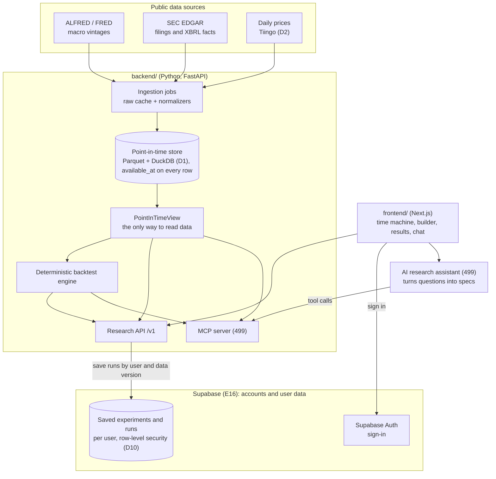
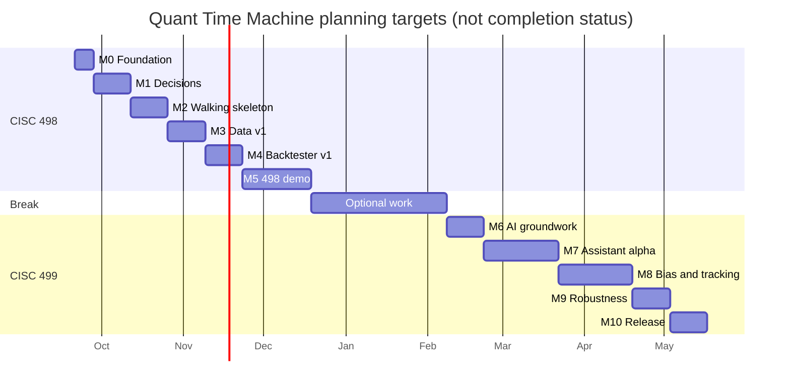
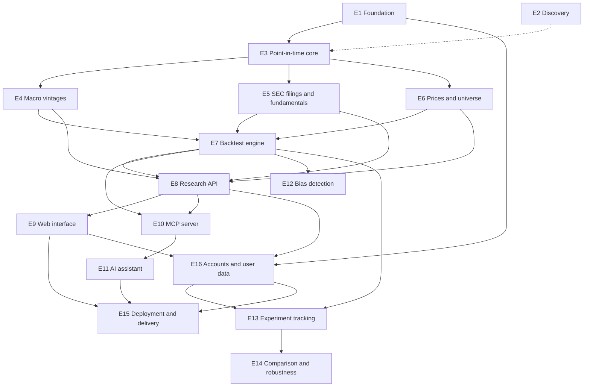

# Quant Time Machine: Roadmap and Product Backlog

> **Updated November 8, 2026.** Progress is audited against committed `main` at [`0c32c57`](https://github.com/nfiasco/Quant-Time-Machine/commit/0c32c573b10e802fb1b933eaf7ba4fbd624ce265). Uncommitted, staged, and untracked work is excluded. This remains a planning document for CISC 498 (Fall 2026) and CISC 499 (Spring 2027); future scope and unconfirmed course dates may change.
>
> **Team workspace:** [Project](https://github.com/users/nfiasco/projects/2) · [Issues](https://github.com/nfiasco/Quant-Time-Machine/issues) · [Milestones](https://github.com/nfiasco/Quant-Time-Machine/milestones). Issues hold the acceptance criteria, checklists, owners, and discussion. Project views organize those same issues. This roadmap connects the product plan, evidence, and milestone progress; refresh it at each milestone and when scope changes.

## At a glance

- **What we're building:** a research environment that reconstructs what was knowable at any past moment (prices, SEC filings, fundamentals from those filings, and economic data as first published) and runs deterministic, reproducible backtests using only that information.
- **CISC 498 (Fall 2026):** point-in-time data layer, deterministic backtester, research API, and web interface. The demo opens the time machine at June 5, 2020, 9:30 AM ET and runs the revenue-growth-plus-momentum backtest from the browser.
- **CISC 499 (Spring 2027):** MCP tools and an AI research assistant that turns questions into structured experiments, plus look-ahead-bias detection, experiment tracking, strategy comparison, and robustness testing.
- **Ground rule:** the AI translates; deterministic code calculates. Every number comes from tested code, and every input carries the time it became public.
- **Size:** 16 epics and 104 stories; 70 are P0 for their semester demo. Sprints are two weeks long; Sprint 1 began Monday, September 28, 2026.
- **Progress:** 32 Done, 13 In progress (partially delivered), 2 Ready, and 57 Backlog. No implementation is awaiting merge in an open pull request at the audit baseline.
- **Next delivery work:** complete the live Time Machine explorer; build the simulation loop and signals, then portfolio construction, metrics, run records, and the backtest API. Keep the missing account workflow and discovery evidence visible.
- **Public demo constraint:** raw Tiingo prices remain disabled on the deployed API pending display rights. The landing-page example is static; it is not the live explorer.

## Contents

1. [Product overview](#1-product-overview)
2. [How point-in-time works](#2-how-point-in-time-works)
3. [Proposed architecture](#3-proposed-architecture)
4. [Requirements](#4-requirements)
5. [Roadmap](#5-roadmap)
6. [Running the project board](#6-running-the-project-board)
7. [Backlog overview](#7-backlog-overview)
8. [Epics, stories, and tasks](#8-epics-stories-and-tasks)
9. [Risks](#9-risks)
10. [Decision log](#10-decision-log)
11. [Glossary](#11-glossary)
12. [References](#12-references)

## 1. Product overview

### 1.1 Problem and vision

Backtests often "see the future" by accident. They use a quarter's revenue before the 10-Q was filed, economic data that was revised months later, or today's index membership for past years. This **look-ahead bias** makes strategies look better than they really were.

Quant Time Machine answers one question for any past moment: *what could a trader actually have known at that time?* It then lets a researcher test ideas using only that information, for example:

> "Using only information available at the beginning of each month, test whether companies with improving revenue growth and positive momentum outperformed the market from 2010 to 2025."

The goal is not an AI that predicts stocks. It is a research environment where results are honest, auditable, and reproducible.

### 1.2 Goals

| Semester | Goal | Demo that proves it |
| --- | --- | --- |
| CISC 498, Fall 2026 | Point-in-time data layer, deterministic backtester, research API, web interface | Open the time machine at June 5, 2020, 9:30 AM ET and see what was and wasn't known. Run the revenue-growth-plus-momentum backtest from the browser and drill into the exact inputs behind any rebalance. |
| CISC 499, Spring 2027 | AI research assistant over MCP tools, look-ahead-bias detection, experiment tracking, strategy comparison, robustness testing | Type a hypothesis in plain English, approve the generated experiment, run it, and read a bias report and a robustness report built from the engine's numbers. |

### 1.3 Non-goals

- Predicting prices, recommending trades, or giving investment advice.
- Live or paper trading, brokerage connections, or order execution.
- Intraday data (daily bars only), options, futures, crypto, FX, or non-US markets.
- Letting the AI, or users, run arbitrary code inside the engine.
- A mobile app. A desktop app is a "maybe later."

### 1.4 Users

From the team's Problem Exploration:

| Persona | Who | What they need |
| --- | --- | --- |
| Student researcher (primary) | University students learning quantitative research | Test an idea honestly without building a data pipeline, and understand why the test is valid |
| Independent researcher or small team (primary) | People combining datasets without data-engineering support | Point-in-time data in one place, reproducible runs, and evidence they can show others |
| Reviewer | Instructors, collaborators, and decision-makers who rely on findings | Confirm that a result used only information available at the time, and re-run it |
| Developer | Our team | Clear contracts, fast tests, and guardrails that make look-ahead impossible by construction |

### 1.5 Success measures

| Measure | Target | How we check |
| --- | --- | --- |
| Point-in-time correctness | All golden cases pass; zero audit violations across runs | Golden tests in CI (S3.6), audit check on every run (S12.1) |
| Deliberate look-ahead is caught | Every case in the biased-strategy suite is flagged | Suite in CI (S12.5) |
| Reproducibility | Re-running any saved run gives identical results | Determinism test (S7.7), re-run and verify (S13.2) |
| Less research effort | Users finish a point-in-time-correct experiment faster than with their current approach | Usability sessions (S15.3, S15.8) compared with interview baselines (S2.1) |
| AI translation quality | Set after a baseline, for example at least 85% of eval questions produce the correct spec | Eval suite (S11.7) |

### 1.6 Where we are today (November 8, 2026)

| Area | Committed state | Remaining work |
| --- | --- | --- |
| Foundation and CI | Next.js/React frontend, FastAPI backend, locked dependencies, templates, license, READMEs, backend lint/format/tests, frontend lint/build, and container build/start checks | Frontend test/format gates (S1.1), complete branch protection (S1.4), ownership and historical-key follow-up (S1.3) |
| Point-in-time core | Append-only Parquet/DuckDB store; knowledge-time enforcement; provenance, raw cache, NYSE calendar, access logs, golden fixtures, and pinned data versions | Formal team ratification of the time model (S3.1) |
| Data | Six macro series with vintages and release times; filing histories and identities; XBRL metrics, quarter derivation/restatements; raw-price ingestion, corporate actions, total returns, and 50-company universe v1 | Combined coverage/delisting handling (S6.7); optional catalog, bulk-data, and universe expansion later |
| API | `/v1` prices, macro/revisions, filings/latest, fundamentals, snapshot, and catalog routes, with OpenAPI examples and tests | Run submission, background execution, results/audit endpoints (S8.4); generated client/caching (S8.6) |
| Backtester | Experiment spec v1, JSON Schema, decision/fill schedule, and total-return utilities | Simulation loop, signal calculations, portfolios/costs, performance metrics, run records, audit, and canonical end-to-end run (S7.3–S7.8) |
| Web | Landing scroll story, app shell, dashboard health check, initial builder form/preset/validation, and sign-in/sign-up UI | Live explorer, catalog-backed builder controls and submission, results, charts, methodology, and real accounts. Most planned routes still render placeholders. |
| Accounts | Supabase CLI configuration and auth forms exist | Hosted setup record, migrations, RLS, token verification, real sessions, saved experiments, privacy/account deletion (E16) |
| Deployment | Railway API and persisted universe-v1 store; Vercel production points to it; upload script and post-deploy smoke workflow are committed | Background-run recovery and resource sizing wait for S8.4; raw-price display remains restricted |
| Validation | 713 backend tests pass in an isolated export of the audited commit; 52 network/local-data cases are excluded. Committed CI and deployment smoke runs are green. | This does not establish a completed backtester, frontend automated test suite, user research, or account security. |

**Completion rule:** implemented scaffolding does not complete a feature. A merged schema does not implement its signal calculator; a form does not establish authentication or backtest execution. Human actions without committed confirmation (interviews, team ratification, key revocation, course approvals) remain unchecked.

## 2. How point-in-time works

Everything in this plan depends on one idea, so it is worth agreeing on early (S3.1 ratifies it).

### 2.1 Two clocks on every record

Every stored fact has:

- **What it describes:** a date or period, such as the June 4 close, Apple's fiscal Q2 2020 revenue, or the May 2020 unemployment rate.
- **`available_at`:** when the world could first know it, such as 4:00 PM ET for a close, the EDGAR acceptance time for a 10-Q, or 8:30 AM ET for the jobs report.
- **`ingested_at`:** when *our* database stored it.

A decision at time *T* may use only rows with `available_at ≤ T`. A saved run also pins a data version (rows with `ingested_at` up to a snapshot), so adding data later never changes an old result. The store is **append-only**: a revision or restatement is a new row, never an overwrite.

```text
    period end                   available_at                 decision time T
    Mar 28, 2020                 around May 1, 2020           Jun 5, 2020, 09:30 ET
    (Apple's fiscal Q2 ends)     (10-Q accepted by EDGAR)
────┼────────────────────────────┼────────────────────────────┼─────▶ time
    │  not public yet: unusable  │    public: usable (≤ T)    │
```

### 2.2 Conventions

| Topic | Rule |
| --- | --- |
| Storage | Timestamps are timezone-aware and stored in UTC |
| Market clock | `America/New_York` and the NYSE calendar, including holidays, early closes, and unscheduled closures |
| Knowledge-time input | A bare date means 09:30 ET on that date, and a time without an offset is New York time (D12); every response echoes the exact timestamp it used |
| Daily price bar | Known at that session's close (16:00 ET, or 13:00 ET on early-close days) |
| SEC filing | Known at its EDGAR acceptance time, not the period end and not the filing date |
| XBRL fact | Known at the acceptance time of the filing that reported it; a value re-reported or restated later is a new version from that later filing's time |
| Macro observation | Known at its ALFRED vintage date plus the release's scheduled time (for example, the Employment Situation at 08:30 ET). If the time is unknown, assume end of day, so it's first usable the next trading day. |
| Universe membership | A change applies from its effective date, never earlier |
| Decisions | Default: first trading day of each month at 09:30 ET |
| Fills | Always strictly after the decision. Default: the decision day's close. |
| Missing or unclear timestamps | Use the later plausible time (conservative) and flag it |

### 2.3 Example: June 5, 2020, at 9:30 AM ET

This table is the acceptance test for the snapshot endpoint (S8.3) and the Time Machine explorer (S9.2).

| Item | Known? | Why |
| --- | --- | --- |
| AAPL daily prices through the June 4 close | ✓ | Each bar is known at 4:00 PM on its own day |
| The June 5 closing price | ✗ | Not known until 4:00 PM on June 5 |
| May 2020 unemployment rate, first print 13.3% | ✓ | The Employment Situation came out at 8:30 AM on June 5 |
| Later revisions to May 2020 labor data | ✗ | Published in later releases and annual revisions |
| Apple's 10-Q for the quarter ended March 28, 2020 | ✓ | Accepted by EDGAR around May 1, 2020 |
| Apple's 10-Q for the quarter ended June 27, 2020 | ✗ | Not filed until late July 2020 |
| Any 10-Q/A or 10-K/A filed after June 5 | ✗ | An amendment counts only from its own acceptance time |
| Fed and other economic data as published by that morning | ✓ | The latest ALFRED vintage on or before that time |
| Universe changes after June 5 | ✗ | Membership applies from its effective date |

### 2.4 Where look-ahead bias creeps in

| Pitfall | Example | Our rule |
| --- | --- | --- |
| Period date used as publication date | Q1 revenue used in April, although the 10-Q came out in May | Fundamentals become usable at the filing's acceptance time |
| Revised data | January 1990 unemployment was first reported as 5.3%, later revised to 5.4% | Use the ALFRED vintage that existed at decision time |
| Restatements and amendments | A 10-K/A changes last year's revenue | A restated value applies only from the amendment's acceptance time |
| Same-day prices | A 9:30 AM decision that uses that day's close | A bar is known only after its session closes |
| Back-adjusted prices | A split-adjusted 2012 AAPL price already reflects the 2014 (7-for-1) and 2020 (4-for-1) splits | Store raw prices plus splits and dividends, compute returns from them, and never use adjusted price levels in signals |
| Survivorship and today's constituents | Testing 2010 with today's S&P 500 list | Point-in-time universe membership; keep delisted companies when data exists; report coverage gaps |
| "Latest value" APIs | SEC's XBRL frames API returns the most recently filed value for each period | Never use latest-value endpoints in backtests |
| AI hindsight | A language model "knows" which companies did well after 2010 | The AI translates the user's hypothesis instead of picking stocks, tools are time-locked, and every variant is logged |
| Data snooping | Trying 50 variants and reporting the best one | Experiment tracking counts variants; robustness tests; multiple-testing-adjusted metrics as a stretch goal |

## 3. Proposed architecture

### 3.1 Overview



### 3.2 Components

Folder names are suggestions. Keep the existing rule that API handlers stay thin and call into `app.data` and `app.backtest`.

| Component | Where | Semester | Epics |
| --- | --- | --- | --- |
| Ingestion and raw cache | `backend/app/data/sources/` | 498 | E3–E6 |
| Point-in-time store and `PointInTimeView` | `backend/app/data/` | 498 | E3 |
| Trading calendar | `backend/app/data/calendar.py` | 498 | E3 |
| Backtest engine: spec, schedule, signals, portfolio, metrics, audit | `backend/app/backtest/` | 498 | E7 |
| Research API | `backend/app/api/` | 498 | E8 |
| Web app | `frontend/app/` | 498–499 | E9, E11–E14 |
| MCP server | `backend/app/mcp/` | 499 | E10 |
| AI assistant: agent loop, prompts, evals | `backend/app/assistant/` | 499 | E11 |
| Bias checks | `backend/app/backtest/checks/` | 499 | E12 |
| Run registry | `backend/app/runs/`, with per-user records in Supabase (D10) | Files at first; Supabase once accounts exist (E16) | E7, E13, E16 |
| Accounts and user data | Supabase (migrations in `supabase/`), sign-in pages in `frontend/app/`, token check in `backend/app/api/` | 498 | E16 |

### 3.3 Data sources

| Data | Source | Point-in-time field | Access | Watch out for |
| --- | --- | --- | --- | --- |
| Economic series and their revisions | ALFRED / FRED API | `realtime_start` and `realtime_end` of each vintage (dates only) | Free API key | Real-time parameters default to *today*, which returns revised data; release time of day isn't in the API; vintage history for some series starts later than the data; some series carry third-party copyright |
| Filing history | SEC EDGAR submissions API (`data.sec.gov/submissions/`) | `acceptanceDateTime`, interpreted per company file: preserve true UTC; correct older shifted caches only when supported by the timing checks (S5.3, PR #79) | Free, no key; send a User-Agent with contact details and stay under 10 requests per second | Older filings are paginated; never use `filingDate` or `reportDate` as the availability time |
| Reported financials | SEC XBRL company facts API (`data.sec.gov/api/xbrl/companyfacts/`) | `filed` date and accession number, joined to the filing's acceptance time | Same as above | XBRL starts in 2009–2011 depending on filer size; tags vary by company and year; the frames API returns last-filed values, so it isn't point-in-time |
| Bulk backfill (optional) | SEC nightly bulk archives or Financial Statement Data Sets | Acceptance time of each submission | Free downloads | Large files; only needed beyond the starter universe |
| Daily prices, splits, dividends | Tiingo end-of-day API (D2; see [`doc/data-sources.md`](data-sources.md#daily-prices-decision-d2)). WRDS (CRSP) through UD's Lerner College, for internal validation only | Bar date and session close | Free key: 50 requests per hour, 1,000 per day, 500 symbols per month | Free and Power plans are internal use only, so displaying prices needs permission or a license; delisted coverage is partial (recent delistings yes, few before 2010) |
| Universe membership | A curated list, `starter_large_caps` (D3; see [`doc/data-sources.md`](data-sources.md#universe-v1-starter_large_caps-decision-d3)), dated by S&P's public announcements | Effective date of each change | Free | Official index membership is proprietary, so we cite announcements for our members only; choosing the members still uses hindsight |
| Trading calendar | `exchange_calendars` (or `pandas_market_calendars`) | Not applicable | Open-source library | Early closes and unscheduled closures |

### 3.4 The experiment spec: where the AI stops and code starts

Every backtest, whether built in the web form (498) or by the AI assistant (499), is a validated JSON document. The assistant's only job is to write and explain this document. The engine validates it, runs it, and produces every number. Here is the canonical question as a spec:

```json
{
  "spec_version": 1,
  "name": "Improving revenue growth + positive momentum",
  "universe": { "type": "point_in_time_list", "id": "starter_large_caps" },
  "period": { "start": "2010-01-01", "end": "2025-12-31" },
  "schedule": {
    "rebalance": "monthly",
    "decision": "first_trading_day 09:30 America/New_York",
    "fill": "same_day_close"
  },
  "signals": {
    "rev_accel": { "type": "revenue_growth_acceleration", "basis": "yoy_quarterly" },
    "mom_12_1": { "type": "momentum", "lookback_months": 12, "skip_months": 1 }
  },
  "filters": [
    { "signal": "rev_accel", "op": ">", "value": 0 },
    { "signal": "mom_12_1", "op": ">", "value": 0 }
  ],
  "portfolio": { "weighting": "equal", "long_only": true },
  "benchmark": "SPY",
  "costs": { "bps_per_trade": 10 }
}
```

The model is [`app/backtest/spec.py`](../backend/app/backtest/spec.py), and its JSON Schema is [`experiment-spec-v1.schema.json`](experiment-spec-v1.schema.json) (S7.1). Signals come from a fixed, documented library, not free-form code. When a spec asks for data outside our coverage, for example fundamentals before XBRL existed, the engine rejects it or warns, and says why.

## 4. Requirements

**Priority:** *Must* is needed for that semester's demo, *Should* is planned but can slip, and *Could* is a stretch goal. The Stories column lists the stories that deliver each requirement.

### 4.1 Functional requirements

#### Point-in-time data (FR-D)

| ID | Requirement | Priority | Stories |
| --- | --- | --- | --- |
| FR-D1 | Every stored record carries the date or period it describes, when it became public (`available_at`), when we ingested it, and its source reference (URL, accession number, or vintage) | Must | S3.4, S4.2, S5.3, S5.5, S6.2 |
| FR-D2 | All reads go through as-of queries bound to a knowledge time; no code path can return a record with `available_at` later than that time | Must | S3.3 |
| FR-D3 | Macro series return values as published at the knowledge time (ALFRED vintages), including past periods that were later revised | Must | S4.1, S4.2, S4.3, S4.4, S4.6 |
| FR-D4 | For a company and knowledge time, list the filings accepted by then and return the latest filing of a given form (10-K, 10-Q, 8-K) with its acceptance time and link | Must | S5.1, S5.3, S5.4 |
| FR-D5 | For a company, metric, and knowledge time, return fundamentals as known then (original, or restated by filings accepted before then), deriving quarterly values where needed (Q4 = full year − first nine months) | Must | S5.1, S5.5, S5.6, S5.7 |
| FR-D6 | Daily raw prices, where an as-of query returns the latest bar whose close was already known | Must | S6.1, S6.2, S6.3 |
| FR-D7 | Splits and dividends stored with ex-dates, and total returns computed without back-adjusted price levels | Must | S6.2, S6.4 |
| FR-D8 | Point-in-time universe membership that keeps companies that later left or were delisted, when data allows | Must | S6.5, S6.6 |
| FR-D9 | A knowledge snapshot for a moment: what was known and what wasn't yet known, for chosen companies and series | Must | S8.3, S9.2 |
| FR-D10 | Repeatable ingestion that caches raw responses, records provenance, and respects each source's rate limits | Must | S3.4, S3.7, S5.8, S15.5 |
| FR-D11 | Coverage reports showing which companies, periods, and series have data, and where the gaps are | Should | S5.6, S6.7 |
| FR-D12 | Resolve a ticker to a company as of a date, using a permanent internal ID (CIK plus security ID) | Must | S5.2 |
| FR-D13 | Revision history for any macro observation: every published value and when it was published | Should | S4.5 |

#### Backtesting (FR-B)

| ID | Requirement | Priority | Stories |
| --- | --- | --- | --- |
| FR-B1 | Accept a structured, versioned experiment spec (universe, period, schedule, signals, filters, weighting, benchmark, costs) and return clear validation errors | Must | S7.1, S7.8 |
| FR-B2 | At each decision time, the engine reads data only through a point-in-time view bound to that time | Must | S7.3 |
| FR-B3 | Deterministic results: the same spec, data version, and engine version always produce identical output | Must | S7.7 |
| FR-B4 | A documented signal library: price momentum, revenue growth and its acceleration, and macro conditions | Must | S7.4 |
| FR-B5 | Portfolio construction: filters, quantile ranking, equal weights, and transaction costs in basis points (value weights and long-short are optional) | Must | S7.5 |
| FR-B6 | Outputs: returns, equity curve against the benchmark, holdings, trades, and standard metrics (CAGR, volatility, Sharpe, max drawdown, turnover, excess return, t-statistic) | Must | S7.6, S7.8 |
| FR-B7 | A data-access audit listing every input used at every decision, with its `available_at` | Must | S3.3, S7.7 |
| FR-B8 | Coverage warnings when companies or periods drop out because of missing data | Should | S6.7, S7.3 |
| FR-B9 | Configurable decision and fill timing, with fills always strictly after decisions | Must | S3.1, S3.5, S7.2 |

#### Research API (FR-A)

| ID | Requirement | Priority | Stories |
| --- | --- | --- | --- |
| FR-A1 | JSON endpoints for as-of prices, macro values, filings, and fundamentals | Must | S8.2 |
| FR-A2 | A knowledge-snapshot endpoint | Must | S8.3 |
| FR-A3 | Endpoints to submit a backtest, check its status, and fetch its results and audit | Must | S8.4 |
| FR-A4 | Catalog endpoints listing available series, companies, and signals with their parameters | Must | S8.5 |
| FR-A5 | OpenAPI docs, versioned routes, consistent errors, and every response echoing the knowledge time and data version it used | Must | S8.1 |

#### Web interface (FR-W)

| ID | Requirement | Priority | Stories |
| --- | --- | --- | --- |
| FR-W1 | Time Machine explorer: pick a moment plus companies and series, and see what was known and what wasn't yet known | Must | S9.1, S9.2 |
| FR-W2 | Macro revision viewer | Should | S9.3 |
| FR-W3 | Company filing timeline showing period ends, acceptance times, and amendments | Could | S9.4 |
| FR-W4 | Backtest builder form with presets, usable without the AI | Must | S9.5 |
| FR-W5 | Results page with charts, metrics, holdings, assumptions, warnings, and an audit drill-down | Must | S9.6 |
| FR-W6 | Methodology page explaining timing rules and known limitations | Should | S9.7 |

#### AI assistant and MCP (FR-AI), CISC 499

| ID | Requirement | Priority | Stories |
| --- | --- | --- | --- |
| FR-AI1 | An MCP server exposing point-in-time data tools, where every call is bound to a knowledge time and can't return later data | Must | S10.1, S10.2 |
| FR-AI2 | MCP tools to validate and run experiments and fetch their results | Must | S10.4 |
| FR-AI3 | Translate a plain-English hypothesis into a schema-valid spec, asking clarifying questions when terms are ambiguous or the period exceeds data coverage | Must | S11.1, S11.2 |
| FR-AI4 | The user reviews, edits, and confirms the spec before anything runs | Must | S11.3 |
| FR-AI5 | Every number shown comes from the engine; the assistant cites run IDs and never computes returns itself | Must | S11.4 |
| FR-AI6 | Guardrails: no arbitrary code or web access, library signals only, no investment advice, and spend limits | Must | S11.6 |
| FR-AI7 | A chat interface with the spec card, run status, and results together | Must | S11.5 |
| FR-AI8 | An evaluation suite that measures translation accuracy | Must | S11.7 |
| FR-AI9 | Every tool call logged with its inputs, knowledge time, and outcome | Must | S10.5 |
| FR-AI10 | Time-locked sessions that cap the knowledge time a conversation's tools can use | Should | S10.3 |
| FR-AI11 | Mitigations for AI hindsight, such as flagging tickers or dates the assistant introduced and optionally anonymizing companies | Should | S2.5, S11.8 |

#### Look-ahead-bias detection (FR-L), CISC 499

| ID | Requirement | Priority | Stories |
| --- | --- | --- | --- |
| FR-L1 | Check every run's audit: all inputs have `available_at` ≤ decision time, and fills come after decisions | Must | S12.1 |
| FR-L2 | Future-perturbation test: changing data after time *T* must not change any decision before *T* | Should | S12.2 |
| FR-L3 | "Bias delta" report: rerun in a clearly labeled naive mode (revised data, period-end dating, today's universe, adjusted prices) and show how much the results change | Must | S12.3 |
| FR-L4 | Spec lint rules that flag risky constructs and suggest fixes | Should | S12.4 |
| FR-L5 | A suite of deliberately biased experiments that the detectors must flag | Must | S12.5 |
| FR-L6 | A bias report in the results UI | Should | S12.6 |

#### Experiment tracking (FR-X), CISC 499

| ID | Requirement | Priority | Stories |
| --- | --- | --- | --- |
| FR-X1 | Persist every run: spec, spec hash, data version, code version, results, metrics, and warnings | Must | S13.1 |
| FR-X2 | Re-run any saved run and confirm identical results, or show what differs | Must | S13.2 |
| FR-X3 | Browse, search, tag, and annotate runs, and count the variants tried for each research question | Must | S13.3 |
| FR-X4 | Export a run (JSON and CSV) and share a read-only link | Should | S13.4 |

#### Comparison and robustness (FR-R), CISC 499

| ID | Requirement | Priority | Stories |
| --- | --- | --- | --- |
| FR-R1 | Compare two to four runs side by side: metrics, curves, and spec differences | Must | S14.1 |
| FR-R2 | Parameter sensitivity sweeps shown as a heatmap | Must | S14.2 |
| FR-R3 | Sensitivity to subperiod, rebalance timing, and transaction costs | Should | S14.3 |
| FR-R4 | Statistical robustness: bootstrap confidence intervals, placebo tests, and a deflated Sharpe ratio | Could | S14.4 |
| FR-R5 | A one-click robustness report, also available through the assistant | Should | S14.5 |

#### Accounts and user data (FR-U)

| ID | Requirement | Priority | Stories |
| --- | --- | --- | --- |
| FR-U1 | Users can sign up, sign in, and sign out, and the backend verifies who is calling | Should | S16.1, S16.3, S16.4 |
| FR-U2 | Saved experiments and runs belong to one user and are private by default (row-level security). They point to market data by data version instead of copying it. | Should | S16.2, S16.5, S13.1 |
| FR-U3 | A privacy page explains what is stored, and users can delete their account and data | Should | S16.6 |

### 4.2 Non-functional requirements

| ID | Quality | Requirement | Priority | Stories |
| --- | --- | --- | --- | --- |
| NFR-1 | No look-ahead by construction | Enforced in the data-access layer, not by convention, and covered by invariant, canary, and golden tests | Must | S3.3, S3.6, S12.1 |
| NFR-2 | Reproducibility | Deterministic engine, pinned dependencies (`uv.lock`, `package-lock.json`), and a pinned data version per run | Must | S1.1, S3.7, S7.7, S13.2 |
| NFR-3 | Transparency | Every result shows its sources, timing assumptions, coverage gaps, and known limitations | Must | S9.6, S9.7 |
| NFR-4 | Time correctness | Timezone-aware UTC storage, the NYSE calendar, and the bare-date rule applied everywhere | Must | S3.1, S3.5, S4.3, S8.1 |
| NFR-5 | Performance | Targets to validate: a single as-of API lookup under 300 ms, and the canonical 2010–2025 monthly backtest on the starter universe under 60 s | Should | S3.2, S8.6, S15.2 |
| NFR-6 | Cost | Runs on free tiers or the course budget; AI spend is capped per session and per day | Must | S1.6, S2.3, S11.1, S11.6, S15.1, S15.6 |
| NFR-7 | Data terms | Follow SEC fair-access rules, FRED terms, and the price source's terms; never commit raw datasets; don't redistribute restricted data | Must | S1.3, S2.3, S3.4, S6.1 |
| NFR-8 | Security | Secrets live only in environment variables, never in the repo or the browser bundle; AI endpoints are protected before public launch | Must | S1.3, S1.5, S11.6, S15.1, S15.6, S15.7 |
| NFR-9 | Maintainability | CI lint, format, test, and build on every PR; review before merge; docs for each module | Must | S1.1, S1.2, S1.4, S15.5, S15.9 |
| NFR-10 | Usability | A first-time user runs the canonical example from the UI within 5 minutes, without reading code | Should | S2.1, S2.4, S15.3, S15.8 |
| NFR-11 | Onboarding | A new teammate can set up and run the tests in under 30 minutes, using the READMEs and fixture data (no API keys needed) | Should | S1.5, S3.6, S15.9 |
| NFR-12 | Accessibility | Keyboard-usable forms, sufficient contrast, and a layout that works at tablet width | Could | S15.3 |

## 5. Roadmap

### 5.1 Timeline



Spring dates are placeholders until the Spring 2027 calendar is confirmed. Move course deadlines (presentations, reports) onto the milestones as soon as they're announced.

### 5.2 Milestones

Targets are retained from the committed plan. A passed target does not close incomplete work. M5 and the spring course deadlines are unconfirmed, so their GitHub due dates are unset; spring dates below are provisional planning targets. Counts cover roadmap stories only, excluding epics, historical trackers, separately tracked bugs, and PRs. PRs now carry their primary milestone for navigation; GitHub milestone totals include both issues and PRs and therefore differ from these story counts.

| ID | Milestone | Planning target | Stories done | Status and remaining gate |
| --- | --- | --- | --- | --- |
| [M0](https://github.com/nfiasco/Quant-Time-Machine/milestone/13) | Foundation | Sep 27, 2026 | 0/1 | **In progress.** Scaffold is present; frontend test/format gates remain in S1.1. |
| [M1](https://github.com/nfiasco/Quant-Time-Machine/milestone/14) | Decisions and discovery | Oct 11, 2026 | 5/10 | **In progress.** Board setup and metadata automation are complete. Planning ownership, license/key follow-up, one-review protection, WRDS/team review, and time-model ratification remain; interviews must also be underway for the exit criterion. |
| [M2](https://github.com/nfiasco/Quant-Time-Machine/milestone/4) | Walking skeleton | Oct 25, 2026 | 13/17 | **In progress.** Core data/API work is merged; live June 5 page, comparison/evaluation work, and Supabase setup remain. S2.4 needs the S2.1 interview baseline from M3. |
| [M3](https://github.com/nfiasco/Quant-Time-Machine/milestone/5) | Point-in-time data v1 | Nov 8, 2026 | 13/16 | **In progress.** Data v1, golden tests, spec/schedule, snapshot, and catalogs are merged; interviews, live explorer, and account schema remain. |
| [M4](https://github.com/nfiasco/Quant-Time-Machine/milestone/15) | Backtester v1 | Nov 22, 2026 | 0/11 | **In progress.** Spec/schedule prerequisites are ready; the simulation, signal, portfolio, metric, run/audit, and API delivery chain remains. |
| [M5](https://github.com/nfiasco/Quant-Time-Machine/milestone/6) | Web UI and CISC 498 demo | Dec 2026, per the course calendar | 1/11 | **In progress.** Railway deployment is complete; builder integration, results, methodology, usability, accounts, and course delivery remain. |
| [M6](https://github.com/nfiasco/Quant-Time-Machine/milestone/16) | Hardening and AI groundwork | Feb 21, 2027 | 0/7 | **In progress.** Only reusable share-count groundwork exists for universe v2; spring scope remains planned. |
| [M7](https://github.com/nfiasco/Quant-Time-Machine/milestone/17) | AI research assistant alpha | Mar 21, 2027 | 0/11 | **Planned.** MCP, assistant execution, persistent runs, and public access control are not implemented. |
| [M8](https://github.com/nfiasco/Quant-Time-Machine/milestone/18) | Bias detection and experiment tracking | Apr 18, 2027 | 0/11 | **Planned.** Full-run bias detection, evaluation, replay/history, and export remain planned. |
| [M9](https://github.com/nfiasco/Quant-Time-Machine/milestone/19) | Comparison and robustness | May 2, 2027 | 0/7 | **Planned.** Comparison, sweeps, robustness, review, and usability remain planned. |
| [M10](https://github.com/nfiasco/Quant-Time-Machine/milestone/20) | Final release and CISC 499 showcase | May 16, 2027, per the course calendar | 0/2 | **Planned.** Final documentation validation, release, report, and showcase remain planned. |

**Exit criteria**

| Milestone | Required outcome |
| --- | --- |
| M0 | Monorepo, CI, and starter apps in place |
| M1 | Board live; repo public with a LICENSE; time model ratified; storage and price source chosen; data-sources memo written; interviews underway |
| M2 | UNRATE vintages, Apple's filings, and a few tickers' prices ingested; as-of functions and `/v1` endpoints return the right answers for June 5, 2020; a bare web page shows them; backend hosting decided |
| M3 | Revenue as known at any time for the starter universe (restatements, Q4); total returns; universe v1; snapshot endpoint and Time Machine explorer; experiment spec v1; interviews synthesized |
| M4 | The canonical example runs end to end and deterministically, with an audit and with metrics checked against a hand-computed case; backtest API works |
| M5 | Builder and results pages work against the deployed backend; methodology page; first usability test; demo rehearsed; final report delivered |
| M6 | 498 feedback addressed; MCP and model spikes decided; hindsight memo written; optional data expansion done |
| M7 | In chat, ask the canonical question, confirm the generated spec, run it, and get a grounded explanation; MCP tools work from an MCP client; runs are saved; AI endpoints are protected |
| M8 | Every run has an audit check and a bias report; the biased-strategy suite passes; saved runs are searchable and re-runnable; the eval suite has a baseline and a target |
| M9 | Comparison, parameter sweeps, and stress tests work from the UI and the assistant; security review and second usability test done |
| M10 | `v1.0` tagged; docs complete; showcase and final report delivered |

### 5.3 Sprint plan

These are the original planning allocations, not evidence of work starting or finishing. The Project shows the reconciled status and iteration; overdue stories remain visible until their criteria are met. Confirm carry-over and ownership at planning.

Stories that span several sprints appear in each one. **Load** is the sum of size midpoints (S ≈ 3 h, M ≈ 6 h, L ≈ 12 h), split evenly across a story's sprints. Five people at 8–10 hours a week give roughly 80–100 hours per sprint, so Sprints 2 and 3 are full: protect them from new work. Accounts (E16) have a dedicated owner, the database lead, so their hours come from that person, not from the other workstreams. Spring sprints are deliberately lighter, because carry-over, bug fixes, and learning the AI stack will take real time.

| Sprint | Dates | Milestone | Focus | Stories | Load |
| --- | --- | --- | --- | --- | --- |
| 0 | Sep 21–27, 2026 | M0 | Repository scaffold delivered; frontend CI gates remain | S1.1 | ~6 h |
| 1 | Sep 28 – Oct 11 | M1 | Board, public repo, configuration, data spikes, time model, storage decision; interviews start | S1.2, S1.3, S1.4, S1.5, S2.1, S2.2, S2.3, S3.1, S3.2, S4.1, S5.1, S6.1 | ~40 h |
| 2 | Oct 12 – Oct 25 | M2 | Walking skeleton: point-in-time core, calendar, first ingestion of macro, filings, and prices; as-of functions; API conventions; app shell | S1.6, S2.1, S2.2, S2.4, S3.3, S3.4, S3.5, S3.6, S4.2, S4.3, S4.4, S5.2, S5.3, S5.4, S6.2, S6.3, S6.5, S8.1, S8.2, S9.1, S16.1 | ~85 h |
| 3 | Oct 26 – Nov 8 | M3 | Fundamentals (XBRL, tags, Q4, restatements), total returns, universe v1, spec v1, snapshot and explorer | S2.1, S3.6, S3.7, S4.5, S5.5, S5.6, S5.7, S6.4, S6.5, S7.1, S7.2, S8.2, S8.3, S8.5, S9.2, S16.2 | ~85 h |
| 4 | Nov 9 – Nov 22 | M4 | Engine loop, signals, portfolio, metrics, audit, canonical run, backtest API | S6.7, S7.3, S7.4, S7.5, S7.6, S7.7, S7.8, S8.4, S9.3, S16.3, S16.4 | ~66 h |
| 5 | Nov 23 – Dec 6 | M5 | Builder, results, methodology, backend deploy. Thanksgiving is Nov 26, so plan for about 60% capacity. | S8.6, S9.4, S9.5, S9.6, S9.7, S15.1, S15.2, S16.5, S16.6 | ~54 h |
| 6 | Dec 7 – end of term | M5 | First usability test, demo, report, retro, winter plan | S15.3, S15.4 | ~12 h |
| Winter | Dec 19 – Feb 7 | — | Optional: bug fixes, data expansion, universe v2 | Volunteer basis | — |
| 7 | Feb 8 – Feb 21, 2027 | M6 | 498 feedback, data expansion, MCP and model spikes, hindsight research | S2.5, S4.6, S5.8, S6.6, S10.1, S10.2, S11.1, S15.5 | ~45 h |
| 8 | Feb 22 – Mar 7 | M7 | MCP tools, question → spec, chat UI, access control | S10.2, S10.3, S10.4, S10.5, S11.2, S11.5, S15.6 | ~42 h |
| 9 | Mar 8 – Mar 21 | M7 | Spec confirmation, grounded answers, guardrails, run registry | S11.3, S11.4, S11.5, S11.6, S11.7, S13.1 | ~33 h |
| 10 | Mar 22 – Apr 4 | M8 | Audit check, perturbation test, biased-strategy suite, re-run, history, evals | S11.7, S11.8, S12.1, S12.2, S12.5, S13.2, S13.3 | ~30 h |
| 11 | Apr 5 – Apr 18 | M8 | Bias delta, lint rules, bias UI, export, sweeps | S12.3, S12.4, S12.5, S12.6, S13.4, S14.2 | ~24 h |
| 12 | Apr 19 – May 2 | M9 | Comparison, sweeps, stress tests, robustness report, security review, second usability test | S14.1, S14.2, S14.3, S14.4, S14.5, S15.7, S15.8 | ~42 h |
| 13 | May 3 – May 16 | M10 | Docs, release, showcase | S15.9, S15.10 | ~12 h |

Spring break will fall somewhere in Sprints 9–11; shift the dates once the calendar is out.

**Suggested workstreams.** One lead per workstream, pairing on L-sized stories. Assign people at Sprint 1 planning, and rotate reviewers so nobody is the only person who understands a module.

| Semester | Workstream | Epics |
| --- | --- | --- |
| Fall | Point-in-time core and macro data | E3, E4 |
| Fall | SEC filings and fundamentals (largest data epic; pair up in Sprint 3) | E5 |
| Fall | Prices, returns, and universe | E6 |
| Fall | Backtest engine | E7 |
| Fall | API and web | E8, E9 |
| Fall | Accounts and user data: the database lead, working on it exclusively | E16 |
| Spring | MCP and assistant (two people) | E10, E11 |
| Spring | Bias detection | E12 |
| Spring | Experiment tracking and robustness | E13, E14 |
| Spring | Web follow-ups and delivery | E9, E15 |

Foundation (E1) and discovery (E2) are shared; take turns running interviews.

### 5.4 Epic dependencies



### 5.5 If we fall behind

Cut scope in this order:

1. P2 stories.
2. P1 stories that aren't on the demo path, such as the filing timeline, revision viewer, or typed client.
3. Scope inside P0 stories: fewer companies, fewer series, or shorter periods, before dropping a P0 story entirely.

Never cut point-in-time enforcement (S3.3), the golden tests (S3.6), or determinism and the audit (S7.7). They are the product.

## 6. Running the project board

### 6.1 Structure

Use the existing [Quant Time Machine project](https://github.com/users/nfiasco/projects/2) for both semesters. Multiple views give the team different perspectives without duplicating work across boards.

- **Epic:** one `epic` issue with its goal, exit criteria, and story roll-up. Each of the 16 epics stays open until all its stories, including optional later work, are complete.
- **Story or spike:** one issue per stable roadmap ID (`S3.7`, for example), with acceptance criteria, tasks, evidence, a parent epic, and one milestone. All 104 stories are represented.
- **Task:** a checklist item inside its story. Split a partly finished task into completed groundwork and the actual remaining work; do not check off the whole feature.
- **Bug:** a `bug` issue linked to the affected story. Keep it on the same project.
- **History:** earlier completed or overlapping trackers retain their discussion and point to the canonical issue. The `historical` label and archived project items keep them out of delivery views.

Issues and Projects are complementary: the issue is the work record; the project is the board, table, and timeline over those records. Use links to merged pull requests as completion evidence.

### 6.2 Fields

| Field | Use |
| --- | --- |
| Status | Backlog → Ready → In progress → In review → Done |
| Priority | P0 required for the semester demo; P1 planned; P2 optional/stretch. Match the issue's `priority: P0/P1/P2` label. |
| Size | XS, S, M, L, XL; split work larger than L before starting. |
| Iteration | Sprint 0 and the two-week fall/spring sprint calendar from §5.3; spring remains provisional. Multi-sprint stories use their planned finishing sprint. |
| Semester | Fall 2026, Spring 2027, or Both for spanning epics. |
| Start date / Target date | Planning windows for roadmap display, not proof of delivery. Unconfirmed end-of-term dates remain unset. |
| Assignees / Milestone / Parent issue | Native issue fields. Completed-story assignees follow verified authored contributions; future ownership is a planning decision. PRs use the primary milestone of their work. |

**Status meanings:** Backlog has no completed implementation for its remaining deliverable; Ready has implemented prerequisites and an existing owner; In progress means committed partial delivery with outstanding criteria, not proof someone is actively coding today; In review requires an open review/merge step; Done requires all story acceptance criteria. In the separate Pull requests view, Done means the PR lifecycle ended; the native merge icon and `not merged` label distinguish delivered changes from abandoned proposals.

### 6.3 Labels

| Labels | Use |
| --- | --- |
| `epic`, `story`, `spike`, `bug` | Work type; choose one for the primary item. |
| `area: data`, `area: engine`, `area: api`, `area: web`, `area: ai`, `area: infra`, `area: research` | The primary system area. |
| `priority: P0`, `priority: P1`, `priority: P2` | Priority visible in both Issues and Projects. Choose exactly one on a story. |
| `blocked` | Fall delivery work with a concrete unresolved prerequisite; inspect the linked dependency. |
| `documentation`, `testing`, `good first issue` | Useful supplemental context. |
| `historical` | Earlier tracker retained for context; follow its canonical issue. |
| `not merged` | PR closed without merging; does not establish delivered work. |

### 6.4 Views

| View | Layout | Purpose |
| --- | --- | --- |
| [Story backlog](https://github.com/users/nfiasco/projects/2/views/1) | Board | Open story/spike issues, excluding bugs and epic duplicates. |
| [Delivery board](https://github.com/users/nfiasco/projects/2/views/2) | Board | Open story/spike and bug issues organized by Status. |
| [Current sprint](https://github.com/users/nfiasco/projects/2/views/3) | Board | Open work in `iteration:@current`. Use Backlog for carry-over outside that iteration. |
| [Roadmap](https://github.com/users/nfiasco/projects/2/views/4) | Roadmap | Epic planning windows, status, and child progress. |
| [My work](https://github.com/users/nfiasco/projects/2/views/5) | Table | Open work assigned to the signed-in teammate. |
| [Completed](https://github.com/users/nfiasco/projects/2/views/6) | Table | Closed canonical issue work and bugs; PRs are excluded. |
| [Needs attention](https://github.com/users/nfiasco/projects/2/views/7) | Table | Open work labeled `blocked`. |
| [Fall delivery](https://github.com/users/nfiasco/projects/2/views/8) | Table | Open Fall 2026 stories and bugs. |
| [Bug tracker](https://github.com/users/nfiasco/projects/2/views/9) | Table | Bugs with status, priority, assignee, milestone, linked PRs, and created/closed dates. |
| [Pull requests](https://github.com/users/nfiasco/projects/2/views/10) | Table | PR history and current reviews, with authorship-based assignees, reviewers, labels, and milestones. |

### 6.5 Working agreement

- Keep one issue per story. Add each story as a sub-issue of its epic and record dependencies with issue links; native blocked-by links represent missing implementation prerequisites.
- Use one focused branch per story, following existing conventions such as `feature/s4-4-macro-as-of`. A PR closes the issue only when it satisfies the whole story; partial PRs say `Refs #<issue>`.
- Update the task checklist with each merged PR. Move to Done only after the remaining acceptance criteria are verified.
- Keep Priority and Size current, select the planned finishing iteration, and keep one milestone per story. Epics span milestones and do not duplicate milestone progress.
- Keep at most two active stories per person. Completed-story assignees follow [verified contributions](contribution-history.md); future assignments need the team's planning decision. A merger is not automatically the implementer.
- Built-in project workflows add repository issues, PRs, and sub-issues, excluding historical trackers. New and reopened items enter Backlog; closed issues move to Done. Set In review when the remaining scope is ready for review. The unconditional PR-linked status workflow is disabled because adding historical links moved completed issues backwards. Move an issue to Done only after its acceptance criteria are met, because the existing auto-close workflow closes issues in Done.

### 6.6 Definition of Ready and Done

**Ready:** clear acceptance criteria, size/priority, an owner, and usable prerequisites. A prerequisite's already merged component may be usable while its separate review or integration follow-up remains open; explain that distinction in the issue.

**Done:** the story's acceptance criteria are met in committed, merged work; applicable checks pass; docs and tests demonstrate the behavior; any explicitly required human validation has recorded evidence. Placeholder pages, disabled buttons, schemas without execution, and unverified external actions remain incomplete.

### 6.7 Team rhythm

| When | Action |
| --- | --- |
| Sprint planning | Pick owners, confirm capacity and dependencies, move selected work into the iteration, and review overdue milestones. |
| During the sprint | Keep the issue checklist and project status current; link each PR and blocker. |
| Sprint review | Demonstrate completed acceptance criteria and record decisions or remaining work. |
| Each milestone | Reconcile this roadmap with merged Git history; refresh story/epic counts and review risks and deadlines. |

### 6.8 Maintaining this structure

Use the repository's story, spike, and bug templates. Add a stable ID, parent epic, area and priority labels, milestone, project fields, and a concise task checklist. Keep acceptance criteria in the issue and roadmap aligned when scope changes. Preserve completed work and evidence rather than deleting useful history. Assign each PR its primary delivery milestone and retain related-issue links. Keep historical trackers and spanning epics unmilestoned. Use story-only counts for roadmap progress because GitHub milestone totals also include PRs.

The [team workflow](github-workflow.md) defines PR requirements, small-maintenance exceptions, issue forms, and automation. GitHub can enforce metadata before merge; the PR template cannot make fields mandatory before initial creation.

The November 8 reconciliation retained the repository's existing project and matching issue numbers, created missing stories/epics, and consolidated overlapping trackers. Empty account-level projects with no repository link were outside this repository cleanup.

## 7. Backlog overview

Every story in one table. Verified contributors are listed for completed stories; use the linked issue for current planning ownership on open work. Select its ID for the detailed checklist or its GitHub link for the canonical issue. Status uses the evidence-based definitions in §6.2.

| ID | Story | Epic | Priority | Size | Sprint | Milestone | Status | GitHub | Verified contributors |
| --- | --- | --- | --- | --- | --- | --- | --- | --- | --- |
| [S1.1](#s11-monorepo-scaffold-with-ci) | Monorepo scaffold with CI | E1 | P0 | M | 0 | M0 | In progress | [#1](https://github.com/nfiasco/Quant-Time-Machine/issues/1) | See issue |
| [S1.2](#s12-set-up-the-github-project-board) | Set up the GitHub Project board | E1 | P0 | S | 1 | M1 | In progress | [#109](https://github.com/nfiasco/Quant-Time-Machine/issues/109) | See issue |
| [S1.3](#s13-make-the-repository-public-safely) | Make the repository public safely | E1 | P0 | S | 1 | M1 | In progress | [#110](https://github.com/nfiasco/Quant-Time-Machine/issues/110) | See issue |
| [S1.4](#s14-contribution-templates-and-branch-protection) | Contribution templates and branch protection | E1 | P1 | S | 1 | M1 | In progress | [#111](https://github.com/nfiasco/Quant-Time-Machine/issues/111) | See issue |
| [S1.5](#s15-configuration-and-secrets) | Configuration and secrets | E1 | P0 | S | 1 | M1 | ✅ Done | [#112](https://github.com/nfiasco/Quant-Time-Machine/issues/112) | [nfiasco](https://github.com/nfiasco) |
| [S1.6](#s16-spike-choose-backend-and-data-hosting) | Spike: choose backend and data hosting | E1 | P0 | S | 2 | M2 | ✅ Done | [#113](https://github.com/nfiasco/Quant-Time-Machine/issues/113) | [nfiasco](https://github.com/nfiasco) |
| [S2.1](#s21-interview-target-users) | Interview target users | E2 | P0 | L | 1–3 | M3 | Backlog | [#114](https://github.com/nfiasco/Quant-Time-Machine/issues/114) | See issue |
| [S2.2](#s22-compare-existing-tools) | Compare existing tools | E2 | P1 | M | 1–2 | M2 | Backlog | [#115](https://github.com/nfiasco/Quant-Time-Machine/issues/115) | See issue |
| [S2.3](#s23-data-sources-and-terms-memo) | Data sources and terms memo | E2 | P0 | M | 1 | M1 | In progress | [#116](https://github.com/nfiasco/Quant-Time-Machine/issues/116) | See issue |
| [S2.4](#s24-success-measures-and-evaluation-plan) | Success measures and evaluation plan | E2 | P1 | S | 2 | M2 | Backlog | [#117](https://github.com/nfiasco/Quant-Time-Machine/issues/117) | See issue |
| [S2.5](#s25-research-how-an-ai-assistant-could-introduce-hindsight) | Research: how an AI assistant could introduce hindsight | E2 | P1 | M | 7 | M6 | Backlog | [#118](https://github.com/nfiasco/Quant-Time-Machine/issues/118) | See issue |
| [S3.1](#s31-ratify-the-time-model) | Ratify the time model | E3 | P0 | S | 1 | M1 | In progress | [#119](https://github.com/nfiasco/Quant-Time-Machine/issues/119) | See issue |
| [S3.2](#s32-spike-choose-the-storage-engine) | Spike: choose the storage engine | E3 | P0 | S | 1 | M1 | ✅ Done | [#20](https://github.com/nfiasco/Quant-Time-Machine/issues/20) | [nfiasco](https://github.com/nfiasco) |
| [S3.3](#s33-pointintimeview-the-only-way-to-read-data) | `PointInTimeView`: the only way to read data | E3 | P0 | M | 2 | M2 | ✅ Done | [#27](https://github.com/nfiasco/Quant-Time-Machine/issues/27) | [nfiasco](https://github.com/nfiasco) |
| [S3.4](#s34-raw-cache-provenance-and-ingestion-cli) | Raw cache, provenance, and ingestion CLI | E3 | P0 | M | 2 | M2 | ✅ Done | [#120](https://github.com/nfiasco/Quant-Time-Machine/issues/120) | [nfiasco](https://github.com/nfiasco) |
| [S3.5](#s35-trading-calendar) | Trading calendar | E3 | P0 | S | 2 | M2 | ✅ Done | [#121](https://github.com/nfiasco/Quant-Time-Machine/issues/121) | [nfiasco](https://github.com/nfiasco) |
| [S3.6](#s36-fixtures-and-golden-test-cases) | Fixtures and golden test cases | E3 | P0 | M | 2–3 | M3 | ✅ Done | [#21](https://github.com/nfiasco/Quant-Time-Machine/issues/21) | [nfiasco](https://github.com/nfiasco) |
| [S3.7](#s37-data-versions-for-reproducible-runs) | Data versions for reproducible runs | E3 | P0 | S | 3 | M3 | ✅ Done | [#122](https://github.com/nfiasco/Quant-Time-Machine/issues/122) | [nfiasco](https://github.com/nfiasco) |
| [S4.1](#s41-spike-explore-the-alfred-api) | Spike: explore the ALFRED API | E4 | P0 | S | 1 | M1 | ✅ Done | [#18](https://github.com/nfiasco/Quant-Time-Machine/issues/18) | [ElijahJeu](https://github.com/ElijahJeu), [nfiasco](https://github.com/nfiasco) |
| [S4.2](#s42-ingest-vintage-history-for-the-starter-series) | Ingest vintage history for the starter series | E4 | P0 | M | 2 | M2 | ✅ Done | [#123](https://github.com/nfiasco/Quant-Time-Machine/issues/123) | [nfiasco](https://github.com/nfiasco) |
| [S4.3](#s43-model-release-times) | Model release times | E4 | P0 | S | 2 | M2 | ✅ Done | [#124](https://github.com/nfiasco/Quant-Time-Machine/issues/124) | [nfiasco](https://github.com/nfiasco) |
| [S4.4](#s44-get_macro_as_of) | `get_macro_as_of` | E4 | P0 | M | 2 | M2 | ✅ Done | [#125](https://github.com/nfiasco/Quant-Time-Machine/issues/125) | [nfiasco](https://github.com/nfiasco) |
| [S4.5](#s45-revision-history) | Revision history | E4 | P1 | S | 3 | M3 | ✅ Done | [#126](https://github.com/nfiasco/Quant-Time-Machine/issues/126) | [nfiasco](https://github.com/nfiasco) |
| [S4.6](#s46-expand-the-series-catalog) | Expand the series catalog | E4 | P2 | M | 7 | M6 | Backlog | [#127](https://github.com/nfiasco/Quant-Time-Machine/issues/127) | See issue |
| [S5.1](#s51-spike-explore-the-edgar-apis) | Spike: explore the EDGAR APIs | E5 | P0 | S | 1 | M1 | ✅ Done | [#19](https://github.com/nfiasco/Quant-Time-Machine/issues/19) | [ElijahJeu](https://github.com/ElijahJeu), [nfiasco](https://github.com/nfiasco) |
| [S5.2](#s52-company-identity-cik-tickers-share-classes) | Company identity: CIK, tickers, share classes | E5 | P0 | M | 2 | M2 | ✅ Done | [#128](https://github.com/nfiasco/Quant-Time-Machine/issues/128) | [nfiasco](https://github.com/nfiasco) |
| [S5.3](#s53-ingest-filing-histories) | Ingest filing histories | E5 | P0 | M | 2 | M2 | ✅ Done | [#129](https://github.com/nfiasco/Quant-Time-Machine/issues/129) | [nfiasco](https://github.com/nfiasco) |
| [S5.4](#s54-get_latest_filing_as_of) | `get_latest_filing_as_of` | E5 | P0 | S | 2 | M2 | ✅ Done | [#130](https://github.com/nfiasco/Quant-Time-Machine/issues/130) | [nfiasco](https://github.com/nfiasco) |
| [S5.5](#s55-ingest-xbrl-company-facts) | Ingest XBRL company facts | E5 | P0 | M | 3 | M3 | ✅ Done | [#131](https://github.com/nfiasco/Quant-Time-Machine/issues/131) | [nfiasco](https://github.com/nfiasco) |
| [S5.6](#s56-map-xbrl-tags-to-standard-metrics) | Map XBRL tags to standard metrics | E5 | P0 | M | 3 | M3 | ✅ Done | [#132](https://github.com/nfiasco/Quant-Time-Machine/issues/132) | [nfiasco](https://github.com/nfiasco) |
| [S5.7](#s57-quarterly-fundamentals-as-known-at-a-time) | Quarterly fundamentals as known at a time | E5 | P0 | L | 3 | M3 | ✅ Done | [#133](https://github.com/nfiasco/Quant-Time-Machine/issues/133) | [nfiasco](https://github.com/nfiasco) |
| [S5.8](#s58-bulk-backfill-from-sec-bulk-files) | Bulk backfill from SEC bulk files | E5 | P2 | M | 7 | M6 | Backlog | [#134](https://github.com/nfiasco/Quant-Time-Machine/issues/134) | See issue |
| [S6.1](#s61-spike-choose-a-daily-price-source) | Spike: choose a daily price source | E6 | P0 | S | 1 | M1 | ✅ Done | [#17](https://github.com/nfiasco/Quant-Time-Machine/issues/17) | [ElijahJeu](https://github.com/ElijahJeu), [nfiasco](https://github.com/nfiasco) |
| [S6.2](#s62-ingest-raw-prices-and-corporate-actions) | Ingest raw prices and corporate actions | E6 | P0 | M | 2 | M2 | ✅ Done | [#135](https://github.com/nfiasco/Quant-Time-Machine/issues/135) | [nfiasco](https://github.com/nfiasco) |
| [S6.3](#s63-get_price_as_of) | `get_price_as_of` | E6 | P0 | S | 2 | M2 | ✅ Done | [#136](https://github.com/nfiasco/Quant-Time-Machine/issues/136) | [nfiasco](https://github.com/nfiasco) |
| [S6.4](#s64-total-returns-without-look-ahead) | Total returns without look-ahead | E6 | P0 | M | 3 | M3 | ✅ Done | [#137](https://github.com/nfiasco/Quant-Time-Machine/issues/137) | [nfiasco](https://github.com/nfiasco) |
| [S6.5](#s65-point-in-time-universe-v1) | Point-in-time universe v1 | E6 | P0 | M | 2–3 | M3 | ✅ Done | [#138](https://github.com/nfiasco/Quant-Time-Machine/issues/138) | [nfiasco](https://github.com/nfiasco) |
| [S6.6](#s66-universe-v2-top-n-by-market-cap-as-of-each-date) | Universe v2: top N by market cap as of each date | E6 | P1 | L | 7 | M6 | In progress | [#139](https://github.com/nfiasco/Quant-Time-Machine/issues/139) | See issue |
| [S6.7](#s67-delistings-and-coverage-report) | Delistings and coverage report | E6 | P1 | M | 4 | M4 | In progress | [#140](https://github.com/nfiasco/Quant-Time-Machine/issues/140) | See issue |
| [S7.1](#s71-experiment-spec-v1) | Experiment spec v1 | E7 | P0 | M | 3 | M3 | ✅ Done | [#141](https://github.com/nfiasco/Quant-Time-Machine/issues/141) | [nfiasco](https://github.com/nfiasco) |
| [S7.2](#s72-rebalance-schedule-and-decision-and-fill-timing) | Rebalance schedule and decision and fill timing | E7 | P0 | S | 3 | M3 | ✅ Done | [#142](https://github.com/nfiasco/Quant-Time-Machine/issues/142) | [nfiasco](https://github.com/nfiasco) |
| [S7.3](#s73-simulation-loop) | Simulation loop | E7 | P0 | L | 4 | M4 | Ready | [#30](https://github.com/nfiasco/Quant-Time-Machine/issues/30) | See issue |
| [S7.4](#s74-signal-library-v1) | Signal library v1 | E7 | P0 | M | 4 | M4 | Ready | [#31](https://github.com/nfiasco/Quant-Time-Machine/issues/31) | See issue |
| [S7.5](#s75-portfolio-construction-and-costs) | Portfolio construction and costs | E7 | P0 | M | 4 | M4 | Backlog | [#143](https://github.com/nfiasco/Quant-Time-Machine/issues/143) | See issue |
| [S7.6](#s76-metrics-and-benchmark-comparison) | Metrics and benchmark comparison | E7 | P0 | M | 4 | M4 | Backlog | [#32](https://github.com/nfiasco/Quant-Time-Machine/issues/32) | See issue |
| [S7.7](#s77-run-records-determinism-and-audit-log) | Run records, determinism, and audit log | E7 | P0 | M | 4 | M4 | Backlog | [#36](https://github.com/nfiasco/Quant-Time-Machine/issues/36) | See issue |
| [S7.8](#s78-run-the-canonical-example-end-to-end) | Run the canonical example end to end | E7 | P0 | S | 4 | M4 | Backlog | [#144](https://github.com/nfiasco/Quant-Time-Machine/issues/144) | See issue |
| [S8.1](#s81-api-conventions) | API conventions | E8 | P0 | S | 2 | M2 | ✅ Done | [#23](https://github.com/nfiasco/Quant-Time-Machine/issues/23) | [nfiasco](https://github.com/nfiasco) |
| [S8.2](#s82-as-of-data-endpoints) | As-of data endpoints | E8 | P0 | M | 2–3 | M3 | ✅ Done | [#24](https://github.com/nfiasco/Quant-Time-Machine/issues/24) | [nfiasco](https://github.com/nfiasco) |
| [S8.3](#s83-knowledge-snapshot-endpoint) | Knowledge snapshot endpoint | E8 | P0 | M | 3 | M3 | ✅ Done | [#145](https://github.com/nfiasco/Quant-Time-Machine/issues/145) | [nfiasco](https://github.com/nfiasco) |
| [S8.4](#s84-backtest-endpoints) | Backtest endpoints | E8 | P0 | M | 4 | M4 | Backlog | [#25](https://github.com/nfiasco/Quant-Time-Machine/issues/25) | See issue |
| [S8.5](#s85-catalog-endpoints) | Catalog endpoints | E8 | P0 | S | 3 | M3 | ✅ Done | [#146](https://github.com/nfiasco/Quant-Time-Machine/issues/146) | [nfiasco](https://github.com/nfiasco) |
| [S8.6](#s86-typed-client-and-response-caching) | Typed client and response caching | E8 | P2 | S | 5 | M5 | Backlog | [#147](https://github.com/nfiasco/Quant-Time-Machine/issues/147) | See issue |
| [S9.1](#s91-app-shell-and-api-client) | App shell and API client | E9 | P0 | S | 2 | M2 | In review | [#148](https://github.com/nfiasco/Quant-Time-Machine/issues/148) | See issue |
| [S9.2](#s92-time-machine-explorer) | Time Machine explorer | E9 | P0 | L | 3 | M3 | In review | [#35](https://github.com/nfiasco/Quant-Time-Machine/issues/35) | See issue |
| [S9.3](#s93-macro-revision-viewer) | Macro revision viewer | E9 | P1 | M | 4 | M4 | Backlog | [#149](https://github.com/nfiasco/Quant-Time-Machine/issues/149) | See issue |
| [S9.4](#s94-company-filing-timeline) | Company filing timeline | E9 | P2 | M | 5 | M5 | Backlog | [#150](https://github.com/nfiasco/Quant-Time-Machine/issues/150) | See issue |
| [S9.5](#s95-backtest-builder) | Backtest builder | E9 | P0 | L | 5 | M5 | In progress | [#33](https://github.com/nfiasco/Quant-Time-Machine/issues/33) | See issue |
| [S9.6](#s96-backtest-results-page) | Backtest results page | E9 | P0 | L | 5 | M5 | Backlog | [#34](https://github.com/nfiasco/Quant-Time-Machine/issues/34) | See issue |
| [S9.7](#s97-methodology-page) | Methodology page | E9 | P1 | S | 5 | M5 | Backlog | [#151](https://github.com/nfiasco/Quant-Time-Machine/issues/151) | See issue |
| [S10.1](#s101-spike-mcp-server-setup) | Spike: MCP server setup | E10 | P0 | S | 7 | M6 | Backlog | [#152](https://github.com/nfiasco/Quant-Time-Machine/issues/152) | See issue |
| [S10.2](#s102-data-tools) | Data tools | E10 | P0 | M | 7–8 | M7 | Backlog | [#153](https://github.com/nfiasco/Quant-Time-Machine/issues/153) | See issue |
| [S10.3](#s103-time-locked-sessions) | Time-locked sessions | E10 | P1 | M | 8 | M7 | Backlog | [#154](https://github.com/nfiasco/Quant-Time-Machine/issues/154) | See issue |
| [S10.4](#s104-experiment-tools) | Experiment tools | E10 | P0 | M | 8 | M7 | Backlog | [#155](https://github.com/nfiasco/Quant-Time-Machine/issues/155) | See issue |
| [S10.5](#s105-tool-call-logging) | Tool-call logging | E10 | P0 | S | 8 | M7 | Backlog | [#156](https://github.com/nfiasco/Quant-Time-Machine/issues/156) | See issue |
| [S11.1](#s111-spike-model-api-and-agent-loop) | Spike: model, API, and agent loop | E11 | P0 | S | 7 | M6 | Backlog | [#157](https://github.com/nfiasco/Quant-Time-Machine/issues/157) | See issue |
| [S11.2](#s112-question-to-experiment-spec) | Question to experiment spec | E11 | P0 | L | 8 | M7 | Backlog | [#158](https://github.com/nfiasco/Quant-Time-Machine/issues/158) | See issue |
| [S11.3](#s113-review-and-confirm-the-spec) | Review and confirm the spec | E11 | P0 | M | 9 | M7 | Backlog | [#159](https://github.com/nfiasco/Quant-Time-Machine/issues/159) | See issue |
| [S11.4](#s114-grounded-results-explanation) | Grounded results explanation | E11 | P0 | M | 9 | M7 | Backlog | [#160](https://github.com/nfiasco/Quant-Time-Machine/issues/160) | See issue |
| [S11.5](#s115-chat-interface) | Chat interface | E11 | P0 | L | 8–9 | M7 | Backlog | [#161](https://github.com/nfiasco/Quant-Time-Machine/issues/161) | See issue |
| [S11.6](#s116-guardrails-and-cost-limits) | Guardrails and cost limits | E11 | P0 | M | 9 | M7 | Backlog | [#162](https://github.com/nfiasco/Quant-Time-Machine/issues/162) | See issue |
| [S11.7](#s117-translation-eval-suite) | Translation eval suite | E11 | P0 | M | 9–10 | M8 | Backlog | [#163](https://github.com/nfiasco/Quant-Time-Machine/issues/163) | See issue |
| [S11.8](#s118-hindsight-mitigations) | Hindsight mitigations | E11 | P1 | M | 10 | M8 | Backlog | [#164](https://github.com/nfiasco/Quant-Time-Machine/issues/164) | See issue |
| [S12.1](#s121-audit-invariant-check) | Audit invariant check | E12 | P0 | S | 10 | M8 | Backlog | [#165](https://github.com/nfiasco/Quant-Time-Machine/issues/165) | See issue |
| [S12.2](#s122-future-perturbation-test) | Future-perturbation test | E12 | P1 | M | 10 | M8 | Backlog | [#166](https://github.com/nfiasco/Quant-Time-Machine/issues/166) | See issue |
| [S12.3](#s123-naive-vs-point-in-time-bias-delta-report) | Naive vs. point-in-time "bias delta" report | E12 | P0 | M | 11 | M8 | Backlog | [#167](https://github.com/nfiasco/Quant-Time-Machine/issues/167) | See issue |
| [S12.4](#s124-spec-lint-rules) | Spec lint rules | E12 | P1 | S | 11 | M8 | Backlog | [#168](https://github.com/nfiasco/Quant-Time-Machine/issues/168) | See issue |
| [S12.5](#s125-deliberately-biased-test-suite) | Deliberately biased test suite | E12 | P0 | M | 10–11 | M8 | Backlog | [#169](https://github.com/nfiasco/Quant-Time-Machine/issues/169) | See issue |
| [S12.6](#s126-bias-report-in-the-ui) | Bias report in the UI | E12 | P1 | M | 11 | M8 | Backlog | [#37](https://github.com/nfiasco/Quant-Time-Machine/issues/37) | See issue |
| [S13.1](#s131-persistent-run-registry) | Persistent run registry | E13 | P0 | M | 9 | M7 | Backlog | [#170](https://github.com/nfiasco/Quant-Time-Machine/issues/170) | See issue |
| [S13.2](#s132-re-run-and-verify) | Re-run and verify | E13 | P0 | S | 10 | M8 | Backlog | [#171](https://github.com/nfiasco/Quant-Time-Machine/issues/171) | See issue |
| [S13.3](#s133-experiment-history) | Experiment history | E13 | P0 | M | 10 | M8 | Backlog | [#172](https://github.com/nfiasco/Quant-Time-Machine/issues/172) | See issue |
| [S13.4](#s134-export-and-share) | Export and share | E13 | P1 | S | 11 | M8 | Backlog | [#173](https://github.com/nfiasco/Quant-Time-Machine/issues/173) | See issue |
| [S14.1](#s141-compare-strategies-side-by-side) | Compare strategies side by side | E14 | P0 | M | 12 | M9 | Backlog | [#174](https://github.com/nfiasco/Quant-Time-Machine/issues/174) | See issue |
| [S14.2](#s142-parameter-sensitivity-sweeps) | Parameter sensitivity sweeps | E14 | P0 | M | 11–12 | M9 | Backlog | [#175](https://github.com/nfiasco/Quant-Time-Machine/issues/175) | See issue |
| [S14.3](#s143-stress-tests-subperiods-timing-and-costs) | Stress tests: subperiods, timing, and costs | E14 | P1 | M | 12 | M9 | Backlog | [#176](https://github.com/nfiasco/Quant-Time-Machine/issues/176) | See issue |
| [S14.4](#s144-statistical-robustness) | Statistical robustness | E14 | P2 | L | 12 | M9 | Backlog | [#177](https://github.com/nfiasco/Quant-Time-Machine/issues/177) | See issue |
| [S14.5](#s145-robustness-report-and-assistant-support) | Robustness report and assistant support | E14 | P1 | M | 12 | M9 | Backlog | [#178](https://github.com/nfiasco/Quant-Time-Machine/issues/178) | See issue |
| [S15.1](#s151-deploy-the-backend-with-data) | Deploy the backend with data | E15 | P0 | M | 5 | M5 | ✅ Done | [#40](https://github.com/nfiasco/Quant-Time-Machine/issues/40) | [nfiasco](https://github.com/nfiasco) |
| [S15.2](#s152-performance-baseline) | Performance baseline | E15 | P1 | S | 5 | M5 | Backlog | [#179](https://github.com/nfiasco/Quant-Time-Machine/issues/179) | See issue |
| [S15.3](#s153-usability-test-round-1) | Usability test, round 1 | E15 | P1 | M | 6 | M5 | Backlog | [#180](https://github.com/nfiasco/Quant-Time-Machine/issues/180) | See issue |
| [S15.4](#s154-cisc-498-demo-and-final-report) | CISC 498 demo and final report | E15 | P0 | M | 6 | M5 | Backlog | [#42](https://github.com/nfiasco/Quant-Time-Machine/issues/42) | See issue |
| [S15.5](#s155-logging-monitoring-and-scheduled-data-refresh) | Logging, monitoring, and scheduled data refresh | E15 | P2 | M | 7 | M6 | Backlog | [#181](https://github.com/nfiasco/Quant-Time-Machine/issues/181) | See issue |
| [S15.6](#s156-protect-the-public-deployment) | Protect the public deployment | E15 | P0 | M | 8 | M7 | Backlog | [#182](https://github.com/nfiasco/Quant-Time-Machine/issues/182) | See issue |
| [S15.7](#s157-security-review) | Security review | E15 | P1 | S | 12 | M9 | Backlog | [#183](https://github.com/nfiasco/Quant-Time-Machine/issues/183) | See issue |
| [S15.8](#s158-usability-test-round-2) | Usability test, round 2 | E15 | P1 | M | 12 | M9 | Backlog | [#184](https://github.com/nfiasco/Quant-Time-Machine/issues/184) | See issue |
| [S15.9](#s159-final-documentation) | Final documentation | E15 | P1 | M | 13 | M10 | Backlog | [#41](https://github.com/nfiasco/Quant-Time-Machine/issues/41) | See issue |
| [S15.10](#s1510-cisc-499-final-release-and-showcase) | CISC 499 final release and showcase | E15 | P0 | M | 13 | M10 | Backlog | [#185](https://github.com/nfiasco/Quant-Time-Machine/issues/185) | See issue |
| [S16.1](#s161-spike-set-up-supabase-migrations-and-sign-in) | Spike: set up Supabase, migrations, and sign-in | E16 | P1 | S | 2 | M2 | In progress | [#186](https://github.com/nfiasco/Quant-Time-Machine/issues/186) | See issue |
| [S16.2](#s162-user-data-schema-with-row-level-security) | User-data schema with row-level security | E16 | P1 | M | 3 | M3 | Backlog | [#22](https://github.com/nfiasco/Quant-Time-Machine/issues/22) | See issue |
| [S16.3](#s163-sign-up-sign-in-and-sign-out) | Sign-up, sign-in, and sign-out | E16 | P1 | M | 4 | M4 | In progress | [#187](https://github.com/nfiasco/Quant-Time-Machine/issues/187) | See issue |
| [S16.4](#s164-the-backend-knows-who-is-calling) | The backend knows who is calling | E16 | P1 | S | 4 | M4 | Backlog | [#188](https://github.com/nfiasco/Quant-Time-Machine/issues/188) | See issue |
| [S16.5](#s165-save-and-reopen-experiments) | Save and reopen experiments | E16 | P1 | M | 5 | M5 | Backlog | [#189](https://github.com/nfiasco/Quant-Time-Machine/issues/189) | See issue |
| [S16.6](#s166-privacy-page-and-account-deletion) | Privacy page and account deletion | E16 | P1 | S | 5 | M5 | Backlog | [#190](https://github.com/nfiasco/Quant-Time-Machine/issues/190) | See issue |

## 8. Epics, stories, and tasks

Each story starts with a metadata line: priority, size, sprint, milestone, area, dependencies, and the requirements it covers. Then come the user story, acceptance criteria, and tasks. Each story is linked to its existing GitHub issue; maintain that issue rather than creating another copy. Evidence notes describe what the audited commit does and what remains.

| Epic | Goal | Semester | Milestones | Stories | P0 | Done | Status | GitHub |
| --- | --- | --- | --- | --- | --- | --- | --- | --- |
| [E1. Project foundation and team workflow](#e1-project-foundation-and-team-workflow) | Everyone can build, test, review, and ship changes safely, and the board runs the project | 498 | M0–M2 | 6 | 5 | 2/6 | In progress | [#97](https://github.com/nfiasco/Quant-Time-Machine/issues/97) |
| [E2. Discovery and validation](#e2-discovery-and-validation) | Test our assumptions about users, existing tools, and data before building too much, and turn what we learn into scope decisions | 498 + 499 | M1–M3, M6 | 5 | 2 | 0/5 | In progress | [#98](https://github.com/nfiasco/Quant-Time-Machine/issues/98) |
| [E3. Point-in-time core and time model](#e3-point-in-time-core-and-time-model) | A single, tested way to ask "what was known at time *T*?" that every other part of the system uses | 498 | M1–M3 | 7 | 7 | 6/7 | In progress | [#13](https://github.com/nfiasco/Quant-Time-Machine/issues/13) |
| [E4. Vintage macroeconomic data (ALFRED/FRED)](#e4-vintage-macroeconomic-data-alfredfred) | Economic series exactly as they were published at any past moment | 498 + 499 | M1–M3, M6 | 6 | 4 | 5/6 | In progress | [#99](https://github.com/nfiasco/Quant-Time-Machine/issues/99) |
| [E5. SEC filings and point-in-time fundamentals (EDGAR/XBRL)](#e5-sec-filings-and-point-in-time-fundamentals-edgarxbrl) | Know which filings and reported numbers existed at any moment | 498 + 499 | M1–M3, M6 | 8 | 7 | 7/8 | In progress | [#100](https://github.com/nfiasco/Quant-Time-Machine/issues/100) |
| [E6. Market prices, corporate actions, and universe](#e6-market-prices-corporate-actions-and-universe) | Honest daily prices and returns for a universe that reflects what existed at the time | 498 + 499 | M1–M4, M6 | 7 | 5 | 5/7 | In progress | [#101](https://github.com/nfiasco/Quant-Time-Machine/issues/101) |
| [E7. Deterministic backtesting engine v1](#e7-deterministic-backtesting-engine-v1) | Turn a structured experiment into reproducible results using only point-in-time data | 498 | M3–M4 | 8 | 8 | 2/8 | In progress | [#14](https://github.com/nfiasco/Quant-Time-Machine/issues/14) |
| [E8. Research API](#e8-research-api) | Expose point-in-time data and backtests over HTTP for the web app, and later for the MCP server | 498 | M2–M5 | 6 | 5 | 4/6 | In progress | [#102](https://github.com/nfiasco/Quant-Time-Machine/issues/102) |
| [E9. Web interface v1](#e9-web-interface-v1) | Make point-in-time research visible and usable without writing code | 498 | M2–M5 | 7 | 4 | 0/7 | In progress | [#15](https://github.com/nfiasco/Quant-Time-Machine/issues/15) |
| [E10. MCP server: point-in-time tools](#e10-mcp-server-point-in-time-tools) | Let AI clients use the data and engine only through safe, time-bounded tools | 499 | M6–M7 | 5 | 4 | 0/5 | Backlog | [#103](https://github.com/nfiasco/Quant-Time-Machine/issues/103) |
| [E11. AI research assistant](#e11-ai-research-assistant) | Turn research questions into structured, confirmed experiments, while the engine does the math | 499 | M6–M8 | 8 | 7 | 0/8 | Backlog | [#104](https://github.com/nfiasco/Quant-Time-Machine/issues/104) |
| [E12. Look-ahead-bias detection](#e12-look-ahead-bias-detection) | Prove, rather than promise, that a result didn't see the future, and show how much look-ahead would have changed it | 499 | M8 | 6 | 3 | 0/6 | Backlog | [#16](https://github.com/nfiasco/Quant-Time-Machine/issues/16) |
| [E13. Experiment tracking and reproducibility](#e13-experiment-tracking-and-reproducibility) | Every experiment is saved, findable, and re-runnable with identical results | 499 | M7–M8 | 4 | 3 | 0/4 | Backlog | [#105](https://github.com/nfiasco/Quant-Time-Machine/issues/105) |
| [E14. Strategy comparison and robustness testing](#e14-strategy-comparison-and-robustness-testing) | Help users tell a robust effect from a lucky backtest | 499 | M9 | 5 | 2 | 0/5 | Backlog | [#106](https://github.com/nfiasco/Quant-Time-Machine/issues/106) |
| [E15. Deployment, quality, and delivery](#e15-deployment-quality-and-delivery) | A dependable, documented system and strong semester deliverables | 498 + 499 | M5–M10 | 10 | 4 | 1/10 | In progress | [#107](https://github.com/nfiasco/Quant-Time-Machine/issues/107) |
| [E16. Accounts and user data](#e16-accounts-and-user-data) | People sign in, and what they save stays with their account, private by default | 498 (499 builds on it) | M2–M5 | 6 | 0 | 0/6 | In progress | [#108](https://github.com/nfiasco/Quant-Time-Machine/issues/108) |

### E1. Project foundation and team workflow

**Status:** In progress · **Stories complete:** 2/6 · **GitHub:** [#97](https://github.com/nfiasco/Quant-Time-Machine/issues/97)

- **Goal:** everyone can build, test, review, and ship changes safely, and the board runs the project.
- **Done when:** the repo is public with a LICENSE, the board is populated, every teammate gets CI results and preview deploys, and backend hosting is decided.
- **Semester:** CISC 498 · **Milestones:** M0–M2

#### S1.1 Monorepo scaffold with CI

**Priority:** P0 · **Size:** M · **Sprint:** 0 · **Milestone:** M0 · **Area:** infra · **Depends on:** — · **Reqs:** NFR-2, NFR-9 · **Status:** In progress

**Story:** As a developer, I want a working frontend, backend, and CI from day one, so that every change is linted, built, and tested automatically.

**Acceptance criteria**

- `npm run dev` and `uv run fastapi dev` start both apps locally.
- CI runs lint, format check, tests, and build for both apps on every pull request.

**Tasks**

- [x] Scaffold the Next.js app with `create-next-app`
- [x] Scaffold the FastAPI app with uv, pytest, and Ruff, and add `GET /health`
- [x] Add CI for frontend lint/build, backend lint/format/tests, and container build/start
- [x] Write the root and per-app READMEs
- [ ] Add frontend automated tests and a formatting check to satisfy the original CI criterion for both apps

**Progress evidence (2026-11-08):** The monorepo, READMEs, backend checks, frontend lint/build, and container build/start are committed. The original criterion also calls for frontend tests and format checking; neither gate exists in the committed frontend scripts or workflow. Evidence: [PR #10](https://github.com/nfiasco/Quant-Time-Machine/pull/10), `.github/workflows/ci.yml`, `frontend/package.json`.

**GitHub:** [#1](https://github.com/nfiasco/Quant-Time-Machine/issues/1) · **Parent epic:** [#97](https://github.com/nfiasco/Quant-Time-Machine/issues/97)

#### S1.2 Set up the GitHub Project board

**Priority:** P0 · **Size:** S · **Sprint:** 1 · **Milestone:** M1 · **Area:** infra · **Depends on:** — · **Reqs:** NFR-9 · **Status:** In progress

**Story:** As a team member, I want all our work on one board, so that everyone knows what to do next and what's blocked.

**Acceptance criteria**

- The Project has the fields, labels, milestones, and views in [§6](#6-running-the-project-board).
- Every epic and story has one issue, with each story attached to its epic as a sub-issue.
- The iteration calendar, planned assignments, and unassigned backlog are visible. Completed-story contributors are supported by merged authored work.
- Planning for selected sprint work is recorded with confirmed owners and agreed carry-over/iteration assignments; unselected backlog can remain explicitly unassigned.

**Tasks**

- [x] Align labels and milestones M0–M10 with the roadmap and verify milestone totals
- [x] Configure the shared Project, planning fields, iteration calendar, and 10 focused views, including Story backlog, Bug tracker, and Pull requests
- [x] Connect all 16 epics and 104 stories through canonical issues and parent/sub-issue links
- [x] Reconcile historical PR titles, descriptions, assignees, labels, milestones, and issue/project links without changing merge or closure history
- [x] Verify all 32 completed-story contributors against authored commits and merged PRs; record the unresolved PR #94 account mapping separately
- [x] Verify seven native workflows for intake and lifecycle status; disable the unconditional PR-linked transition and restore completed stories to Done
- [x] Publish the team workflow and contribution-history guide
- [ ] Record the team's planning outcome: owners for selected open work, carry-over decisions, and agreed iteration assignments

**Progress evidence (2026-11-09):** The cleanup and board configuration are complete in [PR #191](https://github.com/nfiasco/Quant-Time-Machine/pull/191), [PR #192](https://github.com/nfiasco/Quant-Time-Machine/pull/192), [PR #193](https://github.com/nfiasco/Quant-Time-Machine/pull/193), and [PR #194](https://github.com/nfiasco/Quant-Time-Machine/pull/194). The original 57 closed PRs were reconciled, 27 completed-story assignments were corrected, and project statuses and milestone totals were verified. The [team workflow](github-workflow.md) and [contribution audit](contribution-history.md) record the result. Open-work planning has no committed confirmation, so S1.2 remains In progress; setup work does not need to be repeated.

**Remaining completion criterion:** Commit the planning decisions and reflect the confirmed owners/iterations on the selected issues. PR #94's account mapping remains a separate historical ownership question; its existing assignment is retained.

**GitHub:** [#109](https://github.com/nfiasco/Quant-Time-Machine/issues/109) · **Parent epic:** [#97](https://github.com/nfiasco/Quant-Time-Machine/issues/97)

#### S1.3 Make the repository public safely

**Priority:** P0 · **Size:** S · **Sprint:** 1 · **Milestone:** M1 · **Area:** infra · **Depends on:** — · **Reqs:** NFR-7, NFR-8 · **Status:** In progress

**Story:** As a team, we want the repository public, so that Vercel builds previews for everyone's pull requests on the free plan.

**Acceptance criteria**

- A LICENSE file is present, and the choice is recorded (D11).
- Historical secret and data exposure is documented and resolved; a leaked key must be revoked even if history is rewritten.
- The README has a data policy: raw datasets are never committed.
- A teammate's pull request gets a Vercel preview.

**Tasks**

- [ ] Confirm that the MIT license fits course and university ownership expectations
- [x] Add the MIT LICENSE and a README data policy
- [x] Scan history and document the historical FRED key exposure; ignore local datasets
- [x] Make the repository public
- [x] Remove downloaded sample CSVs from the current tracked tree (PRs #65 and #73); keep tiny documented test fixtures
- [ ] Record confirmation that the leaked FRED key was revoked and decide how to handle its historical exposure
- [x] Verify a teammate-authored preview: [PR #88](https://github.com/nfiasco/Quant-Time-Machine/pull/88), authored by `iguy1`, has a successful Vercel Preview deployment for commit [`efd3810`](https://github.com/nfiasco/Quant-Time-Machine/commit/efd38106a962fe7cb34cd8c72b55462b3b364524)

**Progress evidence (2026-11-09):** The repository is public, MIT and the data policy are committed, and downloaded sample CSVs were removed from the tracked tree. GitHub records a successful Vercel status and Preview deployment for teammate-authored PR #88 on November 2, 2026: [deployment record](https://vercel.com/quant-time-machine/quant-time-machine/7mBonfYr2NVkDWHb74eQP6wNBF69). This verifies the historical preview criterion; it does not claim the preview URL remains available indefinitely. Course ownership approval, leaked-key revocation, and the decision about historical exposure remain unconfirmed. Evidence: [PR #44](https://github.com/nfiasco/Quant-Time-Machine/pull/44), [PR #73](https://github.com/nfiasco/Quant-Time-Machine/pull/73), [PR #88](https://github.com/nfiasco/Quant-Time-Machine/pull/88), `LICENSE`, `.gitignore`, and `README.md`.

**GitHub:** [#110](https://github.com/nfiasco/Quant-Time-Machine/issues/110) · **Parent epic:** [#97](https://github.com/nfiasco/Quant-Time-Machine/issues/97)

#### S1.4 Contribution templates and branch protection

**Priority:** P1 · **Size:** S · **Sprint:** 1 · **Milestone:** M1 · **Area:** infra · **Depends on:** S1.2 · **Reqs:** NFR-9 · **Status:** In progress

**Story:** As a reviewer, I want every pull request and issue to follow the same checklist, so that tests, docs, and issue links don't get skipped.

**Acceptance criteria**

- A pull request template contains the Definition of Done checklist.
- Story, spike, and bug forms collect scope/criteria and required area and priority selections.
- The PR metadata check validates a useful description, related issue or explained exception, assignees, labels, and milestone before merge; safe defaults are inherited only when unambiguous.
- `main` requires passing CI and one approving review.

**Tasks**

- [x] Add `.github/pull_request_template.md`
- [x] Replace the basic story, spike, and bug templates with structured forms requiring scope, area, and priority
- [x] Add the Protect main ruleset requiring pull requests and preventing deletion/force pushes
- [x] Require passing frontend, backend, image, organization-policy, and PR metadata checks on `main`
- [ ] Require one approving review on `main`
- [x] Automate issue labels and PR metadata using trusted default-branch code and the built-in repository token
- [x] Verify both failing and passing metadata checks on PR #194, alongside 13 policy tests and the existing CI checks
- [x] Link the contributing workflow from the README

**Progress evidence (2026-11-09):** PR #193 adds structured issue forms, a PR template, tested metadata automation, and the team workflow guide. Protect main requires pull requests, prevents deletion/force pushes, and now requires the frontend, backend, image, organization-policy, and PR metadata checks. It still requires zero approving reviews, so the one-review criterion remains open. The live metadata gate rejected an unresolved priority and then passed after the choice was supplied on [PR #194](https://github.com/nfiasco/Quant-Time-Machine/pull/194); all required CI checks passed before merge. The forms, automation, and documentation work is complete. Only the one-approval requirement prevents story completion. Evidence: [PR #193](https://github.com/nfiasco/Quant-Time-Machine/pull/193), `.github/workflows/organization.yml`, `.github/ISSUE_TEMPLATE/story.yml`, [Protect main rules](https://github.com/nfiasco/Quant-Time-Machine/rules/25326876).

**GitHub:** [#111](https://github.com/nfiasco/Quant-Time-Machine/issues/111) · **Parent epic:** [#97](https://github.com/nfiasco/Quant-Time-Machine/issues/97)

#### S1.5 Configuration and secrets

**Priority:** P0 · **Size:** S · **Sprint:** 1 · **Milestone:** M1 · **Area:** infra · **Depends on:** — · **Reqs:** NFR-8, NFR-11 · **Status:** Done

**Story:** As a developer, I want one documented place for settings and API keys, so that I can run everything locally without committing secrets.

**Acceptance criteria**

- `backend/.env.example` lists `FRED_API_KEY`, `SEC_USER_AGENT`, and `DATA_DIR`, and `frontend/.env.example` lists `NEXT_PUBLIC_API_URL`.
- Backend settings load through one typed config module.
- CI runs without real keys, because tests use fixtures.

**Tasks**

- [x] Add a settings module (for example, pydantic-settings) at `backend/app/config.py`
- [x] Add the `.env.example` files
- [x] Document how to get a FRED API key and what the SEC User-Agent must contain
- [x] Read `NEXT_PUBLIC_API_URL` in one frontend helper (`frontend/lib/api/client.ts`)

**Progress evidence (2026-11-08):** Typed settings, example environments, shared API configuration, and fixture-only CI are committed. Evidence: [PR #44](https://github.com/nfiasco/Quant-Time-Machine/pull/44), [PR #73](https://github.com/nfiasco/Quant-Time-Machine/pull/73), `backend/app/config.py`, `backend/.env.example`, `frontend/.env.example`, `frontend/lib/api/client.ts`.

**Verified contributors (2026-11-09):** [nfiasco](https://github.com/nfiasco). [Authorship evidence](contribution-history.md).

**GitHub:** [#112](https://github.com/nfiasco/Quant-Time-Machine/issues/112) · **Parent epic:** [#97](https://github.com/nfiasco/Quant-Time-Machine/issues/97)

#### S1.6 Spike: choose backend and data hosting

**Priority:** P0 · **Size:** S · **Sprint:** 2 · **Milestone:** M2 · **Area:** infra · **Depends on:** S3.2 · **Reqs:** NFR-6 · **Status:** Done

**Story:** As a team, we want to know early where the API and its data will run, so that storage and job choices fit the host.

**Acceptance criteria**

- Options compared: Vercel (serverless), a container host with a persistent disk (Render, Railway, or Fly.io), and data kept in object storage.
- Compared on cost, cold starts, request time limits, bundle and disk size, and ease of use for five people.
- The decision is recorded in the [decision log](#10-decision-log) (D4).

**Tasks**

- [x] Estimate the data size for the starter universe: 65,829 rows in 1.2 MB of Parquet for the M2 set, and well under 1 GB for 100 securities with XBRL facts
- [x] Deploy the `/health` app to the top candidate: the original Fly.io trial was measured; the committed Railway follow-up supersedes it (PR #95, D4)
- [x] Check how long-running backtests would work there: minutes at full speed and over an hour on a throttled shared CPU, so they run in the background (S8.4) with batched reads
- [x] Record the decision and next steps for S15.1, in [`doc/hosting.md`](hosting.md)

**Progress evidence (2026-11-08):** The hosting comparison and D4 are committed. Railway replaced the historical Fly.io trial; deployment is tracked separately in S15.1. Evidence: [PR #71](https://github.com/nfiasco/Quant-Time-Machine/pull/71), [PR #95](https://github.com/nfiasco/Quant-Time-Machine/pull/95), `backend/spikes/hosting.py`, `backend/spikes/host_compare/run.py`, `doc/hosting.md`.

**Verified contributors (2026-11-09):** [nfiasco](https://github.com/nfiasco). [Authorship evidence](contribution-history.md).

**GitHub:** [#113](https://github.com/nfiasco/Quant-Time-Machine/issues/113) · **Parent epic:** [#97](https://github.com/nfiasco/Quant-Time-Machine/issues/97)

### E2. Discovery and validation

**Status:** In progress · **Stories complete:** 0/5 · **GitHub:** [#98](https://github.com/nfiasco/Quant-Time-Machine/issues/98)

- **Goal:** test our assumptions about users, existing tools, and data before building too much, and turn what we learn into scope decisions.
- **Done when:** interviews are synthesized, existing tools compared, data sources and their terms documented, and success measures agreed.
- **Semester:** CISC 498, plus hindsight research early in CISC 499 · **Milestones:** M1–M3, M6

These stories follow the open questions in sections 9 and 10 of the team's Problem Exploration.

#### S2.1 Interview target users

**Priority:** P0 · **Size:** L · **Sprint:** 1–3 · **Milestone:** M3 · **Area:** research · **Depends on:** — · **Reqs:** NFR-10 · **Status:** Backlog

**Story:** As a team, we want to hear how students and independent researchers actually backtest, so that we build for real pain points instead of guesses.

**Acceptance criteria**

- An interview guide, including questions that measure how long a point-in-time-correct test takes today.
- At least six interviews across students, independent researchers, and small teams, with notes shared only with consent and no unnecessary personal data.
- A synthesis of the top pains, time lost, tools used, and what would make people switch.
- Backlog changes proposed from the findings.

**Tasks**

- [ ] Write the interview guide and consent script
- [ ] Recruit through investment clubs, quantitative finance courses, and faculty contacts
- [ ] Run and write up the interviews
- [ ] Synthesize the findings (for example, with an affinity map) and present them at a sprint review
- [ ] Update the assumptions list and backlog priorities

**Progress evidence (2026-11-08):** No implementation or completion evidence for these acceptance criteria is present in the audited commit. This remains planned work.

**GitHub:** [#114](https://github.com/nfiasco/Quant-Time-Machine/issues/114) · **Parent epic:** [#98](https://github.com/nfiasco/Quant-Time-Machine/issues/98)

#### S2.2 Compare existing tools

**Priority:** P1 · **Size:** M · **Sprint:** 1–2 · **Milestone:** M2 · **Area:** research · **Depends on:** — · **Reqs:** — · **Status:** Backlog

**Story:** As a team, we want to know where existing tools fall short, so that we can explain what Quant Time Machine does differently.

**Acceptance criteria**

- Four to six options compared (for example, QuantConnect, open-source Python backtesters, WRDS datasets, and spreadsheets or notebooks) on setup effort, cost, historical coverage, visibility into when data became available, and reproducibility.
- The canonical question tried hands-on in at least two tools.
- Three clear takeaways for our positioning.

**Tasks**

- [ ] Choose the tools and criteria
- [ ] Try the canonical question in two tools and time it
- [ ] Write the comparison and takeaways

**Progress evidence (2026-11-08):** No implementation or completion evidence for these acceptance criteria is present in the audited commit. This remains planned work.

**GitHub:** [#115](https://github.com/nfiasco/Quant-Time-Machine/issues/115) · **Parent epic:** [#98](https://github.com/nfiasco/Quant-Time-Machine/issues/98)

#### S2.3 Data sources and terms memo

**Priority:** P0 · **Size:** M · **Sprint:** 1 · **Milestone:** M1 · **Area:** research · **Depends on:** S4.1, S5.1, S6.1 · **Reqs:** NFR-6, NFR-7 · **Status:** In progress

**Story:** As a team, we want one document describing every data source, so that we know what each covers, when its data became public, and what we're allowed to do with it.

**Acceptance criteria**

- `doc/data-sources.md` covers each source: coverage, point-in-time fields, rate limits, cost, and terms (can we display it, redistribute it, or use it in a public app?).
- It flags known gaps: delisted companies, historical index membership, and fundamentals before XBRL.
- We've asked whether the university provides WRDS (CRSP) access for student projects, and recorded the answer and any license limits.

**Tasks**

- [x] Combine the findings from spikes S4.1, S5.1, and S6.1 in [`doc/data-sources.md`](data-sources.md)
- [x] Read and summarize each source's terms of use
- [ ] Ask the library or business school about WRDS access. What UD publishes is recorded: WRDS through the Lerner College, including CRSP. The questions to ask are listed in the memo.
- [ ] Review the memo as a team

**Progress evidence (2026-11-08):** Source coverage, terms, limitations, and published UD WRDS information are documented. A direct university response and the team review are not recorded as completed. Evidence: [PR #44](https://github.com/nfiasco/Quant-Time-Machine/pull/44), `doc/data-sources.md`.

**GitHub:** [#116](https://github.com/nfiasco/Quant-Time-Machine/issues/116) · **Parent epic:** [#98](https://github.com/nfiasco/Quant-Time-Machine/issues/98)

#### S2.4 Success measures and evaluation plan

**Priority:** P1 · **Size:** S · **Sprint:** 2 · **Milestone:** M2 · **Area:** research · **Depends on:** S2.1 · **Reqs:** NFR-10 · **Status:** Backlog

**Story:** As a team, we want agreed success measures, so that our demos and final reports show evidence, not just features.

**Acceptance criteria**

- The measures and targets in [§1.5](#15-success-measures) are confirmed or changed.
- A usability-test protocol (tasks, timing, and what counts as success) is ready for S15.3.
- A baseline for research effort comes from the interview notes.

**Tasks**

- [ ] Draft measures and targets with the team
- [ ] Write the usability-test protocol
- [ ] Pull effort baselines from the consented interview notes produced by S2.1

**Progress evidence (2026-11-09):** The measures, protocol, and effort baseline remain planned work in committed main. Completion of the baseline requires the interview evidence from [S2.1 #114](https://github.com/nfiasco/Quant-Time-Machine/issues/114), which is planned under M3. The measures and protocol can be drafted before interviews finish; the baseline acceptance criterion remains blocked until that evidence exists.

**GitHub:** [#117](https://github.com/nfiasco/Quant-Time-Machine/issues/117) · **Parent epic:** [#98](https://github.com/nfiasco/Quant-Time-Machine/issues/98)

#### S2.5 Research: how an AI assistant could introduce hindsight

**Priority:** P1 · **Size:** M · **Sprint:** 7 · **Milestone:** M6 · **Area:** research · **Depends on:** — · **Reqs:** FR-AI11 · **Status:** Backlog

**Story:** As a team, we want to understand how a language model can leak future knowledge into an experiment, so that the assistant's design prevents it.

**Acceptance criteria**

- A short memo covering three routes: tool and web access, outcomes the model learned during training, and iterating until the results look good.
- Each risk is mapped to a mitigation in E10–E12.

**Tasks**

- [ ] Review recent writing on look-ahead bias in LLM-based finance research
- [ ] Probe the model, for example by asking it to pick "promising" companies as of 2010 and comparing its picks with what happened later
- [ ] Write the memo and update the E10–E12 stories

**Progress evidence (2026-11-08):** No implementation or completion evidence for these acceptance criteria is present in the audited commit. This remains planned work.

**GitHub:** [#118](https://github.com/nfiasco/Quant-Time-Machine/issues/118) · **Parent epic:** [#98](https://github.com/nfiasco/Quant-Time-Machine/issues/98)

### E3. Point-in-time core and time model

**Status:** In progress · **Stories complete:** 6/7 · **GitHub:** [#13](https://github.com/nfiasco/Quant-Time-Machine/issues/13)

- **Goal:** a single, tested way to ask "what was known at time *T*?" that every other part of the system uses.
- **Done when:** the conventions are ratified, storage is chosen, `PointInTimeView` enforces `available_at ≤ T` with tests in CI, and the trading calendar, golden fixtures, and data versions exist.
- **Semester:** CISC 498 · **Milestones:** M1–M3

#### S3.1 Ratify the time model

**Priority:** P0 · **Size:** S · **Sprint:** 1 · **Milestone:** M1 · **Area:** data · **Depends on:** — · **Reqs:** NFR-4, FR-B9 · **Status:** In progress

**Story:** As a developer, I want written rules for how time works in the system, so that every data source and the engine treat "known at time *T*" the same way.

**Acceptance criteria**

- The conventions in [§2.2](#22-conventions) are reviewed by the whole team, adjusted, and saved as `doc/time-model.md`.
- Each rule has a worked example; the June 5, 2020 table in [§2.3](#23-example-june-5-2020-at-930-am-et) is one.
- Default decision and fill timing chosen (D5).

**Tasks**

- [ ] Walk through [§2.2](#22-conventions) as a team and settle open questions. The open questions are listed at the end of [`doc/time-model.md`](time-model.md).
- [x] Write `doc/time-model.md` with an example for each source
- [x] Turn each rule into a named test case for S3.6
- [x] Choose the default decision and fill timing: 09:30 ET decision, same-day close fill (D5)

**Progress evidence (2026-11-08):** The time model, examples, decisions, and named tests are committed. Whole-team ratification is still marked pending in the committed decision log. Evidence: [PR #44](https://github.com/nfiasco/Quant-Time-Machine/pull/44), [PR #53](https://github.com/nfiasco/Quant-Time-Machine/pull/53), [PR #79](https://github.com/nfiasco/Quant-Time-Machine/pull/79), `doc/time-model.md`.

**GitHub:** [#119](https://github.com/nfiasco/Quant-Time-Machine/issues/119) · **Parent epic:** [#13](https://github.com/nfiasco/Quant-Time-Machine/issues/13)

#### S3.2 Spike: choose the storage engine

**Priority:** P0 · **Size:** S · **Sprint:** 1 · **Milestone:** M1 · **Area:** data · **Depends on:** — · **Reqs:** NFR-5 · **Status:** Done

**Story:** As a developer, I want to pick the database for point-in-time data from a quick test, so that as-of queries are simple and fast.

**Acceptance criteria**

- Candidates tried on a synthetic dataset of about a million rows: DuckDB with Parquet files, and PostgreSQL (SQLite optional).
- The query "latest row per key with `available_at ≤ T`" written in each, including DuckDB's built-in `ASOF JOIN`.
- The decision is recorded (D1), including how it fits the hosting options in S1.6.

**Tasks**

- [x] Generate synthetic data
- [x] Write and time the as-of query in each candidate ([`backend/spikes/storage_benchmark.py`](../backend/spikes/storage_benchmark.py))
- [x] Record the decision with a short example for the team ([`doc/storage.md`](storage.md))

**Progress evidence (2026-11-08):** The million-row comparison, as-of queries, measurements, and Parquet/DuckDB decision are committed. Evidence: [PR #44](https://github.com/nfiasco/Quant-Time-Machine/pull/44), `backend/spikes/storage_benchmark.py`, `doc/storage.md`.

**Verified contributors (2026-11-09):** [nfiasco](https://github.com/nfiasco). [Authorship evidence](contribution-history.md).

**GitHub:** [#20](https://github.com/nfiasco/Quant-Time-Machine/issues/20) · **Parent epic:** [#13](https://github.com/nfiasco/Quant-Time-Machine/issues/13)

#### S3.3 `PointInTimeView`: the only way to read data

**Priority:** P0 · **Size:** M · **Sprint:** 2 · **Milestone:** M2 · **Area:** data · **Depends on:** S3.1, S3.2 · **Reqs:** FR-D2, FR-B7, NFR-1 · **Status:** Done

**Story:** As a developer, I want every read to go through an object bound to a knowledge time, so that look-ahead is impossible by construction rather than by carefulness.

**Acceptance criteria**

- `PointInTimeView(knowledge_time)` provides typed read methods for prices, macro values, filings, and facts, and each filters on `available_at ≤ knowledge_time`.
- Asking for anything dated after the knowledge time, such as the price on a later date, raises `LookAheadError`.
- Every read is recorded in an access log, which feeds the run audit and E12.
- A "poisoned future row" test proves that a far-future record never appears in results.

**Tasks**

- [x] Define the interface and result types
- [x] Implement the filtering on the chosen storage engine
- [x] Add `LookAheadError` and the access-log hook
- [x] Write the invariant and canary tests
- [x] Document usage with an example in the module docstring

**Progress evidence (2026-11-08):** Typed reads enforce knowledge time, reject look-ahead, record access, and exclude canary rows; fixture tests cover the contract. Evidence: [PR #57](https://github.com/nfiasco/Quant-Time-Machine/pull/57), `backend/app/data/view.py`, `backend/tests/test_view.py`.

**Verified contributors (2026-11-09):** [nfiasco](https://github.com/nfiasco). [Authorship evidence](contribution-history.md).

**GitHub:** [#27](https://github.com/nfiasco/Quant-Time-Machine/issues/27) · **Parent epic:** [#13](https://github.com/nfiasco/Quant-Time-Machine/issues/13)

#### S3.4 Raw cache, provenance, and ingestion CLI

**Priority:** P0 · **Size:** M · **Sprint:** 2 · **Milestone:** M2 · **Area:** data · **Depends on:** S1.5, S3.2 · **Reqs:** FR-D1, FR-D10, NFR-7 · **Status:** Done

**Story:** As a developer, I want ingestion to save exactly what each source returned and where it came from, so that we can re-run, debug, and prove the origin of every number.

**Acceptance criteria**

- A shared HTTP client handles retries, polite rate limits (for SEC, at most 10 requests per second with a declared User-Agent), and caching.
- Raw responses are saved under `DATA_DIR/raw/<source>/` with their URL and fetch time, and `DATA_DIR` is git-ignored.
- Normalized rows carry `source`, `source_ref`, `available_at`, and `ingested_at`.
- One entry point runs any source, for example `uv run python -m app.data.ingest <source> [--refresh]`.

**Tasks**

- [x] Build the HTTP client with retries, rate limiting, and caching
- [x] Define the raw cache layout and metadata file
- [x] Add the shared provenance columns to the storage schema
- [x] Write the ingestion CLI and a README section

**Progress evidence (2026-11-08):** The append-only writer, provenance, rate-limited client, raw response cache, ingestion CLI, tests, and usage docs are committed. Evidence: [PR #56](https://github.com/nfiasco/Quant-Time-Machine/pull/56), [PR #58](https://github.com/nfiasco/Quant-Time-Machine/pull/58), `backend/app/data/http.py`, `backend/app/data/raw_cache.py`, `backend/app/data/store.py`, `backend/app/data/ingest.py`.

**Verified contributors (2026-11-09):** [nfiasco](https://github.com/nfiasco). [Authorship evidence](contribution-history.md).

**GitHub:** [#120](https://github.com/nfiasco/Quant-Time-Machine/issues/120) · **Parent epic:** [#13](https://github.com/nfiasco/Quant-Time-Machine/issues/13)

#### S3.5 Trading calendar

**Priority:** P0 · **Size:** S · **Sprint:** 2 · **Milestone:** M2 · **Area:** data · **Depends on:** S3.1 · **Reqs:** NFR-4, FR-B9 · **Status:** Done

**Story:** As a developer, I want a reliable NYSE calendar, so that decision dates, bar availability, and "first trading day of the month" are always right.

**Acceptance criteria**

- Functions for trading days, session open and close (with early closes), previous and next session, and first trading day of a month, built on an established library such as `exchange_calendars`.
- Tests cover weekends, holidays, the Hurricane Sandy closure (October 29–30, 2012), and an early close (November 27, 2020, at 1:00 PM ET).

**Tasks**

- [x] Add the library and a thin wrapper module
- [x] Write the edge-case tests
- [x] Use the wrapper everywhere dates are computed

**Progress evidence (2026-11-08):** The NYSE wrapper and holiday, Sandy-closure, and early-close tests are committed and used by ingestion and scheduling. Evidence: [PR #55](https://github.com/nfiasco/Quant-Time-Machine/pull/55), `backend/app/data/calendar.py`, `backend/tests/test_calendar.py`.

**Verified contributors (2026-11-09):** [nfiasco](https://github.com/nfiasco). [Authorship evidence](contribution-history.md).

**GitHub:** [#121](https://github.com/nfiasco/Quant-Time-Machine/issues/121) · **Parent epic:** [#13](https://github.com/nfiasco/Quant-Time-Machine/issues/13)

#### S3.6 Fixtures and golden test cases

**Priority:** P0 · **Size:** M · **Sprint:** 2–3 · **Milestone:** M3 · **Area:** data · **Depends on:** S3.3 · **Reqs:** NFR-1, NFR-11 · **Status:** Done

**Story:** As a developer, I want small, committed test data with known right answers, so that CI proves point-in-time behavior without network access or API keys.

**Acceptance criteria**

- A tiny fixture dataset (synthetic values plus a few public figures) lives in `backend/tests/fixtures/`.
- Golden cases include January 1990 unemployment (5.3% as first reported, 5.4% after revision) and the June 5, 2020 snapshot in [§2.3](#23-example-june-5-2020-at-930-am-et).
- Tests that call real APIs are marked (for example, `@pytest.mark.network`) and skipped in CI.

**Tasks**

- [x] Build the fixture files and a pytest fixture that loads them into a temporary store
- [x] Verify the exact golden values and dates against ALFRED and EDGAR, then write the tests
- [x] Add the `network` marker and exclude it in CI

**Progress evidence (2026-11-08):** Fixture loading, sourced golden values, June 5 snapshot cases, restatements, future-row canaries, and network/local-data exclusions are committed. The isolated committed snapshot passes 713 tests; 52 network/local-data cases are deselected. Evidence: [PR #57](https://github.com/nfiasco/Quant-Time-Machine/pull/57), [PR #82](https://github.com/nfiasco/Quant-Time-Machine/pull/82), [PR #91](https://github.com/nfiasco/Quant-Time-Machine/pull/91), `backend/tests/fixture_loader.py`, `backend/tests/fixtures/README.md`, `backend/tests/test_macro.py`, `backend/tests/test_api_snapshot.py`, `backend/pyproject.toml`.

**Verified contributors (2026-11-09):** [nfiasco](https://github.com/nfiasco). [Authorship evidence](contribution-history.md).

**GitHub:** [#21](https://github.com/nfiasco/Quant-Time-Machine/issues/21) · **Parent epic:** [#13](https://github.com/nfiasco/Quant-Time-Machine/issues/13)

#### S3.7 Data versions for reproducible runs

**Priority:** P0 · **Size:** S · **Sprint:** 3 · **Milestone:** M3 · **Area:** data · **Depends on:** S3.4 · **Reqs:** FR-D10, NFR-2 · **Status:** Done

**Story:** As a researcher, I want each run pinned to the data that existed when it ran, so that re-running it later gives the same answer even after new data arrives.

**Acceptance criteria**

- Each ingestion writes a manifest (sources, row counts, content hash, and latest `ingested_at`) that defines a `data_version`.
- A `PointInTimeView` can be pinned to a `data_version`, which hides rows ingested later.
- A test shows that adding new rows doesn't change a pinned query's result.

**Tasks**

- [x] Write the manifest writer: [`app/data/versions.py`](../backend/app/data/versions.py), run at the end of every finished `ingest` command
- [x] Add the `data_version` filter to the view: a pinned view reads only its manifest's files, filters `ingested_at`, and fails clearly if a file is gone or changed; the API pins each request to the newest version and echoes it
- [x] Write the pinning test: `test_pinned_data_version_ignores_later_rows`

**Progress evidence (2026-11-08):** Manifests, pinned reads, file-integrity checks, API version echoes, and pinning tests are merged. Evidence: [PR #76](https://github.com/nfiasco/Quant-Time-Machine/pull/76), `backend/app/data/versions.py`, `backend/tests/test_versions.py`.

**Verified contributors (2026-11-09):** [nfiasco](https://github.com/nfiasco). [Authorship evidence](contribution-history.md).

**GitHub:** [#122](https://github.com/nfiasco/Quant-Time-Machine/issues/122) · **Parent epic:** [#13](https://github.com/nfiasco/Quant-Time-Machine/issues/13)

### E4. Vintage macroeconomic data (ALFRED/FRED)

**Status:** In progress · **Stories complete:** 5/6 · **GitHub:** [#99](https://github.com/nfiasco/Quant-Time-Machine/issues/99)

- **Goal:** economic series exactly as they were published at any past moment.
- **Done when:** the starter series are ingested with their full vintage history and release times, and `get_macro_as_of` passes the golden tests.
- **Semester:** CISC 498, with expansion in CISC 499 · **Milestones:** M1–M3, M6

#### S4.1 Spike: explore the ALFRED API

**Priority:** P0 · **Size:** S · **Sprint:** 1 · **Milestone:** M1 · **Area:** data · **Depends on:** — · **Reqs:** FR-D3 · **Status:** Done

**Story:** As a developer, I want to see how vintages work in practice, so that we model them correctly before writing ingestion.

**Acceptance criteria**

- A script retrieves January 1990 unemployment (UNRATE) as first published and as currently revised.
- Notes explain `realtime_start` and `realtime_end`, `output_type`, and `series/vintagedates`, plus request limits and the missing-value marker.
- A FRED API key is set up and documented.

**Tasks**

- [x] Get an API key. Setup is documented in the README and `backend/.env.example`; never reuse the key that was committed in the notebook.
- [x] Query observations with real-time parameters and list vintage dates ([`backend/spikes/alfred.py`](../backend/spikes/alfred.py)). January 1990 was 5.3% from 1990-02-02 and 5.4% from 1996-03-08; May 2020's 13.3% appears exactly on June 5, 2020.
- [x] Write up the findings for the data-sources memo (S2.3)
- [x] Fix the research notebook's "vintage" query, which passed a parameter FRED ignores and returned revised data

**Progress evidence (2026-11-08):** The vintage spike and first-print/revised UNRATE findings are committed. Evidence: [PR #44](https://github.com/nfiasco/Quant-Time-Machine/pull/44), `backend/spikes/alfred.py`, `doc/data-sources.md`.

**Verified contributors (2026-11-09):** [ElijahJeu](https://github.com/ElijahJeu), [nfiasco](https://github.com/nfiasco). [Authorship evidence](contribution-history.md).

**GitHub:** [#18](https://github.com/nfiasco/Quant-Time-Machine/issues/18) · **Parent epic:** [#99](https://github.com/nfiasco/Quant-Time-Machine/issues/99)

#### S4.2 Ingest vintage history for the starter series

**Priority:** P0 · **Size:** M · **Sprint:** 2 · **Milestone:** M2 · **Area:** data · **Depends on:** S3.4, S4.1 · **Reqs:** FR-D1, FR-D3 · **Status:** Done

**Story:** As a researcher, I want the full revision history of key economic series, so that any backtest date sees the values that existed then.

**Acceptance criteria**

- Starter series: UNRATE, PAYEMS, CPIAUCSL, GDP, FEDFUNDS, and TB3MS (the risk-free rate for Sharpe ratios).
- Every version of every observation is stored with its real-time period, and missing values (`.`) are handled.
- Series metadata (units, frequency, seasonal adjustment, release) is stored.
- Re-running ingestion is idempotent.

**Tasks**

- [x] Create the series config file
- [x] Fetch all vintages for each series
- [x] Normalize to (series, observation date, value, real-time start, real-time end)
- [x] Write fixture-based tests

**Progress evidence (2026-11-08):** All six starter series, vintage normalization, metadata, missing-value handling, and idempotency tests are committed. Evidence: [PR #60](https://github.com/nfiasco/Quant-Time-Machine/pull/60), `backend/app/data/sources/alfred.py`, `backend/app/data/sources/alfred_series.toml`, `backend/tests/test_alfred.py`.

**Verified contributors (2026-11-09):** [nfiasco](https://github.com/nfiasco). [Authorship evidence](contribution-history.md).

**GitHub:** [#123](https://github.com/nfiasco/Quant-Time-Machine/issues/123) · **Parent epic:** [#99](https://github.com/nfiasco/Quant-Time-Machine/issues/99)

#### S4.3 Model release times

**Priority:** P0 · **Size:** S · **Sprint:** 2 · **Milestone:** M2 · **Area:** data · **Depends on:** S4.2 · **Reqs:** FR-D3, NFR-4 · **Status:** Done

**Story:** As a researcher, I want each release to become visible at its actual release time, so that a 9:30 AM decision can use the 8:30 AM jobs report but an 8:00 AM decision can't.

**Acceptance criteria**

- `available_at` is the vintage date plus the release's scheduled time (for example, the Employment Situation and CPI at 08:30 ET).
- Releases without a known time use the conservative end-of-day rule and are flagged.
- Values before a series' first archived vintage count as unknown until that vintage (ALFRED's history starts later than the data for some series).
- Tests: at 09:30 ET on June 5, 2020, the May 2020 unemployment rate (13.3%) is known; at 08:00 ET it isn't.

**Tasks**

- [x] Map each series to its FRED release
- [x] Build a release-time table for the starter releases
- [x] Apply the default rule and flag it
- [x] Write the tests

**Progress evidence (2026-11-08):** Release mappings, scheduled times, conservative defaults, and pre/post-release tests are committed. Evidence: [PR #61](https://github.com/nfiasco/Quant-Time-Machine/pull/61), `backend/app/data/sources/alfred_series.toml`, `backend/tests/test_alfred.py`.

**Verified contributors (2026-11-09):** [nfiasco](https://github.com/nfiasco). [Authorship evidence](contribution-history.md).

**GitHub:** [#124](https://github.com/nfiasco/Quant-Time-Machine/issues/124) · **Parent epic:** [#99](https://github.com/nfiasco/Quant-Time-Machine/issues/99)

#### S4.4 `get_macro_as_of`

**Priority:** P0 · **Size:** M · **Sprint:** 2 · **Milestone:** M2 · **Area:** data · **Depends on:** S3.3, S4.3 · **Reqs:** FR-D3 · **Status:** Done

**Story:** As a researcher, I want to ask for a series' value as known at a moment, so that my experiments never use revised numbers.

**Acceptance criteria**

- `get_macro_as_of(series, knowledge_time, period=None)` returns the latest observation, or a given period, as known then, with the vintage date, release time, and source.
- `get_macro_series_as_of(series, knowledge_time, start, end)` returns the whole series as it looked then, for charts and signals.
- The golden tests pass: January 1990 UNRATE is 5.3% right after its first release and 5.4% after the revision.

**Tasks**

- [x] Implement both functions on `PointInTimeView`
- [x] Write golden and edge-case tests (before the first release, between revisions)
- [x] Add docstrings with examples

**Progress evidence (2026-11-08):** Both macro as-of methods and first-release/revision golden tests are merged. Evidence: [PR #62](https://github.com/nfiasco/Quant-Time-Machine/pull/62), `backend/app/data/view.py`, `backend/tests/test_macro.py`.

**Verified contributors (2026-11-09):** [nfiasco](https://github.com/nfiasco). [Authorship evidence](contribution-history.md).

**GitHub:** [#125](https://github.com/nfiasco/Quant-Time-Machine/issues/125) · **Parent epic:** [#99](https://github.com/nfiasco/Quant-Time-Machine/issues/99)

#### S4.5 Revision history

**Priority:** P1 · **Size:** S · **Sprint:** 3 · **Milestone:** M3 · **Area:** data · **Depends on:** S4.4 · **Reqs:** FR-D13 · **Status:** Done

**Story:** As a student researcher, I want to see every value an observation has had, so that I understand how much revisions matter.

**Acceptance criteria**

- `get_revision_history(series, period)` lists each published value with its publication time.
- It's exposed through the API (S8.2) for the revision viewer (S9.3).

**Tasks**

- [x] Write the query and tests: `get_revision_history` in [`app/data/view.py`](../backend/app/data/view.py) lists every version known at the knowledge time, oldest first, tested in [`tests/test_macro.py`](../backend/tests/test_macro.py)
- [x] Add the API route: `GET /v1/macro/{series_id}/revisions?as_of&period` in [`app/api/macro.py`](../backend/app/api/macro.py)

**Progress evidence (2026-11-08):** Revision-history queries and the HTTP route are merged and tested. Evidence: [PR #89](https://github.com/nfiasco/Quant-Time-Machine/pull/89), `backend/app/data/view.py`, `backend/app/api/macro.py`, `backend/tests/test_api_macro.py`.

**Verified contributors (2026-11-09):** [nfiasco](https://github.com/nfiasco). [Authorship evidence](contribution-history.md).

**GitHub:** [#126](https://github.com/nfiasco/Quant-Time-Machine/issues/126) · **Parent epic:** [#99](https://github.com/nfiasco/Quant-Time-Machine/issues/99)

#### S4.6 Expand the series catalog

**Priority:** P2 · **Size:** M · **Sprint:** 7 · **Milestone:** M6 · **Area:** data · **Depends on:** S4.4 · **Reqs:** FR-D3 · **Status:** Backlog

**Story:** As a researcher, I want more economic series available, so that I can test a wider range of macro hypotheses.

**Acceptance criteria**

- Twenty to thirty widely used series added (for example, retail sales, industrial production, jobless claims, and Treasury yields), each checked for copyright notes and vintage coverage.
- The catalog endpoint lists them with their coverage dates.

**Tasks**

- [ ] Choose the series with the team
- [ ] Check each series' terms and vintage history
- [ ] Ingest them and add their release times

**Progress evidence (2026-11-08):** No implementation or completion evidence for these acceptance criteria is present in the audited commit. This remains planned work.

**GitHub:** [#127](https://github.com/nfiasco/Quant-Time-Machine/issues/127) · **Parent epic:** [#99](https://github.com/nfiasco/Quant-Time-Machine/issues/99)

### E5. SEC filings and point-in-time fundamentals (EDGAR/XBRL)

**Status:** In progress · **Stories complete:** 7/8 · **GitHub:** [#100](https://github.com/nfiasco/Quant-Time-Machine/issues/100)

- **Goal:** know which filings and reported numbers existed at any moment.
- **Done when:** filing histories have acceptance times, the latest filing as of any moment is correct, and revenue (plus a few other metrics) is available as known then, including restatements and derived Q4 values.
- **Semester:** CISC 498, with an optional bulk backfill in CISC 499 · **Milestones:** M1–M3, M6

#### S5.1 Spike: explore the EDGAR APIs

**Priority:** P0 · **Size:** S · **Sprint:** 1 · **Milestone:** M1 · **Area:** data · **Depends on:** — · **Reqs:** FR-D4, FR-D5 · **Status:** Done

**Story:** As a developer, I want to see real EDGAR responses and their timestamps, so that we pick the right "available at" field.

**Acceptance criteria**

- A script fetches Apple's (CIK 320193) submissions and company facts with a compliant User-Agent.
- Notes compare `acceptanceDateTime`, `filingDate`, and `reportDate`, and confirm the timezone of acceptance times against a filing's index page.
- Notes confirm that the frames API returns last-filed values and is therefore off-limits for backtests.

**Tasks**

- [x] Write the exploration script ([`backend/spikes/edgar.py`](../backend/spikes/edgar.py))
- [x] Check one filing's acceptance time against its EDGAR index page. Three were checked, plus every Apple filing against the 5:30 PM filing-date rule. Finding: the JSON's `acceptanceDateTime` runs ahead of the true time by the Eastern UTC offset, so ingestion must correct it.
- [x] Write up the findings for S2.3

**Progress evidence (2026-11-08):** The EDGAR spike and timing investigation are committed. Later corrections preserve true-UTC files and handle older shifted caches (S5.3). Evidence: [PR #44](https://github.com/nfiasco/Quant-Time-Machine/pull/44), `backend/spikes/edgar.py`, `doc/data-sources.md`.

**Verified contributors (2026-11-09):** [ElijahJeu](https://github.com/ElijahJeu), [nfiasco](https://github.com/nfiasco). [Authorship evidence](contribution-history.md).

**GitHub:** [#19](https://github.com/nfiasco/Quant-Time-Machine/issues/19) · **Parent epic:** [#100](https://github.com/nfiasco/Quant-Time-Machine/issues/100)

#### S5.2 Company identity: CIK, tickers, share classes

**Priority:** P0 · **Size:** M · **Sprint:** 2 · **Milestone:** M2 · **Area:** data · **Depends on:** S3.4 · **Reqs:** FR-D12 · **Status:** Done

**Story:** As a researcher, I want to type a ticker and get the right company for that date, so that ticker changes and reused symbols don't mix companies up.

**Acceptance criteria**

- A securities table with an internal security ID, CIK, name, and ticker history with valid-from and valid-to dates.
- `resolve_ticker(ticker, knowledge_time)` returns the company that used the ticker at that time.
- Multiple share classes under one CIK (for example, GOOG and GOOGL) are separate securities.
- The limitation is documented: SEC's ticker file lists current tickers only, so ticker history for the starter universe comes from a curated overrides file (for example, FB → META in 2022).

**Tasks**

- [x] Load SEC's current ticker file
- [x] Create the curated overrides file for historical tickers
- [x] Write the resolver and its tests

**Progress evidence (2026-11-08):** SEC ticker snapshots, curated historical identities, share classes, and the time-aware resolver are merged. Evidence: [PR #63](https://github.com/nfiasco/Quant-Time-Machine/pull/63), `backend/app/data/sources/securities.py`, `backend/app/data/sources/securities.toml`, `backend/tests/test_securities.py`.

**Verified contributors (2026-11-09):** [nfiasco](https://github.com/nfiasco). [Authorship evidence](contribution-history.md).

**GitHub:** [#128](https://github.com/nfiasco/Quant-Time-Machine/issues/128) · **Parent epic:** [#100](https://github.com/nfiasco/Quant-Time-Machine/issues/100)

#### S5.3 Ingest filing histories

**Priority:** P0 · **Size:** M · **Sprint:** 2 · **Milestone:** M2 · **Area:** data · **Depends on:** S5.1, S5.2 · **Reqs:** FR-D1, FR-D4 · **Status:** Done

**Story:** As a researcher, I want every company's filing history with exact acceptance times, so that the system knows the moment each filing became public.

**Acceptance criteria**

- For the starter universe: accession number, form, filing date, acceptance time (UTC), period of report, primary document URL, and an amendment flag.
- Older filings beyond the "recent" block are followed through pagination and included.
- Amendments (10-K/A, 10-Q/A) link to the filing they amend when possible.
- Ingestion is idempotent and respects SEC rate limits.

**Tasks**

- [x] Fetch and normalize the submissions JSON
- [x] Follow the pagination files
- [x] Handle amendments
- [x] Write fixture tests

**Progress evidence (2026-11-08):** Filing normalization, pagination, amendments, idempotency, and per-file timestamp interpretation are merged. Evidence: [PR #68](https://github.com/nfiasco/Quant-Time-Machine/pull/68), [PR #79](https://github.com/nfiasco/Quant-Time-Machine/pull/79), `backend/app/data/sources/edgar.py`, `backend/tests/test_edgar.py`.

**Verified contributors (2026-11-09):** [nfiasco](https://github.com/nfiasco). [Authorship evidence](contribution-history.md).

**GitHub:** [#129](https://github.com/nfiasco/Quant-Time-Machine/issues/129) · **Parent epic:** [#100](https://github.com/nfiasco/Quant-Time-Machine/issues/100)

#### S5.4 `get_latest_filing_as_of`

**Priority:** P0 · **Size:** S · **Sprint:** 2 · **Milestone:** M2 · **Area:** data · **Depends on:** S3.3, S5.3 · **Reqs:** FR-D4 · **Status:** Done

**Story:** As a researcher, I want the latest 10-K, 10-Q, or 8-K as of a moment, so that I only use filings that were public.

**Acceptance criteria**

- `get_latest_filing_as_of(ticker, knowledge_time, form="10-Q")` returns the latest filing accepted at or before that time, with its acceptance time and link; amendments can be included or excluded.
- `list_filings_as_of(...)` returns the filing history up to that time.
- Golden case: at 09:30 ET on June 5, 2020, Apple's latest 10-Q is for the quarter ended March 28, 2020, and the 10-Q for the quarter ended June 27, 2020 isn't visible.

**Tasks**

- [x] Implement both functions on `PointInTimeView`
- [x] Add form-family filters
- [x] Write golden and edge-case tests (a filing accepted after the close, an amendment)

**Progress evidence (2026-11-08):** Latest/list filing reads, form-family filters, amendment behavior, and golden cases are merged. Evidence: [PR #69](https://github.com/nfiasco/Quant-Time-Machine/pull/69), `backend/app/data/view.py`, `backend/tests/test_filings.py`.

**Verified contributors (2026-11-09):** [nfiasco](https://github.com/nfiasco). [Authorship evidence](contribution-history.md).

**GitHub:** [#130](https://github.com/nfiasco/Quant-Time-Machine/issues/130) · **Parent epic:** [#100](https://github.com/nfiasco/Quant-Time-Machine/issues/100)

#### S5.5 Ingest XBRL company facts

**Priority:** P0 · **Size:** M · **Sprint:** 3 · **Milestone:** M3 · **Area:** data · **Depends on:** S5.3 · **Reqs:** FR-D1, FR-D5 · **Status:** Done

**Story:** As a researcher, I want every reported financial value tied to the filing that reported it, so that restated and re-reported numbers are tracked separately.

**Acceptance criteria**

- For a curated concept list (the revenue family, net income, diluted EPS, operating cash flow, total assets, and shares outstanding), each fact is stored with its period start and end, fiscal year and period, form, accession number, and an `available_at` taken from that filing's acceptance time.
- Values repeated in later filings (comparatives and restatements) are kept as separate rows; only exact duplicates are dropped.

**Tasks**

- [x] Fetch company facts for each CIK: [`sources/xbrl.py`](../backend/app/data/sources/xbrl.py), run by `ingest sec` right after each XBRL filer's filings
- [x] Normalize the facts and join each accession number to its acceptance time: the `xbrl_facts` table; a fact whose filing isn't in `filings` counts from the end of its filed date, flagged (rule 11)
- [x] Drop exact duplicates only: the value is part of each row's key
- [x] Write fixture tests: [`tests/test_xbrl.py`](../backend/tests/test_xbrl.py), with the data side of `test_fact_versions_follow_filing_acceptance`

**Progress evidence (2026-11-08):** Company-facts ingestion keeps distinct versions, joins acceptance times, uses a flagged conservative fallback, and has fixture tests. Evidence: [PR #80](https://github.com/nfiasco/Quant-Time-Machine/pull/80), [PR #84](https://github.com/nfiasco/Quant-Time-Machine/pull/84), `backend/app/data/sources/xbrl.py`, `backend/tests/test_xbrl.py`.

**Verified contributors (2026-11-09):** [nfiasco](https://github.com/nfiasco). [Authorship evidence](contribution-history.md).

**GitHub:** [#131](https://github.com/nfiasco/Quant-Time-Machine/issues/131) · **Parent epic:** [#100](https://github.com/nfiasco/Quant-Time-Machine/issues/100)

#### S5.6 Map XBRL tags to standard metrics

**Priority:** P0 · **Size:** M · **Sprint:** 3 · **Milestone:** M3 · **Area:** data · **Depends on:** S5.5 · **Reqs:** FR-D5, FR-D11 · **Status:** Done

**Story:** As a researcher, I want "revenue" to mean the same thing across companies and years, so that growth signals compare like with like.

**Acceptance criteria**

- Each standard metric resolves through an ordered list of us-gaap concepts (for example, `RevenueFromContractWithCustomerExcludingAssessedTax`, `Revenues`, and `SalesRevenueNet`), with per-company overrides.
- The concept used is returned with every value.
- A coverage report lists companies and periods with no usable concept.

**Tasks**

- [x] Write the mapping config: [`sources/metrics.toml`](../backend/app/data/sources/metrics.toml), six metrics, with JPMorgan's revenue override
- [x] Implement the resolution logic: [`app/data/fundamentals.py`](../backend/app/data/fundamentals.py); for each period, the first concept with a value, which comes with it
- [x] Test companies whose tags changed around the 2018 revenue-recognition switch (ASC 606): Microsoft's quarter ended March 31, 2018, and JPMorgan's recast 2014
- [x] Generate the coverage report: `uv run python -m app.data.coverage`, with the first full load's results in [`doc/data-sources.md`](data-sources.md#sec-xbrl-reported-financials-company-facts)

**Progress evidence (2026-11-08):** Six standard metrics, company overrides, concept resolution, ASC 606 cases, and fundamentals coverage are merged. Evidence: [PR #81](https://github.com/nfiasco/Quant-Time-Machine/pull/81), [PR #84](https://github.com/nfiasco/Quant-Time-Machine/pull/84), `backend/app/data/sources/metrics.toml`, `backend/app/data/fundamentals.py`, `backend/app/data/coverage.py`, `backend/tests/test_coverage.py`.

**Verified contributors (2026-11-09):** [nfiasco](https://github.com/nfiasco). [Authorship evidence](contribution-history.md).

**GitHub:** [#132](https://github.com/nfiasco/Quant-Time-Machine/issues/132) · **Parent epic:** [#100](https://github.com/nfiasco/Quant-Time-Machine/issues/100)

#### S5.7 Quarterly fundamentals as known at a time

**Priority:** P0 · **Size:** L · **Sprint:** 3 · **Milestone:** M3 · **Area:** data · **Depends on:** S5.6, S3.3 · **Reqs:** FR-D5 · **Status:** Done

**Story:** As a researcher, I want the last several quarters of a metric exactly as they were known at a moment, so that growth signals use only published numbers.

**Acceptance criteria**

- `get_fundamentals_as_of(ticker, metric, knowledge_time, quarters=8)` returns discrete three-month values, choosing facts by their duration rather than year-to-date totals.
- Q4 is derived as the full year minus the nine-month year-to-date value, only when both were known.
- For each period, the most recently filed value at or before the knowledge time wins, so a restatement appears only after it was filed.
- Each value cites its accession numbers, and 52/53-week fiscal years (such as Apple's) are handled.

**Tasks**

- [x] Classify fact durations (quarter, year-to-date, annual), allowing 13- and 14-week quarters and 52- and 53-week years
- [x] Derive Q4, and Q2 and Q3 from year-to-date totals too (decided 2026-11-01), since 10-Qs report cash flows only year to date; per-share amounts are never derived
- [x] Select the as-of value for each period: `PointInTimeView.get_fundamentals_as_of`, the latest filed value, citing its accession numbers
- [x] Write tests, including a synthetic restatement: [`tests/test_fundamentals.py`](../backend/tests/test_fundamentals.py), with `test_restatement_applies_from_amendment` (a made-up 10-K/A), Apple's fiscal 2021 Q4, and Microsoft's June fiscal year

**Progress evidence (2026-11-08):** Quarter classification, Q2/Q3/Q4 derivation, filing-time restatements, provenance, and fiscal-year edge cases are merged. Evidence: [PR #82](https://github.com/nfiasco/Quant-Time-Machine/pull/82), `backend/app/data/fundamentals.py`, `backend/tests/test_fundamentals.py`.

**Verified contributors (2026-11-09):** [nfiasco](https://github.com/nfiasco). [Authorship evidence](contribution-history.md).

**GitHub:** [#133](https://github.com/nfiasco/Quant-Time-Machine/issues/133) · **Parent epic:** [#100](https://github.com/nfiasco/Quant-Time-Machine/issues/100)

#### S5.8 Bulk backfill from SEC bulk files

**Priority:** P2 · **Size:** M · **Sprint:** 7 · **Milestone:** M6 · **Area:** data · **Depends on:** S5.5 · **Reqs:** FR-D10 · **Status:** Backlog

**Story:** As a researcher, I want fundamentals for many more companies, so that experiments aren't limited to the starter universe.

**Acceptance criteria**

- Ingestion can load SEC's nightly bulk archives (or the Financial Statement Data Sets) instead of calling the API once per company.
- Results match the per-company path for a sample of companies.

**Tasks**

- [ ] Download and parse the bulk files
- [ ] Reuse the existing normalizers
- [ ] Check consistency against the API path

**Progress evidence (2026-11-08):** No implementation or completion evidence for these acceptance criteria is present in the audited commit. This remains planned work.

**GitHub:** [#134](https://github.com/nfiasco/Quant-Time-Machine/issues/134) · **Parent epic:** [#100](https://github.com/nfiasco/Quant-Time-Machine/issues/100)

### E6. Market prices, corporate actions, and universe

**Status:** In progress · **Stories complete:** 5/7 · **GitHub:** [#101](https://github.com/nfiasco/Quant-Time-Machine/issues/101)

- **Goal:** honest daily prices and returns for a universe that reflects what existed at the time.
- **Done when:** raw prices, splits, and dividends are ingested for the starter universe and benchmark, `get_price_as_of` and total returns are correct, universe v1 is point-in-time, and gaps are reported.
- **Semester:** CISC 498, with universe v2 in CISC 499 · **Milestones:** M1–M4, M6

#### S6.1 Spike: choose a daily price source

**Priority:** P0 · **Size:** S · **Sprint:** 1 · **Milestone:** M1 · **Area:** data · **Depends on:** — · **Reqs:** FR-D6, NFR-7 · **Status:** Done

**Story:** As a team, we want a price source we can trust and are allowed to use, so that returns are right and the app can display them.

**Acceptance criteria**

- Candidates compared (for example, Tiingo, Stooq, yfinance, Alpha Vantage, and WRDS/CRSP if available) on history back to 2005, delisted coverage, raw and adjusted prices, splits and dividends, limits, cost, and terms.
- Test pulls done for AAPL and a delisted company (for example, Lehman Brothers).
- The decision is recorded (D2).

**Tasks**

- [x] Do test pulls from each candidate ([`backend/spikes/prices.py`](../backend/spikes/prices.py)). Stooq blocks scripts, and WRDS needs UD access.
- [x] Review each candidate's terms of use
- [x] Record the decision: Tiingo (D2). The test pull confirmed raw prices, splits, and dividends; delisted coverage is partial (Twitter yes, Lehman no).

**Progress evidence (2026-11-08):** Price candidates, test pulls, terms, and the Tiingo decision are documented. Production raw-price display remains disabled pending rights; choosing the source does not resolve that restriction. Evidence: [PR #44](https://github.com/nfiasco/Quant-Time-Machine/pull/44), `backend/spikes/prices.py`, `doc/data-sources.md`.

**Verified contributors (2026-11-09):** [ElijahJeu](https://github.com/ElijahJeu), [nfiasco](https://github.com/nfiasco). [Authorship evidence](contribution-history.md).

**GitHub:** [#17](https://github.com/nfiasco/Quant-Time-Machine/issues/17) · **Parent epic:** [#101](https://github.com/nfiasco/Quant-Time-Machine/issues/101)

#### S6.2 Ingest raw prices and corporate actions

**Priority:** P0 · **Size:** M · **Sprint:** 2 · **Milestone:** M2 · **Area:** data · **Depends on:** S3.4, S3.5, S6.1 · **Reqs:** FR-D1, FR-D6, FR-D7 · **Status:** Done

**Story:** As a researcher, I want unadjusted daily prices plus split and dividend events, so that returns can be computed without leaking future splits into past prices.

**Acceptance criteria**

- Raw OHLCV for each trading day, with splits and cash dividends stored separately by ex-date.
- Each bar's `available_at` is its session close, respecting early closes.
- SPY is ingested as the default benchmark.
- Missing sessions are flagged, and updates are incremental and idempotent.

**Tasks**

- [x] Write the fetcher for the chosen source
- [x] Normalize and align bars to the trading calendar
- [x] Create the corporate actions table
- [x] Write fixture tests

**Progress evidence (2026-11-08):** Raw bars, separate corporate actions, calendar alignment, SPY, missing-session warnings, and incremental ingestion are merged. Evidence: [PR #66](https://github.com/nfiasco/Quant-Time-Machine/pull/66), `backend/app/data/sources/tiingo.py`, `backend/app/data/sources/prices.py`, `backend/tests/test_prices_ingest.py`.

**Verified contributors (2026-11-09):** [nfiasco](https://github.com/nfiasco). [Authorship evidence](contribution-history.md).

**GitHub:** [#135](https://github.com/nfiasco/Quant-Time-Machine/issues/135) · **Parent epic:** [#101](https://github.com/nfiasco/Quant-Time-Machine/issues/101)

#### S6.3 `get_price_as_of`

**Priority:** P0 · **Size:** S · **Sprint:** 2 · **Milestone:** M2 · **Area:** data · **Depends on:** S3.3, S6.2 · **Reqs:** FR-D6 · **Status:** Done

**Story:** As a researcher, I want the last known price at a moment, so that a 9:30 AM decision uses yesterday's close, not today's.

**Acceptance criteria**

- `get_price_as_of(ticker, knowledge_time)` returns the latest bar whose close was already known, with its date. At 09:30 ET on June 5, 2020, it returns the June 4 close.
- `get_price_history_as_of(ticker, knowledge_time, lookback)` returns lookback windows for signals.
- Tests cover weekends, holidays, and early closes.

**Tasks**

- [x] Implement both functions on `PointInTimeView`
- [x] Write the tests

**Progress evidence (2026-11-08):** Price and history reads, holiday/early-close behavior, and future-row protection are merged. Evidence: [PR #67](https://github.com/nfiasco/Quant-Time-Machine/pull/67), `backend/app/data/view.py`, `backend/tests/test_prices.py`.

**Verified contributors (2026-11-09):** [nfiasco](https://github.com/nfiasco). [Authorship evidence](contribution-history.md).

**GitHub:** [#136](https://github.com/nfiasco/Quant-Time-Machine/issues/136) · **Parent epic:** [#101](https://github.com/nfiasco/Quant-Time-Machine/issues/101)

#### S6.4 Total returns without look-ahead

**Priority:** P0 · **Size:** M · **Sprint:** 3 · **Milestone:** M3 · **Area:** engine · **Depends on:** S6.2 · **Reqs:** FR-D7 · **Status:** Done

**Story:** As a researcher, I want correct total returns, so that performance includes dividends and splits without relying on adjusted price levels.

**Acceptance criteria**

- Daily and monthly total returns are computed from raw prices, splits, and dividends (reinvested on the ex-date).
- For three sample tickers, the returns match a vendor's adjusted-close returns within a small tolerance.
- Signals that use price levels, such as market cap, use raw prices.

**Tasks**

- [x] Write the return calculator: [`app/backtest/returns.py`](../backend/app/backtest/returns.py), daily and monthly, with split factors such as 7.000007 rounded to the ratio they stand for
- [x] Write the reconciliation test: [`tests/test_returns_vs_tiingo.py`](../backend/tests/test_returns_vs_tiingo.py) checks the 43 curated securities that trade today against Tiingo's adjusted closes, locally (`-m local_data`), within 10⁻⁶; CI checks made-up bars ([`tests/test_returns.py`](../backend/tests/test_returns.py))
- [x] Explain the approach briefly in `doc/time-model.md`: [rule 4](time-model.md#4-a-daily-price-bar-is-known-at-its-sessions-close)

**Progress evidence (2026-11-08):** Daily/monthly raw-price total returns, hand-checkable fixtures, and the local vendor reconciliation test are merged. The vendor reconciliation is not run by offline CI. Evidence: [PR #85](https://github.com/nfiasco/Quant-Time-Machine/pull/85), `backend/app/backtest/returns.py`, `backend/tests/test_returns.py`, `backend/tests/test_returns_vs_tiingo.py`.

**Verified contributors (2026-11-09):** [nfiasco](https://github.com/nfiasco). [Authorship evidence](contribution-history.md).

**GitHub:** [#137](https://github.com/nfiasco/Quant-Time-Machine/issues/137) · **Parent epic:** [#101](https://github.com/nfiasco/Quant-Time-Machine/issues/101)

#### S6.5 Point-in-time universe v1

**Priority:** P0 · **Size:** M · **Sprint:** 2–3 · **Milestone:** M3 · **Area:** data · **Depends on:** S5.2, S6.1 · **Reqs:** FR-D8 · **Status:** Done

**Story:** As a researcher, I want the list of eligible companies to reflect each date, so that my test isn't limited to today's survivors.

**Acceptance criteria**

- Universe membership is stored as (security, added, removed, source).
- v1 is small and documented (D3: [`starter_large_caps`](data-sources.md#universe-v1-starter_large_caps-decision-d3), built 2026-10-31 with 50 members, which ingestion loads with SPY): a curated set of 50–100 large companies with membership history, deliberately including companies that later left or were delisted.
- `universe_as_of(name, knowledge_time)` returns the members at that time.
- Tests: a company removed in year X is a member before X and not after.

**Tasks**

- [x] Choose and document v1 (D3): `starter_large_caps`, 50 to 100 large US companies, each a member while it was in the S&P 500, dated and cited from S&P's announcements; see [`doc/data-sources.md`](data-sources.md#universe-v1-starter_large_caps-decision-d3)
- [x] Build the membership history with sources: 50 members in [`universes.toml`](../backend/app/data/sources/universes.toml), dated from S&P's announcements, with their identities in `securities.toml`
- [x] Write the query and tests: `universe_as_of`, `test_universe_change_applies_from_effective_date`

**Progress evidence (2026-11-08):** The sourced 50-company universe, membership queries, and effective-date tests are merged. Evidence: [PR #77](https://github.com/nfiasco/Quant-Time-Machine/pull/77), `backend/app/data/sources/universes.toml`, `backend/tests/test_universes.py`.

**Verified contributors (2026-11-09):** [nfiasco](https://github.com/nfiasco). [Authorship evidence](contribution-history.md).

**GitHub:** [#138](https://github.com/nfiasco/Quant-Time-Machine/issues/138) · **Parent epic:** [#101](https://github.com/nfiasco/Quant-Time-Machine/issues/101)

#### S6.6 Universe v2: top N by market cap as of each date

**Priority:** P1 · **Size:** L · **Sprint:** 7 · **Milestone:** M6 · **Area:** data · **Depends on:** S6.5, S5.5 · **Reqs:** FR-D8 · **Status:** In progress

**Story:** As a researcher, I want a rules-based large-company universe, so that I don't depend on proprietary index lists.

**Acceptance criteria**

- Market cap is the raw price times the latest shares outstanding known at the time.
- `top_n_by_market_cap(n, knowledge_time)` is computed for each rebalance date.
- Coverage limits, such as companies without prices, are reported.

**Tasks**

- [x] Expose cover-page shares outstanding through the point-in-time fundamentals reader
- [ ] Resolve balance-sheet fallbacks and share-class coverage for shares outstanding
- [ ] Compute market cap and rankings
- [ ] Add universe v2 coverage results

**Progress evidence (2026-11-08):** Cover-page shares_outstanding can be read as of a time. Balance-sheet fallback, share-class coverage, market-cap ranking, and universe v2 are not implemented. Evidence: [PR #81](https://github.com/nfiasco/Quant-Time-Machine/pull/81), [PR #82](https://github.com/nfiasco/Quant-Time-Machine/pull/82), `backend/app/data/sources/metrics.toml`, `backend/app/data/view.py`.

**GitHub:** [#139](https://github.com/nfiasco/Quant-Time-Machine/issues/139) · **Parent epic:** [#101](https://github.com/nfiasco/Quant-Time-Machine/issues/101)

#### S6.7 Delistings and coverage report

**Priority:** P1 · **Size:** M · **Sprint:** 4 · **Milestone:** M4 · **Area:** data · **Depends on:** S6.2, S5.6 · **Reqs:** FR-D11, FR-B8 · **Status:** In progress

**Story:** As a researcher, I want to know where data is missing and how delistings were handled, so that I can judge how far to trust a result.

**Acceptance criteria**

- A security that stops trading is exited at its last available price, and the assumption is flagged in results. The delisting rule is configurable.
- A coverage report lists missing prices and fundamentals by security and period.
- Backtests show these as warnings (S7.3).

**Tasks**

- [ ] Detect last trading dates for engine exits
- [ ] Add the engine hook for delisting exits and result warnings
- [x] Implement and test fundamentals coverage reporting (S5.6)
- [ ] Extend reporting to combined price/fundamental gaps by security and period

**Progress evidence (2026-11-08):** The fundamentals coverage report exists. Combined price/fundamental gaps, delisting exits, and run warnings still need the simulation engine. Evidence: [PR #81](https://github.com/nfiasco/Quant-Time-Machine/pull/81), [PR #84](https://github.com/nfiasco/Quant-Time-Machine/pull/84), `backend/app/data/coverage.py`, `backend/tests/test_coverage.py`.

**GitHub:** [#140](https://github.com/nfiasco/Quant-Time-Machine/issues/140) · **Parent epic:** [#101](https://github.com/nfiasco/Quant-Time-Machine/issues/101)

### E7. Deterministic backtesting engine v1

**Status:** In progress · **Stories complete:** 2/8 · **GitHub:** [#14](https://github.com/nfiasco/Quant-Time-Machine/issues/14)

- **Goal:** turn a structured experiment into reproducible results using only point-in-time data.
- **Done when:** the canonical example runs end to end, the same inputs always give identical outputs, every decision's inputs are audited, and the metrics match a hand-computed case.
- **Semester:** CISC 498 · **Milestones:** M3–M4

#### S7.1 Experiment spec v1

**Priority:** P0 · **Size:** M · **Sprint:** 3 · **Milestone:** M3 · **Area:** engine · **Depends on:** S3.1 · **Reqs:** FR-B1 · **Status:** Done

**Story:** As a researcher, I want to describe an experiment as a validated document, so that it's explicit, repeatable, and (later) writable by the AI.

**Acceptance criteria**

- A Pydantic model with a `spec_version` covers the universe, period, schedule (rebalance, decision time, fill rule), signals with parameters, filters, weighting, benchmark, and costs.
- A JSON Schema is exported for the API and the assistant.
- Validation errors are readable and point to the field.
- The canonical example in [§3.4](#34-the-experiment-spec-where-the-ai-stops-and-code-starts) is a test fixture.

**Tasks**

- [x] Write the model and validators: [`app/backtest/spec.py`](../backend/app/backtest/spec.py), which matches the frontend's `ExperimentSpec` type field for field. Each error names its field: "schedule.fill must be 'same_day_close' or 'next_day_open'."
- [x] Export the JSON Schema: [`experiment-spec-v1.schema.json`](experiment-spec-v1.schema.json), from `uv run python -m app.backtest.spec`, which a test keeps current
- [x] Add example specs and invalid-spec tests: §3.4's example is [`tests/fixtures/specs/canonical.json`](../backend/tests/fixtures/specs/canonical.json), and [`tests/test_spec.py`](../backend/tests/test_spec.py) checks valid variants and 30 invalid ones

**Progress evidence (2026-11-08):** The validated v1 spec, schema export, canonical fixture, and invalid-input tests are merged. A signal schema is not an implemented signal calculator. Evidence: [PR #86](https://github.com/nfiasco/Quant-Time-Machine/pull/86), `backend/app/backtest/spec.py`, `doc/experiment-spec-v1.schema.json`, `backend/tests/test_spec.py`.

**Verified contributors (2026-11-09):** [nfiasco](https://github.com/nfiasco). [Authorship evidence](contribution-history.md).

**GitHub:** [#141](https://github.com/nfiasco/Quant-Time-Machine/issues/141) · **Parent epic:** [#14](https://github.com/nfiasco/Quant-Time-Machine/issues/14)

#### S7.2 Rebalance schedule and decision and fill timing

**Priority:** P0 · **Size:** S · **Sprint:** 3 · **Milestone:** M3 · **Area:** engine · **Depends on:** S3.5, S7.1 · **Reqs:** FR-B9 · **Status:** Done

**Story:** As a researcher, I want rebalance dates and trade prices to follow clear rules, so that no trade uses information from after its decision.

**Acceptance criteria**

- Decision times are generated (default: the first trading day of each month at 09:30 ET), and fill times follow the chosen rule (default: the same day's close; option: the next day's open).
- The fill time is always strictly after the decision time, and a test enforces it across holidays and early closes.

**Tasks**

- [x] Write the schedule generator: [`app/backtest/schedule.py`](../backend/app/backtest/schedule.py), the first trading day of each month at the spec's New York time
- [x] Implement the fill rules: the same day's close (13:00 ET on an early close) or the next session's open, always strictly after the decision. A same-day close fill that wouldn't be raises an error that names each day
- [x] Write the tests: [`tests/test_schedule.py`](../backend/tests/test_schedule.py), with `test_fill_strictly_after_decision` over every month since 2005, a 16:00 decision, July 3, 2023's early close, and November 2012 after Hurricane Sandy

**Progress evidence (2026-11-08):** Rebalance decisions and strictly later fills are merged, including holiday and early-close tests. Evidence: [PR #87](https://github.com/nfiasco/Quant-Time-Machine/pull/87), `backend/app/backtest/schedule.py`, `backend/tests/test_schedule.py`.

**Verified contributors (2026-11-09):** [nfiasco](https://github.com/nfiasco). [Authorship evidence](contribution-history.md).

**GitHub:** [#142](https://github.com/nfiasco/Quant-Time-Machine/issues/142) · **Parent epic:** [#14](https://github.com/nfiasco/Quant-Time-Machine/issues/14)

#### S7.3 Simulation loop

**Priority:** P0 · **Size:** L · **Sprint:** 4 · **Milestone:** M4 · **Area:** engine · **Depends on:** S7.2, S3.3, S6.4 · **Reqs:** FR-B2, FR-B8 · **Status:** Ready

**Story:** As a researcher, I want the engine to step through history one decision at a time, so that each decision sees only what was known then.

**Acceptance criteria**

- For each decision, the engine creates a `PointInTimeView`, evaluates the signals, builds the target portfolio, computes trades and costs, holds until the next rebalance, and records returns.
- The engine receives only a view factory, never a raw database connection, and a test checks this.
- Delisting exits and missing-data exclusions produce warnings.

**Tasks**

- [ ] Write the portfolio state and the loop
- [ ] Compute trades, costs, and holding-period returns
- [ ] Collect warnings
- [ ] Write toy-data tests

**Progress evidence (2026-11-08):** The committed backtest package has returns, spec validation, and scheduling, but no simulation loop. Its implemented dependencies are ready; the existing issue owner is retained. Evidence: `backend/app/backtest/__init__.py`.

**GitHub:** [#30](https://github.com/nfiasco/Quant-Time-Machine/issues/30) · **Parent epic:** [#14](https://github.com/nfiasco/Quant-Time-Machine/issues/14)

#### S7.4 Signal library v1

**Priority:** P0 · **Size:** M · **Sprint:** 4 · **Milestone:** M4 · **Area:** engine · **Depends on:** S4.4, S5.7, S6.3 · **Reqs:** FR-B4 · **Status:** Ready

**Story:** As a researcher, I want standard, documented signals, so that I can express common hypotheses without writing code.

**Acceptance criteria**

- Momentum: 12-1 by default, with configurable lookback and skip.
- Revenue growth year over year, and its acceleration (this quarter's growth minus last quarter's).
- Macro condition: a series' change over *k* releases is above or below a threshold, as known at the time.
- Each signal documents its formula, data needs, and minimum history, and returns "no value" with a reason when inputs are missing.
- Each signal has a poisoned-future test.

**Tasks**

- [ ] Implement the signals
- [ ] Write `doc/signals.md` with the formulas
- [ ] Write the tests, including poisoned-future rows

**Progress evidence (2026-11-08):** Signal schemas and catalog descriptions exist, but momentum, revenue-growth, and macro-condition calculators and doc/signals.md do not. The existing issue owner is retained. Evidence: `backend/app/backtest/spec.py`, `backend/app/api/catalog.py`.

**GitHub:** [#31](https://github.com/nfiasco/Quant-Time-Machine/issues/31) · **Parent epic:** [#14](https://github.com/nfiasco/Quant-Time-Machine/issues/14)

#### S7.5 Portfolio construction and costs

**Priority:** P0 · **Size:** M · **Sprint:** 4 · **Milestone:** M4 · **Area:** engine · **Depends on:** S7.3 · **Reqs:** FR-B5 · **Status:** Backlog

**Story:** As a researcher, I want to turn signals into portfolios in standard ways, so that I can test "stocks with X outperform" ideas.

**Acceptance criteria**

- Filters (for example, signal > 0), quantile ranking, and equal-weight long-only portfolios.
- Value weights and long-short are optional settings.
- Costs are charged in basis points on traded value, and turnover is reported.

**Tasks**

- [ ] Implement filters and ranking
- [ ] Implement the weighting schemes
- [ ] Implement the cost model and turnover
- [ ] Write hand-checked tests

**Progress evidence (2026-11-08):** No implementation or completion evidence for these acceptance criteria is present in the audited commit. This remains planned work.

**GitHub:** [#143](https://github.com/nfiasco/Quant-Time-Machine/issues/143) · **Parent epic:** [#14](https://github.com/nfiasco/Quant-Time-Machine/issues/14)

#### S7.6 Metrics and benchmark comparison

**Priority:** P0 · **Size:** M · **Sprint:** 4 · **Milestone:** M4 · **Area:** engine · **Depends on:** S7.3 · **Reqs:** FR-B6 · **Status:** Backlog

**Story:** As a researcher, I want standard performance metrics against a benchmark, so that I can judge whether a strategy beat the market.

**Acceptance criteria**

- CAGR, annualized volatility, Sharpe ratio (risk-free rate from TB3MS as known at the time), maximum drawdown, turnover, hit rate, excess return, beta and alpha, and the t-statistic of mean monthly excess return.
- The formulas are documented.
- The results match a hand-computed spreadsheet for a toy case (three stocks over four months).

**Tasks**

- [ ] Write the metrics module
- [ ] Write the spreadsheet cross-check test
- [ ] Document the formulas

**Progress evidence (2026-11-08):** No implementation or completion evidence for these acceptance criteria is present in the audited commit. This remains planned work.

**GitHub:** [#32](https://github.com/nfiasco/Quant-Time-Machine/issues/32) · **Parent epic:** [#14](https://github.com/nfiasco/Quant-Time-Machine/issues/14)

#### S7.7 Run records, determinism, and audit log

**Priority:** P0 · **Size:** M · **Sprint:** 4 · **Milestone:** M4 · **Area:** engine · **Depends on:** S7.3, S3.7 · **Reqs:** FR-B3, FR-B7, NFR-2 · **Status:** Backlog

**Story:** As a reviewer, I want every run to record exactly what it used and produced, so that I can verify and reproduce it.

**Acceptance criteria**

- Each run saves the canonical spec, spec hash, data version, engine version and git SHA, returns, holdings, trades, metrics, warnings, and the audit (every input at every decision, with its `available_at`).
- The run ID is a hash of the spec, data version, and engine version.
- Running the same inputs twice produces byte-identical result files, checked in CI.

**Tasks**

- [ ] Write canonical JSON (sorted keys, fixed number formatting)
- [ ] Write the run writer (files keyed by run ID for now)
- [ ] Build the audit from the access log
- [ ] Write the determinism test

**Progress evidence (2026-11-08):** No implementation or completion evidence for these acceptance criteria is present in the audited commit. This remains planned work.

**GitHub:** [#36](https://github.com/nfiasco/Quant-Time-Machine/issues/36) · **Parent epic:** [#14](https://github.com/nfiasco/Quant-Time-Machine/issues/14)

#### S7.8 Run the canonical example end to end

**Priority:** P0 · **Size:** S · **Sprint:** 4 · **Milestone:** M4 · **Area:** engine · **Depends on:** S7.4, S7.5, S7.6, S7.7, S6.5 · **Reqs:** FR-B1, FR-B6 · **Status:** Backlog

**Story:** As a team, we want the revenue-growth-plus-momentum question answered by the engine, so that we have a real result to demo and sanity-check.

**Acceptance criteria**

- The canonical spec runs on universe v1 for 2010–2025.
- The team reviews the results and coverage warnings. Expect thin fundamentals in 2010–2011, while XBRL was still phasing in.
- A short write-up doubles as the middle section of the demo script.

**Tasks**

- [ ] Run the spec and inspect the results
- [ ] Sanity-check them (benchmark returns match published SPY returns; holdings look plausible)
- [ ] Write it up

**Progress evidence (2026-11-08):** No implementation or completion evidence for these acceptance criteria is present in the audited commit. This remains planned work.

**GitHub:** [#144](https://github.com/nfiasco/Quant-Time-Machine/issues/144) · **Parent epic:** [#14](https://github.com/nfiasco/Quant-Time-Machine/issues/14)

### E8. Research API

**Status:** In progress · **Stories complete:** 4/6 · **GitHub:** [#102](https://github.com/nfiasco/Quant-Time-Machine/issues/102)

- **Goal:** expose point-in-time data and backtests over HTTP for the web app, and later for the MCP server.
- **Done when:** all endpoints are documented in OpenAPI, tested, and deployed.
- **Semester:** CISC 498 · **Milestones:** M2–M5

#### S8.1 API conventions

**Priority:** P0 · **Size:** S · **Sprint:** 2 · **Milestone:** M2 · **Area:** api · **Depends on:** S3.1 · **Reqs:** FR-A5, NFR-4 · **Status:** Done

**Story:** As a frontend developer, I want every endpoint to handle time, errors, and versions the same way, so that the client code stays simple.

**Acceptance criteria**

- Routes live under `/v1`.
- `as_of` accepts a date or an ISO timestamp (a bare date means 09:30 ET, and a time without an offset is New York time; D12), and every response echoes `knowledge_time` and `data_version`.
- Errors: 404 for an unknown ticker or series, 422 for invalid input (including a local time that never happened or happened twice), and 200 with `data: null` plus a reason when nothing was known yet.
- CORS allows the frontend origins (local and Vercel).
- The response and error formats follow the contract in [`doc/api-v1.md`](api-v1.md), written for S9.1's demo page and reviewed by the frontend.

**Tasks**

- [x] Write a shared `as_of` parsing dependency
- [x] Add the response envelope and error handlers
- [x] Configure CORS
- [x] Write the tests

**Progress evidence (2026-11-08):** Versioned routing, knowledge-time parsing, envelopes, errors, CORS, documentation, and tests are merged. Evidence: [PR #53](https://github.com/nfiasco/Quant-Time-Machine/pull/53), [PR #54](https://github.com/nfiasco/Quant-Time-Machine/pull/54), [PR #70](https://github.com/nfiasco/Quant-Time-Machine/pull/70), `backend/app/api/knowledge_time.py`, `backend/app/api/conventions.py`, `backend/app/api/errors.py`, `backend/tests/test_api_v1.py`.

**Verified contributors (2026-11-09):** [nfiasco](https://github.com/nfiasco). [Authorship evidence](contribution-history.md).

**GitHub:** [#23](https://github.com/nfiasco/Quant-Time-Machine/issues/23) · **Parent epic:** [#102](https://github.com/nfiasco/Quant-Time-Machine/issues/102)

#### S8.2 As-of data endpoints

**Priority:** P0 · **Size:** M · **Sprint:** 2–3 · **Milestone:** M3 · **Area:** api · **Depends on:** S8.1, S4.4, S5.4, S6.3, S5.7 · **Reqs:** FR-A1 · **Status:** Done

**Story:** As a frontend developer, I want HTTP endpoints for each as-of query, so that the web app can show point-in-time data.

**Acceptance criteria**

- `GET /v1/prices/{ticker}`, `GET /v1/macro/{series_id}` (plus `/revisions`), `GET /v1/filings/{ticker}` (plus `/latest`), and `GET /v1/fundamentals/{ticker}`, each taking `as_of`. Prices, macro, and filings are ready in Sprint 2 for the walking skeleton; fundamentals follow in Sprint 3.
- Tests use FastAPI's test client on fixtures.
- Examples appear in `/docs`.

**Tasks**

- [x] Write the routers and response models for each domain, `GET /v1/fundamentals/{ticker}` included ([`app/api/fundamentals.py`](../backend/app/api/fundamentals.py))
- [x] Write the tests
- [x] Add OpenAPI examples

**Progress evidence (2026-11-08):** Prices, macro/revisions, filings/latest, and fundamentals routes are merged, with test-client coverage and OpenAPI examples. Evidence: [PR #70](https://github.com/nfiasco/Quant-Time-Machine/pull/70), [PR #83](https://github.com/nfiasco/Quant-Time-Machine/pull/83), [PR #89](https://github.com/nfiasco/Quant-Time-Machine/pull/89), `backend/app/api/v1.py`, `doc/api-v1.md`.

**Verified contributors (2026-11-09):** [nfiasco](https://github.com/nfiasco). [Authorship evidence](contribution-history.md).

**GitHub:** [#24](https://github.com/nfiasco/Quant-Time-Machine/issues/24) · **Parent epic:** [#102](https://github.com/nfiasco/Quant-Time-Machine/issues/102)

#### S8.3 Knowledge snapshot endpoint

**Priority:** P0 · **Size:** M · **Sprint:** 3 · **Milestone:** M3 · **Area:** api · **Depends on:** S8.2 · **Reqs:** FR-A2, FR-D9 · **Status:** Done

**Story:** As a researcher, I want one call that says what was and wasn't known at a moment, so that the time machine view can explain it.

**Acceptance criteria**

- `GET /v1/snapshot?as_of=…&tickers=AAPL&series=UNRATE` returns a "known" section (latest prices, filings, and macro values with release times) and a "not yet known" section (next filings and later revisions of the values shown) with their future timestamps.
- The "not yet known" section comes from a separate, clearly named function that deliberately looks ahead. The engine and MCP tools can't import it, and a test enforces this.
- It reproduces the June 5, 2020 table in [§2.3](#23-example-june-5-2020-at-930-am-et).

**Tasks**

- [x] Write the snapshot service: [`app/api/snapshot.py`](../backend/app/api/snapshot.py), whose known part reads the request's `PointInTimeView`. Each company also gets its latest revenue quarter and its universes, so every row of the June 5 table is covered.
- [x] Write the separate, teaching-only look-ahead query: [`app/data/look_ahead.py`](../backend/app/data/look_ahead.py). It reads through a view bound to the moment the data version was cut, so the fixtures' 2099 canaries never show. [`tests/test_look_ahead.py`](../backend/tests/test_look_ahead.py) fails if anything in `app/backtest/` imports it, directly or through another module, or if anything but the snapshot route does.
- [x] Add the endpoint and golden test: [`tests/test_api_snapshot.py`](../backend/tests/test_api_snapshot.py) checks every row of the June 5 table in [`time-model.md`](time-model.md#june-5-2020-at-0930-et-1330z), which it reads from the doc

**Progress evidence (2026-11-08):** The snapshot, isolated teaching-only look-ahead path, import guard, and complete June 5 golden table are merged. Evidence: [PR #91](https://github.com/nfiasco/Quant-Time-Machine/pull/91), `backend/app/api/snapshot.py`, `backend/app/data/look_ahead.py`, `backend/tests/test_api_snapshot.py`, `backend/tests/test_look_ahead.py`.

**Verified contributors (2026-11-09):** [nfiasco](https://github.com/nfiasco). [Authorship evidence](contribution-history.md).

**GitHub:** [#145](https://github.com/nfiasco/Quant-Time-Machine/issues/145) · **Parent epic:** [#102](https://github.com/nfiasco/Quant-Time-Machine/issues/102)

#### S8.4 Backtest endpoints

**Priority:** P0 · **Size:** M · **Sprint:** 4 · **Milestone:** M4 · **Area:** api · **Depends on:** S7.7, S8.1 · **Reqs:** FR-A3 · **Status:** Backlog

**Story:** As a frontend developer, I want to submit a spec and get results back, so that users can run backtests from the browser.

**Acceptance criteria**

- `POST /v1/backtests` validates the spec (422 with field paths on errors) and returns a run ID.
- `GET /v1/backtests/{id}` returns status, metrics, and series, and `GET /v1/backtests/{id}/audit` returns the audit.
- Runs execute synchronously if they're fast enough; otherwise they run as a background task with status polling, without extra infrastructure.

**Tasks**

- [ ] Write the endpoints and models
- [ ] Add background execution if needed
- [ ] Write the tests
- [ ] Mark interrupted background runs failed after restart, and set Railway CPU/memory limits from real run measurements (deployment follow-up from S15.1)

**Progress evidence (2026-11-08):** No implementation or completion evidence for these acceptance criteria is present in the audited commit. This remains planned work.

**GitHub:** [#25](https://github.com/nfiasco/Quant-Time-Machine/issues/25) · **Parent epic:** [#102](https://github.com/nfiasco/Quant-Time-Machine/issues/102)

#### S8.5 Catalog endpoints

**Priority:** P0 · **Size:** S · **Sprint:** 3 · **Milestone:** M3 · **Area:** api · **Depends on:** S8.1 · **Reqs:** FR-A4 · **Status:** Done

**Story:** As a frontend developer, I want lists of available series, companies, and signals, so that forms and search boxes offer only valid choices.

**Acceptance criteria**

- `GET /v1/catalog/series`, `/v1/catalog/companies`, and `/v1/catalog/signals`, where signals include their parameter schemas.
- Coverage dates are included.

**Tasks**

- [x] Write the endpoints and tests: [`app/api/catalog.py`](../backend/app/api/catalog.py) and [`tests/test_api_catalog.py`](../backend/tests/test_api_catalog.py). Series and companies are as known at `as_of`, with coverage dates from the store. Signals come from the spec's models (S7.1) and take no `as_of`.

**Progress evidence (2026-11-08):** Series, companies, coverage dates, and signal schemas are served by merged and tested catalog endpoints. Evidence: [PR #90](https://github.com/nfiasco/Quant-Time-Machine/pull/90), `backend/app/api/catalog.py`, `backend/tests/test_api_catalog.py`.

**Verified contributors (2026-11-09):** [nfiasco](https://github.com/nfiasco). [Authorship evidence](contribution-history.md).

**GitHub:** [#146](https://github.com/nfiasco/Quant-Time-Machine/issues/146) · **Parent epic:** [#102](https://github.com/nfiasco/Quant-Time-Machine/issues/102)

#### S8.6 Typed client and response caching

**Priority:** P2 · **Size:** S · **Sprint:** 5 · **Milestone:** M5 · **Area:** api · **Depends on:** S8.2 · **Reqs:** NFR-5 · **Status:** Backlog

**Story:** As a developer, I want generated TypeScript types and cached as-of responses, so that the frontend stays in sync with the API and repeated queries are fast.

**Acceptance criteria**

- TypeScript types are generated from the OpenAPI schema by an npm script (for example, with `openapi-typescript`).
- As-of responses are cached by query, knowledge time, and data version, since they never change for a given data version.

**Tasks**

- [ ] Add the type generation script
- [ ] Add cache headers (ETag) or an in-process cache

**Progress evidence (2026-11-08):** No implementation or completion evidence for these acceptance criteria is present in the audited commit. This remains planned work.

**GitHub:** [#147](https://github.com/nfiasco/Quant-Time-Machine/issues/147) · **Parent epic:** [#102](https://github.com/nfiasco/Quant-Time-Machine/issues/102)

### E9. Web interface v1

**Status:** In progress · **Stories complete:** 0/7 · **GitHub:** [#15](https://github.com/nfiasco/Quant-Time-Machine/issues/15)

- **Goal:** make point-in-time research visible and usable without writing code.
- **Done when:** the Time Machine explorer, backtest builder, and results pages are deployed and working against the deployed API.
- **Semester:** CISC 498 · **Milestones:** M2–M5

Next.js 16 has breaking changes from older versions. Check the docs bundled in `frontend/node_modules/next/dist/docs/` before using an API (see `frontend/AGENTS.md`).

#### S9.1 App shell and API client

**Priority:** P0 · **Size:** S · **Sprint:** 2 · **Milestone:** M2 · **Area:** web · **Depends on:** S1.5 · **Reqs:** FR-W1 · **Status:** In review

**Story:** As a user, I want consistent navigation and clear loading and error states, so that the app feels like one product.

**Acceptance criteria**

- A layout with navigation to Time Machine, Backtests, and Methodology.
- One API client helper reads `NEXT_PUBLIC_API_URL`.
- Shared loading, empty, and error states.
- A bare page shows the June 5, 2020 as-of results from the API (the M2 exit criterion).

**Tasks**

- [x] Build the layout and navigation
- [x] Write the API helper and error handling
- [x] Add shared loading, empty, and error states and the dashboard API health check
- [x] Build the live M2 June 5 data page, completing the integration through S9.2

**Progress evidence (2026-11-09):** The app shell, navigation, API helper, dashboard health check, and shared states are merged. The live June 5 data page arrives with the Time Machine explorer (S9.2), in review: `/time-machine?as_of=2020-06-05T09:30&tickers=AAPL,TSLA&series=UNRATE,FEDFUNDS` shows the June 5, 2020 as-of results from the API. Evidence: [PR #51](https://github.com/nfiasco/Quant-Time-Machine/pull/51), [PR #52](https://github.com/nfiasco/Quant-Time-Machine/pull/52), [PR #93](https://github.com/nfiasco/Quant-Time-Machine/pull/93), `frontend/components/layout/app-sidebar.tsx`, `frontend/lib/api/client.ts`, `frontend/app/(app)/loading.tsx`, `frontend/app/(app)/error.tsx`.

**GitHub:** [#148](https://github.com/nfiasco/Quant-Time-Machine/issues/148) · **Parent epic:** [#15](https://github.com/nfiasco/Quant-Time-Machine/issues/15)

#### S9.2 Time Machine explorer

**Priority:** P0 · **Size:** L · **Sprint:** 3 · **Milestone:** M3 · **Area:** web · **Depends on:** S8.3, S9.1 · **Reqs:** FR-W1, FR-D9 · **Status:** In review

**Story:** As a student researcher, I want to pick a moment and see what was known and what wasn't, so that I understand look-ahead bias concretely.

**Acceptance criteria**

- Pick a date and time (default 09:30 ET), tickers, and series.
- "Known" shows the last close, the latest 10-K, 10-Q, and 8-K with acceptance times and links, and the latest macro values with release times.
- "Not yet known" shows upcoming filings and later revisions, clearly marked.
- It reproduces [§2.3](#23-example-june-5-2020-at-930-am-et), and the URL holds the state so views can be shared.

**Tasks**

- [x] Add the explorer route with knowledge-time URL parsing and display
- [x] Build date/time controls, ticker search, and the series picker
- [x] Render known and not-yet-known sections from `/v1/snapshot`
- [x] Keep the complete form state in shareable URL parameters
- [x] Add snapshot-specific empty and error states

**Progress evidence (2026-11-09):** In review. The explorer renders live snapshots from `/v1/snapshot`: date and time controls, a ticker search over the universe on the chosen date with free entry, a series picker, and one knowledge horizon per company and series. The URL holds the whole view, and the page has empty, invalid-link, API-error, and unreachable-API states. Unit tests (Vitest, now in CI) cover the URL rules and show that a record dated after the knowledge time can't land on the known side. Evidence: `frontend/app/(app)/time-machine/page.tsx`, `frontend/features/time-machine/`, `frontend/features/time-machine/snapshot-events.test.ts`. Earlier work: [PR #51](https://github.com/nfiasco/Quant-Time-Machine/pull/51), [PR #92](https://github.com/nfiasco/Quant-Time-Machine/pull/92).

**Additional committed groundwork (2026-11-09):** Local branch `feature/s9.2-time-machine-explorer` contains commit `351da187d3969398510f0cfddbd29aa8ddd42a64`, adding typed v1 responses, snapshot/catalog client functions, and API failure handling. This commit is not merged into the audited main branch; live rendering, controls, and the remaining UI acceptance criteria are still open. No uncommitted work is included.

**GitHub:** [#35](https://github.com/nfiasco/Quant-Time-Machine/issues/35) · **Parent epic:** [#15](https://github.com/nfiasco/Quant-Time-Machine/issues/15)

#### S9.3 Macro revision viewer

**Priority:** P1 · **Size:** M · **Sprint:** 4 · **Milestone:** M4 · **Area:** web · **Depends on:** S4.5, S9.1 · **Reqs:** FR-W2 · **Status:** Backlog

**Story:** As a student researcher, I want to see how a data point changed across releases, so that I appreciate why vintages matter.

**Acceptance criteria**

- Choose a series and an observation period, and a chart and table show each published value over time.
- The value that was visible at the Time Machine's current moment is highlighted.
- It works for January 1990 UNRATE.

**Tasks**

- [ ] Use the charting library chosen in D8
- [ ] Build the chart and table component
- [ ] Link to it from the Time Machine

**Progress evidence (2026-11-08):** No implementation or completion evidence for these acceptance criteria is present in the audited commit. This remains planned work.

**GitHub:** [#149](https://github.com/nfiasco/Quant-Time-Machine/issues/149) · **Parent epic:** [#15](https://github.com/nfiasco/Quant-Time-Machine/issues/15)

#### S9.4 Company filing timeline

**Priority:** P2 · **Size:** M · **Sprint:** 5 · **Milestone:** M5 · **Area:** web · **Depends on:** S8.2 · **Reqs:** FR-W3 · **Status:** Backlog

**Story:** As a student researcher, I want to see the gap between a quarter's end and its filing, so that I understand why period dates can't stand in for publication dates.

**Acceptance criteria**

- A timeline shows fiscal period ends against acceptance times, with amendments flagged.
- The reporting lag is shown for each filing (for example, "published 34 days after quarter end").

**Tasks**

- [ ] Build the timeline component
- [ ] Calculate the lag

**Progress evidence (2026-11-08):** No implementation or completion evidence for these acceptance criteria is present in the audited commit. This remains planned work.

**GitHub:** [#150](https://github.com/nfiasco/Quant-Time-Machine/issues/150) · **Parent epic:** [#15](https://github.com/nfiasco/Quant-Time-Machine/issues/15)

#### S9.5 Backtest builder

**Priority:** P0 · **Size:** L · **Sprint:** 5 · **Milestone:** M5 · **Area:** web · **Depends on:** S8.4, S8.5 · **Reqs:** FR-W4 · **Status:** In progress

**Story:** As a researcher, I want to build a backtest with a form, so that I can test ideas without code, before the AI assistant exists.

**Acceptance criteria**

- Choose the universe, period, rebalance frequency, signals and their parameters, filters, weighting, benchmark, and costs.
- The canonical example is a one-click preset.
- Validation errors from the API appear next to the right fields.
- Submitting starts a run and shows its progress.

**Tasks**

- [x] Build initial period, schedule, weighting, benchmark, and cost controls with a spec preview
- [x] Add the canonical preset
- [x] Display client-side field validation errors
- [ ] Load catalogs and add editable universe, signal parameters, and filters
- [ ] Display API validation errors beside the affected fields
- [ ] Submit runs and poll for status after S8.4

**Progress evidence (2026-11-08):** The initial form, canonical preset, client validation, and spec preview are merged. Universe/signals/filters come from the preset; the Run button is disabled. Catalog controls, API errors, submission, and polling remain open. Evidence: [PR #94](https://github.com/nfiasco/Quant-Time-Machine/pull/94), `frontend/features/backtests/backtest-builder.tsx`, `frontend/features/backtests/presets.ts`, `frontend/features/backtests/validation.ts`.

**GitHub:** [#33](https://github.com/nfiasco/Quant-Time-Machine/issues/33) · **Parent epic:** [#15](https://github.com/nfiasco/Quant-Time-Machine/issues/15)

#### S9.6 Backtest results page

**Priority:** P0 · **Size:** L · **Sprint:** 5 · **Milestone:** M5 · **Area:** web · **Depends on:** S8.4 · **Reqs:** FR-W5, NFR-3 · **Status:** Backlog

**Story:** As a researcher, I want clear results with the evidence behind them, so that I can trust, or question, the outcome.

**Acceptance criteria**

- Equity curve against the benchmark, drawdown chart, metrics table, and holdings at each rebalance.
- Assumptions (decision time, fill rule, costs, data version) and warnings (coverage, delistings) are shown prominently.
- Audit drill-down: pick a rebalance date to see every input used, with its `available_at`.
- Each run has a permanent link by run ID.

**Tasks**

- [ ] Build the charts with the library chosen in D8
- [ ] Build the metrics and holdings tables
- [ ] Build the assumptions and warnings panel
- [ ] Build the audit drill-down
- [ ] Add the permalink

**Progress evidence (2026-11-08):** No implementation or completion evidence for these acceptance criteria is present in the audited commit. This remains planned work.

**GitHub:** [#34](https://github.com/nfiasco/Quant-Time-Machine/issues/34) · **Parent epic:** [#15](https://github.com/nfiasco/Quant-Time-Machine/issues/15)

#### S9.7 Methodology page

**Priority:** P1 · **Size:** S · **Sprint:** 5 · **Milestone:** M5 · **Area:** web · **Depends on:** S3.1 · **Reqs:** FR-W6, NFR-3 · **Status:** Backlog

**Story:** As a reviewer, I want the rules and limitations in plain language, so that I know what the results do and don't prove.

**Acceptance criteria**

- It explains the timing rule for each source, the append-only store, and known limitations (survivorship gaps, fundamentals starting in 2009–2011, conservative defaults).
- It's linked from the results page.

**Tasks**

- [ ] Write the content, reusing `doc/time-model.md`
- [ ] Build the page and add links

**Progress evidence (2026-11-08):** No implementation or completion evidence for these acceptance criteria is present in the audited commit. This remains planned work.

**GitHub:** [#151](https://github.com/nfiasco/Quant-Time-Machine/issues/151) · **Parent epic:** [#15](https://github.com/nfiasco/Quant-Time-Machine/issues/15)

### E10. MCP server: point-in-time tools

**Status:** Backlog · **Stories complete:** 0/5 · **GitHub:** [#103](https://github.com/nfiasco/Quant-Time-Machine/issues/103)

- **Goal:** let AI clients use the data and engine only through safe, time-bounded tools.
- **Done when:** the MCP server exposes data and experiment tools, works in MCP Inspector and a real MCP client, and every tool respects knowledge-time limits.
- **Semester:** CISC 499 · **Milestones:** M6–M7

#### S10.1 Spike: MCP server setup

**Priority:** P0 · **Size:** S · **Sprint:** 7 · **Milestone:** M6 · **Area:** ai · **Depends on:** S4.4 · **Reqs:** FR-AI1 · **Status:** Backlog

**Story:** As a developer, I want a minimal MCP server working end to end, so that we learn the SDK and choose how the web assistant will connect to it.

**Acceptance criteria**

- A server built with the official MCP Python SDK in `backend/app/mcp/` exposes `get_macro_as_of` over stdio.
- The tool works from MCP Inspector and from a desktop MCP client such as Claude Desktop or Claude Code.
- A decision is recorded on how the web assistant reaches the tools (D7): same-process function calls, or the MCP server over Streamable HTTP.

**Tasks**

- [ ] Add the SDK and a one-tool server
- [ ] Test it with MCP Inspector and a desktop client
- [ ] Record D7

**Progress evidence (2026-11-08):** No implementation or completion evidence for these acceptance criteria is present in the audited commit. This remains planned work.

**GitHub:** [#152](https://github.com/nfiasco/Quant-Time-Machine/issues/152) · **Parent epic:** [#103](https://github.com/nfiasco/Quant-Time-Machine/issues/103)

#### S10.2 Data tools

**Priority:** P0 · **Size:** M · **Sprint:** 7–8 · **Milestone:** M7 · **Area:** ai · **Depends on:** S10.1, S8.2 · **Reqs:** FR-AI1 · **Status:** Backlog

**Story:** As a researcher using an AI assistant, I want point-in-time data tools with clear descriptions, so that the assistant can answer questions about any past moment without seeing its future.

**Acceptance criteria**

- Tools: `get_price_as_of`, `get_macro_as_of`, `get_latest_filing_as_of`, `get_fundamentals_as_of`, `search_companies`, `list_series`, and `get_knowledge_snapshot` (the known part only).
- They are thin wrappers over the same service functions the API uses.
- Descriptions and input schemas explain the time rules, and errors return guidance instead of stack traces.

**Tasks**

- [ ] Implement the tools
- [ ] Write the descriptions and schemas
- [ ] Write tests that call each tool directly

**Progress evidence (2026-11-08):** No implementation or completion evidence for these acceptance criteria is present in the audited commit. This remains planned work.

**GitHub:** [#153](https://github.com/nfiasco/Quant-Time-Machine/issues/153) · **Parent epic:** [#103](https://github.com/nfiasco/Quant-Time-Machine/issues/103)

#### S10.3 Time-locked sessions

**Priority:** P1 · **Size:** M · **Sprint:** 8 · **Milestone:** M7 · **Area:** ai · **Depends on:** S10.2 · **Reqs:** FR-AI10 · **Status:** Backlog

**Story:** As a researcher, I want to lock a conversation to a moment in history, so that the assistant can't look past it, even by accident.

**Acceptance criteria**

- A session can set a maximum knowledge time, and tool calls asking for later data are refused with an explanation.
- The lock is logged.
- Test: a session locked to June 5, 2020, can't fetch June 6 prices.

**Tasks**

- [ ] Add the session context
- [ ] Enforce the lock in the tool layer
- [ ] Write the tests

**Progress evidence (2026-11-08):** No implementation or completion evidence for these acceptance criteria is present in the audited commit. This remains planned work.

**GitHub:** [#154](https://github.com/nfiasco/Quant-Time-Machine/issues/154) · **Parent epic:** [#103](https://github.com/nfiasco/Quant-Time-Machine/issues/103)

#### S10.4 Experiment tools

**Priority:** P0 · **Size:** M · **Sprint:** 8 · **Milestone:** M7 · **Area:** ai · **Depends on:** S10.2, S8.4 · **Reqs:** FR-AI2 · **Status:** Backlog

**Story:** As a researcher using the assistant, I want it to validate and run experiments through the engine, so that results come from tested code.

**Acceptance criteria**

- `validate_experiment(spec)` returns errors and warnings, including coverage gaps.
- `run_backtest(spec)` returns a run ID and summary metrics, `get_backtest_result(run_id)` returns details, and `explain_signal(name)` returns a signal's definition.
- Outputs are compact, with links to the full results.

**Tasks**

- [ ] Implement the tools
- [ ] Limit output sizes
- [ ] Write the tests

**Progress evidence (2026-11-08):** No implementation or completion evidence for these acceptance criteria is present in the audited commit. This remains planned work.

**GitHub:** [#155](https://github.com/nfiasco/Quant-Time-Machine/issues/155) · **Parent epic:** [#103](https://github.com/nfiasco/Quant-Time-Machine/issues/103)

#### S10.5 Tool-call logging

**Priority:** P0 · **Size:** S · **Sprint:** 8 · **Milestone:** M7 · **Area:** ai · **Depends on:** S10.2 · **Reqs:** FR-AI9 · **Status:** Backlog

**Story:** As a reviewer, I want every tool call recorded, so that I can see exactly what the assistant looked at.

**Acceptance criteria**

- Each call logs its inputs, a summary of its output, the knowledge time, latency, and session.
- Logs are viewable per conversation and linked from runs.

**Tasks**

- [ ] Add logging middleware
- [ ] Store the logs and build a simple viewer

**Progress evidence (2026-11-08):** No implementation or completion evidence for these acceptance criteria is present in the audited commit. This remains planned work.

**GitHub:** [#156](https://github.com/nfiasco/Quant-Time-Machine/issues/156) · **Parent epic:** [#103](https://github.com/nfiasco/Quant-Time-Machine/issues/103)

### E11. AI research assistant

**Status:** Backlog · **Stories complete:** 0/8 · **GitHub:** [#104](https://github.com/nfiasco/Quant-Time-Machine/issues/104)

- **Goal:** turn research questions into structured, confirmed experiments, while the engine does the math.
- **Done when:** a user can type the canonical question, review and confirm the generated spec, run it, and get an explanation grounded in the run's numbers, and the eval suite meets its target.
- **Semester:** CISC 499 · **Milestones:** M6–M8

#### S11.1 Spike: model, API, and agent loop

**Priority:** P0 · **Size:** S · **Sprint:** 7 · **Milestone:** M6 · **Area:** ai · **Depends on:** S10.1 · **Reqs:** FR-AI3, NFR-6 · **Status:** Backlog

**Story:** As a team, we want to choose the model and agent setup from a small test, so that the assistant is reliable and affordable.

**Acceptance criteria**

- A prototype uses Claude through the Anthropic API (the default candidate), with tool use for data and experiment calls, and structured outputs or strict tool schemas so the generated spec always matches its JSON Schema.
- It's tried on 10 sample questions, recording tool-call reliability, spec validity, latency, and cost per conversation.
- Where the loop runs is decided (recommended: the Python backend, reusing the MCP tool functions) and recorded as D6.

**Tasks**

- [ ] Prototype the loop, with the SDK's tool runner or a hand-written loop
- [ ] Run the 10 questions and record the results
- [ ] Estimate the monthly cost of demo usage
- [ ] Record D6

**Progress evidence (2026-11-08):** No implementation or completion evidence for these acceptance criteria is present in the audited commit. This remains planned work.

**GitHub:** [#157](https://github.com/nfiasco/Quant-Time-Machine/issues/157) · **Parent epic:** [#104](https://github.com/nfiasco/Quant-Time-Machine/issues/104)

#### S11.2 Question to experiment spec

**Priority:** P0 · **Size:** L · **Sprint:** 8 · **Milestone:** M7 · **Area:** ai · **Depends on:** S11.1, S10.4, S7.1 · **Reqs:** FR-AI3 · **Status:** Backlog

**Story:** As a researcher, I want to describe a hypothesis in plain English and get a precise experiment, so that I don't have to learn the spec format.

**Acceptance criteria**

- The canonical questions produce schema-valid specs.
- Ambiguous terms trigger clarifying questions. For example: does "the market" mean SPY? Does "improving revenue growth" mean year-over-year acceleration?
- Every assumption is listed explicitly in the spec.
- If the requested period exceeds data coverage (for example, 2005–2025 needs fundamentals from before XBRL), the assistant explains the gap and suggests alternatives, such as a shorter period or macro-only signals for the early years.

**Tasks**

- [ ] Write the system prompt with the spec schema and signal catalog
- [ ] Produce the spec with validation and a retry on errors
- [ ] Add clarifying-question behavior
- [ ] Check coverage through `validate_experiment`

**Progress evidence (2026-11-08):** No implementation or completion evidence for these acceptance criteria is present in the audited commit. This remains planned work.

**GitHub:** [#158](https://github.com/nfiasco/Quant-Time-Machine/issues/158) · **Parent epic:** [#104](https://github.com/nfiasco/Quant-Time-Machine/issues/104)

#### S11.3 Review and confirm the spec

**Priority:** P0 · **Size:** M · **Sprint:** 9 · **Milestone:** M7 · **Area:** ai · **Depends on:** S11.2 · **Reqs:** FR-AI4 · **Status:** Backlog

**Story:** As a researcher, I want to see and approve the experiment before it runs, so that the AI never runs something I didn't intend.

**Acceptance criteria**

- A readable plan card shows the universe, period, timing, signals with their definitions, assumptions, and warnings.
- Nothing runs until the user confirms, and edits are re-validated.

**Tasks**

- [ ] Build the plan card component
- [ ] Build the edit flow with re-validation
- [ ] Add the confirmation gate to the agent loop

**Progress evidence (2026-11-08):** No implementation or completion evidence for these acceptance criteria is present in the audited commit. This remains planned work.

**GitHub:** [#159](https://github.com/nfiasco/Quant-Time-Machine/issues/159) · **Parent epic:** [#104](https://github.com/nfiasco/Quant-Time-Machine/issues/104)

#### S11.4 Grounded results explanation

**Priority:** P0 · **Size:** M · **Sprint:** 9 · **Milestone:** M7 · **Area:** ai · **Depends on:** S11.3 · **Reqs:** FR-AI5 · **Status:** Backlog

**Story:** As a researcher, I want the assistant's summary to match the actual results, so that I can trust what it tells me.

**Acceptance criteria**

- Summaries cite the run ID. Metrics and charts are rendered from the run record by the UI, not typed by the model.
- Limitations and warnings are included.
- A check compares any numbers in the text with the run record and flags mismatches.

**Tasks**

- [ ] Design the result-summary tool output for explanation
- [ ] Render numbers in the UI from the API
- [ ] Write the numeric-claim check

**Progress evidence (2026-11-08):** No implementation or completion evidence for these acceptance criteria is present in the audited commit. This remains planned work.

**GitHub:** [#160](https://github.com/nfiasco/Quant-Time-Machine/issues/160) · **Parent epic:** [#104](https://github.com/nfiasco/Quant-Time-Machine/issues/104)

#### S11.5 Chat interface

**Priority:** P0 · **Size:** L · **Sprint:** 8–9 · **Milestone:** M7 · **Area:** web · **Depends on:** S11.1, S9.1 · **Reqs:** FR-AI7 · **Status:** Backlog

**Story:** As a researcher, I want a chat page that shows the conversation, the plan, and the results together, so that research feels like one flow.

**Acceptance criteria**

- Streaming responses, the plan card, run status, and a results panel on one page.
- Conversation history for each session.

**Tasks**

- [ ] Build the chat page with streaming
- [ ] Integrate the plan card and results panel
- [ ] Save session history

**Progress evidence (2026-11-08):** No implementation or completion evidence for these acceptance criteria is present in the audited commit. This remains planned work.

**GitHub:** [#161](https://github.com/nfiasco/Quant-Time-Machine/issues/161) · **Parent epic:** [#104](https://github.com/nfiasco/Quant-Time-Machine/issues/104)

#### S11.6 Guardrails and cost limits

**Priority:** P0 · **Size:** M · **Sprint:** 9 · **Milestone:** M7 · **Area:** ai · **Depends on:** S11.2 · **Reqs:** FR-AI6, NFR-6, NFR-8 · **Status:** Backlog

**Story:** As a team, we want firm limits on what the assistant can do and spend, so that it stays safe, honest, and within budget.

**Acceptance criteria**

- Only whitelisted tools and signals are available: no code execution and no web access.
- Requests for investment advice ("should I buy X?") get a research-framed answer instead.
- Text inside data, such as a filing's content, can't trigger actions.
- Spend limits apply per session and per day, and prompt caching covers the stable system prompt and tool definitions.

**Tasks**

- [ ] Add the tool whitelist and refusal behaviors
- [ ] Track spend and enforce limits
- [ ] Set up prompt caching and effort settings, and measure the savings
- [ ] Add an eval case for each guardrail (S11.7)

**Progress evidence (2026-11-08):** No implementation or completion evidence for these acceptance criteria is present in the audited commit. This remains planned work.

**GitHub:** [#162](https://github.com/nfiasco/Quant-Time-Machine/issues/162) · **Parent epic:** [#104](https://github.com/nfiasco/Quant-Time-Machine/issues/104)

#### S11.7 Translation eval suite

**Priority:** P0 · **Size:** M · **Sprint:** 9–10 · **Milestone:** M8 · **Area:** ai · **Depends on:** S11.2 · **Reqs:** FR-AI8 · **Status:** Backlog

**Story:** As a team, we want a repeatable test of the assistant, so that prompt or model changes don't silently make it worse.

**Acceptance criteria**

- 25–40 questions with expected specs: clear, ambiguous, out-of-coverage, advice-seeking, and look-ahead-inducing (for example, "use revised GDP for 2020 decisions").
- An automatic scorer compares specs field by field; for ambiguous cases, a clarifying question counts as correct.
- It runs on demand (a manually triggered workflow, to control cost), results are tracked over time, and a target is set after the first baseline.

**Tasks**

- [ ] Write the cases
- [ ] Write the scorer and report
- [ ] Add the manually triggered workflow
- [ ] Record the baseline and set the target

**Progress evidence (2026-11-08):** No implementation or completion evidence for these acceptance criteria is present in the audited commit. This remains planned work.

**GitHub:** [#163](https://github.com/nfiasco/Quant-Time-Machine/issues/163) · **Parent epic:** [#104](https://github.com/nfiasco/Quant-Time-Machine/issues/104)

#### S11.8 Hindsight mitigations

**Priority:** P1 · **Size:** M · **Sprint:** 10 · **Milestone:** M8 · **Area:** ai · **Depends on:** S2.5, S11.2 · **Reqs:** FR-AI11 · **Status:** Backlog

**Story:** As a researcher, I want the assistant kept from using what it "knows" about later events, so that its help doesn't smuggle hindsight into my experiment.

**Acceptance criteria**

- Mitigations from the S2.5 memo are implemented. For example: warn when the assistant, not the user, introduces tickers, dates, or parameters; optionally anonymize company names in tool outputs; and log every variant to experiment tracking.
- Each mitigation has an eval case.

**Tasks**

- [ ] Implement the chosen mitigations
- [ ] Add the eval cases

**Progress evidence (2026-11-08):** No implementation or completion evidence for these acceptance criteria is present in the audited commit. This remains planned work.

**GitHub:** [#164](https://github.com/nfiasco/Quant-Time-Machine/issues/164) · **Parent epic:** [#104](https://github.com/nfiasco/Quant-Time-Machine/issues/104)

### E12. Look-ahead-bias detection

**Status:** Backlog · **Stories complete:** 0/6 · **GitHub:** [#16](https://github.com/nfiasco/Quant-Time-Machine/issues/16)

- **Goal:** prove, rather than promise, that a result didn't see the future, and show how much look-ahead would have changed it.
- **Done when:** every run gets a bias report and every deliberately biased experiment is caught.
- **Semester:** CISC 499 · **Milestone:** M8

#### S12.1 Audit invariant check

**Priority:** P0 · **Size:** S · **Sprint:** 10 · **Milestone:** M8 · **Area:** engine · **Depends on:** S7.7 · **Reqs:** FR-L1, NFR-1 · **Status:** Backlog

**Story:** As a reviewer, I want an automatic check of every input's timing, so that each run carries proof that it used only available data.

**Acceptance criteria**

- For every decision, all audited inputs have `available_at` ≤ decision time, and fills come after decisions.
- The result is shown as pass or fail with details, and the check runs by default.

**Tasks**

- [ ] Write the checker
- [ ] Define the report model
- [ ] Add a badge to the results page

**Progress evidence (2026-11-08):** No implementation or completion evidence for these acceptance criteria is present in the audited commit. This remains planned work.

**GitHub:** [#165](https://github.com/nfiasco/Quant-Time-Machine/issues/165) · **Parent epic:** [#16](https://github.com/nfiasco/Quant-Time-Machine/issues/16)

#### S12.2 Future-perturbation test

**Priority:** P1 · **Size:** M · **Sprint:** 10 · **Milestone:** M8 · **Area:** engine · **Depends on:** S12.1 · **Reqs:** FR-L2 · **Status:** Backlog

**Story:** As a reviewer, I want to confirm that changing the future doesn't change the past, so that leaks the audit can't see are still caught.

**Acceptance criteria**

- The experiment re-runs with all data after a cutoff *T* scrambled, and every decision and return before *T* must be identical.
- Any difference reports the first diverging decision.
- Sampled cutoffs keep the runtime reasonable.

**Tasks**

- [ ] Build the scrambled-future data view
- [ ] Write the comparator and report
- [ ] Tune performance

**Progress evidence (2026-11-08):** No implementation or completion evidence for these acceptance criteria is present in the audited commit. This remains planned work.

**GitHub:** [#166](https://github.com/nfiasco/Quant-Time-Machine/issues/166) · **Parent epic:** [#16](https://github.com/nfiasco/Quant-Time-Machine/issues/16)

#### S12.3 Naive vs. point-in-time "bias delta" report

**Priority:** P0 · **Size:** M · **Sprint:** 11 · **Milestone:** M8 · **Area:** engine · **Depends on:** S12.1 · **Reqs:** FR-L3 · **Status:** Backlog

**Story:** As a researcher, I want to see how much a naive backtest would have overstated my results, so that the value of point-in-time data is concrete.

**Acceptance criteria**

- A clearly labeled naive mode, never the default, uses the latest revised macro values, dates fundamentals by period end, uses today's universe, and uses adjusted prices.
- The same spec runs both ways, and a report compares the metrics (for example, Sharpe ratio and CAGR, point-in-time vs. naive).

**Tasks**

- [ ] Build the naive data view
- [ ] Run both modes and write the comparison report
- [ ] Add a section to the results page

**Progress evidence (2026-11-08):** No implementation or completion evidence for these acceptance criteria is present in the audited commit. This remains planned work.

**GitHub:** [#167](https://github.com/nfiasco/Quant-Time-Machine/issues/167) · **Parent epic:** [#16](https://github.com/nfiasco/Quant-Time-Machine/issues/16)

#### S12.4 Spec lint rules

**Priority:** P1 · **Size:** S · **Sprint:** 11 · **Milestone:** M8 · **Area:** engine · **Depends on:** S7.1 · **Reqs:** FR-L4 · **Status:** Backlog

**Story:** As a researcher, I want warnings about risky experiment choices, so that I can fix them before running.

**Acceptance criteria**

- Rules flag, with suggested fixes: hand-picked ticker lists (possible hindsight), fills at or before decisions, lookback windows that end after the decision, and series without vintage history.
- Warnings appear during validation in the API, the form, and the assistant.

**Tasks**

- [ ] Write the rules and messages
- [ ] Wire them into validation
- [ ] Write the tests

**Progress evidence (2026-11-08):** No implementation or completion evidence for these acceptance criteria is present in the audited commit. This remains planned work.

**GitHub:** [#168](https://github.com/nfiasco/Quant-Time-Machine/issues/168) · **Parent epic:** [#16](https://github.com/nfiasco/Quant-Time-Machine/issues/16)

#### S12.5 Deliberately biased test suite

**Priority:** P0 · **Size:** M · **Sprint:** 10–11 · **Milestone:** M8 · **Area:** engine · **Depends on:** S12.1, S12.3 · **Reqs:** FR-L5 · **Status:** Backlog

**Story:** As a team, we want known-bad experiments that must be caught, so that we know the detectors work, as the Problem Exploration asked.

**Acceptance criteria**

- At least six biased cases: revenue dated by period end, revised unemployment data, today's universe, a same-day close used for a 9:30 AM decision, adjusted price levels in a signal, and an injected future-dated row.
- Each case is flagged by at least one detector, and the suite runs in CI on fixtures.

**Tasks**

- [ ] Build each case
- [ ] Write assertions for each detector
- [ ] Add the suite to CI

**Progress evidence (2026-11-08):** No implementation or completion evidence for these acceptance criteria is present in the audited commit. This remains planned work.

**GitHub:** [#169](https://github.com/nfiasco/Quant-Time-Machine/issues/169) · **Parent epic:** [#16](https://github.com/nfiasco/Quant-Time-Machine/issues/16)

#### S12.6 Bias report in the UI

**Priority:** P1 · **Size:** M · **Sprint:** 11 · **Milestone:** M8 · **Area:** web · **Depends on:** S12.1, S12.3 · **Reqs:** FR-L6 · **Status:** Backlog

**Story:** As a researcher, I want the bias checks explained on the results page, so that I understand what they found.

**Acceptance criteria**

- A summary of the checks (pass, fail, warnings), the bias-delta chart, and plain-language explanations linked to the methodology page.

**Tasks**

- [ ] Build the bias report section
- [ ] Write the explanations and links

**Progress evidence (2026-11-08):** No implementation or completion evidence for these acceptance criteria is present in the audited commit. This remains planned work.

**GitHub:** [#37](https://github.com/nfiasco/Quant-Time-Machine/issues/37) · **Parent epic:** [#16](https://github.com/nfiasco/Quant-Time-Machine/issues/16)

### E13. Experiment tracking and reproducibility

**Status:** Backlog · **Stories complete:** 0/4 · **GitHub:** [#105](https://github.com/nfiasco/Quant-Time-Machine/issues/105)

- **Goal:** every experiment is saved, findable, and re-runnable with identical results.
- **Done when:** runs persist in a database and can be re-run and verified, browsed in the UI, and exported.
- **Semester:** CISC 499 · **Milestones:** M7–M8

#### S13.1 Persistent run registry

**Priority:** P0 · **Size:** M · **Sprint:** 9 · **Milestone:** M7 · **Area:** api · **Depends on:** S7.7, S16.2 · **Reqs:** FR-X1, FR-U2 · **Status:** Backlog

**Story:** As a researcher, I want all my runs saved, so that I can come back to them and show them to others.

**Acceptance criteria**

- Runs are stored in Supabase under their owner's account (D10, extending the tables from S16.2), with their ID, spec, spec hash, data version, engine version and git SHA, creation time, status, metric summary, tags, and the question or conversation that produced them.
- Result files are stored alongside and survive redeploys.

**Tasks**

- [ ] Extend the S16.2 schema with these fields
- [ ] Move the file-based run writer onto it
- [ ] Write the store and load API

**Progress evidence (2026-11-08):** No implementation or completion evidence for these acceptance criteria is present in the audited commit. This remains planned work.

**GitHub:** [#170](https://github.com/nfiasco/Quant-Time-Machine/issues/170) · **Parent epic:** [#105](https://github.com/nfiasco/Quant-Time-Machine/issues/105)

#### S13.2 Re-run and verify

**Priority:** P0 · **Size:** S · **Sprint:** 10 · **Milestone:** M8 · **Area:** engine · **Depends on:** S13.1 · **Reqs:** FR-X2, NFR-2 · **Status:** Backlog

**Story:** As a reviewer, I want to re-run any saved experiment and confirm it matches, so that I can trust results I didn't produce.

**Acceptance criteria**

- "Re-run" replays the run with its pinned data version and engine version.
- The result is either "identical" or a diff of the spec, data, and code versions and of the results.

**Tasks**

- [ ] Write the re-run endpoint
- [ ] Write the result comparator
- [ ] Add the button and diff view

**Progress evidence (2026-11-08):** No implementation or completion evidence for these acceptance criteria is present in the audited commit. This remains planned work.

**GitHub:** [#171](https://github.com/nfiasco/Quant-Time-Machine/issues/171) · **Parent epic:** [#105](https://github.com/nfiasco/Quant-Time-Machine/issues/105)

#### S13.3 Experiment history

**Priority:** P0 · **Size:** M · **Sprint:** 10 · **Milestone:** M8 · **Area:** web · **Depends on:** S13.1 · **Reqs:** FR-X3 · **Status:** Backlog

**Story:** As a researcher, I want to browse and annotate my experiments, so that I can keep track of what I've tried.

**Acceptance criteria**

- List, search, and filter runs by name, tag, date, and metric, and add notes.
- Runs are grouped under a research question, showing how many variants were tried.

**Tasks**

- [ ] Build the history page
- [ ] Add filters to the API
- [ ] Add notes and grouping

**Progress evidence (2026-11-08):** No implementation or completion evidence for these acceptance criteria is present in the audited commit. This remains planned work.

**GitHub:** [#172](https://github.com/nfiasco/Quant-Time-Machine/issues/172) · **Parent epic:** [#105](https://github.com/nfiasco/Quant-Time-Machine/issues/105)

#### S13.4 Export and share

**Priority:** P1 · **Size:** S · **Sprint:** 11 · **Milestone:** M8 · **Area:** api · **Depends on:** S13.1 · **Reqs:** FR-X4 · **Status:** Backlog

**Story:** As a researcher, I want to export and share a run, so that instructors and collaborators can review it.

**Acceptance criteria**

- Export as JSON (spec and data manifest) plus CSV (returns, holdings, and audit).
- A read-only share link.

**Tasks**

- [ ] Write the export endpoint
- [ ] Add share links

**Progress evidence (2026-11-08):** No implementation or completion evidence for these acceptance criteria is present in the audited commit. This remains planned work.

**GitHub:** [#173](https://github.com/nfiasco/Quant-Time-Machine/issues/173) · **Parent epic:** [#105](https://github.com/nfiasco/Quant-Time-Machine/issues/105)

### E14. Strategy comparison and robustness testing

**Status:** Backlog · **Stories complete:** 0/5 · **GitHub:** [#106](https://github.com/nfiasco/Quant-Time-Machine/issues/106)

- **Goal:** help users tell a robust effect from a lucky backtest.
- **Done when:** comparison and a robustness suite run from the UI and the assistant, with a summary report.
- **Semester:** CISC 499 · **Milestone:** M9

#### S14.1 Compare strategies side by side

**Priority:** P0 · **Size:** M · **Sprint:** 12 · **Milestone:** M9 · **Area:** web · **Depends on:** S13.3 · **Reqs:** FR-R1 · **Status:** Backlog

**Story:** As a researcher, I want to compare strategies directly, so that I can see which idea is actually better.

**Acceptance criteria**

- Select two to four runs to see a metrics table, overlaid equity curves, and a spec diff.
- The difference in monthly returns is shown with its mean, t-statistic, and correlation.

**Tasks**

- [ ] Write the comparison API
- [ ] Build the comparison page

**Progress evidence (2026-11-08):** No implementation or completion evidence for these acceptance criteria is present in the audited commit. This remains planned work.

**GitHub:** [#174](https://github.com/nfiasco/Quant-Time-Machine/issues/174) · **Parent epic:** [#106](https://github.com/nfiasco/Quant-Time-Machine/issues/106)

#### S14.2 Parameter sensitivity sweeps

**Priority:** P0 · **Size:** M · **Sprint:** 11–12 · **Milestone:** M9 · **Area:** engine · **Depends on:** S13.1 · **Reqs:** FR-R2 · **Status:** Backlog

**Story:** As a researcher, I want to vary parameters systematically, so that I can see whether results hold across reasonable choices.

**Acceptance criteria**

- A sweep defines a small grid (for example, momentum lookback of 6, 9, or 12 months and 3, 5, or 10 quantiles) and runs every combination deterministically, tracking each run.
- A heatmap shows a chosen metric, and the report notes whether good results form a broad plateau or an isolated peak.

**Tasks**

- [ ] Write the sweep spec and runner
- [ ] Build the heatmap view
- [ ] Add the plateau-or-peak note

**Progress evidence (2026-11-08):** No implementation or completion evidence for these acceptance criteria is present in the audited commit. This remains planned work.

**GitHub:** [#175](https://github.com/nfiasco/Quant-Time-Machine/issues/175) · **Parent epic:** [#106](https://github.com/nfiasco/Quant-Time-Machine/issues/106)

#### S14.3 Stress tests: subperiods, timing, and costs

**Priority:** P1 · **Size:** M · **Sprint:** 12 · **Milestone:** M9 · **Area:** engine · **Depends on:** S14.2 · **Reqs:** FR-R3 · **Status:** Backlog

**Story:** As a researcher, I want to see whether results depend on a lucky period, rebalance day, or cost assumption, so that I don't over-trust a fragile result.

**Acceptance criteria**

- Metrics by subperiod (for example, 2010–15, 2016–20, and 2021–25) and over rolling 36-month windows.
- Rebalance-day offsets (1st, 5th, and 10th trading day).
- Costs of 0, 10, 25, and 50 basis points, with the break-even cost.

**Tasks**

- [ ] Compute subperiod and rolling metrics
- [ ] Add timing offsets
- [ ] Add cost sensitivity

**Progress evidence (2026-11-08):** No implementation or completion evidence for these acceptance criteria is present in the audited commit. This remains planned work.

**GitHub:** [#176](https://github.com/nfiasco/Quant-Time-Machine/issues/176) · **Parent epic:** [#106](https://github.com/nfiasco/Quant-Time-Machine/issues/106)

#### S14.4 Statistical robustness

**Priority:** P2 · **Size:** L · **Sprint:** 12 · **Milestone:** M9 · **Area:** engine · **Depends on:** S14.2, S13.3 · **Reqs:** FR-R4 · **Status:** Backlog

**Story:** As a researcher, I want statistics that account for luck and for how many variants I tried, so that I don't fool myself.

**Acceptance criteria**

- Block-bootstrap confidence intervals for the Sharpe ratio and excess return, with a fixed random seed.
- A placebo test using random signals with similar turnover.
- A deflated Sharpe ratio (Bailey and López de Prado, 2014) using the variant count from experiment tracking.

**Tasks**

- [ ] Implement the bootstrap
- [ ] Implement the placebo test
- [ ] Implement the deflated Sharpe ratio

**Progress evidence (2026-11-08):** No implementation or completion evidence for these acceptance criteria is present in the audited commit. This remains planned work.

**GitHub:** [#177](https://github.com/nfiasco/Quant-Time-Machine/issues/177) · **Parent epic:** [#106](https://github.com/nfiasco/Quant-Time-Machine/issues/106)

#### S14.5 Robustness report and assistant support

**Priority:** P1 · **Size:** M · **Sprint:** 12 · **Milestone:** M9 · **Area:** ai · **Depends on:** S14.3, S11.4 · **Reqs:** FR-R5 · **Status:** Backlog

**Story:** As a researcher, I want one robustness report I can request from the UI or the assistant, so that checking robustness becomes a habit, not a chore.

**Acceptance criteria**

- One click runs the sweeps and stress tests and produces a summary report.
- The assistant can propose the suite, run it after confirmation, and summarize it with grounded numbers.

**Tasks**

- [ ] Write the report generator
- [ ] Add the UI button
- [ ] Add the assistant tool and an eval case

**Progress evidence (2026-11-08):** No implementation or completion evidence for these acceptance criteria is present in the audited commit. This remains planned work.

**GitHub:** [#178](https://github.com/nfiasco/Quant-Time-Machine/issues/178) · **Parent epic:** [#106](https://github.com/nfiasco/Quant-Time-Machine/issues/106)

### E15. Deployment, quality, and delivery

**Status:** In progress · **Stories complete:** 1/10 · **GitHub:** [#107](https://github.com/nfiasco/Quant-Time-Machine/issues/107)

- **Goal:** a dependable, documented system and strong semester deliverables.
- **Done when:** the demo is deployed in both semesters, the docs are complete, usability tests are done, and the final reports and presentations are delivered.
- **Semester:** CISC 498 and CISC 499 · **Milestones:** M5–M10

#### S15.1 Deploy the backend with data

**Priority:** P0 · **Size:** M · **Sprint:** 5 · **Milestone:** M5 · **Area:** infra · **Depends on:** S1.6, S8.3 · **Reqs:** NFR-6, NFR-8 · **Status:** Done

**Story:** As a user, I want the web app working online, so that the demo doesn't depend on someone's laptop.

**Acceptance criteria**

- The backend is deployed per D4, with the point-in-time data available (persistent disk or object storage).
- The production frontend uses it, with CORS and secrets configured.
- A smoke-test script checks the key endpoints after each deploy.

**Tasks**

- [x] Provision and configure the host: Railway project `quant-time-machine`, service `api` in US East, built from `backend/` on merges to `main` after CI, at <https://quant-time-machine-api.up.railway.app>
- [x] Upload the data and set environment variables: the universe v1 store (data version `20261101T202624Z`) on a volume at `/data`, uploaded by [`backend/scripts/upload_store.sh`](../backend/scripts/upload_store.sh); `CORS_ORIGINS` for the Vercel site, and no secrets on the host
- [x] Write the smoke-test script: [`backend/scripts/smoke_test.py`](../backend/scripts/smoke_test.py), run after each deploy by [`smoke.yml`](../.github/workflows/smoke.yml) and tested against the fixtures by [`tests/test_smoke_test.py`](../backend/tests/test_smoke_test.py)
- [x] Document the deploy steps: [`doc/hosting.md`](hosting.md#the-deployment-on-railway)

**Progress evidence (2026-11-08):** The committed deployment record documents Railway, the persisted store, production frontend configuration, upload script, and post-deploy smoke checks. Background backtests and CPU/memory sizing belong to S8.4, which is still open. Evidence: [PR #96](https://github.com/nfiasco/Quant-Time-Machine/pull/96), `backend/Dockerfile`, `backend/scripts/smoke_test.py`, `.github/workflows/smoke.yml`, `doc/hosting.md`.

**Verified contributors (2026-11-09):** [nfiasco](https://github.com/nfiasco). [Authorship evidence](contribution-history.md).

**GitHub:** [#40](https://github.com/nfiasco/Quant-Time-Machine/issues/40) · **Parent epic:** [#107](https://github.com/nfiasco/Quant-Time-Machine/issues/107)

#### S15.2 Performance baseline

**Priority:** P1 · **Size:** S · **Sprint:** 5 · **Milestone:** M5 · **Area:** engine · **Depends on:** S7.8 · **Reqs:** NFR-5 · **Status:** Backlog

**Story:** As a user, I want backtests and lookups to feel quick, so that exploring ideas isn't frustrating.

**Acceptance criteria**

- The canonical backtest and single lookups are timed against the NFR-5 targets.
- Hot spots are profiled, and follow-up issues are filed (for example, caching per decision date).

**Tasks**

- [ ] Write a timing harness
- [ ] Profile and file issues

**Progress evidence (2026-11-08):** Hosting spikes benchmark synthetic backtest-shaped workloads and lookups. They do not establish the canonical backtest baseline, because the engine is not implemented. Evidence: [PR #71](https://github.com/nfiasco/Quant-Time-Machine/pull/71), [PR #95](https://github.com/nfiasco/Quant-Time-Machine/pull/95), `backend/spikes/hosting.py`, `doc/hosting.md`.

**GitHub:** [#179](https://github.com/nfiasco/Quant-Time-Machine/issues/179) · **Parent epic:** [#107](https://github.com/nfiasco/Quant-Time-Machine/issues/107)

#### S15.3 Usability test, round 1

**Priority:** P1 · **Size:** M · **Sprint:** 6 · **Milestone:** M5 · **Area:** research · **Depends on:** S2.4, S9.6 · **Reqs:** NFR-10, NFR-12 · **Status:** Backlog

**Story:** As a team, we want to watch real users try the app, so that we fix confusing parts before building more.

**Acceptance criteria**

- Three to five participants complete the protocol tasks: explore a moment, run the canonical backtest, and find the inputs behind one rebalance.
- Success rate and time per task are recorded, and issues are filed and prioritized for Sprint 7.

**Tasks**

- [ ] Recruit participants
- [ ] Run the sessions
- [ ] Summarize and file issues

**Progress evidence (2026-11-08):** No implementation or completion evidence for these acceptance criteria is present in the audited commit. This remains planned work.

**GitHub:** [#180](https://github.com/nfiasco/Quant-Time-Machine/issues/180) · **Parent epic:** [#107](https://github.com/nfiasco/Quant-Time-Machine/issues/107)

#### S15.4 CISC 498 demo and final report

**Priority:** P0 · **Size:** M · **Sprint:** 6 · **Milestone:** M5 · **Area:** research · **Depends on:** S9.6, S15.1 · **Reqs:** — · **Status:** Backlog

**Story:** As a team, we want a polished demo and report, so that the first semester's work comes across clearly.

**Acceptance criteria**

- Demo script: June 5, 2020, in the Time Machine, then UNRATE revisions, then the canonical backtest, then an audit drill-down, then the limitations.
- The report and slides meet the course requirements, a dry run is done, and a backup recording exists.

**Tasks**

- [ ] Write the demo script and check the data it uses
- [ ] Prepare the slides and report
- [ ] Do a dry run and record a backup

**Progress evidence (2026-11-08):** No implementation or completion evidence for these acceptance criteria is present in the audited commit. This remains planned work.

**GitHub:** [#42](https://github.com/nfiasco/Quant-Time-Machine/issues/42) · **Parent epic:** [#107](https://github.com/nfiasco/Quant-Time-Machine/issues/107)

#### S15.5 Logging, monitoring, and scheduled data refresh

**Priority:** P2 · **Size:** M · **Sprint:** 7 · **Milestone:** M6 · **Area:** infra · **Depends on:** S15.1 · **Reqs:** FR-D10, NFR-9 · **Status:** Backlog

**Story:** As a team, we want to see errors and keep data current without manual work, so that the deployed app stays healthy.

**Acceptance criteria**

- Structured logs with request IDs for the API and ingestion.
- A scheduled job (for example, a GitHub Actions cron workflow) runs incremental ingestion weekly and reports failures, and the store stays append-only.

**Tasks**

- [ ] Add structured logging
- [ ] Add the scheduled ingestion workflow
- [ ] Add failure notifications

**Progress evidence (2026-11-08):** No implementation or completion evidence for these acceptance criteria is present in the audited commit. This remains planned work.

**GitHub:** [#181](https://github.com/nfiasco/Quant-Time-Machine/issues/181) · **Parent epic:** [#107](https://github.com/nfiasco/Quant-Time-Machine/issues/107)

#### S15.6 Protect the public deployment

**Priority:** P0 · **Size:** M · **Sprint:** 8 · **Milestone:** M7 · **Area:** infra · **Depends on:** S15.1, S16.4 · **Reqs:** NFR-6, NFR-8 · **Status:** Backlog

**Story:** As a team, we want the AI features protected from abuse, so that a public link can't run up our bill.

**Acceptance criteria**

- AI endpoints require sign-in with an account (D9, E16).
- Rate limits apply per user or IP, and spend alerts are set.
- All keys stay on the server.

**Tasks**

- [ ] Require sign-in on the AI endpoints (using S16.4)
- [ ] Add rate limiting
- [ ] Set up spend alerts

**Progress evidence (2026-11-08):** No implementation or completion evidence for these acceptance criteria is present in the audited commit. This remains planned work.

**GitHub:** [#182](https://github.com/nfiasco/Quant-Time-Machine/issues/182) · **Parent epic:** [#107](https://github.com/nfiasco/Quant-Time-Machine/issues/107)

#### S15.7 Security review

**Priority:** P1 · **Size:** S · **Sprint:** 12 · **Milestone:** M9 · **Area:** infra · **Depends on:** S11.6 · **Reqs:** NFR-8 · **Status:** Backlog

**Story:** As a team, we want a security pass before the final release, so that we don't ship obvious holes.

**Acceptance criteria**

- A dependency audit, secret scan, input-validation review, and prompt-injection review of the assistant's tools.
- Findings are fixed or filed.

**Tasks**

- [ ] Run the audits and scans
- [ ] Review the AI tool surface
- [ ] Fix or file the findings

**Progress evidence (2026-11-08):** No implementation or completion evidence for these acceptance criteria is present in the audited commit. This remains planned work.

**GitHub:** [#183](https://github.com/nfiasco/Quant-Time-Machine/issues/183) · **Parent epic:** [#107](https://github.com/nfiasco/Quant-Time-Machine/issues/107)

#### S15.8 Usability test, round 2

**Priority:** P1 · **Size:** M · **Sprint:** 12 · **Milestone:** M9 · **Area:** research · **Depends on:** S15.3, S11.5 · **Reqs:** NFR-10 · **Status:** Backlog

**Story:** As a team, we want to test the AI-assisted flow with real users, so that the final release is easy to use.

**Acceptance criteria**

- Three to five participants ask their own hypothesis in chat, approve a spec, and read the bias and robustness reports.
- Results are compared with round 1 and with the interview baselines for the research-effort measure in [§1.5](#15-success-measures).

**Tasks**

- [ ] Update the protocol
- [ ] Run the sessions
- [ ] Summarize and fix the top issues

**Progress evidence (2026-11-08):** No implementation or completion evidence for these acceptance criteria is present in the audited commit. This remains planned work.

**GitHub:** [#184](https://github.com/nfiasco/Quant-Time-Machine/issues/184) · **Parent epic:** [#107](https://github.com/nfiasco/Quant-Time-Machine/issues/107)

#### S15.9 Final documentation

**Priority:** P1 · **Size:** M · **Sprint:** 13 · **Milestone:** M10 · **Area:** infra · **Depends on:** — · **Reqs:** NFR-9, NFR-11 · **Status:** Backlog

**Story:** As a future contributor, I want complete docs, so that I can use, run, and extend the project after the course ends.

**Acceptance criteria**

- The READMEs are current; architecture, data ingestion, and time-model docs live in `doc/`; the API reference comes from OpenAPI; and there's a user guide for the web app.
- Someone outside the team sets up the project and runs the tests in under 30 minutes (NFR-11).

**Tasks**

- [ ] Update the docs and fill gaps
- [ ] Run the outside-reader setup test

**Progress evidence (2026-11-08):** Current setup, data, API, and hosting docs exist. A final user guide, final feature review, and outside-reader setup test are still pending. Evidence: [PR #72](https://github.com/nfiasco/Quant-Time-Machine/pull/72), [PR #84](https://github.com/nfiasco/Quant-Time-Machine/pull/84), [PR #96](https://github.com/nfiasco/Quant-Time-Machine/pull/96), `README.md`, `backend/README.md`, `doc/api-v1.md`.

**GitHub:** [#41](https://github.com/nfiasco/Quant-Time-Machine/issues/41) · **Parent epic:** [#107](https://github.com/nfiasco/Quant-Time-Machine/issues/107)

#### S15.10 CISC 499 final release and showcase

**Priority:** P0 · **Size:** M · **Sprint:** 13 · **Milestone:** M10 · **Area:** research · **Depends on:** S12.3, S14.2, S11.4 · **Reqs:** — · **Status:** Backlog

**Story:** As a team, we want a stable release and a strong showcase, so that the project ends with a clear, working demo.

**Acceptance criteria**

- `v1.0` is tagged, with release notes.
- Showcase demo: a plain-English question, an approved spec, a run, a bias report, and a robustness report.
- The final report and presentation are delivered, a dry run is done, and a backup recording exists.

**Tasks**

- [ ] Work through a release checklist and tag the release
- [ ] Write and rehearse the demo script
- [ ] Prepare the final report and slides

**Progress evidence (2026-11-08):** No implementation or completion evidence for these acceptance criteria is present in the audited commit. This remains planned work.

**GitHub:** [#185](https://github.com/nfiasco/Quant-Time-Machine/issues/185) · **Parent epic:** [#107](https://github.com/nfiasco/Quant-Time-Machine/issues/107)

### E16. Accounts and user data

**Status:** In progress · **Stories complete:** 0/6 · **GitHub:** [#108](https://github.com/nfiasco/Quant-Time-Machine/issues/108)

- **Goal:** people can sign in, and everything they save (experiment specs, runs, settings) stays with their account, private by default.
- **Done when:**
  - sign-up, sign-in, and sign-out work in the web app;
  - the backend knows who is calling;
  - saved experiments and runs live in Supabase behind tested row-level security;
  - a privacy page is published;
  - no market data is stored in Supabase ([`doc/storage.md`](storage.md#two-stores-point-in-time-data-and-accounts)).
- **Semester:** CISC 498; the full run registry (S13.1) builds on it in CISC 499 · **Milestones:** M2–M5
- **Owner:** the database lead, the teammate who set up Supabase. They own the Supabase project, the schema, sign-in, and the security rules. Teammates pair on the web pages (S16.3, S16.5) and the API hook (S16.4).

#### S16.1 Spike: set up Supabase, migrations, and sign-in

**Priority:** P1 · **Size:** S · **Sprint:** 2 · **Milestone:** M2 · **Area:** infra · **Depends on:** — · **Reqs:** FR-U1, NFR-8 · **Status:** In progress

**Story:** As a team, we want the Supabase project and its workflow in place before we build on it, so that every schema change is reviewed and reproducible and nobody edits the database by hand.

**Acceptance criteria**

- A hosted Supabase project (free plan) exists for development, and running Supabase locally (CLI plus Docker) is documented.
- Schema changes are SQL migrations in `supabase/migrations/`, reviewed in pull requests like code. The `seed.sql` that `supabase/config.toml` points to exists, or the reference is removed.
- The sign-in methods are chosen (for example, email and password, magic links, or GitHub), along with how the backend verifies Supabase's tokens. The decision is recorded (D9).
- New settings are in the `.env.example` files: the project URL and public key for the frontend, and what the backend needs to verify tokens. The secret (service-role) key is used only on the server, if at all.
- The free plan's limits are written down (500 MB, two active projects, paused after a week without activity), with a plan for demo days.

**Tasks**

- [x] Initialize the Supabase CLI configuration
- [ ] Verify the hosted development project and team access in a committed setup record
- [ ] Add the first migration and fix the missing `seed.sql` reference
- [ ] Choose sign-in methods and token verification (D9)
- [ ] Add account settings to `.env.example` and `backend/app/config.py`
- [ ] Write `supabase/README.md` with migration workflow, local setup, and demo-day limits

**Progress evidence (2026-11-08):** Supabase CLI configuration is committed, but migrations and supabase/README.md are absent, seed.sql is referenced but missing, and auth methods/token verification remain undecided. A legacy market-data upload experiment does not implement accounts. Evidence: `supabase/config.toml`.

**GitHub:** [#186](https://github.com/nfiasco/Quant-Time-Machine/issues/186) · **Parent epic:** [#108](https://github.com/nfiasco/Quant-Time-Machine/issues/108)

#### S16.2 User-data schema with row-level security

**Priority:** P1 · **Size:** M · **Sprint:** 3 · **Milestone:** M3 · **Area:** data · **Depends on:** S16.1 · **Reqs:** FR-U2, NFR-8 · **Status:** Backlog

**Story:** As a user, I want my saved work visible only to me, so that my research stays private unless I choose to share it.

**Acceptance criteria**

- Migrations create tables for profiles, saved experiments (name, spec JSON, notes), and runs (spec hash, `data_version`, status, metric summary, timestamps). Each row has a `user_id` tied to the signed-in user.
- Row-level security is on for every table, so users can read and write only their own rows. Tests prove that one user can't read or change another user's rows.
- No market data is stored in Supabase. Runs point to it through `data_version` (S3.7).
- Deleting an account deletes that user's rows.
- The run-registry storage decision is recorded (D10).

**Tasks**

- [ ] Write the migrations
- [ ] Write the row-level security policies
- [ ] Test the policies with two test users against the local Supabase
- [ ] Document the tables in `supabase/README.md`

**Progress evidence (2026-11-08):** The market-data schema is already implemented under E3–E6. This issue now tracks the remaining user-data schema: there are no committed account migrations or row-level security tests. Evidence: `supabase/config.toml`, `doc/storage.md`.

**GitHub:** [#22](https://github.com/nfiasco/Quant-Time-Machine/issues/22) · **Parent epic:** [#108](https://github.com/nfiasco/Quant-Time-Machine/issues/108)

#### S16.3 Sign-up, sign-in, and sign-out

**Priority:** P1 · **Size:** M · **Sprint:** 4 · **Milestone:** M4 · **Area:** web · **Depends on:** S16.1, S9.1 · **Reqs:** FR-U1 · **Status:** In progress

**Story:** As a user, I want to create an account and sign in, so that my experiments are waiting for me next time.

**Acceptance criteria**

- Sign-up, sign-in, sign-out, and password reset (or magic links) work in the web app through Supabase Auth, with the methods chosen in S16.1.
- The page header shows whether you're signed in, and pages that need an account send you to sign in.
- The session survives a page reload. Only the public key is in the browser bundle.

**Tasks**

- [x] Build sign-in/sign-up forms with client/server validation and an explicit unavailable state
- [ ] Add the Supabase Auth client and real sign-in, sign-up, sign-out, and recovery actions
- [ ] Add account/session UI and persistence across reloads
- [ ] Protect pages that need an account
- [ ] Add a smoke test for the sign-in flow

**Progress evidence (2026-11-08):** Sign-in/sign-up forms and validation are committed. Their server actions explicitly return unavailable; no account is created, no session exists, and no Supabase Auth client is wired in. Evidence: [PR #51](https://github.com/nfiasco/Quant-Time-Machine/pull/51), `frontend/features/auth/actions.ts`, `frontend/features/auth/credentials-form.tsx`.

**GitHub:** [#187](https://github.com/nfiasco/Quant-Time-Machine/issues/187) · **Parent epic:** [#108](https://github.com/nfiasco/Quant-Time-Machine/issues/108)

#### S16.4 The backend knows who is calling

**Priority:** P1 · **Size:** S · **Sprint:** 4 · **Milestone:** M4 · **Area:** api · **Depends on:** S16.1, S8.1 · **Reqs:** FR-U1, NFR-8 · **Status:** Backlog

**Story:** As a developer, I want each API request tied to a verified user, so that results are saved to the right account and use can be limited per person.

**Acceptance criteria**

- A FastAPI dependency verifies the Supabase access token on each request and provides the user's ID. Missing, invalid, or expired tokens get HTTP 401.
- Point-in-time data endpoints work without an account. Endpoints that save or list a user's data require one.
- Tests use locally signed test tokens, so CI needs no Supabase project.

**Tasks**

- [ ] Write the token-check dependency
- [ ] Mark which endpoints require sign-in
- [ ] Write tests with test tokens

**Progress evidence (2026-11-08):** No implementation or completion evidence for these acceptance criteria is present in the audited commit. This remains planned work.

**GitHub:** [#188](https://github.com/nfiasco/Quant-Time-Machine/issues/188) · **Parent epic:** [#108](https://github.com/nfiasco/Quant-Time-Machine/issues/108)

#### S16.5 Save and reopen experiments

**Priority:** P1 · **Size:** M · **Sprint:** 5 · **Milestone:** M5 · **Area:** web · **Depends on:** S16.2, S16.3, S16.4, S9.5 · **Reqs:** FR-U2, FR-X1 · **Status:** Backlog

**Story:** As a researcher, I want to save an experiment and its runs to my account, so that I can come back to them later.

**Acceptance criteria**

- From the backtest builder, a signed-in user can save a spec, run it again later, and find it on a "My experiments" page.
- Each saved run records its spec, `data_version`, and metric summary, so it can be reproduced (S7.7). The full run registry and history (S13.1, S13.3) build on these tables in CISC 499.
- Signed-out users can still run the canonical example; saving asks them to sign in.

**Tasks**

- [ ] Add save and list endpoints, or Supabase queries under row-level security
- [ ] Add "Save" to the builder and results pages
- [ ] Build the "My experiments" page

**Progress evidence (2026-11-08):** No implementation or completion evidence for these acceptance criteria is present in the audited commit. This remains planned work.

**GitHub:** [#189](https://github.com/nfiasco/Quant-Time-Machine/issues/189) · **Parent epic:** [#108](https://github.com/nfiasco/Quant-Time-Machine/issues/108)

#### S16.6 Privacy page and account deletion

**Priority:** P1 · **Size:** S · **Sprint:** 5 · **Milestone:** M5 · **Area:** web · **Depends on:** S16.2 · **Reqs:** FR-U3, NFR-8 · **Status:** Backlog

**Story:** As a user, I want to know what the app stores about me and to be able to delete it, so that I can trust it with an account.

**Acceptance criteria**

- A privacy page says what is stored (email address, saved experiments, runs), why, where (Supabase), and how to delete it. FRED's terms require a privacy policy when an app collects user information.
- A signed-in user can delete their account, which deletes their data.
- The README and the site footer link to the privacy page.

**Tasks**

- [ ] Write the privacy page
- [ ] Add "Delete my account"
- [ ] Ask the course staff whether a student project needs anything more

**Progress evidence (2026-11-08):** No implementation or completion evidence for these acceptance criteria is present in the audited commit. This remains planned work.

**GitHub:** [#190](https://github.com/nfiasco/Quant-Time-Machine/issues/190) · **Parent epic:** [#108](https://github.com/nfiasco/Quant-Time-Machine/issues/108)

## 9. Risks

Review this table at every milestone.

| ID | Risk | Likelihood | Impact | Mitigation | Related |
| --- | --- | --- | --- | --- | --- |
| R1 | Free price data leaves out delisted companies, creating survivorship bias | High | High | Test delisted coverage (S6.1); ask about WRDS (S2.3); report coverage gaps in every run (S6.7); state the limitation on the methodology page. *Oct 12:* Yahoo has none (LEH, LEHMQ, and TWTR return nothing). Tiingo covers recent delistings (Twitter) but few before 2010 (no Lehman), so check each universe member's coverage. UD's WRDS includes CRSP, but for internal use only. | S6.1, S6.7 |
| R2 | Historical index membership is proprietary or incomplete | High | Medium | Start with a small, documented universe (S6.5); add a rules-based universe later (S6.6) | S6.5, S6.6 |
| R3 | XBRL fundamentals start in 2009–2011, and tags vary by company and year | High | Medium | Tag mapping with a coverage report (S5.6); coverage-aware specs and assistant (S11.2); expect thin data in 2010–2011 | S5.6, S7.8 |
| R4 | Timestamps are ambiguous: the timezone of acceptance times, ALFRED's date-only vintages, and missing early vintages | Medium | High | Verify against source pages (S5.1); use conservative defaults (S4.3); lock behavior in with golden tests (S3.6). *Oct 11:* confirmed. EDGAR's JSON acceptance times run ahead by the Eastern UTC offset, and FRED's real-time parameters default to today. Both are now rules in [`doc/time-model.md`](time-model.md) with named tests. | S3.6, S4.3, S5.1 |
| R5 | API rate limits or outages slow ingestion | Medium | Medium | Raw cache and idempotent ingestion (S3.4); bulk files (S5.8); ingest once and reuse | S3.4, S5.8 |
| R6 | A source's terms don't allow display in a public app | Medium | High | Review terms before choosing sources (S2.3); keep data out of git; show only what the terms allow. *Oct 11:* this has happened for prices. Tiingo's free and Power plans are internal use only, so settle display rights before M5 (D2), and show FRED's required notice. | S2.3, S6.1 |
| R7 | The assistant mistranslates questions or states wrong numbers | High | High | Schema-validated specs, user confirmation, numbers only from the engine, and an eval suite | S11.2, S11.3, S11.4, S11.7 |
| R8 | The model's training data leaks hindsight into experiments | Medium | Medium | The AI translates rather than picks; time-locked tools; variant logging; research memo | S2.5, S10.3, S11.8 |
| R9 | The scope is too big for two semesters | High | High | The live walking-skeleton page is still open after the October 25 target; a P0-only demo path; the cut order in [§5.5](#55-if-we-fall-behind); re-plan at every milestone | All epics |
| R10 | Hosting limits (timeouts, bundle or disk size) block long backtests | Medium | Medium | Hosting spike in Sprint 2 (S1.6); background runs (S8.4); performance baseline (S15.2). *Nov 8:* hosting benchmarks and Railway deployment are committed. The simulation is not built yet; batched reads, background execution, interruption recovery, and final CPU/memory sizing remain in S7.3/S8.4. The production volume holds the 8.6 MB universe-v1 store ([`doc/hosting.md`](hosting.md)). | S1.6, S8.4, S15.2 |
| R11 | AI costs grow with public use | Medium | Medium | Access control, rate limits, spend caps, and prompt caching | S11.6, S15.6 |
| R12 | Team capacity dips around midterms, Thanksgiving, and finals | High | Medium | Lighter sprints where expected, small pull requests, pairing on critical stories, and a current board | S1.2 |
| R13 | Knowledge silos: one person is the only one who understands XBRL or the engine | Medium | Medium | Rotate reviewers, write module docs, and pair on L-sized stories | S1.4 |
| R14 | Secrets get committed. It happened on Oct 9: a FRED key in a notebook, which gitleaks didn't catch because notebook JSON escapes quotes. | High | High | Revoke the key now; keys only in git-ignored `.env` files; review notebooks for keys and outputs before merging; scan before going public | S1.3, S1.5 |
| R15 | Accounts bring personal data and new security work. A missing row-level security rule or a leaked secret key would expose users' data, and the free Supabase project pauses after a week without activity. | Medium | High | Row-level security tests (S16.2); keep the secret key on the server (NFR-8); a privacy page (S16.6); security review (S15.7); use the project before demos, or upgrade for the demo month | E16, S15.7 |

## 10. Decision log

Open decisions, each owned by a story. When one is made, record the outcome and the date here and in the story.

| ID | Decision | Options | Current leaning | Decide by | Story | Status |
| --- | --- | --- | --- | --- | --- | --- |
| D1 | Point-in-time storage | DuckDB + Parquet, PostgreSQL, SQLite | **Parquet files queried with DuckDB, in-process.** On 1M rows it was about 10× faster than PostgreSQL for snapshots and about 18× for backtest-style as-of joins, with no server to run. Accounts and user data are a separate store in Supabase (PostgreSQL and Auth; D9, D10). See [`doc/storage.md`](storage.md). | Sprint 1 | S3.2 | Decided 2026-10-11 (pending team review) |
| D2 | Daily price source | Tiingo, Stooq, yfinance, Alpha Vantage, WRDS/CRSP | **Tiingo end-of-day API**: raw closes plus split and dividend fields on every bar (confirmed: AAPL's raw $702.10 close on 2012-09-19). Delisted coverage is partial. Yahoo returns split-adjusted closes and no delisted tickers; Stooq blocks scripts; Alpha Vantage's free tier has no history. CRSP through UD is for internal validation only. Display rights need settling before M5. See [`doc/data-sources.md`](data-sources.md#daily-prices-decision-d2). | Sprint 1 | S6.1 | Decided 2026-10-11; the test pull on 2026-10-12 confirmed it (pending team review) |
| D3 | Universe v1 | Curated list with history, Dow 30 history, reconstructed S&P 500, top N by market cap | **A curated list, `starter_large_caps`:** 50 to 100 large US companies (v1 aims for 50). Each is a member from the effective date it joined the S&P 500 until the date it left, cited from S&P's public announcements, from 2010-01-01 on. It deliberately includes at least 10 companies that left and 10 that joined, Tesla among them for rule 8's test. Every member files 10-Ks and 10-Qs and has Tiingo prices for its whole membership; gaps are listed, not dropped. *Built 2026-10-31 (S6.5):* 50 members, 13 that joined after 2010 and 13 that left; ingestion loads them with SPY. See [`doc/data-sources.md`](data-sources.md#universe-v1-starter_large_caps-decision-d3). | Sprint 3 (moved from early Sprint 2; the M2 set unblocks ingestion) | S6.5 | Decided 2026-10-29 (pending team review) |
| D4 | Backend and data hosting | Vercel, Render, Railway, Fly.io, AWS Lambda, ECS on Fargate, AWS Batch, Step Functions, Google Cloud Run, Cloudflare, object storage for data | **Railway's Hobby plan:** the same container, built from GitHub on each merge to `main` and always on, for $5 a month with $5 of usage included (the API should use about $2–3). It has no cold starts, unthrottled CPU, and no time limit on background work, so S8.4 runs backtests in a thread. Railway reopened sign-ups on 2026-11-02, but its 2026-10-21 security incident still has no final report, so the host keeps few secrets. Google Cloud Run's free tier is the way out if paying stops being worth it. DuckDB stays. *History:* Fly.io was decided on 2026-10-23 and ran on its free trial until 2026-10-31, and AWS Lambda led from 2026-10-31. See [`doc/hosting.md`](hosting.md). | Sprint 2 | S1.6 | Decided 2026-11-06 (pending team review), replacing Fly.io (2026-10-23). Deployed 2026-11-07 (S15.1) |
| D5 | Default decision and fill timing | 09:30 ET decision with same-day close fill, or next-day open fill | **09:30 ET decision, same-day close fill**, configurable per spec; next-day open is a robustness check (S14.3). See [`doc/time-model.md`](time-model.md#10-fills-strictly-after-the-decision-by-default-the-decision-days-close-d5). | Sprint 1 | S3.1 | Decided 2026-10-11 (pending team review) |
| D6 | Model, API, and where the agent loop runs | Claude through the Anthropic API (default candidate) or alternatives; backend or frontend | Claude through the Anthropic API, with the loop in the Python backend | Sprint 7 | S11.1 | Open |
| D7 | How the assistant reaches the tools | Same-process calls, MCP over Streamable HTTP, or both | The same functions behind both; decide in the spike | Sprint 7 | S10.1 | Open |
| D8 | Charting library | Recharts, Chart.js, lightweight-charts, others | One library for every chart | Sprint 4 | S9.3, S9.6 | Open |
| D9 | Access control and sign-in | Access code, GitHub sign-in, Supabase Auth accounts, none | Supabase Auth accounts (E16): the team plans sign-in so each user's data stays with their account, which also caps AI cost (S15.6). S16.1 picks the sign-in methods. | Sprint 2 (original target passed) | S16.1 | Open |
| D10 | Run registry storage | Files, SQLite, PostgreSQL | Supabase PostgreSQL with row-level security, alongside accounts (D9), in the tables from S16.2; files until accounts exist. Runs point to market data by `data_version` and never copy it ([`doc/storage.md`](storage.md#two-stores-point-in-time-data-and-accounts)). | Sprint 3 (not yet implemented) | S16.2 | Open |
| D11 | License | MIT, Apache-2.0, other | **MIT** ([`LICENSE`](../LICENSE)); still confirm it fits the course's code-ownership expectations | Sprint 1 | S1.3 | Decided 2026-10-11 |
| D12 | Knowledge-time input and timestamps in API responses | Reject a time without an offset, or read it as New York time; echo times in UTC or in New York time | **A time without an offset is New York time**, which is the market clock and what the web app already sends. A local time that never happened or happened twice (the daylight-saving hours) gets a 422. Responses write every timestamp in New York time with its offset. See [time-model rule 3](time-model.md#3-a-bare-date-means-0930-et-and-a-time-without-an-offset-is-new-york-time) and [`doc/api-v1.md`](api-v1.md). | Sprint 2 | S8.1 | Decided 2026-10-19 (pending team review) |

## 11. Glossary

| Term | Meaning |
| --- | --- |
| As-of query | A question asked "as of" a knowledge time, which returns only what was public by then |
| Knowledge time (*T*) | The moment a decision is made; the limit on what data it can use |
| `available_at` | When a fact became public |
| `ingested_at`, data version | When our database stored a fact; a data version is a snapshot of the store that makes runs reproducible |
| Vintage | One published version of an economic series. ALFRED keeps all of them. |
| Real-time period | ALFRED's `realtime_start` to `realtime_end`: the dates during which a value was the current published one |
| Acceptance time | When EDGAR accepted a filing, which is effectively when it became public |
| Accession number | EDGAR's unique ID for a filing |
| XBRL, company facts | Machine-readable financial data tagged in filings; the SEC publishes all of a company's facts as JSON |
| Restatement, amendment | A later correction of reported numbers; a filing such as a 10-K/A amends an earlier one |
| Look-ahead bias | Using information in a backtest before it was actually available |
| Survivorship bias | Testing only companies that still exist today, ignoring those that failed or were delisted |
| Data snooping | Trying many variants and keeping the best, which overstates how good an idea is |
| Universe | The set of companies eligible at each decision |
| Rebalance, decision, fill | The scheduled portfolio update; the moment the choice is made; the price at which trades execute |
| Benchmark | What a strategy is compared with. Default: SPY, an S&P 500 index ETF. |
| Momentum (12-1) | The return over the past 12 months, skipping the most recent month |
| Revenue growth acceleration | This quarter's year-over-year revenue growth minus last quarter's |
| Sharpe ratio, max drawdown, turnover | Return per unit of risk; the largest peak-to-trough loss; how much of the portfolio trades at each rebalance |
| MCP (Model Context Protocol) | An open standard for connecting AI applications to tools and data |
| Experiment spec | The validated JSON document that fully describes a backtest |
| Walking skeleton | The thinnest end-to-end version of the system, built first to prove the pieces connect |
| Spike | A short, time-boxed investigation that ends in a decision |

## 12. References

- The team's Problem Exploration (CISC 498 course deliverable, Fall 2026).
- Sprint 1 write-ups: [time model](time-model.md), [data sources and terms](data-sources.md), and [storage decision](storage.md); the evidence is in [`backend/spikes/`](../backend/spikes/).
- ALFRED API documentation: <https://fred.stlouisfed.org/docs/api/fred/alfred.html>
- FRED API Terms of Use: <https://fred.stlouisfed.org/docs/api/terms_of_use.html>
- SEC, accessing EDGAR data (fair access and User-Agent): <https://www.sec.gov/search-filings/edgar-search-assistance/accessing-edgar-data>
- Tiingo end-of-day API: <https://www.tiingo.com/documentation/end-of-day>
- FRED API documentation: <https://fred.stlouisfed.org/docs/api/fred/>
- SEC EDGAR APIs: <https://www.sec.gov/search-filings/edgar-application-programming-interfaces>
- QuantConnect research guide, on sources of bias: <https://www.quantconnect.com/docs/v2/writing-algorithms/key-concepts/research-guide>
- Daniel, Sornette, and Wöhrmann, "Look-Ahead Benchmark Bias in Portfolio Performance Evaluation": <https://arxiv.org/abs/0810.1922>
- Bailey and López de Prado (2014), "The Deflated Sharpe Ratio," *Journal of Portfolio Management*.
- Model Context Protocol: <https://modelcontextprotocol.io>, and its Python SDK: <https://github.com/modelcontextprotocol/python-sdk>
- Claude API docs on [tool use](https://platform.claude.com/docs/en/agents-and-tools/tool-use/overview), [structured outputs](https://platform.claude.com/docs/en/build-with-claude/structured-outputs), and [prompt caching](https://platform.claude.com/docs/en/build-with-claude/prompt-caching)
- GitHub Projects documentation: <https://docs.github.com/en/issues/planning-and-tracking-with-projects>
- `exchange_calendars`: <https://github.com/gerrymanoim/exchange_calendars>
- DuckDB: <https://duckdb.org>
